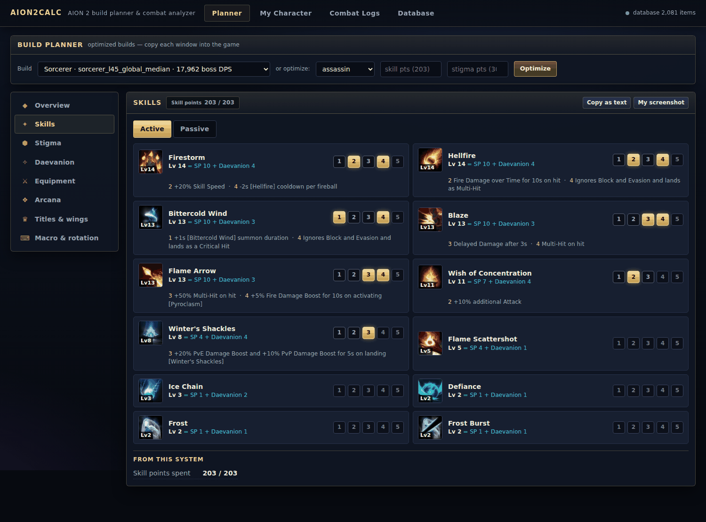
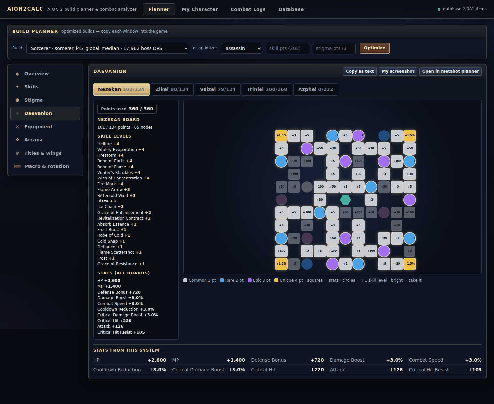
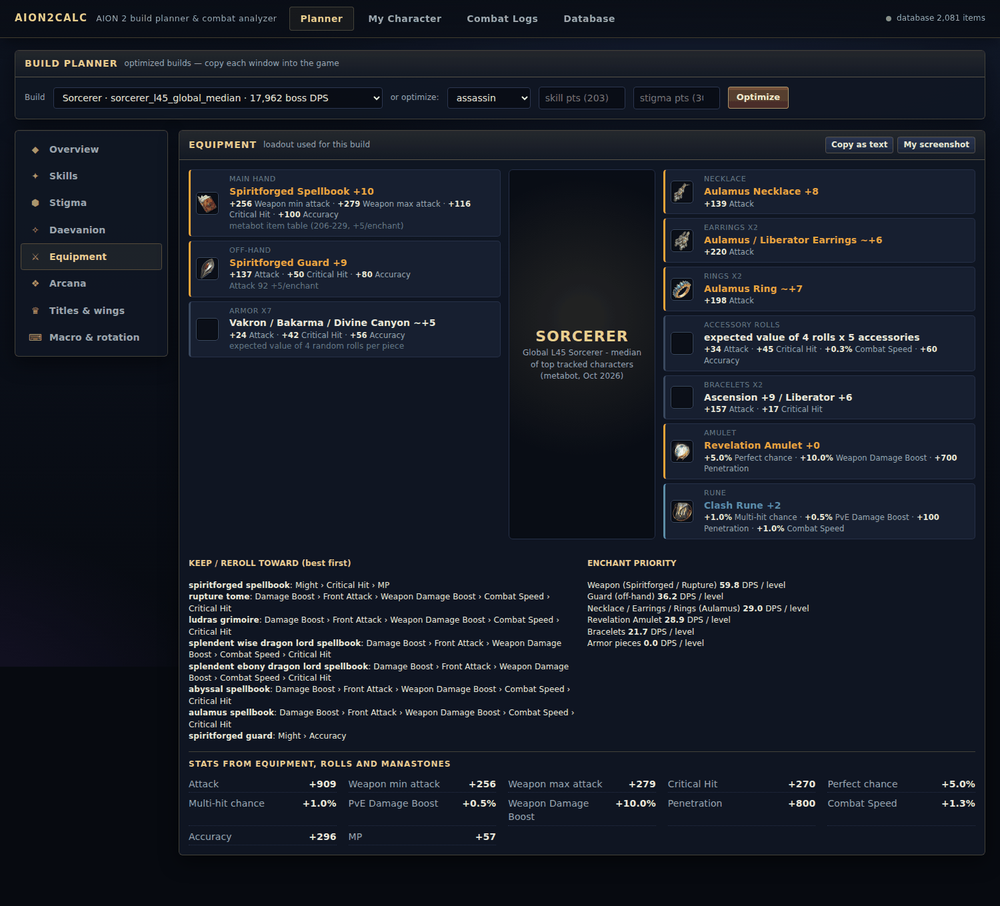
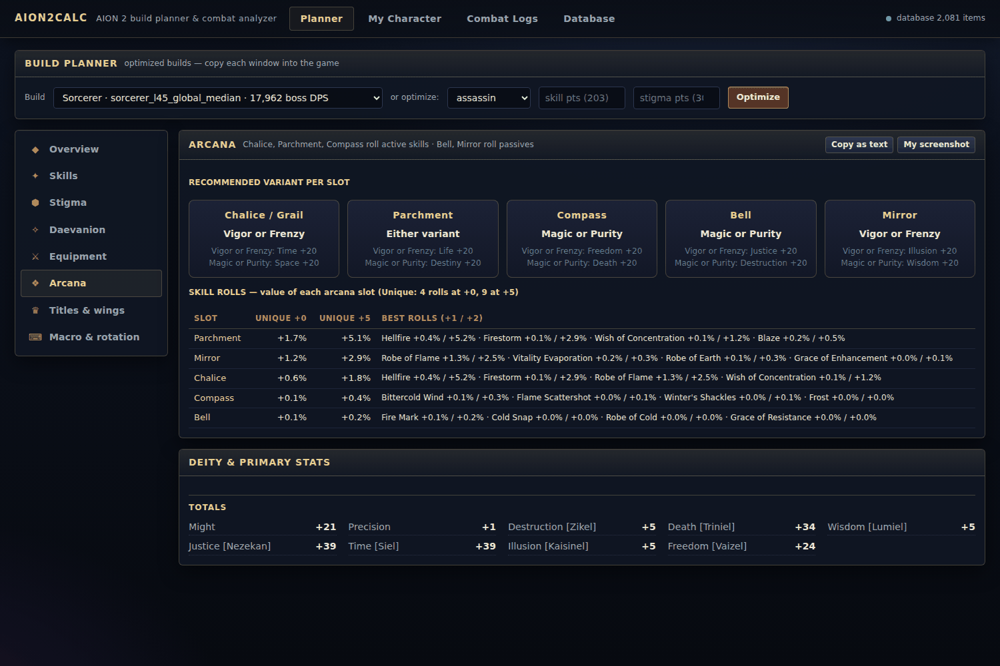
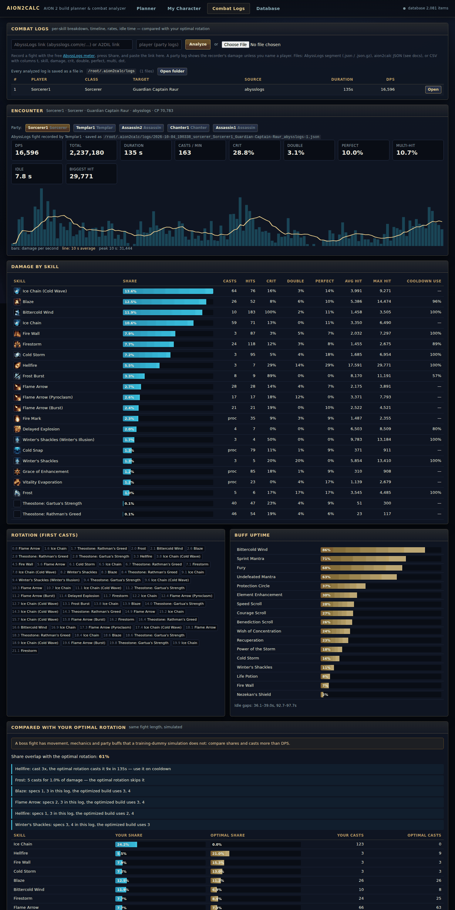
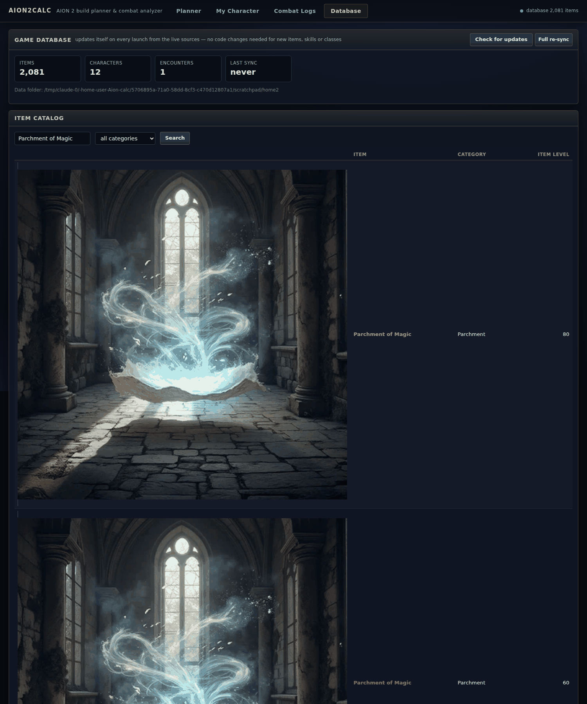

# Aion 2 Calc app guide

A task-oriented guide to the desktop app and shared review controls. Detailed comparison/privacy rules are in the [user guide](user-guide.md); formulas and assumptions are in [Methodology](methodology.md). Version history belongs in [Releases](https://github.com/sam-t-anderson/Aion-2-tools/releases).

## Contents

- [Start here](#start-here)
- [My Character](#my-character)
- [Point budgets](#point-budgets)
- [Planner and hotbar](#planner-and-hotbar)
- [Gear & Advice](#gear--advice)
- [Saved Results](#saved-results)
- [Experimental PvP optimization](#experimental-pvp-optimization)
- [Survivability and HP reserves](#survivability-and-hp-reserves)
- [Live capture](#live-capture)
- [Overlay](#overlay)
- [Automatic metadata and idle DPS](#automatic-metadata-and-idle-dps)
- [Long recordings and archive parts](#long-recordings-and-archive-parts)
- [Combat-log review](#combat-log-review)
- [Importing external logs](#importing-external-logs)
- [Pet and spirit grouping](#pet-and-spirit-grouping)
- [Sharing logs and recovering upload queues](#sharing-logs-and-recovering-upload-queues)
- [Your account and legions](#your-account-and-legions)
- [Featured encounters](#featured-encounters)
- [Community comparisons](#community-comparisons)
- [Editing shared raid plans](#editing-shared-raid-plans)
- [Official news](#official-news)
- [Regional event timers](#regional-event-timers)
- [Pet Tracker](#pet-tracker)
- [Settings](#settings)
- [Application updates](#application-updates)
- [Database and data sync](#database-and-data-sync)
- [Where your data is saved](#where-your-data-is-saved)
- [Troubleshooting and diagnostic exports](#troubleshooting-and-diagnostic-exports)
- [External services and privacy](#external-services-and-privacy)
- [Screenshots](#screenshots)
- [Log format reference](#log-format-reference)
- [Local API reference](#local-api-reference)

## Start here

Install a desktop build using the [installation guide](install.md). The app opens to **Live Meter** so you can record combat right away. The top bar has three sections and Settings: **Combat** (Live Meter, Combat Logs, Raid Planner), **Character** (Build Planner, Builds, My Character, Gear & Advice, Saved Results) and **Game** (Timers, Maps, Database, Crafting, Pet Tracker, News). The row underneath lists the current section's pages, and a section's link returns to the page you last used in it (since 0.2.342). **My Character** imports and optimizes a character, **Build Planner** shows an example class build, and **Saved Results** holds previous optimizations and advice. **Settings → App & data → Page at launch** picks the page the app opens on.

Combat Logs has separate Saved Parts, My Uploads, Community Combat Logs and My Character Identities lists. Open a log for a focused detail page and use Back to return. Settings controls the theme, data folders, community server and game-data sync.

## My Character

1. Search a character name (global regions: North America, Europe, Asia, Latin America).
2. **Import** reads the official character page: profile stats, every equipped
   item with its rolls, manastones, theostones and skill rolls, arcana, titles,
   wings, pet, skill levels, slotted stigmas and every open Daevanion node.
3. The build is scored as it is. The official profile does not show
   specializations, so the score uses the best legal specs for your levels.
4. **Optimize PvE build** keeps your gear and uses your entered point budgets
   (Skill, Stigma and PvE Daevanion). It finds the best
   allocation and rotation, then shows the DPS gain and what to change.
   A character below level 45 is optimized at its own level: only the stigma
   slots and Daevanion boards its level opens, no skill trained past what its
   level allows, and no skill it has not learned yet.

What the profile does not show, and how it is handled:

| Missing | Handling |
|---|---|
| specializations | assumed best for your levels |
| bonus from owned (unequipped) titles | estimated (+4 Attack, +20 Crit, +30 Accuracy) |
| stats of uncommon wings | counted only for wings in a small table (Ultimate Daeva Wings) |

**Imported before** lists the newest eight imports. Click one to fetch its current official profile again. This refresh is separate from reopening a saved optimization snapshot.

**At launch** (since 0.2.329). Two settings under **Settings → App & data → My Character at launch**, both off by default: *Show the character you opened last when My Character opens* opens the page straight on the newest of the characters imported before, from the snapshot saved at its last import, so it shows at once and without asking the official site; *Refresh that character from the official site when the app opens* fetches its current profile instead of showing that snapshot. With **Page at launch** set to My Character, the app starts on your character. The character opens once per app session; **Imported before** and **Search** work as before.

### Personal damage objectives

My Character's **Damage objective** selects the existing primary scenario or balanced equal-weight boss/dummy (PvE) or sustained/burst (PvP) damage. The choice is remembered locally. Both scenarios use the same imported gear, fixed saved Genus lines, entered budgets and HP/trained-skill constraints. Balanced search takes longer and can trade primary DPS for the combined score. Results and recovered builds show the weights, component DPS and objective score; the gain compares the current and optimized builds using the same objective. Shares, macro, opener and sensitivity remain primary-scenario views. PvP remains experimental.

## Point budgets

The build windows show points spent / optimization budget. Gear and Daevanion bonus skill levels do not consume purchased skill points. PvP Daevanion uses its own resource.

For **My Character**, the official profile gives allocated levels/nodes; unused points may be absent. Enter your in-game **spent + unspent** totals before optimizing. Imported budgets are observed lower bounds. Totals below points already spent are rejected. The optimizer preserves gear and uses the entered skill, stigma and PvE Daevanion budgets. Below level 45 the page does not fill in the community's highest totals, which come from characters at the level cap.

The Planner lets you set all three budgets. Bundled example budgets are 203 skill, 30 stigma and 360 PvE Daevanion; these are simulation presets, not a maximum or a guarantee about quest rewards.

## Planner and hotbar

Every optimized build is shown as a set of windows laid out like the in-game
screens, so you can copy each one into the game:

| Window | Shows |
|---|---|
| Overview | DPS, crit chance, cooldown reduction, combat speed, stat priority, damage share |
| Skills | Active and Passive tabs. Each skill shows its icon with a level badge, the level split (skill points + Daevanion + gear), and five numbered specialty rows with effect descriptions. Recommended effects are highlighted |
| Stigma | the four slots with level and which specializations are unlocked |
| Daevanion | one tab per board with the node grid (taken nodes lit), and the game's left-side summary: points used, skill levels gained, stats gained. There is also a link to the metabot planner |
| Pet Genus | saved manual analysis lines, modeled contributions and excluded effects |
| Equipment | a paper-doll layout of the loadout, the rolls to keep or reroll toward, and enchant priority |
| Arcana | the recommended variant per slot, and the value of each slot's skill rolls (Unique +0 and +5) |
| Titles & wings | equipped titles, wings, pet, and the best titles for the build |
| Skills hotbar | suggested key bindings, manual skills and macro placement |
| Macro & rotation | the in-game Skill Macro steps and the priority list |

Below each window there is a **Stats from this system** summary. **Copy as
text** puts the window's choices on the clipboard. **My screenshot** lets you
pin a screenshot of the same in-game window next to it, so you can compare them
side by side. The screenshot is kept only in your browser.

Planner lists one community PvE and PvP preset per class when the configured service supports canonical comparisons. **Refresh presets** checks for updates; launch synchronization also runs in the background. The overview shows weighted modeled DPS, comparison assumptions and last-check time. Bundled or legacy examples fill missing choices and are labeled **Example**. Bundled PvP examples compare separately generated sustained and burst allocations, selecting the higher 50/50 weighted modeled DPS. Their overview shows the common comparison assumptions and search provenance. Offline viewing uses the last successful matching-server snapshot; a different configured server does not reuse another server's community cache.

Comparison resources and common gear make eligible builds comparable within a class, mode and scoring policy. These scores are not player rankings or win probabilities. PvP remains experimental. Eligible optimizations submit anonymous allocations for server evaluation; personal Genus/HP/trained-minimum constraints and larger resource budgets require a separate common-loadout optimization. Open **Saved Results** for all your personal runs and advice.

**Overview → Contribute a community comparison → Generate community comparison** runs a separate anonymous optimization with the common gear and budgets. It searches both mode-specific scenarios once and keeps the better weighted score. Personal gear, Genus, trained minimums, HP reserves and larger point totals are not inputs; your personal result is retained. Progress survives tab navigation in the current app session. Model calculations wait for other optimizer/advice jobs to finish. A completed comparison is cached by scoring inputs and reused across restarts; **Resubmit saved comparison** retries submission without another search. A network failure retains that cache. Closing the app during calculation interrupts it, and the next request restarts an unfinished search.

The **Optimize** button runs a new optimization for any class in the selected PvE or experimental PvP damage mode. Outputs are saved separately by mode. Skill, Stigma and Daevanion budgets are configurable. Presets are examples, not character progression maxima.

Set up **Skills hotbar** first, then copy the numbered **Macro & rotation** steps. The macro binding suggestion is **Right-click**. Skills that require charging stay on manual keys; the app does not change game bindings. A chain step is not a skill of its own: the Templar's Punishing Strike is Pummel pressed again while Pummel's chain is open, the Gladiator's Smashing Blow Rending Blow's and the Cleric's Thunder and Lightning Earth's Retribution's. Such a step shows with its parent's icon, level and key ("Pummel's chain: press Pummel again while the chain is open"), and gets no hotbar slot (0.2.323). In the macro the parent's key presses its chain step while the chain is open, so the planner may list Pummel twice or leave Punishing Strike to Pummel's step, whichever simulates better.

## Gear & Advice

Pick an imported character to see its inventory: the equipped items come from the official page,
and you add the rest from the catalog, with enchant level and skill options. You also enter its
Genus Insight lines and the titles you own here, typed in or [read from the game's
screen](#reading-genus-insight-and-titles-from-the-game) (Windows, since 0.2.347). **Run advice** then plans gear (best set from
the inventory, goal gear, upgrade path), arcana, titles, pantheon, genus insight and your fights,
ranked by simulated DPS gain. The results are shown as game-style windows with the game's icons:
an equipment paper doll, the upgrade path as item cards, arcana cards, title plates, the
pantheon deities and the genus insight grids. The
model is calibrated from the character's fights when there are enough. Details:
[planner.md](planner.md).

A goal item and a reroll step name the rolls to chase (0.2.328): the stats of the item's roll pool
worth the most to your damage, as many as the item rolls, shown on the Next goal and Best in slot
cards, on the upgrade path's step (*reroll Ring of X toward Critical Hit +30 – +50*) and in the copied
text. A stat worth nothing to damage, such as HP, is never one to chase, so an item can list fewer
rolls than it has.

**Adding an item with its enchant level, rolls and skill options (0.2.333).** **Add…** on a catalog
search result, or **Edit** on an item you added before, opens the item panel: the enchant level up to
the catalog's limit for that item (+5 for an arcana card), with the catalog's stat line for the chosen
level; one line per random roll the item has, each a stat from the item's own pool with its range and
the value you see in game (a percentage range takes the number before the %, and a stat the damage
model does not score says so); the skill options, from the pool the catalog lists for your class first
and the class's other skills after, with their levels (an arcana card holds its grade's base options
plus one per enchant level, at most +4 on one skill; other gear's options reach +1); and a note. What
you enter is checked against the catalog: an enchant level past the item's limit, a stat the item
cannot roll, a value outside its range or more skill options than the item holds is refused with the
reason, and the entry keeps its previous values. Leave every roll line empty if you do not know the
rolls: the planner then assumes the expected rolls of the pool, as before. The inventory table shows
each item's rolls, skill options and note, and the advice cards show the rolls you entered. Items
read from the official page are not edited: add a copy from the catalog to plan one with other rolls.
The command line does the same (0.2.334): `python -m aion2calc inventory "Name" --options <item>` shows what an
item can take, `--add`/`--edit` take `--roll "Critical Hit=41"`, `--skill Hellfire=1` and `--note`, with the same
catalog check ([cli.md](cli.md)).

Gear & Advice shows calculation stages and elapsed time beside Run advice in a sticky status panel. The bar is indeterminate; it does not predict a completion percentage. When complete, scroll below the inventory or choose **View results**. Progress and completed results survive navigation within the current app session. Errors appear in the same panel.

**The last advice, kept (0.2.344).** Gear & Advice opens on the advice it calculated last for the character, from
this session of the app or an earlier one (it is the `advice.json` written beside `ADVICE.md`, so advice from the
command line counts too). A line above the inventory says when it was calculated, and whether the character's gear,
inventory, Genus lines or titles have changed since or another version of the app calculated it; **Run advice**
calculates it again with the current gear and fights. When no advice is kept for the character, or the kept advice
cannot be shown by this version, opening the page or choosing the character runs the advice.

### Pet Genus Insight

The Pet Genus results view uses five genus selectors, a nine-slot ring and an analysis list. Gold nodes have saved lines; gray nodes are not recorded, and dim nodes are locked according to the saved Insight level. These colors do not indicate rarity. The editor shows the same ring alongside its inputs. The official profile supplies the equipped pet but not these Insight levels or rolls, so enter them from the in-game window. Missing data remains explicitly not recorded. Saving new lines does not change an old result: optimize or calculate advice again.

**My Character → Pet Genus Insight** edits the same saved lines as Gear & Advice. Save edits before using either **Optimize PvE build** or **Optimize PvP damage**. Genus scoring defaults on; disable it to compare without manual lines. Set relative PvE enemy weights (default: equal Cogni/Fera/Natura/Varian). The PvP model ignores enemy mix and excludes genus-specific effects whose applicability to players is unverified.

Optimization holds your lines fixed while choosing skills, specialties and boards. Current-build comparisons and optimized results use the same snapshot. The **Pet Genus** results window and Markdown retain the inputs, modeled line contributions and reasons for excluding effects, including in Saved Results. Low contributions can guide review but do not predict reroll cost or guarantee better rolls. Defensive and owned collection effects are not simulated.


In **Gear & Advice**, choose a genus tab, enter its in-game Insight level and fill its unlocked analysis slots with the stat and exact value (including `%` when shown). All five genus drafts stay available while switching tabs. **Clear slot** removes a line; clear occupied higher slots before lowering the level. **Save genus lines** saves all genera together, then run advice again to recalculate. Invalid saves retain the previous inventory.

The official profile does not provide Genus Insight allocations. **Advanced JSON** lets you repair older entries; apply it to the draft before saving. Defensive lines are retained for reference, but current advice evaluates damage effects only. Recovered saved advice shows the allocation snapshot used at calculation time.

### Reading Genus Insight and titles from the game

Since 0.2.347 the app can read the game's **Genus Insight** panel and its **Title** window from your screen, with the text recognition built into Windows (offline, nothing is sent anywhere), so you need not type them. It works on Windows 10 and 11 with English (United States) installed under Settings → Time & language → Language & region; the row says so when it is missing. Nothing it reads is saved until you press **Save genus lines** or **Save titles**.

Above the Genus editor (on Gear & Advice and on My Character) and above the titles list, **Read from the game** offers three ways:

- **Read the game screen**: press it, then switch to the game within 3 seconds; the app reads the game window, or the main screen when it cannot find the game.
- The **Read the game screen into the app** hotkey (Settings → Hotkeys; none is set until you choose one): press it in the game with the panel open, and Windows' plain beep says it read something, its error sound that it did not. The app's pages pick the read up when you come back, including reads made before you opened the page.
- A screenshot: **Choose a screenshot…**, or click the row and paste one (Ctrl+V). PNG, JPEG, BMP or WebP, up to 24 MB.

**Genus Insight.** Open Pets → Genus Insight on the genus you want, with its analysis lines showing. The read opens that genus's tab, sets its Insight level and fills each slot it read; slots it did not read keep what you had. Each name is matched to the lines that slot can roll and each value checked against their ranges, so a misread is marked on its slot with what to check (*250 is outside what slot 2 rolls for Boss Defense*, *the stat name was not recognised*) rather than filled in silently. A line you edit loses its mark. Correct what is marked, then save. When the level is not read, it is set from the slots read, and the message asks you to check it.

**Titles you own.** The game's Title window shows every title, owned or not, so the app reads it with **Show unacquired titles only** ticked: open the window, tick the box, and read each page (scroll for the next one) until you have read them all. Every title of your character's faction in the app's title catalog that no page listed is one you own. The faction comes from the character's official profile, or else from the titles the pages showed. Each page read is listed with whether its box was ticked, which you can correct; **Forget** drops a page and **Start over** drops them all (the app keeps them until it closes). The game's *Total Collection Status* count, when on screen, checks the result: the panel says whether the list matches it. **Put these in the list** replaces the titles list with the ones you own, **Add them to the list** adds the ones missing from it; check the list, then **Save titles**. Without a known faction, pages read with the box unticked give the titles you own instead: those seen there and on no ticked page.

Text recognition can misread small or stylised text. Only names that match the catalog are taken, and a name too far from any (a stream overlay, chat, another window) is left out. If a read finds nothing, the row shows what was read, under **What was read**; reading again with the panel larger on screen, or a screenshot, usually helps.


### Genus coverage and safe candidates

Genus results show all five recorded levels, saved versus unlocked slots, included damage effects and the next catalog milestone. An unrecorded level stays unknown; enter 0 only when that is the actual recorded level. Leave the level blank to remove an empty recorded group. The catalog describes nine slots and level 10 grade changes; it does not prove collection ownership or current-build applicability.

Gear & Advice uses the same Genus effect filters as character optimization, including protection against re-adding primary stats already in official totals. Saved damage lines now participate in the advice loadout. Unsupported/defensive lines remain visible with a reason and are not labeled as damage-free rerolls. Candidate damage-boost swaps replace one unlocked slot, including the loss of its recorded modeled effect. A missing target line is explicitly a hypothetical empty-slot assumption; it cannot establish the actual gain. Candidates do not overwrite your lines or model roll probabilities/costs or defensive tradeoffs. Advice results retain their original Genus snapshot.

### Point budget provenance

My Character and optimized results distinguish observed allocated points, assumed available totals, assumed unspent points and the source of each budget. Saved/entered totals and level-based examples are not verified progression maxima. Confirm spent plus unspent points in game; Genus levels do not grant skill, stigma or crystal-board budgets.

## Saved Results

Completed character/class optimizations and advice save automatically under the app data folder's `history` directory. Open **Saved Results**, select Open to review a previous run, or Export/Import its result JSON. Import restores a snapshot; it does not run an optimization or change your equipped gear. The latest existing old build/advice files are recovered when available. Keep exported copies to move runs between installations. Advice reflects the saved run, not future game or gear changes.

Edited point totals persist per character on this installation. Enter spent + unspent resources. Anonymous totals are sent after character optimization and accumulate as highest observed resources on the community service, grouped by class/region/build/source. Only characters at level 45 send totals or builds. Unknown build observations stay separate, and observed totals are not verified game caps.

New raw optimizer reports include their simulation loadout, equipment IDs, available official icons and enchant levels. Reopening or rerendering those reports uses saved gear rather than a later character import. Older raw reports without this snapshot show a legacy gear-source notice; their original gear cannot be recovered from a newer profile. Existing Saved Results are already stored view snapshots and remain unchanged.

Recovered build titles use saved character identity and PvE/PvP mode when available. A generic class title means the older snapshot lacks character identity. Recovery entries and explicitly saved runs remain separate historical records.

## Experimental PvP optimization

My Character provides separate PvE and PvP damage actions. PvP uses the generic class kit against a stationary neutral player proxy, excludes PvE/boss stat buckets and learned PvE skill/proc/critical calibration, and assesses sustained (180 seconds) and burst (30 seconds) damage. Saved results retain this model description. It does not optimize dedicated PvP progression, defensive skill use, crowd control, movement or opponent-specific defenses, and its skill coefficients are not validated PvP coefficients. PvP output is excluded from PvE community preset submission.

The optional HP reserve below also applies to PvP. It models your manual pressure assumptions, not verified opponent builds or win probability.

## Survivability and HP reserves

My Character → **Survivability** preserves the character's imported flat **HPMax** contribution from the four optimized crystal boards by default. The existing DPS objective stays primary inside the set of allocations meeting this floor. Skill, stigma and Daevanion budgets and board connectivity remain enforced. A stricter minimum can trade some modeled DPS for more crystal HP. Disable preservation and leave the minimum/scenarios empty to use the previous damage-only objective. This is an HP-node constraint, not a full survival simulator.

Optional scenarios describe one hit followed by sustained pressure. Enter current in-game maximum HP and up to eight encounter/opponent assumptions: **hit damage after mitigation + largest ongoing pressure deficit + positive HP reserve**. Set assumed HPS, healing delay and healing duration; blank duration means the remaining window and zero means no healing. The deficit grows with incoming DPS, falls while healing is active, and never drops below zero: excess healing cannot protect against later damage. The model checks the delay, end of healing and end of pressure window to retain the largest deficit. With zero delay and blank duration this matches the previous constant-HPS calculation. The largest requirement sets the floor. HPS never absorbs the initial hit. Estimated total HP is entered current HP plus the flat node-HP change; percentage modifiers and passive/gear changes are not modeled. Headroom is a scenario proxy, not verified effective HP, guaranteed survival or win probability. Confirm final HP in game.

**Import recorded incoming damage** reads an exported a2log JSON file locally. Choose the encounter, player recipient and a window from 0.1 to 120 seconds. The largest rolling sum of recorded damage becomes the hit requirement; sustained DPS and HPS start at zero to avoid double counting. It includes all recorded attackers against that recipient, ignores healing and resets the window at recorded deaths. If death markers are missing, a window may span separate lives. Review the positive reserve and your current maximum HP. Missing packets can understate damage, and a different recipient's gear/defenses may not represent yours. Older outgoing-hit-only logs cannot supply this evidence. Imported assumptions remain editable, and results retain their original recording context.

Settings persist per selected character in this browser. Saved Results/build JSON/Markdown retain assumptions and the assessment. Infeasible requests report an error without publishing a lower-HP fallback. Solver limits can prevent finding an allocation even when one exists. Damage-only stat priorities, baseline comparisons and Gear & Advice do not validate survival; constrained builds are not submitted as community damage presets.

**Import optimized PvP opponent benchmark** accepts up to eight exported optimized PvP results from Saved Results, subject to the remaining scenario slots and a combined 20 MiB limit. Re-optimize opponents to save complete expected-hit traces. Choose the sustained or burst scenario, explicitly enter an incoming damage scale (1 means unchanged), and choose a window no longer than its simulation. **Timed hits** selects each opponent's greatest gross-damage window and retains the individual hit times. Healing and defensive/control/movement reductions are applied on that selected window's local clock. Same-time hits land together, healing cannot pre-pay damage, and a hit exactly at a reduction's end is unprotected. The separate manual initial hit stays protected independently. The imported trace has a fixed duration; re-import to change it.

**Average pressure** remains available for older results without traces. It uses the saved DPS as constant pressure rather than peak burst. Both modes retain source assumptions and use the strictest incoming HP requirement while maximizing damage; saved results identify the binding opponent and show bounded hit details. Batch imports are all-or-nothing. Personal constraints do not enter community damage preset scoring.

These are stationary, expected-damage benchmarks from optimized opponent builds, not reactive duels. The selected gross-damage window does not establish the worst mitigated requirement over every possible healing/defense alignment. Random critical spikes, actual target mitigation, opponent reactions, CC immunity and win probability are not inferred. Defense/control/movement efficacy and outgoing action/cooldown costs remain explicit separate assumptions; verified tactical coefficients and adverse-matchup damage are follow-ups.


### Timed pressure reductions

Each incoming-pressure scenario supports up to eight optional **defensive**, **control** or **movement** windows. Enter a name, start delay, duration and assumed percentage reduction of ongoing incoming DPS. Times are relative to the scenario start; windows are clipped to its duration. New windows default to zero duration and reduction.

Overlapping windows use the strongest percentage; reductions do not stack. Healing still follows its own delay and duration, excess healing is not banked, and the initial hit remains unchanged. The calculation checks the largest ongoing HP deficit at every window boundary. Saved Results and Markdown show the timings, required HP and a reference using the same healing without the added reductions.

These are editable assumptions about successful tactical use, not decoded skill formulas, boss immunity rules, PvP success rates or automatic casts. Do not apply the same reduction again if it is already included in your incoming DPS. Optionally link a catalog skill, a minimum trained level and a supporting effect to each window. Linked requirements are automatically merged with separate reserves; stricter minimums and all requested effects are retained. Stigma links keep the stigma equipped, and supporting-effect links enforce their effective-level gates using trained points, fixed bonuses and connected Daevanion nodes. Links apply even to zero-duration or out-of-window assumptions. Conflicting effect-slot or point-budget requests fail explicitly. Links alone do not cast skills or consume outgoing action time. For a failure case, add another scenario with no reductions; the strictest scenario constrains the build.

Optional **assumed effective cooldown** checks reuse of a linked skill within each scenario. Blank means unknown, not verified available; zero imposes no reuse gap. All skills start ready. Positive-duration, positive-reduction windows count as activations; entries sharing the same start count once. The largest entered cooldown for that skill applies when assumptions differ. Reuse before that cooldown is rejected. Scenarios are alternative encounters and are checked separately. Saved Results and Markdown retain starts, the shortest reuse gap and the assessment. These are user-entered effective values: review them after gear or cooldown-reduction changes. Charges, resets and shared cooldown groups are not modeled. Explicit outgoing action-time assumptions are entered separately.

### Outgoing action-time assumptions

Personal PvE and PvP optimization accepts up to eight explicit pauses for defense or movement. Enter starts (0–3600 seconds) and durations (0–120 seconds) on one fight’s outgoing rotation clock. Each damage scenario applies the schedule once, clipped to its duration; overlaps use their union. A schedule covering an entire scenario is rejected. Incoming pressure scenarios have independent clocks and are never automatically copied.

The simulator chooses actions that finish before each pause and waits through it. Previously scheduled hits, DoTs and pet damage still resolve, and cooldowns and regeneration continue. Candidate builds, rotation search, stat weights, macros and the current-character comparison use this schedule. Community damage references remain unpaused; they are not equivalent tactical comparisons. Saved Results, exports and reconstructed reports preserve the assumptions.

Optionally link each outgoing pause to a catalog active skill or stigma and a supporting effect. Linked minimums merge with incoming-window links and separate reserves: the strictest trained level wins and effects are unioned within the same point and slot budgets. Passives cannot be outgoing action links. Zero-duration and clipped-out entries still retain their requested allocation; only positive-duration windows starting before a damage scenario ends count as assumed uses in that scenario.

An optional **assumed effective cooldown** checks the spacing of those uses independently for each outgoing damage scenario. Blank remains unknown; zero imposes no gap. Same-start entries represent one assumed use; the largest entered cooldown for a skill applies, including assumptions on clipped-out entries. Reuse before that assumed cooldown is rejected. Saved Results and Markdown retain linked requirements, per-scenario starts, shortest reuse gap and unknown/satisfied status. Incoming pressure clocks stay independent. Reuse checks alone do not alter offensive cooldown availability. **Reserve cooldown in rotation** opts into an explicit exclusion for each linked positive-duration use before the scenario ends; an entered cooldown is required. Matching uses share the kit's explicit cooldown groups. Offensive casts are held if their modeled cooldown or the entered assumption (whichever is larger) would overlap the upcoming use. The group is excluded from the use start until the entered cooldown expires afterward. Reset hooks do not shorten that fixed exclusion. Conflicting assumed uses in an explicit shared group are rejected. Same-start uses in a group count once with the largest entered cooldown.

Saved current/optimized results and Markdown identify matched action keys/groups or **no matching modeled action**. Missing kit actions are not treated as a successfully reserved cooldown. Cross-skill hooks and resource readiness are not verified; an exclusion is not proof of tactical availability. These exclusions do not execute the tactical skill, consume MP, apply damage/shields/CC, establish success or discover unrecorded shared groups and charges. Old schedules default to no rotation reservation; explicit unavailability windows still apply.

These pauses model unavailable offensive time, not an actual defensive skill: tactical MP, cooldowns, shields, crowd-control success and movement outcomes still need verified rules. Empty schedules preserve the default damage model.

### Trained skill and stigma reserves

Under **Retain trained skills and equipped stigmas → Choose effects**, reserve supporting effects on active skills. The optimizer keeps those effects while searching the remaining choices. The optimizer jointly allocates trained points and connected Daevanion nodes to cover catalog effect unlocks and selection-slot gates, including fixed gear bonuses. This can cost skill points, Daevanion points and damage. Requests that cannot fit the budgets and any HP reserve are rejected explicitly. Saved results also show the effective-level requirement and its trained, Daevanion and fixed-bonus contributions. Stigma effects remain automatic. Saved results and Markdown list the retained effects. These choices preserve your utility setup; their defensive, control or movement efficacy is not scored.

My Character → **Retain trained skills and equipped stigmas** optionally sets minimum purchasable levels for active/passive skills and currently equipped stigmas. A reserved stigma stays equipped. The optimizer maximizes modeled damage within these floors and the point/slot budgets; infeasible requests produce an error. Settings persist per character and apply to both PvE and PvP. Saved Results, build JSON and Markdown retain the minimum and selected levels. These personal builds are excluded from community damage preset comparisons.

Skill minimums apply to trained levels. Reserved supporting effects additionally constrain effective levels for their catalog unlocks and selection slots. The joint allocation can fund these with trained points, fixed gear bonuses and connected Daevanion nodes within the same budgets. Other specialties and bonuses may change. A feasible seed is required before searching damage; the final allocation and point-polishing moves must preserve the required effective levels. Infeasible or unconfirmed solver allocations are rejected without an unconstrained fallback. Use utility skills manually when absent from the suggested rotation. Reserving a defensive or movement skill does not simulate its tactical use, CC, shields, opponent defenses or win probability; damage baselines remain unconstrained references, while personal stat priorities use the selected scenarios and explicit outgoing pauses.

## Live capture

The **Live Meter** tab includes the migrated A2Tools packet engine. Choose
**Live Capture** (the default), then press the yellow **Start** button. While capture runs it becomes the red **Stop** button; click it to stop. Its built-in encoder,
automatic interface and game-host selection, and port `50349` are filled in
for the standard connection. These capture settings sit under **Advanced
capture**, a section that is closed until you open it (since 0.2.342) and
remembers being opened; it also holds the name override, the game
installation, the final boss and **Capture diagnostics**. Set a specific
interface or game-host address only when automatic selection cannot see the
game traffic; **Refresh interfaces** lists the identifiers Npcap exposes on
this computer. Choose the target mode above it and, if the meter does not find
your character, enter its name as the override.

The Windows desktop build includes Scapy. Windows setup offers an optional
**Download and install Npcap for Live Capture** choice, and Live Meter asks
again when you press Start if Npcap is still missing. After you confirm, it
finds the current installer on [npcap.com](https://npcap.com/), downloads it
to the app's `drivers` folder, and opens its normal installer. This keeps
Npcap separate from aion2calc, as required by its license. Select
WinPcap-compatible mode in the installer and grant capture permission.

Npcap is Windows-only. macOS uses its built-in packet-capture framework.
Linux needs the distribution's `libpcap` package plus permission to capture
packets; Live Meter reports that prerequisite when the operating system denies
capture access.
The meter keeps decoded combat events, not raw packet captures. **Save to
Combat Logs** sends the active fight into the existing analyzer; **Export
a2log** writes an open JSON file to the app's logs folder; **Upload** sends it
to the log server set in Settings; and **Screenshot** saves a desktop image to
the app's screenshots folder. The GitHub Pages site is a viewer, so uploads go
through the configured log-server API that backs it.

Use **Split now** for a manual encounter boundary or configure automatic splits. The overlay's **New** button makes the same split and, since 0.2.329, empties the overlay's meter at once until the next fight's first hit, while this page keeps showing the previous fight until then. From that hit on, both show only the combat since the split: the live view joins a fight back together across a zone change in the middle of it, but never across a split you asked for (before 0.2.346, a hit within the pull gap brought the fight before the split back). **Finish run** closes the current run while preserving earlier encounters. These boundaries do not establish a boss kill or verified PvP match result. Export and upload buttons show progress and completion/error feedback. Exporting during capture snapshots the retained data; it does not stop capture. With Settings → *Upload every recording … when the meter stops or the app quits* on (the default), stopping the meter from the app, the overlay or its hotkey, and quitting the app, upload every archive part recorded since launch that is not on the configured server yet, newest first; a part already on the server is recognised by its recording key and never sent twice, a quit spends at most about twenty seconds on it, and — with *Catch up at the next launch* also on (the default) — whatever is left uploads shortly after the next launch (parts from the last seven days, at most twenty). Turn the catch-up option off to upload only at Stop and quit. With *Upload the recording each time a boss fight ends* also on (the default, and only while automatic uploads are on), the current recording is sent as soon as a boss, mini-boss, field or world boss has died and the fight has paused for a few seconds (at most every 30 seconds), so its kill reaches the community world-boss feed, its standings refresh the overlay's community-rank badge, and the leaderboards see the fight during play; a share server that supersedes (log server 0.2.93 or later) updates the same log in place, so these uploads and the final one at Stop are one log, never duplicates. If the recording rolled over to a new archive part since the last of these uploads (a final boss's death lets a waiting rollover happen at once), the finished part goes up first, so the kill it holds is not left until Stop; the new part follows once it holds player damage of its own. The opt-in *live community-rank refresh* (Overlay settings) still re-sends only after a ranked-eligible fight.

### Capture-stage diagnostics

**Capture diagnostics** is under **Advanced capture** on the Live Meter page (since 0.2.342) and folded away until you expand it (since 0.2.329), as is the line with the installed game version and capture context; folded, that line still names the installed version and the zone. Raw TCP payload recording is optional and controls only the diagnostic payload file; leave it off for ordinary live combat capture. **Export capture diagnostics** still includes counters without raw data. The live capture details show payload packets, forwarded chunks, decoded effects and players visible under the selected filters. The ZIP also includes scope, retained-effect count, roster count and whether a local identity was observed. These cumulative indicators distinguish capture, flow detection, decoding and view filtering; idle time or zero visible players alone does not prove capture failed. When reporting an empty meter, export immediately after combat with the original settings.


### Finding capture diagnostics

**Export capture diagnostics** saves a ZIP on this computer while capture runs or after Stop. **Open diagnostics folder** opens its saved location. The ZIP always includes `capture-summary.txt` and `diagnostics.json` with capture state, counters and errors; the UI reports its size and observed/decoded counts. Required metadata entries are checked before publishing the ZIP. Stop also saves a metadata ZIP when TCP recording is off.

With **Record TCP payloads** unchecked, `tcp-payloads.jsonl` is intentionally empty. The checkbox controls raw network recording, not capture counters or decoded combat processing. It is a saved setting (since 0.2.318): while it is ticked every capture records, however it starts (this page's Start, the overlay's Start button, the Start/Stop hotkey or the start at launch), and ticking it during a capture records from that moment. Unticking it stops the recording; what was recorded stays in the ZIP that Stop saves. Diagnostic ZIPs do not contain a decoded combat session; use Combat Logs/export for that. Raw traffic, when enabled, may identify characters or network endpoints; review files before sharing.

## Overlay

### Show the overlay when starting

**Show overlay when starting** is checked by default beside Live Meter's Start button and saved as a preference. It is also available in Settings. Starting capture opens or reuses the overlay when enabled. Unchecking it skips automatic opening; Open overlay and Hide overlay remain available. An overlay-launch failure does not stop capture. Browser-only fallback may require clicking Open overlay if popup blocking prevents automatic opening.


The overlay is a dark blue-grey card: the header carries the view tabs, the Lock / New / Copy / Hide buttons and the Start/Stop pill; the metric row holds the DPS / HPS / D.Taken pills with the latest-combat status; the current target sits in a boss panel (name and remaining HP on top, time-to-kill, damage dealt and the top contributors beneath, with the HP and kill-progress bars attached); each player row is a class-tinted bar with the class emblem, the name (a **ME** mark on your own row), the rate in large light numbers and the total · share beside it; the ping, your Odyle Energy and your identity line form the footer strip above the opacity slider. Every control, readout and layout setting works as before — the look is the only change.

Each class has its own tint on the overlay (sorcerer blue, assassin green, templar copper, ranger olive, chanter magenta, gladiator crimson, spiritmaster violet, cleric teal). A class colour you choose under **Settings → Combat colours**, or a palette you apply there, wins over the overlay tint, and the *Overlay (cool)* palette there carries the overlay tints into the review pages too.

Under **Settings → Overlay colors & fonts**, choose separate colors for rate text and total/share text. Both default to light (white rate numbers, blue-grey totals) to read on the tinted bars. The same choices apply to DPS, HPS and D.Taken; an open overlay refreshes them within ten seconds. **Reset number colors** restores both defaults.

Use **DPS**, **HPS** or **D.Taken** below Meter/Plan/Hide to choose the overlay metric. Each view sorts its own bars and shows the rate, total and percentage for that metric. The selection is saved on this computer. DPS uses the shared active outgoing-damage clock; HPS and incoming damage per second use recorded encounter spans, which hold steady between effects. Healing-only activity does not create a combat encounter.

The DPS beside each top contributor in the boss panel (*Name 12.3k/s*) is that player's damage to the current target alone, over the target's fight clock: from the party's first hit on it to the last, untargetable stretches included, as other meters time a boss fight. It can differ from the same player's row, which counts their damage to every enemy in the encounter over the active clock. Adds and cleave raise the row, time when nobody could hit the target lowers the panel's number, and earlier fighting in the same encounter averages into the row only. Summons and a player's re-registered actor IDs count for that player in both.

On Windows the overlay hides when another application has focus, when the game is minimized, or when no supported game window can be found. It returns when the game is foreground again. If the game process cannot be recognized, the meter remains available in Live Meter.

Boss wipes create a new encounter boundary before the next pull when a complete, unchanged party roster is resolved (including Self), every member has a recorded death during the attempt, the known boss has recorded positive HP, and incoming/outgoing damage has been quiet for at least two seconds. Positive player HP cancels that player's death state; boss death cancels wipe detection. Missing identities, partial rosters, unknown bosses or missing death/HP evidence retain the normal inactivity/manual split rules. A wipe split preserves prior metrics and does not mark a partial run complete or ranked.

If a partial capture lacks identity or pet-owner packets, the overlay and Live Meter show unresolved actor and linked-pet counts. An unnamed row may include your damage, but the tool cannot identify it as your character without a supported identity record. Pet grouping applies only to recorded owner links, including links carried inside compressed packets. Send capture diagnostics with TCP recording enabled before Start when reporting missing identity or grouping.

**Live Meter → Open overlay** opens one compact overlay that shows the live meter and plays your most
recent raid plan. On the installed Windows app it is frameless, transparent, always on top, and follows
the Aion 2 game window when it starts or moves. It closes with the desktop app: when the app quits it
closes its overlay windows first, before it stops the capture and sends the quit upload, and each overlay
process watches the app's process and ends within seconds of it, even when the app was ended outright or
its quit never reached the close (since 0.2.331; before, an overlay that only polled the app's address
could outlive a quit, and an app launched again within twelve seconds adopted it beside its own). Where a
native overlay is not available it opens as a normal small window instead. From source,
`python -m aion2calc.overlay` does the same (`pip install pywebview` for the transparent window).

Use **Hide overlay** to hide it and **Open overlay** to show it again. Drag its non-interactive background to reposition it; use the opacity slider directly to change opacity. Repeated Open requests reuse the existing overlay.

### Skill cooldowns and the break gauge

Two overlay readouts are off by default under **Settings → Live meter overlay**:

- **Show a strip of your skills on cooldown.** Your skills on cooldown appear as icons that count down, soonest ready first. A skill lights up as it comes off cooldown and stays lit for three seconds; an open chain-skill window shows first with a green ring. The strip uses the cooldown the game sends with each of your casts, so your cooldown reduction is already included and there is nothing to set up. Choose the shortest cooldown shown (3 seconds by default, so fillers stay out), how many icons (8) and where the strip sits (below the meter, or above the player rows). It only knows skills you have used since Start, and when a proc resets a cooldown the strip catches up on your next cast.
- **Show the current target's break (stagger) gauge.** Bosses and elites carry a break gauge. The boss card shows what is left (*Break 63%*, or *BROKEN* while the enemy is staggered) with a bar beneath the HP and kill-progress bars.

### Odyle Energy

Your character's Odyle Energy shows beside the game's Odyle Energy icon on the overlay, under the ping, and on the Live Meter page, under the ping line: the total you can spend, then its regular and bonus parts, such as *Odyle Energy 145 (40 + 105 bonus)*. It is the game's own count, sent when you enter the world, at every zone load and whenever it changes. The reading follows the 15 the regular energy regains every three hours and what each claimed reward cube spends (80 in every claim recorded so far, taken from the regular energy first and then from the bonus). Until the first of these records arrives the line stays hidden. A meter started inside a zone shows it at the next change or zone load. A zone load keeps it, and logging in on another character replaces it. **Settings → Live meter overlay → Show your Odyle Energy** (on by default) hides it in both places.

### Shugo Festival keys

Your Shugo Festival Reward Keys (since 0.2.329) show the same way, under the Odyle Energy line on the overlay, above your identity line, and on the Live Meter page, beside a key icon: the total, then the regular keys and the bonus ones, such as *Shugo Keys 26 (21 + 5 bonus)*. They come from the same counter records as Odyle Energy, sent at login, at every zone load and whenever they change. Since 0.2.332 the line reads counter 1, whose two values are the count the festival window shows (21 and 5 in the 23 October recording, and the same for every character of the 19 October one, so it is the account's); 0.2.329 had read counter 4, identified from its spend pattern alone, which turned out to be the Nightmare tickets. The line stays hidden until the game has sent the counters, so a meter started inside a zone shows it at the next zone load or change. **Settings → Live meter overlay → Show your Shugo Festival keys** (on by default) hides it in both places.

### Nightmare tickets

Your Nightmare tickets (since 0.2.332) show under the Shugo keys on the overlay and on the Live Meter page, beside a ticket icon: the total, then the regular tickets and the bonus ones, such as *Nightmare Tickets 12 (4 + 8 bonus)*. They are the game's counter 4, a character's own count: in the 19 October recording its two values went from 3 and 2 to 0 and 0 one at a time, the first value first, and came back one at a time, which 0.2.329 had taken for the Shugo keys until the owner compared the numbers with the game. **Settings → Live meter overlay → Show your Nightmare tickets** (on by default) hides it in both places.

### In-game through RivaTuner Statistics Server (RTSS)

**Settings → Live meter overlay → In-game (RTSS)** draws the meter inside the game itself, through RivaTuner Statistics Server (the on-screen-display server MSI Afterburner installs, also available on its own). Windows only, off by default, and a first draft: please report what you see. With it on, the app writes the meter text — the fight and its elapsed time, then the top rows (name, rate per second, share) for the chosen metric — into RTSS's own shared memory, in an OSD slot it owns under the name `Aion2Calc`, and RTSS draws that text in the game the way it draws its frame counter. Nothing is injected into or loaded by the game by this app; RTSS does its own hooking, under its own terms, and whether to run it is your choice. The text refreshes every half second by default (100 ms to 5 s); **Rows**, **Metric** (DPS, HPS, damage taken) and **Style** (plain text, or class colours through RTSS colour tags) shape it; the status line says whether RTSS was found and which slot the text is in.

What you need: RTSS 7.x running (its *Show On-Screen Display* on, and the game not excluded in its profile), and the shared memory it exposes (v2.0 or later; the extended 4096-character text slot from v2.7). Position, font, size and colour come from RTSS's own settings; the plain style leaves them entirely to RTSS. If RTSS is not running the app says so and keeps checking every five seconds; turning the option off, stopping the app or quitting clears the slot so the text leaves the game. Player names are drawn as plain text (angle brackets are removed so a name can never form an RTSS tag). The overlay window and the OBS browser source keep working alongside; this is a third way to see the same snapshot.

### Hidden Cube radar

**Settings → Overlay → Hidden Cube radar** (Windows, off by default) shows where a Hidden Cube is around you and how near, from the soft jingle it plays, in a small overlay window of its own (since 0.2.329): the sound the cube guides tell players to listen for, headphones on, with the game's music, ambient, monster and own-character sounds muted and the effect volume up. Turn the game's **3D audio** on too: it is what lets the radar tell a cube ahead from one behind.

Teach it the game's sound in samples. In the game, while the radar is on, each step's key listens at once; its button in Settings waits 5 seconds first, so you can switch back to the game (some setups mute a game in the background).

1. **Ctrl+1**, where no cube or Empyrean Trace feather can be heard: the background (4 seconds). Take one in each kind of place you search: the radar takes the median of them off before it listens for the jingle, and asks more of each band the more that band varied.
2. **Ctrl+2**, facing a Hidden Cube while it jingles (8 seconds): first beside it, then a few steps away and as far off as you can still hear it. The loudest sample is *right here*, and the faintest sets the radar's rim (30 dB below the loudest, or 6 dB past the faintest, up to 50 dB). A later sample may be faint, but it must be the same jingle (most of its peaks on the jingle's notes, or its bands shaped like the jingle's), and only those notes and bands are kept of it: far off, a footstep is as loud as the jingle.
3. **Ctrl+3**, from where you took one, with your back to the cube (8 seconds): the radar learns how the game's 3D audio changes the jingle behind you, and then shows whether a cube is ahead of you or behind.

**Ctrl+4**, while a sound the radar takes for a cube plays (an Empyrean Trace feather, a voice in voice chat, a skill; 6 seconds): it no longer takes that sound for one, by the notes or bands only that sound plays. A sound the radar cannot tell from the cube's (the same notes) is not kept, since it would hide the cube too.

The status line says what each sample taught, or what to change (stand closer, mute the music), and the list under it shows every sample (what it is, how far below the loudest, whether its notes were found, when) with **Forget** beside each; **Forget every sample** clears them all. The newest 6 background, 6 facing, 4 behind and 6 not-a-cube samples are kept.

**Its window** opens beside the meter overlay whenever the radar is on (with the overlay, and the moment the radar is turned on in Settings or by its hotkey) and closes when it is turned off. It has its own opacity slider, **Lock** (freeze it for a screenshot) and **Hide**, which closes the radar's window alone: **Open overlay** on the Live Meter page, or turning the radar off and on, brings it back. It remembers where you drag it, apart from the meter overlay's place, and it is never resizable: it fits the radar. The meter overlay no longer draws the radar. In the window, a circle around you, ahead of you at the top, with rings for *right here*, *close*, *nearby* and *far*, carries the cube's blip: its side from the stereo balance, how near it is from how loud it is against the loudest sample, and *getting closer* or *moving away* as you walk. It stays on the radar 2.5 seconds after the jingle last sounded, and the line says when it last heard one.

- **Ahead or behind.** A stereo mix alone cannot tell them apart: a cube 30° to your right sounds like one 150° to your right. Until the radar knows, it draws two hollow blips, one in each place, and the line reads *to your right, ahead or behind*: turn towards the sound (a cube ahead moves to the middle, one behind further out) or walk forward (one ahead grows louder). It draws one solid blip (*ahead to your right*, *behind you to the left*) once it can tell:
  - **The game's 3D audio** dulls a sound behind you. Steps 2 and 3 teach the radar how much: it compares two-second runs of the jingle's low, middle and high notes, and keeps what it learned only when it sorts the runs it did not learn from (85 % on their own side). If your samples ahead and behind sound alike (3D audio off, or taken right beside the cube, where the game may not place the sound), the status line says so: learn both again a few steps from the cube.
  - **A surround output** (5.1 or 7.1, such as a virtual-surround headset): the radar records its own channels, and once it has heard the jingle on the rear ones (so the game renders it in surround), the speakers it plays on tell its direction all the way round, with no sample behind needed.
- **Notes.** When the jingle is a sparkle of notes, as a cube's is, the radar learns the notes themselves (the peaks of the fine spectrum) beside its bands. A note stands out of the background far better than a band does: on synthetic sound the radar hears a cube about 6 dB fainter than by its bands alone, and another chime, or a feather a semitone off the cube's notes, is not taken for one. A profile learned by 0.2.323 keeps working by its bands until a new sample adds the notes.
- **Sensitivity** (1–10, 5 by default): raise it to hear a cube further away, lower it if voice chat sets it off. Music does not hide the jingle.
- **Learn again** after changing the game's volume a lot, or with different headphones.
- Hotkeys (Settings → Hotkeys): **Ctrl+1** to **Ctrl+4** are the steps above, taken only while the radar is on; rebind or clear them there, and the Settings notes name the keys you chose. **Turn the Hidden Cube radar on / off** can be bound there too.

The app reads what Windows plays (a loopback recording of the default output) in memory and keeps only each sample's levels in 40 frequency bands and the jingle's peak frequencies, in `hidden-cube-sound.json` in your data folder. Nothing is recorded or uploaded, and nothing is sent to the game.

### If the overlay goes blank

Reported on 21 October: after hours open, the overlay could turn into a dark card-coloured rectangle with nothing in it. That is the overlay's browser control (WebView2) no longer drawing: its page's process has died or hung, or the control has stopped presenting after the graphics driver or the display changed. Since 0.2.327 the overlay watches its own page every five seconds (does it answer, and, while shown, does the window draw anything but the card colour) and heals it in steps: hide and show the control, reload the page, open it afresh, and at last restart the overlay process, which the app starts again (at most five times in ten minutes). A process failure WebView2 reports is acted on at once. **Open overlay** while the overlay is already open now reloads its page, so a blank overlay can also be brought back by hand. What the watchdog saw and did is written to `logs/overlay.log` in the app's data folder, and the capture diagnostics ZIP includes it: if an overlay still goes blank, export diagnostics afterwards and send the ZIP.

### If the overlay opens as a bare header

Reported on 23 October (0.2.329 and 0.2.330): with the app opening its overlay at launch, the meter overlay and the Hidden Cube radar's window both came up as the meter's header, the metric pills and the pet option, nothing under them, the window never growing and the radar's window showing no radar. The overlay log's watchdog lines showed what it was: at one launch both windows captured an identical 0.7008 share of card-coloured pixels, the bare page at its first size in both, and only a page whose script never ran leaves the radar's window with the meter's header. The page's script had not loaded. The app's server took connections five at a time (the Python server's default backlog); every request is a connection of its own, a page load opens six at once for its stylesheet and scripts, and since 0.2.329 two overlay pages load together at the moment the app is busiest (the launch sync, the capture starting, the radar listening). On Windows a connection that finds the backlog full is refused outright, and a browser never fetches a refused script again.

Since 0.2.331 the server holds the launch burst (a backlog of 128), the page guards its own startup, and the watchdog covers the rest: a page that has finished loading without its script having started (or without its stylesheet) reports it to `logs/overlay.log` (*the page loaded without its script; reloading (1)*, after a *failed to load …overlay.js* line) and reloads itself, at most three times a window; the overlay's watchdog reloads a page whose script never reached the end of its startup, twice a process and a minute apart, then says so and leaves it. The page's own error reporter is installed before anything else runs, so an error in the startup itself reaches the log too. If an overlay still opens bare, export diagnostics afterwards: the ZIP carries the log.

### Overlay refresh and diagnostic export

The overlay retains its last readings if a refresh fails. Its warning shows the HTTP error, invalid response or timeout, the age of the last successful refresh, and a Retry button. This warning means capture status is unknown; it is separate from a decoder error saying capture stopped.

Use **Export capture diagnostics** even if the meter display cannot refresh or TCP recording was off. Export reads capture counters independently of combat graph aggregation. A busy decoder is labeled as a best-effort snapshot; cached zone/catalog context includes its timestamp. Raw payloads are included only when recording was enabled. The result shows the saved ZIP path and a download link. Include the ZIP when reporting a persistent refresh failure.

### What the live meter costs

The live meter is built to cost a small, steady share of one processor core, whatever the length of the session (0.2.336). The live reading the overlay and the Live Meter page show is carried on from the previous reading by the effects recorded since, so its cost follows the current fight rather than everything recorded since Start; it is recomputed only when the capture changed, and then at most twice a second; between pulls the last reading is served again with its idle time and pause flags brought up to date. The overlay rebuilds its rows only when their content changed, and the live-ticking numbers write only the numbers and bar lengths that moved. Until the game connection is found the capture listens to all TCP traffic; it reads the few header fields it needs from each frame itself, so a download or a stream beside a waiting meter costs little.

To spend less still: lower the live-ticking rate or turn it off (**Settings → Live meter overlay → Live-ticking DPS numbers**, 50–1000 ms; 200 ms unless changed), turn on **Show meter only in combat**, and leave the app on another page than Live Meter while you play (its review panel exports the live combat log, which for a long fight takes most of a second; the page spaces those refreshes by what the last one took and pauses them while its window is hidden). The overlay's **Overlay FPS** readout drives a per-frame loop while it is shown, so leave it off unless you are measuring.

## Automatic metadata and idle DPS

Live Meter discovers Steam libraries and registered Windows/PURPLE game installations, then reads the selected executable's first four **Product version** components for comparison groups across launchers. If a copy is not detected automatically, use **Settings → Add install folder manually** (or `install-version --add-path`) to point at the game's install folder; it is accepted only when it contains the game executable or shipped `Content\Paks`, and is then selectable like a detected copy. The engine file version and launcher build IDs are diagnostic evidence only. Installation paths are not exported. Recorded home server IDs are matched against official regional metadata; the installation language does not establish a physical region.

Recognized map/instance IDs supply supported zone and content metadata. Difficulty is filled only when the recorded PvE instance has an explicit catalog value. Live capture has no manual classification overrides. Correct completed saved logs by encounter or recorded run; manual corrections retain their source. Unknown game version, difficulty and match outcomes remain unknown. New captures group by the selected executable’s first four Product version components, while retaining its full version in diagnostics. Engine file versions and launcher IDs do not substitute for it, and current installation evidence is never applied to historical logs. Choose a detected installation when multiple copies are present. Unregistered PURPLE installation discovery, launcher namespace equivalence and verified difficulty-signature inference remain planned work.

Capture errors now reach the displayed meter status and Start/Stop control instead of being discarded as failed status requests. Meter polling has a timeout and retries; desktop and overlay retain the last readings with a visible connection warning when refresh fails. An interrupted view does not establish whether capture is still running.

The Live Combat Session explorer also follows new encounters by default, rather than staying on its first encounter. Selecting a historical encounter or run pins it; enable **Follow latest encounter** to resume following. Saved-log and shared-log viewers retain their normal historical selection behavior.

The overlay follows the latest encounter independently of the desktop’s selected historical encounter or enemy. Live Meter labels a pinned/earlier encounter and provides **Follow latest combat** to clear its encounter and enemy selections. Capture diagnostics show elapsed time since the last forwarded game data and decoded effect; idle time alone does not prove a capture failure.

Automatic archive rollover waits and retries when the current Self/Party filter has no identifiable combat report. A visible warning explains that capture continues within its history limits; unresolved identities can still prevent saving or cause old history to expire. This condition does not stop the decoder.

A missing TCP chunk can leave later traffic waiting for reassembly. Capture allows five seconds for normal reordering, then resumes from fresh bytes at a recorded lossy boundary. Live Meter shows recovery counts, retains earlier combat and marks the capture incomplete for rankings. Recovery does not reconstruct missing effects. An enemy filter is cleared when that enemy is absent from the newly selected combat; a deliberately selected historical combat remains pinned until you choose **Latest combat**.

Live DPS pauses after two seconds without damage while capture continues, and resumes when damage returns. Healing does not extend the live damage interval. Saved reports use the full retained event interval, so their rates can differ. This does not establish a kill.

### Game Product version

New live captures use the first four executable ProductVersion components for Steam/PURPLE metric groups and retain the full string in diagnostics. Reports label it **Product version**; file version and launcher IDs remain diagnostic evidence. Older logs retain their recorded identifiers and are not assigned the currently installed version. Compatibility API/storage keys such as `game_patch` and `installed_build` remain supported; they carry the product-version comparison key for new captures.

Generic executable/engine versions do not identify a unique game build; PURPLE installs without a recognized launcher build ID remain unavailable. Build evidence alone does not establish encounter difficulty, authenticity or complete capture.

### Choosing a game installation

In Live Meter, under **Advanced capture**, **Game installation → Refresh installations** lists Steam library manifests and recognized Windows game registrations. Select the copy you play if several are installed; Advanced capture opens by itself while that choice is needed. Auto chooses only when one copy is found. The choice is stored locally and takes effect at capture start. A missing selected installation stays unavailable until you choose another; a launcher installation without a recognized game registration may not appear.

Save or export retained combat, stop capture, then clear the session before changing the installation. Restarting live capture with retained combat keeps that session's installed-version evidence. The selected Steam Build ID supplies the comparison build; executable versions alone are insufficient. Region resolves from the recorded home-server ID and official server metadata. Other actors retain their own recorded identities.

## Long recordings and archive parts

Long captures save numbered archive parts before retained-history limits are reached. Each part shares an archive ID and appears in **Combat Logs → Saved Parts**. Capture continues with its decoder and identity context; Live Meter export/upload covers the current part. Open earlier parts separately to review or upload them. Pressing **Start** again on a stopped session that still holds combat also begins the next part: Stop saved the stopped part as finished (and the automatic upload sent it as such), so what you record after the restart goes into a part of its own, linked to the one before. The restart still ends the open run, as packets were missed while stopped.

There is no fixed total part count or automatic deletion; disk space is the practical limit. A part boundary is not a kill or completed instance. Boundary parts are conservatively unranked and are not automatically stitched together. Failed rollover saves stop capture visibly and retain memory. Recovery checkpoints are saved every 15 seconds; abrupt termination can lose newer unsaved data. See [retention limits](methodology.md#archive-boundaries-and-retention).

### Browse a recording

In Saved Parts, **Show recording** groups the exact recorded archive ID. Desktop searches all saved session files and shows parts in numeric order; Pages groups only files selected locally. **All recordings** returns to the list. Upload selections and recovery receipts remain in the queue while navigating. The first desktop search can take time for a large archive; metadata caching avoids repeatedly parsing unchanged files. Parts remain separate reports: archive IDs do not prove completeness or ownership, and effects are not stitched or deduplicated.

## Combat-log review

For a saved log with an archive ID, expand **Other parts of this recording** and select **Find recording parts**. The desktop searches saved parts on this computer; shared views list public available uploads on the selected server. Browse with Previous/Next and open a part on its own log page. The current PvE/PvP filter is retained. Private and unlisted sibling uploads require their own saved links or upload credentials.

Part numbers may have gaps or duplicates, and archive IDs are submitted metadata. The browser does not merge totals, recover missing entry evidence or make incomplete parts eligible for rankings. **Recording checkpoint**, **Storage boundary saved** and **Saved part** describe storage state, not a verified clear.

Combat Logs separates **Saved Parts**, **My Uploads**, **Community Combat Logs** and **My Character Identities** on desktop and Pages. Desktop remembers the selected list tab while opening a focused log and returning; Pages preserves it while opening a local preview. Tabs hide their panels without resetting upload queues. Website Saved Parts means files selected from your computer, not direct access to the desktop archive directory. Arrow keys, Home and End navigate tabs. Community Combat Logs in PvE mode hide mini-bosses (an earlier boss of a dungeon whose final boss the catalog knows, as the log server reports from recorded ids) until **Mini-bosses: show** is ticked in the filter row; the choice is remembered per browser, and the Boss dropdown leaves hidden names out.

- Open saved, analyzed and shared logs in a focused detail view with **Back to combat logs**. History, upload queues and server settings stay on the list screen. Pages local previews use a temporary focused browser view; refresh requires reopening the file.
- Reconstructed rate graphs offer live-style bars with a trailing 10-second average, player series and time inspection. Timeline adds a seconds ruler, sticky player labels, skill icons, zoom windows and navigation; hover, focus or click shows effect details. Markers represent observed effects, not inferred cast durations. Crowded markers are labeled and remain available in Events.

Skill images use the desktop icon cache or metabot.gg on the website; unavailable images retain labeled tiles. Local previews and queue state are temporary; saved files and server reports remain available.

Choose **Table**, **Timeline** or **Events** for the detailed metrics. Graph and timeline visibility controls are separate. Damage Done, Damage Taken, Healing and Death recaps describe recorded effects; unavailable telemetry is not shown as zero.

Community lists show recorded-event count, build and encounter icons. PvP classes are deduplicated; unknown classes, absent bosses and unavailable portraits use an AION 2 emblem. Open a community entry to review only its selected combat mode, or choose **All recorded modes** in the focused viewer. Mode filters select recorded encounters and retain their original ranking indices; they do not infer the mode of ambiguous effects within a single encounter. Whole-run progression is available in the unfiltered view.

Click a character to open its focused build page, then **Back to log** to restore the same review selections. Saved official profiles display the available portrait, stats, equipment slots, skills, passives, stigmas, pet/wings and boards. Full recorded build information retains all source sections, including rolls and specialties. Current official lookups remain previews and never replace historical profiles. Missing assets and pet genus stay unavailable when not supplied.

### Casts, buffs and break gauge

Fights recorded by the live meter from 0.2.306 carry the game's own records of each skill cast, each buff and debuff with its duration, chain-skill windows and the boss break gauge; from 0.2.307 also the recording player's MP and the bosses' casts. The **Casts, buffs and break gauge** section below the tables summarises them in six tabs; the Player filter above applies to them.

- **Rotation.** Skill casts, casts per minute, procs and dodges per player; a cast timeline across the fight (hover a cast for its time, target and cooldown; the line under a cast is how long it locked the caster, recorded for the player who made the recording only); and a table per skill with the average gap, the cooldown the game sent, *cooldown usage* (casts made out of how many fit between the first cast and the end of the fight) and the cast time. Chain skills show how often the follow-up was used while its window was open. **Hide procs and passive effects** is on by default. Since 0.2.307 an **MP** table shows the recording player's MP (the game sends no one else's): where it started and ended, its lowest, the maximum (from the player's own record, else the highest reading), MP spent (every drop, mostly skill costs) and restored (regeneration and MP-restoring skills), and the time spent below a fifth of the maximum.
- **Buffs & debuffs.** Uptime of each buff on the party and who gave it, each debuff on enemies and who applied it, and enemy effects on the party. A window runs from an effect's application to its removal, or to its stated duration when the game sent no removal; re-applications while it is held extend it, and overlapping windows count once.
- **Crowd control.** What the party landed, by player and state (stun, knockdown, airborne, slow and the others the skill descriptions name), how many times including re-applications, how long it held and how often the game removed it early. The state comes from the skill's description, the timing from the effect records.
- **Break gauge.** Each boss's gauge over the fight with its breaks shaded, each player's share of the gauge drained, and the damage each player dealt while it was broken. A drop shared by several hits in the same read is split by each skill's listed Stagger Gauge Damage.
- **Boss casts (0.2.307).** The skills each catalog boss cast, how often, first and last, and which players they were aimed at, then each cast in order. Most boss skills have no name in the bundled tables and show their ID; area skills often name no target.
- **Buff contribution (an estimate, 0.2.307).** How much of each player's damage came from other players' damage buffs and debuffs, and how much their own buffs added to others. *Buff-adjusted DPS* takes out what others gave; *rDPS* also credits what the player gave, so the party's total stays the same. Below that, who added what to whom, each credited buff with its PvE value and where its caster's level came from, and a check against the fight's own hits. It is **not used for rankings or parses** until it has been checked against real data (see [the methodology](methodology.md#estimated-buff-contribution-02307)).
  - Credited: the PvE Damage Boost auras (Undefeated Mantra and Light of Protection, which do not stack), the party PvE Damage Boost on block (Fury and Experienced Counterstrike) and the enemy PvE Damage Tolerance cuts (Chain of Torment and Earth's Promise). Defense cuts and Combat Speed buffs (Power of the Storm) are not, because their effect on damage needs values the log does not carry.
  - The caster's skill level comes from the official profile uploaded with the log when it has one, else from the effect record (inferred), else from the typical top player's build. The player's other damage boosts are the typical build's for their class, and a boss's Damage Tolerance is taken as 30%.
  - Pet hits are not adjusted. PvP encounters show no estimate.

Everything comes from what the game server broadcasts: in a crowd, the casts of distant players can be missing, and shields, interrupts and misses are still not decoded (other players' MP is never sent). Logs recorded before 0.2.306 and imported logs do not carry these records. A shared log shows the section once its sharing server runs 0.2.306 or later.

### Recorded pressure and evidence coverage

Enable **Encounter insights** in a selected encounter on desktop or the website. Evidence coverage distinguishes recorded counts, absent records and unsupported decoding. Peak windows show each source's greatest recorded damage/healing and each recipient's incoming damage over 1, 3 and 5 seconds, with encounter-relative times and effect counts. Incoming windows also show recorded healing received, separately from damage. Incoming abilities list sources, recipients, totals and largest recorded hits. Player/pet filters apply after the bounded summaries; pets retain separate sources.

Windows stop at explicit actor deaths and exclude effects sharing a death timestamp because their order is unknown. Missing deaths can join separate lives. Recorded healing includes overheal; short captures and missing attribution limit interpretation.

**Effective healing and overheal (0.2.307)** follow the healing relationships. An instant heal on a player restores at most the HP they are missing, read from the party HP feed: the target's last HP reading before the heal and their maximum HP (the recording player's maximum comes from their own record). The rest is overheal. Heals over time are recorded once with their whole amount while HP rises tick by tick, and some shields arrive as healing, so both are listed apart and not measured; the skill descriptions tell them apart (potions heal over time). A check compares each read that healed a player with the HP after it. See [the methodology](methodology.md#effective-healing-and-overheal-02307). Imported buff windows show the recipient's own outgoing damage overlapping the intervals, not damage caused by the buff. Older online logs gain these summaries after the sharing server is updated; retained source records are required.

## Importing external logs

Import a log in any of these ways:

| Source | How |
|---|---|
| AbyssLogs | record the fight with the free [AbyssLogs meter](https://abysslogs.com), press **Share** in the meter, and paste the `https://abysslogs.com/e/<id>` link. Any public or unlisted fight works, yours or someone else's |
| AbyssLogs file | a segment file saved from abysslogs.com (`.json` or `.json.gz`) |
| A2DIL | a record link (Korean training-dummy logs) |
| your own tool | a JSON or CSV file in the formats below |

For AbyssLogs:

* A link to a whole dungeon run picks its biggest boss pull. A link with `?seg=` (a link to one
  pull) uses that pull.
* A party log shows the damage of whoever recorded it. Type a name in **player**, or click a party
  member above the results, to see someone else's.
* AbyssLogs records hit-by-hit timelines for boss pulls only, so trash pulls cannot be analyzed.
* Chain follow-ups are listed under their skill, for example *Ice Chain (Cold Wave)* and
  *Flame Arrow (Burst)*.
* The log includes each skill's specializations. The comparison lists the ones that differ from
  the optimized build. The official character page does not show specializations.

The analyzer shows:

* DPS, total damage, duration, casts per minute, and crit / double / perfect /
  multi-hit rates
* a per-second DPS timeline with a 10-second average
* damage by skill: share, casts, hits, rates, average and biggest hit, and how
  well each skill's cooldown was used
* the opening rotation, buff uptimes and idle gaps
* **Compared with your optimal rotation**: the same fight length simulated with
  the optimized build. It shows share and casts per skill, specializations
  that differ, and concrete tips such as "cast 21x, the optimal rotation casts
  it 27x"
* **Compared with top players**: the class's top-10 A2DIL dummy logs

Every imported log is stored in the encounter history and saved as a file in
the `logs` folder (see [Where your data is saved](#where-your-data-is-saved)),
for example
`2026-10-04_190338_sorcerer_Name_Guardian-Captain-Raur_abysslogs-12.json`.
The file uses the canonical JSON format below, so it can be kept, shared or
analyzed again (drop it back on the Combat Logs page). **Open folder** on the
Combat Logs page opens the folder.

Compare shares and casts more than DPS when:

* the log is Korean (A2DIL): those players have higher-level gear than the global simulation;
* the log is a boss fight: movement, mechanics and party buffs are not in a training-dummy
  simulation.

For uploads made by an external meter, use that meter's supported sharing workflow; importing its log here does not upload it back to the external service. Aion 2 Calc sharing uses the configured community server.

## Pet and spirit grouping

In desktop/website combat review, **Combine pets with owner** is checked by default above the graph. Uncheck it for separate pet rows/lanes. **Pets** controls pet effect visibility in the graph/timeline; it does not remove pet damage from the recorded table totals. Encounter insights retain separate source labels. Pet deaths are not counted as owner deaths.

Live Meter and the overlay both have **Combine pets with owner**, enabled by default and synchronized for the active capture. The overlay includes recorded linked-pet damage in the owner row. Uncheck either control to inspect separate live pet rows. Grouping requires a recorded ownership link; unknown spirits are not assigned by name, proximity or class. Saved logs keep separate pet source IDs so grouping does not destroy detail.

## Sharing logs and recovering upload queues

Upload a retained fight or saved part to the server selected in Settings. Choose **Public**, **Unlisted**, **Legion only** or **Private** deliberately; uploads default to Public. **Legion only** (0.2.348, log server 0.2.140) needs an account: the log opens only for you and the members of your legions, and is never listed or ranked; signed out, a legion upload goes up as private and the result says so. The GitHub Pages site reviews logs through that server API rather than storing uploads itself; its log page's **Copy share link** gives the log's link on that server (`/l/<id>`), which chat apps such as Discord show with a picture of the fight (log server 0.2.133 or later), where a link to the static site can only show the site's own card. Official desktop builds provide the community upload configuration for the default server; custom servers may require a key.

**My Uploads** uses separate ownership credentials to change visibility, rotate private links or delete uploads. An upload a moderator has put on hold shows the moderator's note and **Appeal this hold**: a short explanation sent with the upload's own credential, once per hold, which a moderator upholds or overturns with a note shown in the same place. An overturned hold leaves the upload private until you choose its visibility again. Export a private credential backup before moving devices. A shared upload key or character name does not recover ownership. See [privacy and ownership](user-guide.md#my-uploads-and-privacy).

**Saved Parts** supports a sequential upload queue. Select local files, choose visibility and upload; each file becomes an independent report. Results show progress, report links and errors. **Restore saved queue** or an exported recovery file resumes local queue metadata; Pages requires you to reselect the original files. Check My Uploads before explicitly retrying an uncertain request, because the server may have accepted it already. File fingerprints verify content and saved random request IDs let updated servers reuse matching accepted requests. Older servers and legacy uncertain requests can still duplicate. Clearing a queue starts fresh request IDs. Retry receipts do not reissue private links or ownership tokens; use the original My Uploads entry or ownership backup. Recovery files do not grant ownership. See [saved-part uploads](user-guide.md#review-and-upload-saved-parts) and [queue recovery](user-guide.md#resume-uploads).

## Your characters

**Combat Logs → My Character Identities** (its own tab since 0.2.349, after Saved Logs; before, it sat under My Uploads) holds *Your characters*: the characters this computer's public recordings can claim on the configured share server. The Account page's Legions tab links straight to it (`#/combat/identities` in the app, `logs.html#identities` on the website). A claim is proven by your own recordings, never by a password or an account: the private credentials of three public recordings where you were the recording player (the same credentials *My uploads* keeps) prove to the server that you recorded them, and the server issues an identity credential that stays in the app's data folder. A claimed character shows a **verified** mark (✓) wherever it is listed on the server, the website and the app.

With **Hide me in other uploaders' public logs, leaderboards and parse brackets** ticked (off by default), other people's public logs show you as a stable stand-in name (`Daeva-…`) with no character id, your parses leave the leaderboards and the parse brackets entirely (as an entry and as a competitor), and your records are unavailable to others. Your own uploads always show your name, and your own requests from the app are never masked.

Another uploader can claim a character you hold only with recordings newer than yours; the panel then shows a seven-day notice, and you keep the character by uploading a public recording of yours that is newer than theirs and pressing **Renew**. Otherwise the claim passes to them. **Release** gives a character up. Nothing in a claim changes who recorded a log or how it ranks.

Recovery needs no extra secret: on another computer, restore your ownership backup (My uploads → export/import) and press **Recover**; the credentials of three of the claim's own recordings reissue the identity credential. The website's Combat Logs page offers the same tab, from the credentials saved in that browser: for uploads the app made, claim in the app, which holds their credentials.

A moderator can revoke a claim. The panel then shows the moderator's note, and the recordings the claim was built on can no longer claim the character; newer recordings of yours still can (**Claim with newer recordings**). **Appeal the revocation** asks a moderator to look again, once, with this claim's own credential; the panel shows when it was sent and, once decided, whether it was upheld or overturned with the moderator's note. An overturned revocation gives you the character back, unless someone has claimed it in the meantime.

## Your account and legions

An account is optional (0.2.348, log server 0.2.139; legions need 0.2.140). With one, your uploads from every computer are in one place under your name, in the app and on the website, and you can share logs with a legion. There is no password. Open **Sign in** at the top right of the app and press **Create my account** (a name is optional; you can change it later). The app keeps the account's credential in `account.json` in its data folder, never in a settings export, and its pages never see it: they ask the app, which talks to the server, and only for the account's own routes. The account belongs to the log server it was made on; with another server in Settings, the app shows itself signed out.

Once signed in, the app adds to the account the uploads its ownership backup holds and the characters it has claimed (*Your characters*), and every later upload joins the account. A character claimed while signed in joins the account at once (0.2.349), in the app and on a signed-in website, so a legion can use it straight away; once per run, the app also gives the account every claim it holds that the account may lack (claims made before signing in, or before 0.2.349). **Add this app's uploads** on My logs does it again, for example after importing an ownership backup. Signing in proves nothing about a character: a character still joins the account only by a claim made with your own recordings.

**The menu with your name** (top right) opens **My logs**, **Legions** and **Sign-in & security**, approves a website sign-in, opens the website signed in, and signs out.

- **My logs** lists every upload of the account, newest first, with its visibility, which you can change, and lets you rename, delete or detach one (detaching keeps the log but takes it out of the account).
- **Sign-in & security** shows the computers and browsers signed in, ends any of them, and lists the account's recent activity: sign-ins, approvals, new ways in, legion changes.

**The website** (**Sign in** at the top right of every page; on a phone, **Account** in the menu) signs in four ways. **Approve in the app**: the website shows an eight-character code; in the app, open the menu with your name → **Approve a website sign-in** and enter it. The app shows which browser asks and whether it started on this computer's internet connection, so a code someone else asks you for can be denied. **Open the website signed in** from the app's menu does the same without a code, with a one-time ticket in the part of the address browsers never send to a site. A **passkey** (Windows Hello, a phone or a security key) and **Discord** work once added on the website under Sign-in & security; adding a way in needs a sign-in from the last 15 minutes. The website keeps its sign-in in that browser alone, sends it only to the log server, as a header rather than a cookie, so another site's page cannot use it, and ends it after 30 days unused.

**Another computer** joins the account with **Link with a code** (a code made on the signed-in website, Sign-in & security → **Make a link code**) or **Sign in with Discord**, if you linked Discord. Finish the Discord sign-in in the browser on the same computer: Discord sends the browser back to the app itself (`http://127.0.0.1:<port>/api/account/discord-done`, served by the app, 0.2.349 and log server 0.2.142), and the server gives the app its sign-in only for what that page receives, so a Discord link someone sends you never signs their app in to your account. Linking Discord on the website is likewise finished by the signed-in website that started it. An app that lost its credential uses **Recover with my uploads**: the private credentials of three of the account's uploads, from your ownership backup, prove the account is yours.

**Legions.** A legion is founded on one of your claimed characters' servers, with its name as in the game (unique on that server); you lead it. The game does not say who is in a legion, so the leader decides who joins: an **invite link** (made by the leader or an officer) joins at once, and a **request** waits for the leader or an officer to approve it. Members are known by their claimed character, never by account. The leader names officers, can hand the legion to another member (staying on as an officer) and disbands it by typing its name; the leader removes anyone and an officer removes members. Anyone can leave, the leader once someone else leads; the last member to leave ends the legion. Members see each other's public and **Legion only** logs on the legion's page, newest first. Invites made by someone who leaves or stops being an officer stop working. Closing the account (Sign-in & security) leaves every legion and ends every sign-in.

## Featured encounters

The log server's operator can feature the latest bosses (0.2.352, log server 0.2.145). Each one sits at the top of **Combat Logs**, above **Browse logs**, in the app and on the website: the boss's portrait and nine cards, each with its top three.
- **Progress**: the teams that got furthest.
- **Speed**: each team's fastest complete run.
- **Execution**: each team's final-boss kill with the fewest deaths.
- **All Stars (DPS)**, **All Stars (Tank)** and **All Stars (Support)**: for each character, their best parse on each of the encounter's bosses, added up.
- **DPS**, **Tank Damage** and **Support Damage**: the classes' median recorded DPS.

**View more…** and the links beside the encounter's title open its pages:
- **Race Summary**: the phases (the mini bosses, then the final boss) side by side over one bar, filled as far as the leading team got. Each phase shows how many teams reached and killed it, its first kill on record, and the teams still working on it. The teams that finished stand under **Complete!**. **A closer look** then shows the leading teams: their progress, their pulls, and the boss they are on or when they finished.
- **Progress**: every team by how far it got, with the bosses it killed, its pulls and when it last made progress. Then come the final-boss kills, first first, with the party's classes, the game version, the duration and the deaths.
- **All Reports**: the encounter's public logs, newest first.
- **Rankings**: the players on one of its bosses by damage or healing per second, for one class or all of them, or each team's fastest run (**Speed (teams)**). A player's log opens at the ranked fight.
- **Statistics**: each class's recorded rate on one of its bosses: the samples, the 25th, 50th, 75th and 95th percentiles, the best, and a bar showing the middle half.

The race, progress, rankings and statistics can be narrowed to one **Region**. Everything comes from public uploads that are not under moderator review. A fight counts at the time it ended, never after its upload. It counts once, however many party members uploaded it.

**Teams.** A fight counts for its party, named after its first member by name. It counts for a legion instead when two things hold:
- the legion's leader shows it on these pages, under **Account → Legions →** the legion **→ Featured encounters**;
- the member who uploaded the fight played it with the character they joined the legion with.

The setting is off until the leader turns it on, since who is in a legion is for its members to know. A legion's members are never listed.

**Roles** only arrange the cards. Gladiator and Templar tank, Cleric and Chanter support, and the other four deal damage. This is how the developers group the classes for party synergy (the party-synergy screen of an official AION 2 live broadcast, reported on [Inven](https://www.inven.co.kr/board/aion2/6451/19644)).

On the website, an encounter's pages are at `encounter.html?f=<id>&view=race|progress|reports|rankings|statistics`; in the app, at `#/featured/<id>/<view>`. The log server's operator adds, orders and removes the encounters on the server's command line or its private dashboard.

## Community comparisons

Use Combat Logs to browse public submissions by type, boss, build, difficulty and region. Class distributions stay in separate encounter buckets and show parse counts. A parse is a run's percentile among every ranked run of the same class on the same encounter, category, game version and difficulty, by every character (log server 0.2.122; before it, each character's best alone), shrunk toward 50 while the bracket is small (log server 0.2.127: a bracket of two runs reads 67 and 33 rather than 100 and 0, the best of 10 reads 92, of 30 reads 97, of 100 reads 99), so gold marks the bracket's best run by its rank rather than a 100 and the tooltip names the rank (0.2.335); the website's leaderboard opens sorted by parse across all of PvE, the best parses first whatever the class or encounter; its dropdowns narrow the list and **Sort by → Metric** restores the DPS order. Search personal records using server ID plus name, or database character ID. World ranks cover this community's public submissions only. Missing classification prevents ranking; open a local saved session to add verified metadata.

Add multiple comparison logs and select matching encounters and players explicitly. Differences are recorded DPS, not gear-adjusted scores.

Completed-run speed and Boss progression require supported evidence. Boss progression excludes players, linked pets, dummies and known non-bosses; the catalog does not yet distinguish every miniboss from a major or world boss. See the [user guide](user-guide.md#run-timing-and-boss-progression) for eligibility and missing-data limits.

### Dates and world names

Every date the app and the website show carries the time of day in your computer's clock, as `2026-10-23 15:04:05`: the community logs, Saved Logs, My uploads, Your characters, the review's upload and profile times, Saved Results, the news and the timers (the timers' second stamp is the event's own zone). A server is named by its world, Zikel rather than 2102, wherever a recording or a report carries only the ID: the review's player labels, the **All matching public attempts** table, Your characters, the Live Meter identity line and the field-boss lines on the overlay and the Timers page. The names come from the bundled official server list (`aion2calc/meter/a2parser/data/servers.json`, rendered as `server-names.js` by `tools/export_server_names.py`); an ID the list does not know keeps its number.

### Contributing a class build

Planner's **Contribute community comparison** action generates an anonymous build with common gear and fixed comparison budgets for the selected class and mode. It first searches the two comparison scenarios, then refines their weighted objective and retains the highest independently evaluated score. The extra refinement takes longer; phase progress remains visible. Completed contributions are cached for the same scoring scope and search revision. They do not replace your personal saved build or use its Genus, HP or skill reserves. PvP comparisons remain experimental damage proxies.

**Bonus skill levels from gear rolls and arcana cards (0.2.328).** The common loadout carries no skill options, so until 0.2.327 no skill in a community preset passed level 14 (10 trained plus the Daevanion levels) and the fifth supporting effect (level 16) and the third selection slot (level 20) were never reached. The anonymous point observation a collected or optimized level-45 character sends now also carries the skill levels its gear rolls and its arcana cards give (skill names and levels only, by source). The server keeps the highest total and the most on one skill per class and publishes them as the comparison's **bonus allowance** in the scoring policy; the comparison search places that many bonus levels on the skills whose levels gain most, solves the trained levels and Daevanion nodes around them and polishes the placement with full simulations, and the preset lists them under **Bonus levels to chase** in its Skills window with the arcana cards whose option pools hold each skill. A personal build submitted as a preset carries its own gear and arcana levels, cut to the allowance. The allowance is the highest reported, not a verified cap. This needs server 0.2.120; an older server's presets stay as before.

### Recorded boss defeats

Expand **Recorded boss defeats** under **Combat Logs → Community Combat Logs** in PvE mode to view public defeat observations. Desktop and GitHub Pages share the same panel. The game-build and region filters apply; other combat-log filters do not. Search filters the displayed boss names/NPC IDs, and **Refresh boss observations** retrieves a new snapshot. **Open log** shows the source combat report.

Rows show recorded defeat time in your local timezone, submitted defeat/party-observation counts, and how many recorded roster members engaged the boss. Exact duplicate encounters count once; separate perspectives can still repeat a defeat. Roster engagement is not kill credit. Broad catalog boss roles can include minibosses. Current availability, physical server/channel and respawn estimates remain unknown until independently verified; missing identity or death evidence cannot form an observation.

## Editing shared raid plans

Publish stores a unique owner credential locally. Update published plan keeps the shared link; Publish new copy creates a separate publication. Export a Private ownership backup and keep it private. Import file restores that backup on another device. Refresh published plan obtains the current revision and replaces local edits, so export those first. Old publications without a saved ownership/delete credential need a new publication; author names do not grant editing access.

## Official news

**News** on desktop and Pages lists official Global (English), Korean and Taiwan (Traditional Chinese) notice and update cards with source-provided short previews and approved official thumbnails when available. Choose a news region, then filter Notices/Updates and open the original article on NCSoft's site. Publication and retrieval dates are separate; cached headlines can be stale when a source is unavailable. The source-list links remain available when the configured community server cannot serve the feed. News region is stored in this browser and does not change capture region. Regional feeds require a server that supports the region selector. All Pages tabs share the same banner and News option.

Announcement dates do not prove the build installed on your computer or used by an older combat log. Korean/Taiwan feeds remain unavailable.

## Regional event timers

Open **Timers** in desktop or GitHub Pages. Select the game region explicitly; device location does not identify the game server. Korea also requires a matching group for group-specific forecasts. The selected region/group is saved in this browser. Cards show the schedule zone, next local/server time, countdown and three upcoming local starts. Rift cards distinguish the entry deadline from the longer event window.

The bundled schedule is a dated community snapshot from [Shugo.GG](https://shugo.gg/timers), with a review date. It is not verified against the installed build or maintenance changes. Rift anchors conflict with [another community report](https://aion2codex.wiki/tools/rift-timer); confirm them in game. Countdown windows are forecasts, not observed live availability. Device clock accuracy matters. Daylight saving uses the named schedule zone; nonexistent wall times are skipped and repeated wall times retain both occurrences.

**Load / refresh observations** retrieves public recorded boss defeats separately. Filter by recorded log region and search the returned bosses. Up to 25 context groups are displayed; updated servers include the latest 20 retained observations per group with source-log links and omitted-history counts. Source links open the recorded encounter. Exact indexed duplicates count once; different perspectives can repeat a defeat. Physical server/channel, reliable respawn rules and current availability remain unknown. Schedules work without the community server; observations require it.

**Field boss kills by server** lists the field and world boss kills the live meter observed: kills found in public Live Meter recordings, plus the opt-in standalone auto-reports once two installs agree. In the app, once the live meter has identified your character and home server, the server is chosen for you and a line says what was identified; the **Faction** filter (*Mine*, resolved once from the official character search for the recorded name and server and cached; Elyos; Asmodian; every zone) keeps the bosses of your faction's zones and the Abyss. Otherwise press **Load / refresh kills** and choose your game server; the choices are saved in this browser. Each row names the boss's zone, when it was killed and how many different uploaders recorded it, and counts down to the expected return: the community respawn reference after the kill (unverified), or the length measured from repeated kills when the reference has none. A boss the reference lists in both Verteron and Altgard is told apart by the map the kill was recorded on. The Abyss's Lower Reshanta (map 20) counts as open world since 0.2.318; before that its field-boss kills never reached this list. A kill is placed on the home server of the recorded characters who fought the boss, so a visitor from another server reports its own server: trust a kill more when several uploaders recorded it. Kills appear when a recording is uploaded, not at the moment the boss dies — with the per-fight upload (0.2.297) that is usually within a minute of the kill. **The kill times people type into the Fera Discord bot never reach this list or the overlay**: they stay in the bot, which reads this same feed.

**On the overlay**, with *Show regional event notifications* on (the default), the event strip also counts down these observed kills for your identified server and faction: a boss joins the strip when its expected return is within fifteen minutes (*back in 7m*, then *now*, with the same chime as the scheduled events) and stays for half an hour past it; the tooltip says who observed the kill, when, and which respawn reference was used. Nothing is shown until the faction has resolved, and the strip never uses manual Discord timers. *Include observed field-boss timers in the event strip* (Settings → Overlay, on by default) takes these kills out of the strip and leaves the scheduled events; the Timers page keeps them. Two global hotkeys (Settings → Hotkeys, since 0.2.317) flip that setting (*Show / hide field-boss timers on the overlay*) and show or hide the overlay's skill-cooldown strip and break-gauge bar together (*Show / hide combat assist*: it hides whichever are on and brings back the ones it hid, or both). An Abyss artifact status is not available: no record of artifact ownership is decoded yet.

## Pet Tracker

[Pet Tracker](https://github.com/0Fox2Give/PetTracker), by 0Fox2Give, is a separate Windows program (open source, GPL-3.0) that shows your pet ranks and how many souls you still need while you farm. Since 0.2.337 Aion 2 Calc works with it, with its author's permission: it installs it on request, runs its capture, and shows its pets in an overlay window of its own and on the **Pet Tracker** page. Pet Tracker reads the game's traffic, as the Live Meter does (it needs Npcap too); like any third-party tool it is unofficial, and using it can put your game account at risk.

**Installing it.** Tick *Download and install Pet Tracker by 0Fox2Give* in the Aion 2 Calc installer (off by default, and greyed out when Pet Tracker is installed already), or press **Install Pet Tracker** under **Settings → Pet Tracker** or on the Pet Tracker page. Aion 2 Calc fetches the release record Pet Tracker's publisher signs (`releases.win-stable.signed.json`, on its GitHub release), checks the signature with the key Pet Tracker's own updater uses, and checks that the record names Pet Tracker's stable channel and has not expired. It then downloads Pet Tracker's installer and starts it only if the installer's SHA-256 is the one the record signs. Pet Tracker installs for your user, in `%LOCALAPPDATA%\PetTracker.Desktop`, and updates itself from then on; the downloaded installer is deleted once it finishes. Aion 2 Calc never bundles or changes Pet Tracker. A copy unpacked from Pet Tracker's portable ZIP works too: enter its folder under **Pet Tracker folder**.

**Turning it on.** **Use Pet Tracker** (Settings → Pet Tracker, or the Pet Tracker page; off by default, and turned on by the installer task) starts Pet Tracker's capture, `PetTracker.Capture.exe`, with the app: in the background, before you log into your character, so your collection syncs at login. Aion 2 Calc talks to the capture the way Pet Tracker's own window does, over a named pipe only your Windows account can open. When the app quits, or you turn this off, a capture the app started saves and stops, unless Pet Tracker's own window is still using it. Pet Tracker's window and Aion 2 Calc can run together: they share the one capture and its data, in `%LOCALAPPDATA%\PetTracker`. While Pet Tracker's own window runs, the capture is its own: it starts the capture itself, and stops it to install an update. Since 0.2.338 Aion 2 Calc then starts no capture, nor while Pet Tracker's updater replaces its files, nor for 20 seconds after its window closes.

**The overlay.** *Show the Pet Tracker overlay while the game runs* opens it in the window you choose:

- **In Aion 2 Calc's own window** (the default): an overlay window apart from the meter's, with its own Lock, Hide and opacity. It remembers where you drag it, fits its rows and follows the overlay's click-through setting. It lists your pets by the rules Pet Tracker's own overlay uses: pinned pets first, then your **Recent** soul rewards (which leave after Pet Tracker's inactive time) or the pet mobs the game reported **Nearby**, maxed pets last or hidden with **Hide maxed**, sorted and limited as Pet Tracker's settings say. Each row shows the pet's portrait, name, family (Cogni, Fera, Natura, Varian or Special), rank, and souls toward the next rank with a bar, plus Pet Tracker's notices (*Rank increased*, *Rank increase pending*, *Last seen 30s ago*); the star pins a pet. While this window is open, a running Pet Tracker's own overlay is hidden, so one shows, not two. It comes back when the window closes, when the app quits, or when you turn Pet Tracker off here.
- **As Pet Tracker's own window**: Pet Tracker's overlay, with its direction arrow, launched if Pet Tracker is not running. If Pet Tracker started minimized, show its overlay once from its tray icon.

Recent or Nearby, Hide maxed, pins and farming goals are Pet Tracker's own settings, so both windows show the same pets. **Hide** closes Aion 2 Calc's window and turns its setting off. The hotkey *Show / hide the Pet Tracker overlay* (Settings → Hotkeys) shows and hides the chosen window, and turns Pet Tracker on if it was off.

**The Pet Tracker page** (in the top bar) shows the same rows, Pet Tracker's status (your character and the capture's state) and the farming session: souls gained, pets ranked up and **Reset session**. Below them is your whole collection, with a search, family and rank filters, a sort by name or by closest to the next rank, and a farming goal for each pet (Rank 1, 2 or 3), for which Pet Tracker counts the souls still needed.

**Pet Tracker's own window.** **Open Pet Tracker** on the Pet Tracker page starts Pet Tracker, as its Start-menu shortcut does: its overlay, and its paw icon in the Windows tray. Right-click the icon for Find a pet (with its farming maps), Settings and the rest; double-click it for Settings. Pet Tracker runs one copy at a time, so while it runs the button reads *Pet Tracker is running* and the tray icon is the way in. Choosing *as Pet Tracker's own window* for the overlay starts it too.

**Updates.** Pet Tracker updates itself from its own window: it checks 30 seconds after it opens and every 6 hours, and its tray icon says when an update is ready. Since 0.2.338 Aion 2 Calc checks as well while Pet Tracker is on, at launch and every 6 hours, from the release record Pet Tracker's publisher signs. When a newer version is out, the Pet Tracker page and Settings → Pet Tracker say *Pet Tracker 0.1.58 is available (you have 0.1.57)*. **Update Pet Tracker** opens Pet Tracker, whose own updater saves your collection and stops its capture before it installs: double-click its paw icon in the Windows tray, then **Updates → Download update → Restart to update**. A copy from Pet Tracker's older offline installer is replaced by its current installer instead (**Install Pet Tracker 0.1.58**), and for a copy in a folder of your own the notice links to Pet Tracker's releases.

**If it does not connect.** The status line says what is missing: Pet Tracker not installed, turned off, its capture still starting, or waiting for Pet Tracker's own window or its update. *Windows did not start Pet Tracker's capture* names the reason Windows gave; when Smart App Control or an antivirus blocked it, allow Pet Tracker there. *Pet Tracker's capture stopped* repeats the reason the capture wrote when it gave up at startup, such as a missing Npcap. *Totals paused* means Pet Tracker needs your collection again: return to character selection and log back in. *This Pet Tracker speaks protocol N* means one of the two programs is older than the other: update it. Pet Tracker runs on Windows only.

How the two programs talk, and the app's local endpoints for it, are in [Pet Tracker integration](pettracker-integration.md).

## Settings

| Setting | What it does |
|---|---|
| Theme | **Follow computer** (light or dark with your system), **Light** (parchment and gold) or **Dark** (night sky and gold). The ◐ button in the top bar switches between them too. The choice is kept in this browser |
| Open as its own window | choose a desktop window or your browser; close the app with Quit. Since 0.2.329 the window opens at 1920×1080, or as large as the screen allows when it is smaller, centred and not maximized, so you can place and size it |
| Language | English, Deutsch, Français, Español, Português (Brasil) or 日本語, the languages of the official site, here or at the top of every page (0.2.348); choosing one reloads the app in it. The pages' buttons, headings and short texts change language; long explanations, the game's names (skills, bosses, items, servers), players', legions' and characters' names, the overlay and the reports stay as they are. The website has the same choice at the top of each page; each keeps its own |
| Text size | the size of the app's text, 70–150 % (100 % is the size the app ships with); every word and the layout around it scale together, like the browser's zoom. The overlay's text has its own size under Live meter overlay |
| Page at launch | the page the app opens on, and shows when the tray icon or the Open-app hotkey brings it back: Live Meter unless you choose another, such as My Character. Links to the other pages work as before |
| My Character at launch | *Show the character you opened last when My Character opens* (the newest import, from its last snapshot) and *Refresh that character from the official site when the app opens* instead; both off by default (see My Character) |
| Your data | the data folder, with buttons to open it, the combat logs and the results |
| Log server | where **Share link** uploads fights, an optional upload key, and the visibility every upload uses (**public** unless you change it: listed in the community logs and ranked). **Save** checks the server answers |
| Game database | item count, last update, and **Check now** |
| Version | the app version, and a link when a newer release is out |
| Stop the app | the same as **Quit** in the top bar |

Settings → **Game database → Export image coverage** saves a troubleshooting JSON with image-reference counts and up to 200 missing or changed official IDs. Use **Re-index cached icons** to collect references from profiles already imported on this computer. Progress and completion appear beside the button. The coverage export includes the last re-index counts and time. Re-indexing keeps original import times, retains newer references and excludes conflicting references from automatic fallback; it does not fetch new data or change saved builds or historical logs. Refresh a character import to collect its current official item/skill/pet/wing references. The export contains asset labels/IDs, not character identities, gear stats or keys. It checks recorded references, not whether remote URLs currently load. Equipment ID fallback stays within the recorded region; unavailable NPC portraits still use placeholders.
The export also includes image failures from this browser session: source host, count, time and recognized public skill IDs. It omits full URLs and portrait paths; browser errors do not provide HTTP status codes. Failed resources use a placeholder for five minutes. **Retry images** permits another attempt and clears that failure list, so export first when troubleshooting. Combat review has the same retry control; Settings requires reopening the affected view. No failure records are uploaded automatically.


### Image diagnostics

Settings → **Export image coverage** includes observed official references, browser-session image failures and desktop image-proxy request counters. HTTP error codes help distinguish missing assets from server failures; fetch/cache errors have no HTTP status. Counts are attempts, not unique assets. Cached images do not check remote availability. The export omits full image URLs, portrait paths, character identities and credentials. Export before closing the app; runtime counters are not persisted or automatically uploaded. Browser-direct images remain separate because the browser does not expose their HTTP status.

## Application updates

**Install update** asks GitHub for the newest release when you choose it, so a copy several
versions behind installs that one directly, and stages its installer first. The app
closes its local server, then a detached helper waits for the desktop process
to exit before opening the installer. This prevents a running `aion2calc.exe`
from locking the files the installer needs to replace.

See [installation and updates](install.md) for platform-specific steps and troubleshooting. On Windows, helper logs are in the data folder's `updates` directory.

## Database and data sync

The page shows sync progress, the last sync, item, character and encounter
counts, and an item catalog with search. Each item lists its fixed stats,
enchant table, random roll pool and per-class skill-roll pools.

When the app starts, a background sync checks for new and changed data. The sync can refresh supported data without reinstalling the app; new mechanics or source-layout changes can still require code updates:

* **Discovery.** metabot's sitemaps list every class, skill, item, title and
  wing page with a last-modified date. The sync fetches a page again only when
  that date moves. The equipment universe is whatever metabot's category
  pages list (weapons, armor, accessories, arcana, theostones). Classes are
  discovered from the sitemap as well.
* **Where updates go.** Class data, titles, arcana pools and median loadouts
  are written to the `data` subfolder of the data folder (see
  [Where your data is saved](#where-your-data-is-saved)). Every reader prefers
  that copy over the bundled one. Items go into `aion2.db` in the same folder.
* **Seed.** A fresh install starts from the bundled seed catalog
  (`aion2calc/data/seed/items.json.gz`), so only the changes are fetched.
* **Limits.** The sync is time-boxed (15 minutes per launch) and resumable. A
  page whose layout changed is skipped, and the old data is kept.
* **New skills.** A skill that appears in a build is simulated from its tooltip
  by the generic kit, even for classes with a hand-written kit.

To sync by hand, use **Settings → Game database → Check now** (or **Full re-sync**
on the Database page).

## Where your data is saved

Everything the app writes goes in one folder:

| System | Folder |
|---|---|
| Windows | `%LOCALAPPDATA%\aion2calc` (`C:\Users\<you>\AppData\Local\aion2calc`) |
| Linux, macOS | `~/.aion2calc` |
| any (override) | the folder in the `AION2CALC_HOME` environment variable |

| Inside | Holds |
|---|---|
| `logs\` | one JSON file per analyzed combat log |
| `results\` | optimizations run from the app, and your character optimizations |
| `data\` | game data the launch-time sync downloaded, model calibration (`calibration\`), log server settings |
| `inventory\` | one inventory per character for the gear planner |
| `aion2.db` | item catalog, imported characters, encounter history |
| `history\` | saved optimization/advice snapshots |
| `diagnostics\`, `updates\` | capture diagnostics and staged app updates |
| `downloads\pettracker\` | Pet Tracker's verified installer while it runs (deleted when it finishes) |
| `cache\`, `icons\` | downloaded pages and icons |

Earlier versions kept this folder in `C:\Users\<you>\.aion2calc` on Windows too. The first launch
moves it to AppData. **Settings → Your data** has buttons that open the data, logs and results
folders.

## Troubleshooting and diagnostic exports

**Stop** first stops packet intake, then gives queued game payloads up to five seconds to decode before saving the final log. The status shows **Stopping capture** during this drain. A decoder call already in progress cannot be forcibly interrupted. If shutdown remains stuck, Start and Clear stay blocked; wait and press Stop again, or export capture diagnostics. Diagnostic ZIP compression can take additional time for long raw recordings.

Capture diagnostics separate decoder failures, shutdown payload discards and payloads successfully decoded during shutdown. Only failures/discards are loss evidence. The legacy combined error/discard count overlaps those fields; do not sum them. Older logs without separate fields show **not recorded**. TCP payload recording is optional for this behavior.

If capture sees no combat, inspect the selected interface/host/port and dependency permissions. Open **Advanced capture**, expand **Capture diagnostics** and tick **Record TCP payloads** (best before the capture starts, so the recording covers it from the beginning), record the problem, then stop or export diagnostics. The ZIP includes raw TCP diagnostics and metadata; ordinary app logs do not contain TCP payloads.

TCP diagnostics record the entire session to disk with no record-count or size cap. Writes use a bounded buffer to reduce capture-thread disk traffic, flushed during recording and before export; a sudden process exit can lose the unflushed raw diagnostic tail. Available disk space is the limit; the UI shows recording size and write errors. Long sessions take longer to compress on Stop or export. Export during capture takes a fixed snapshot while recording continues. Raw `tcp-session-*.jsonl` files stay recoverable after a crash or failed export; successful stopped-session exports remove their raw temporary copy. ZIPs remain until you delete them. Raw traffic can contain character names and network addresses; review before sharing. This changes raw diagnostic retention, not the separate decoded combat-history limits.

Files are in the user data folder’s `diagnostics` directory (`%LOCALAPPDATA%\aion2calc\diagnostics` on Windows). Keep leftover raw files after a failed export for troubleshooting; remove them and old ZIPs manually when no longer needed. Nothing is automatically uploaded.

Windows capture requests an 8 MiB Npcap buffer per adapter before recording. Diagnostics include the accepted buffer size or a warning if the backend retains its default. Capture uses non-promiscuous mode. Driver counters show received packets and supported buffer/interface drops. Unsupported or partial coverage is labeled; zero or missing counters does not prove loss-free capture. Positive drops conservatively exclude rankings. See [capture evidence](methodology.md#capture-driver-counters).

Expand **Mapping coverage** in a reviewed log and use **Export mapping report** for unresolved NPC/map/instance IDs. A session actor ID is not a stable NPC type or official character ID. Reports contain bounded retained counts, not kill totals. Missing NPC types are listed separately by session actor reference and recorded effect count. Live diagnostics include these references even when the NPC type is absent; live hit counts cover outgoing damage in the selected view, while reviewed effect counts include either side of retained effects. An absent effect count is unavailable, not zero. See [catalog interpretation](methodology.md#encounter-catalog-and-boss-roles).

## External services and privacy

Optimization runs locally. Character import, data sync, icon retrieval and sharing contact external services:

| Service | Purpose |
|---|---|
| metabot.gg | supported game tables and icons |
| aion2.plaync.com | official character and item information |
| abysslogs.com / a2dil.com | supported external combat-log imports |
| Configured community server | uploads, shared reviews and community data |
| GitHub Releases | application update checks and downloads |
| github.com/0Fox2Give/PetTracker releases | Pet Tracker's signed release record and installer: when you install Pet Tracker, and every 6 hours while it is on, to check for its updates |

Reading a local log is separate from uploading it. Diagnostic exports are not automatically sent. See the [user guide](user-guide.md) for visibility, credentials and reporting.

Every HTTPS connection checks the server's certificate with the operating system's own verifier, as the browser does (the Windows chain engine, the macOS Security framework, the system's certificates on Linux), with Mozilla's root certificates, bundled with the app, as a second check (0.2.345). Earlier versions checked against Python's copy of the Windows certificate stores, which can lack a root Windows downloads only when it first needs it: see ["could not check for updates"](install.md#settings-says-could-not-check-for-updates).

## Screenshots

| Planner: skills | Planner: Daevanion |
|---|---|
|  |  |
| **Planner: equipment** | **Planner: arcana** |
|  |  |
| **Combat logs** | **Database** |
|  |  |

## Log format reference

JSON (the canonical format):

```json
{"meta": {"source": "my-tool", "player": "Name", "target": "Boss", "duration": 180},
 "hits": [{"t": 0.0, "skill_id": 15060000, "skill": "Hellfire", "damage": 12345,
           "crit": true, "double": false, "perfect": false, "multi": 2, "dot": false}],
 "buffs": [{"name": "Element Enhancement", "skill_id": 15400000, "uptime": 0.98}]}
```

Optional per hit: `front`, `back`, and `step`, the name of a chain follow-up
(`"skill_id": 15090000, "step": "Cold Wave"` is shown as *Ice Chain (Cold Wave)*).
Optional at the top level: `"specs": {"Hellfire": "2, 4"}`.

CSV needs these columns: `t, skill, damage`, plus optionally `skill_id, crit, double, perfect, multi, dot`.

## Local API reference

`GET /api/status`, `/api/classes`, `/api/results`, `/api/build?path=`,
`/api/character/search?name=&region=`, `/api/characters`, `/api/encounters`,
`/api/encounters/<id>`, `/api/logs`, `/api/logserver`, `/api/inventory?character=`,
`/api/calibration?class=`, `/api/items?search=&category=`,
`/api/items/<slug>`, `/api/items/<slug>/options?class=` (what the Gear page's item panel may set: enchant
levels, roll pool with ranges, skill options), `/api/jobs/<id>`, `/api/icon?u=`

`GET /api/pettracker` (`?collection=1` adds every pet), `/api/pettracker/portrait/<id>.png`; `POST /api/pettracker` (`{"action": ...}`); see [Pet Tracker integration](pettracker-integration.md)

`GET /api/screen-read?since=<id>` (whether reads work here, and the reads newer than `id`), `/api/screen-read/titles?character=` (the Title window pages read and the titles they say are owned); `POST /api/screen-read` with `{"action": "read", "delay": seconds}` (the game screen), `{"action": "image", "image": "data:image/png;base64,..."}` (a screenshot), `{"action": "page", "page": id, "unacquired_only": true|false|null}`, `{"action": "forget-page", "page": id}` or `{"action": "clear-titles"}`. See [reading the game](#reading-genus-insight-and-titles-from-the-game)

`GET /api/account` (whether the app is signed in, and the account as the server sees it; never the credential); `POST /api/account` with `{"action": ...}`: `register`, `link` (`code`), `recover`, `discord-start`, `discord-poll`, `sync`, `website`, `signout`, or `request` (`method`, `path`, `body`) for the account's and the legions' own routes on the log server, which the app lists. Both answer only on the computer running the app. See [Your account and legions](#your-account-and-legions)

`POST /api/sync`, `/api/optimize`, `/api/character/import`,
`/api/character/optimize`, `/api/encounters/import` (`{"ref": link, "player": name}`
or `{"text": file contents, "name": file name, "player": name}`), `/api/encounters/<id>/share`,
`/api/logserver`, `/api/inventory/add|update|remove|genus|titles`, `/api/advice` (job), `/api/logs/open`

Long requests return a job id; poll `/api/jobs/<id>` until its status is `done`.

These endpoints belong to the local desktop app. See [CLI and development](cli.md) for source usage; the community server has its own API.


### Reporting missing images from a log

Use **Export image failures** in a log review or its character build view on desktop or Pages. The JSON contains image-error counts and recorded public asset references where available: official IDs stay paired with their region and asset kind; Metabot item slugs and skill IDs remain separate. These identify the displayed asset, not a verified URL-to-ID relationship. Character portraits have no exported ID. Full URLs, character names, gear stats and credentials are excluded.

The report retains up to 200 failed resources and eight distinct references per resource, with eviction/truncation indicators. Export before reloading, navigating to another website page or using Retry images; this data exists only for the current page lifetime. Browser image errors do not expose HTTP status. Settings' image coverage export includes this report alongside the local index and proxy counters.

### Starting capture during an instance

Combat effects can arrive before the first party roster or your identity record. Party view reconciles earlier retained effects against the first roster observed in the same identity context when actor names match. App and overlay show those readings with a late-roster notice; the affected encounters remain unranked because earlier membership is unverified. Later joins/disbands do not rewrite the initial roster. Players without a matching name remain unresolved.

Self comes from the game: your character's record, which a zone load sends, or since 0.2.323 your MP record, which the game sends for your character only, every few seconds while your MP changes. So a meter started inside a zone (the app opened, or restarted to update, mid-session) finds you as soon as you fight, and your row reads **You** until the next zone load sends your name. The optional exact character-name override names you sooner. Nearby damage is never used to guess which actor is you. Raw TCP recording is optional and does not control combat decoding.

### The party inside a dungeon

A Party capture keeps only the effects of party members, so the party roster decides whose damage is recorded at all. Inside a group instance the catalog lists (a dungeon, transcendence, nightmare, ascension trial or raid) only the group that entered is present. There, every named player using a class skill counts as the party, whether or not the roster packet named them. Before 0.2.316, a roster packet that decoded short dropped everyone it missed. A Krao Cave run listed one other member of five, and its log kept under a third of each boss's damage; the overlay showed two players.

In the open world the roster alone still decides, so other players at a world boss stay out. The roster decoder also lists a member whose record has an unusual layout, and reads past gaps in the slots and empty slots, instead of ending the party there.

**An open-world party** (since 0.2.329) is read from the records the game does send outside a dungeon, where no party list comes: every other member's status record, every two seconds or so wherever they are (their character, class, level and legion), and the party HP feed, the HP records of the members in view. A batch that holds an HP record for every member pairs each member with their character in the game world, and the character's name from the zone's records names them; a member in view before that is a party member by the HP feed alone. The party's count, classes and names then show on the overlay and in the log as a dungeon party's do, and the members' damage is kept. A member who is never in view stays unnamed, and the log marks the party as not fully resolved. A member whose status stops for thirty seconds has left; a dungeon's party list still rules while it comes.

### Partial mid-dungeon metrics

You can start Live Meter inside a dungeon. The default **Automatic · allow partial metrics** view shows observed players when your local identity is missing. Unknown names remain actor numbers; nearby players may be included, and this does not identify you or confirm party membership. Self + Party and Self only remain available as stricter filters.

Partial captures show recorded damage, skill breakdowns, healing and incoming effects where their actors can be resolved, in both the app and overlay. Missing packets cannot be reconstructed. Runs without observed entry, or captures using observed-player fallback, stay unranked and are excluded from community learning on the updated server. Saving, reviewing and uploading these logs remains available.

### Encounter clocks and archive parts

Automatic encounter splits require at least 120 seconds without outgoing player damage. A player death does not reset the encounter: their DPS falls while other players continue damage, using a shared active damage clock (one-second buckets containing outgoing damage). Once everyone stops damaging, DPS freezes at the last value and resumes the same totals when damage restarts, excluding idle seconds. Incoming hits and healing do not extend that clock. Map/mode changes and manual splits remain separate boundaries.

Soft storage rollover waits until combat pauses or the run ends; hard retention limits still create incomplete archive parts. A later part may lack entry evidence recorded earlier even if capture began before the dungeon. TCP diagnostic recording is independent of these eligibility checks. Review shows a graph key; selecting a specific run limits character buttons to the selected encounter's roster/effect references.

### Recording-part continuity details

**Other parts of this recording** shows retained decoded-effect ranges and predecessor checks for new recordings. Ranges cover all retained damage/healing records before view filtering; their counts can differ from the selected report's event count. Gaps, overlaps, duplicate files/uploads, unavailable predecessors and changed capture/identity contexts are shown. Each refresh compares available parts across pagination. Older recordings show metadata not recorded.

Connecting submitted ranges do not establish authentic or loss-free packet capture. The counters cannot detect packets that never decoded, and matching tokens do not prove a common uploader. Storage continuation does not restore entry evidence or combine totals. Reports and ranking eligibility remain per part.

### Overlay rows with matching names

Each overlay tab hides actors with no recorded amount in that metric. A damage-only actor can disappear on HPS and reappear on DPS; this does not remove recorded effects. If different combat actor IDs share a name, the overlay displays their IDs below the name. They remain separate until supported identity or ownership records resolve them. Include a diagnostic ZIP from that capture when reporting repeated nonzero rows.


At an observed idle zone transition, live actor IDs and pet ownership are reset before the new zone's identity records are read. Earlier encounters retain their own identities. A name-only pet owner field must match exactly one current actor; ambiguous matches remain unresolved. If the new zone has not yet supplied your identity or roster, its metrics show partial-capture status until those records arrive. Already saved logs retain their recorded attribution.


### Review connected recording parts

Open a stopped saved part, expand **Other parts of this recording**, choose the first and last part, then select **Review connected parts**. Desktop uses available local files; shared desktop/Pages/server review uses public, available uploads only. The recording totals follow the PvE/PvP filter, while the encounter selector preserves each original fight. **Back to source part**, source-part buttons and **Export combined review** retain access to originals.

The selected range must contain 2–32 consecutive unambiguous parts, no more than 64 MiB of source JSON, and fit the combat review's player/encounter/effect limits. Continuity metadata, matching scopes, closed predecessors and ordered timestamps are required. Missing ranges, duplicates, overlaps or changed scope cause a visible refusal instead of silently dropping data. Legacy files without ranges cannot be combined. A range can start after part 1, but cannot establish what occurred before it.

Player totals join only with recorded region, server and database character ID. Missing identities remain separate. Conflicting classes block review; differing profiles/stats are not presented as one encounter-time build. Open an original source part for its profile. Capture counters use their highest submitted value, not a sum of cumulative samples. Original encounters and run boundaries remain separate; this view does not restore lost packets, infer missing entry/completion or grant ranking eligibility. Exported combined reviews remain unranked and cannot be uploaded as additional samples; share the original source parts.


New captures also retain a stable submitted run token, original record origin and observed entry/final-boss timestamps across storage rollover. **Run timing across selected parts** uses these fields only when contexts and timestamps agree, the selected range contains the run origin, and the configured final-boss death is present. Contradictory or missing evidence shows unavailable timing. Earlier recordings without this run provenance keep their original boundaries. This restores descriptive timing across supported new parts, not leaderboard eligibility.

## Automatic encounter context

Live capture uses recorded map/instance IDs and explicit fields in the bundled NPC catalog to fill missing category and difficulty. The shared log viewer's **Automatic encounter context** panel lists the supporting NPC IDs, catalog instance candidate, category/tier and any disagreement. Mapping report exports include the same bounded evidence.

If only NPC IDs suggest the instance, the zone can be displayed but the recorded instance ID stays missing, entry is not inferred and the sample stays unranked. Mixed NPC instances or contradictory map evidence are flagged. Multiple tiers remain ambiguous. Post-capture manual corrections are retained. Old uploaded files are preserved; the updated server refreshes their derived context and comparisons in memory/indexes.

The catalog is community data without a verified game-build association. An exact catalog match is not an official difficulty confirmation or a numeric confidence estimate. HP candidates on the server remain evidence for future calibration, not an automatic HP classifier.

## Build workspace

Open **Builds** in the desktop app or website to create a local PvE/PvP allocation draft. A saved character profile in log review has **Open saved character in Builds**, with a return link to its log. Character reference shows recorded stats, equipment slots, skill icons, pets/wings and boards; the full supplied profile remains available as JSON.

Drafts support trained skill/passive levels, bonus levels, supporting effects, stigma levels and connected Daevanion paths. Enter the point budgets appropriate to the character. The editor checks the bundled catalog's level gates, effect unlocks, slot limits, board paths and entered budgets. Its defaults are example progression assumptions, not verified ownership or current game-build rules.

Import an exported official profile as a read-only reference, an optimizer `build.json` as allocations, or an `.a2build.json` draft. **Load current community preset** copies the server's current evaluated allocation. Editing does not rerun the optimizer or recalculate source stats. Open **Equipment, Genus & evaluation** to explicitly score the draft with entered contributions. Profile totals are not automatically converted to trained points.

Save up to ten drafts / 2 MiB in this browser, or export a draft that passes the listed checks. References may contain character information. Nothing is uploaded automatically; browser storage can be cleared and unsaved edits are lost when leaving the page. The draft format is for this workspace; its allocation and entered model inputs can be evaluated explicitly. Return URLs can carry private-log view access; these tokens are not stored in draft source metadata.

## Timeline display and application storage

Timeline rows have **Hide** and **Collapse** controls. Open **Player timeline visibility** to restore individual rows, **Show all**, or **Expand all**. These are encounter-scoped display preferences; they do not change graph/table totals or saved events.

**Application screenshot** in the header renders the current page from top to bottom into the local screenshots folder. The Live Meter screenshot button uses the same renderer. It includes application content below the fold, excludes other monitors/windows, and does not use desktop capture. Collapsed sections and internally scrolling panels keep their current display state. Very large pages are scaled within PNG limits or require shorter visible sections. This DOM renderer may differ slightly from the browser and may omit unavailable/cross-origin images. Password inputs are blanked in the render.

Settings → **Storage maintenance** inspects managed cache/update files before cleanup. Disposable web/comparison cache older than seven days and images older than thirty days can be removed. Images may need downloading again. Unknown files, symlinks/junctions, external cache locations, credentials, imports, results, logs, diagnostics and upload receipts are preserved. Each folder scan is bounded and reports truncation.

Updater maintenance retains two recognized release packages, helpers for seven days, and at least the latest five helper logs plus all logs from the last thirty days. Active helper processes are excluded; inability to inspect Windows processes preserves legacy helpers. New helpers remove their own script/readiness marker after completing. Partial downloads remain because another app may be writing them. Cleanup also runs at launch.

## Maps and crafting

### Farming routes

Under the embedded map, **Farming routes** lists ordered waypoint loops for the selected zone, as text beside the map: for Verteron, Altgard and Chaotic Lower Reshanta, a Hidden Cube loop and a Monolith-material loop built from the AION 2 Interactive Map's marker data (CC BY-NC 4.0, credited with the commit used). Each loop is grouped into legs by named area (for example *Western Cantas Valley, 12 cubes, waypoints 1–12*), starts near a teleport, and expands to every waypoint with its position on the source's map; **Copy as text** copies the ordered list. The order is computed (nearest-neighbour with 2-opt) and the panel says so; it is not a community-verified route, and map positions are the source's, not in-game coordinates.

Gathering-node routes (ore, gems, logs, herbs, Odyle) and mob-farming loops are not listed because no source publishes their positions under terms that allow reuse; the panel links the guides that describe them instead. A zone with no permitted source at all (the starter zones) says so and shows no route. Rebuild the catalog with `python -m aion2calc routes-build` (see `docs/cli.md`).

**Maps** embeds the provider-supported InteractiveMap.app viewer for Verteron, Altgard, Poeta and Ishalgen. The provider's page is heavy (10–14 MB, with its own advertising and tracking scripts), so it loads only when you press **Load the interactive map**; tick **Load the map automatically** to skip the button on this computer or browser. Use its marker filters, zoom and route controls, or **Open provider** if embedding/storage restrictions prevent use. Shugo.GG/A2DB links provide additional regional references. This online view does not transfer application profiles, combat logs or credentials; account/checklist state and data belong to the provider. It does not classify encounters or verify marker/build applicability.

**Crafting** provides a dated Gamers4Life recipe snapshot with profession/faction search, mastery gates, materials, normal/combo product icons and listed fees. Enter the number of planned completed crafts. Optionally expand source-linked same-faction intermediates without combo outcomes. Each branch rounds to whole crafts; surplus is not credited. Owned quantities subtract from final material rows only. Export the plan as JSON.

Source combo rates use its 10,000-point scale. The effective combo rate can be overridden as an explicit assumption; no modifier formula is claimed. Expected combo checks and probability of at least one assume independent, constant-rate completed-craft checks. A repeatable seeded scenario illustrates variation. General success/failure/refund rules, combo output quantities/replacement behavior and current-build/region applicability are unavailable, so the tool does not promise final item yields or guaranteed material requirements.

Recipe data loads offline; source images and maps require connectivity. Missing images keep item names/IDs. Image-failure exports preserve the Gamers4Life catalog namespace instead of equating these IDs with an official or NPC namespace. Refresh the bounded recipe snapshot with `python tools/export_crafting_catalog.py` and review its source hash/schema before release.

## Evaluating edited builds

In **Builds → Equipment, Genus & evaluation**, import an optimizer build with a frozen loadout or enter component contributions by slot/name in JSON. Percentage stats use fractions: 5% is `0.05`. The model adds class base stats, board stats and passive effects, so final character totals must not be entered again as equipment. Skill bonus levels remain in the Allocation draft to avoid double counting. Names/slots are descriptive; the editor does not validate item ownership or legal rolls.

Enter manual Genus levels/lines and a PvE enemy mix, then **Apply inputs to this draft**. Save/export retains these inputs. **Evaluate this draft** uses the selected allocation in the existing boss/dummy or experimental player-target/burst scenarios. Default class priority is the baseline; the optional priority-search checkbox searches a bounded set of orders for that fixed allocation. Allocation and specialties stay fixed. Evaluation does not infer survival or recalculate combat power/gear score. Results carry evaluator/calibration and input hash; changing a draft makes its earlier evaluation stale. Source character profiles and scores remain references.

Desktop evaluates locally and refuses while another model calculation is running. Pages sends the allocation, entered budgets and modeled equipment/Genus inputs to a supporting configured server; names, notes, profile references and private log links are excluded. No draft is published or added to rankings. Server request logs may record normal connection metadata. Inputs are limited to 128 KiB/64 components and bounded finite nonnegative stats; these are safety limits, not verified gear caps. Older servers show an evaluation error while local planning/export remain available.

Draft scoring currently supports level 45, matching the model's base-resource assumptions. Lower-level allocation drafts remain editable and exportable; no lower-level score is supplied.

Draft evaluation excludes learned personal/community calibration and records neutral proc-rate, critical-midpoint and skill-multiplier parameters. Desktop and server serialize this model context against their other model calculations.

### Build sections and image sources

The build workspace separates budgets, active skills, passives, stigmas, Daevanion, equipment, arcana, Pantheon, Genus Insight, evaluation and source references. Equipment/arcana/Pantheon contributions are explicit simulator inputs; imported profile totals remain references. Genus uses the manual nine-slot editor. Changes must be applied before changing sections or saving/exporting.

Fresh draft and personal planner budgets load the highest available server-reported resources for the class. Character optimization also preserves the profile lower bound and larger saved totals. The source label explains whether region/build contexts are pooled. Missing observations require explicit input rather than silent 203/30/360 defaults. Shared comparison presets support a versioned policy using the server’s highest reported totals. Servers without observations retain an explicitly labeled example policy; changed resource totals create a new comparison scope.

Skill, class and crafting icons are bundled from the URLs already referenced by their catalogs. `game-assets.json` records source URLs and retrieval metadata; game artwork belongs to its owners. Official character portraits/items use their recorded source URLs. Unmapped boss portraits use the AION emblem beside the recorded boss name until an ID-backed portrait is available.

Boss portraits are independently joined by numeric NPC ID and exact English name agreement against the existing catalog. The snapshot adds 197 portraits for 1,321 known boss-category NPC IDs. Role classification is unchanged, and unknown portraits keep the emblem placeholder. Provenance is recorded in game-assets.json.

### Automatic image collection

The repository asset-refresh workflow checks published source references daily and after class/NPC catalog changes. It can also be dispatched for an observed build, optionally refetching existing image URLs. Skill and item references retain their source namespaces and IDs; NPC portraits require agreement with the reviewed catalog. Collection produces a pull request and explicitly dispatches the existing CI gates. It does not merge itself or execute downloaded scripts. Upstream NPC/dungeon changes are staged as a diff audit, so new IDs and gameplay roles can be reviewed before promotion. Timestamp-only changes do not create another snapshot.

An observed build is collection context, not proof that a community database applies to that build. If a provider changes its schema, an image fails, the pending collection branch conflicts, or repository permissions forbid automated pull requests, the workflow fails and preserves the published snapshot. GitHub Actions must be allowed to create pull requests for automatic publication of the review branch.

### Visual build editing

Build budgets appear with their skill, stigma or Daevanion allocations. Equipment and arcana use inventory-slot selection with catalog icons and enhancement choices. Catalog selections apply fixed stats and listed enchantment bonuses. An arcana card enhances to +5 (0.2.328): each step adds one skill option (a Unique +5 holds nine), the panel says how many the card holds at its level, and the catalog lists no stat change per step, so the card's stats stay those of +0. Select random-roll lines and enter their values in the item panel, then Apply rolls; duplicate lines and values outside the bundled source ranges are rejected. Unsupported effects are retained but unscored. Imported aggregate contributions need explicit review to avoid overlap. Pantheon tiles edit modeled deity contributions, while recorded profile totals remain read-only. The current catalog does not reconstruct the in-game Pantheon node board.

The Maps, Crafting and Build Workspace views expand with the available browser/window width.

### Draft priority search and arcana options

Choose a catalog arcana card, select skill levels from its class/slot pool, and Apply item options. The bundled grade/enhancement rule limits the total, with a separate per-skill cap. Card bonuses add to manual bonuses, so remove overlapping imported contributions. These controls do not verify ownership or current-build rules.

In Evaluation / advanced inputs, optionally enable Search skill priority. The model keeps gear, Genus, allocations and supporting effects fixed and compares complete-window priorities, keeping the default priority as a baseline. Results show the best evaluated order and the stopping limit (96 evaluations, six improving passes or 15 seconds per scenario). This does not establish a global optimum or simulate reactive PvP behavior.
