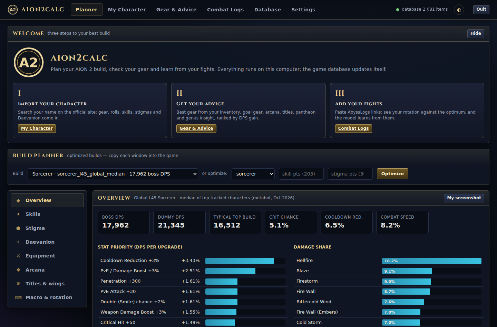
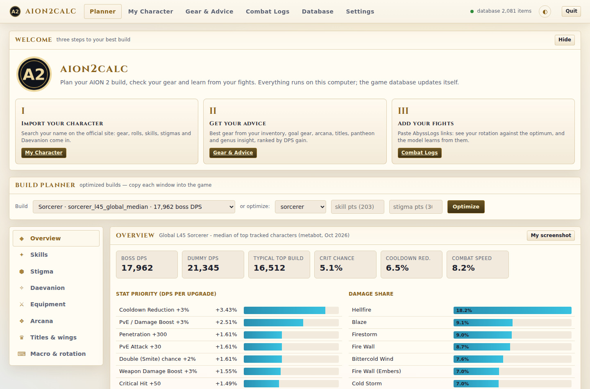

# Installing aion2calc

## For players: the desktop app

Download the file for your computer from the
[Releases page](https://github.com/sam-t-anderson/Aion-2-tools/releases/latest):

| Your computer | File | Then |
|---|---|---|
| **Windows** (recommended) | `aion2calc-setup-<version>.exe` | Run it. It installs for your user only (no admin rights) and adds **aion2calc** to the Start menu, plus an optional desktop shortcut |
| Windows, no install | `aion2calc-<version>-windows-portable.zip` | Unzip anywhere (a USB stick works), run `aion2calc.exe` |
| macOS | `aion2calc-<version>-macos.zip` | Unzip, move `aion2calc.app` to Applications, open it |
| Linux | `aion2calc-<version>-linux.tar.gz` | `tar xzf aion2calc-*-linux.tar.gz && ./aion2calc/aion2calc` |

No Python and no command line are needed. The app opens in its own window (Edge or Chrome in app
mode; without either, your default browser) and follows your computer's light or dark mode. You
can also pick a theme with the ◐ button in the top bar or on the **Settings** page.

**Unsigned builds.** The builds are not code-signed yet ([plan](code-signing.md)), so the first
launch may need one extra click:

* Windows SmartScreen ("Windows protected your PC"): **More info → Run anyway**.
* Windows 11 Smart App Control: see [below](#windows-11-smart-app-control).
* macOS ("cannot be opened" or "Apple could not verify"): open **System Settings → Privacy &
  Security**, scroll down to the message about aion2calc and choose **Open Anyway**.

### Windows 11 Smart App Control

If Windows says **"Smart App Control blocked an app that may be unsafe"** (or that it could not
verify the publisher of `aion2calc.exe`), Smart App Control is on. It blocks an app whose files
are not signed and that it has no reputation for, and unlike SmartScreen it has no **Run anyway**
and no way to allow one app. Until the releases are signed, the only way to run aion2calc on that
computer is to turn Smart App Control off:

1. Open **Windows Security** (Start → type "Windows Security").
2. Choose **App & browser control → Smart App Control settings**.
3. Choose **Off**, then start aion2calc again.

On Windows 11 updated from April 2026 you can turn Smart App Control back on in the same place
later, but it then blocks aion2calc again. On older builds, turning it off stays off until Windows
is reset or reinstalled. Microsoft Defender and SmartScreen keep protecting the computer either way.
Signed releases are the real fix; the release workflow is ready for a signing certificate
([code signing](code-signing.md)).

### "Failed to load Python DLL"

If starting aion2calc shows **"Failed to load Python DLL ... `_internal\python312.dll`. LoadLibrary:
The specified module could not be found."**, the copy in `%LOCALAPPDATA%\Programs\aion2calc` has lost
its Python runtime. Either an update run with an installer older than 0.2.326 did not finish (it was
cancelled, an error was answered with Cancel, or the computer turned off) after it had deleted the old
runtime, or an antivirus removed the file. Download `aion2calc-setup-<version>.exe` from the
[Releases page](https://github.com/sam-t-anderson/Aion-2-tools/releases/latest) and run it. It installs
over the broken copy, and your data in `%LOCALAPPDATA%\aion2calc` is kept. If the message comes back,
look for files from that folder in your antivirus's quarantine (**Windows Security → Virus & threat
protection → Protection history**).

From 0.2.326 on, an update that does not finish puts back the copy it was replacing, so the app you had
still starts. Setup also writes a log of each run to `%TEMP%` (`Setup Log <date> #<n>.txt`), which says
what went wrong.

**Using it.** The first page has three steps: import your character, get gear advice, add your
fights. **Settings** holds the theme, the data folder (with buttons to open it), the log server
for sharing fights, the game-database update and the version. Closing the app window stops the
app (in a browser tab, it stops a few minutes after the last tab closes); **Quit** in the top bar
stops it at once. Starting it again while it runs brings the window back instead of starting a
second copy.

**Updating.** When a newer release is out, the app asks within a few seconds of opening whether to
install it, once per window and for the newest release: one that comes out while the app is open
only updates the gold **Version … available** chip in the top bar, which links to its download page.
Installing always takes the newest release, however many versions behind you are, so the versions in
between are never installed one by one. It checks the Releases page when it starts or a window
opens, then hourly; a check that fails (no network yet right after Windows starts, say) is retried
within a couple of minutes. **Settings → Version** shows what the last check found, with **Check
now** and **Install now**. Installing puts the new version over the old one. Your data is kept.

**Your data** stays on your computer, in `%LOCALAPPDATA%\aion2calc` on Windows and
`~/.aion2calc` on macOS and Linux (details in [app.md](app.md#where-your-data-is-saved)). If the
app fails to start, the reason is in `aion2calc.log` in that folder. When Windows instead says it
failed to load the Python DLL, see [above](#failed-to-load-python-dll).

**Uninstalling.** Windows: **Settings → Apps → Installed apps → aion2calc → Uninstall** (or
delete the portable folder). Other systems: delete the app. Uninstalling keeps your data folder;
delete it too to remove everything.

## Developers and maintainers

Running from source, the command-line interface, building the installer, CI, releasing, code
signing and presetting the log server are in [`cli.md`](cli.md).
