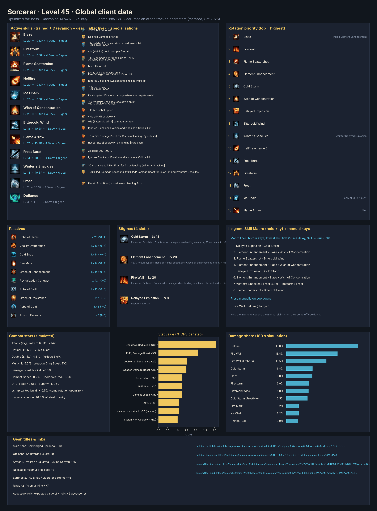
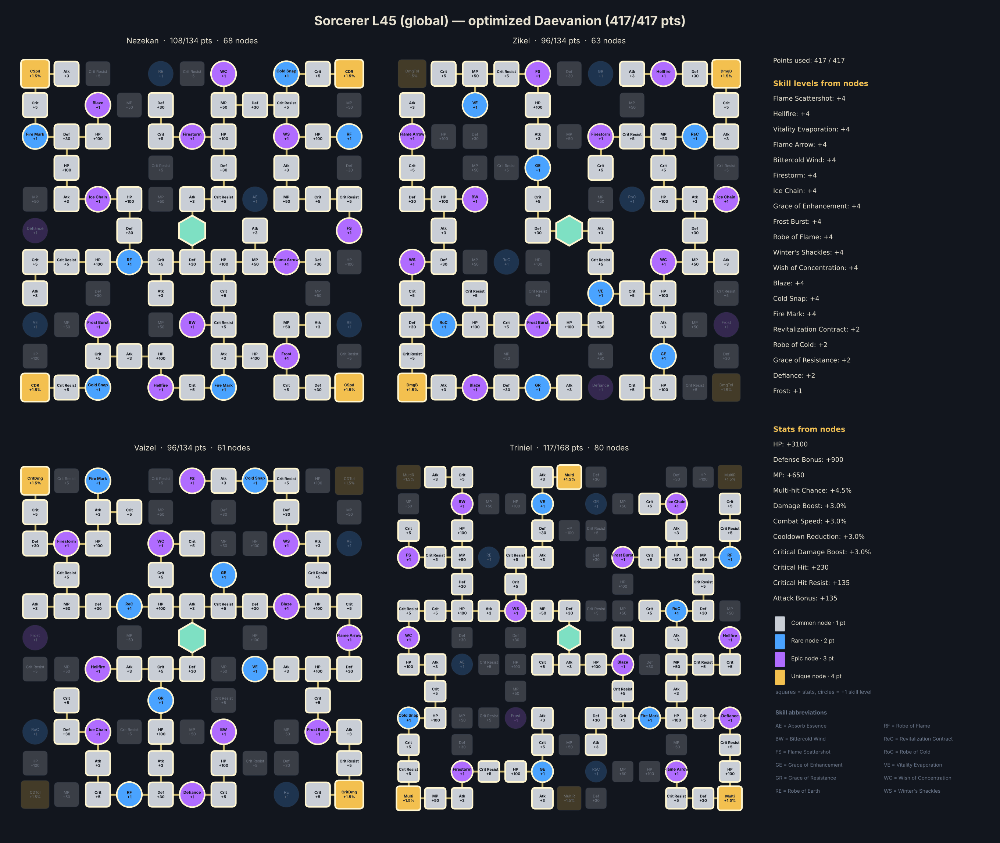
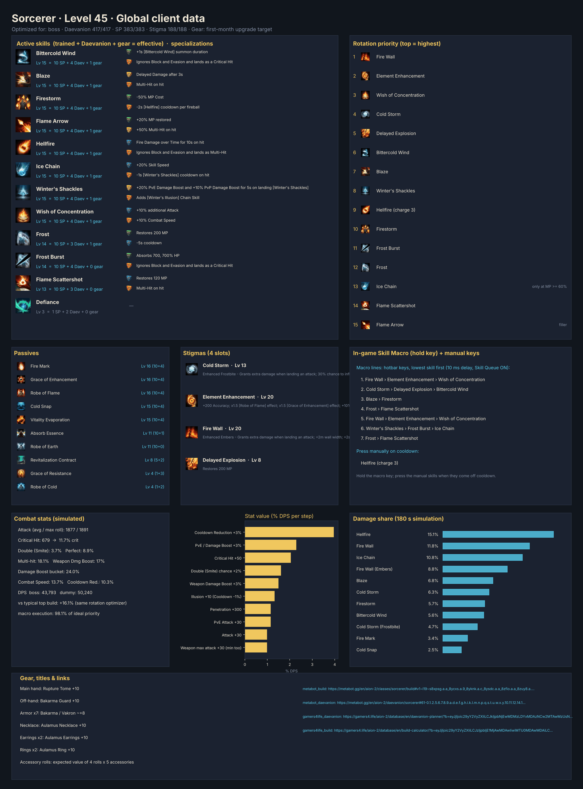

# Sorcerer, level 45 global: results at a glance

| | Median gear, highest reported points | Median gear, 383 skill points, launch stigma and Daevanion | Upgrade gear, highest reported points |
|---|---:|---:|---:|
| Skill / stigma / Daevanion points | 383 / 188 / 417 | 383 / 30 / 360 | 383 / 188 / 417 |
| Bonus skill levels (gear rolls, arcana cards) | 50 placed by the search | none | 20, its five arcana's own |
| Optimized build, boss DPS | **49,658** | **23,876** | **43,793** |
| Typical top global build, same points, same rotation optimizer | 44,920 | 21,094 | 37,722 |

The highest reported points are the most Sorcerers have reported to the community server (5 November 2026): 383
skill, 188 stigma and 417 Daevanion points, and up to 50 bonus skill levels from gear rolls and arcana cards, at most
6 on one skill. The median-gear build is the Sorcerer preset the planner offers before a character is imported. The
upgrade gear's arcana carry 20 skill levels of their own, fewer than the preset's 50, so on boss DPS it reads below the
median-gear preset; it gains on dummy DPS (50,240 against 47,760) and on everything its gear adds.

* Full reports: [median gear, highest reported points](../../results/sorcerer_l45/README.md) ·
  [383 skill points, launch stigma and Daevanion](../../results/sorcerer_l45_full_sp/README.md)
  ([what the reported points and bonus levels add](../../results/sorcerer_l45_full_sp/DIFF.md)) ·
  [upgrade gear](../../results/sorcerer_l45_geared/README.md) ([what changes](../../results/sorcerer_l45_geared/DIFF.md))
* Bonus levels to chase in gear rolls and arcana options: Blaze, Firestorm, Flame Scattershot, Hellfire, Ice Chain,
  Robe of Flame and Wish of Concentration +6 each, Bittercold Wind +4, Flame Arrow +3, Vitality Evaporation +1
* Stigmas: Element Enhancement 20, Fire Wall 20, Cold Storm 13, Delayed Explosion 8
* Priority: Blaze (inside Element Enhancement) → Fire Wall → Flame Scattershot → Element Enhancement → Cold Storm →
  Wish → Delayed Explosion → Bittercold Wind → Winter's Shackles (timed to Delayed Explosion) → Hellfire (full
  charge) → Frost Burst → Firestorm → Frost → Ice Chain (MP 60% or more) → Flame Arrow (filler)
* One-button in-game Skill Macro reaches ~96% of that priority list in simulation
* Stat priority (median gear): Cooldown Reduction > Damage Boost > Double ≈ Weapon Damage Boost > Penetration ≈ PvE
  Attack ≈ Combat Speed > Attack; on upgrade gear Critical Hit moves up to third, behind Damage Boost



**Daevanion boards (optimized, 417 points)**



**Build card on upgrade gear**



## Reproduce

```bash
python -m aion2calc optimize sorcerer --reported-budgets               # median gear, the highest reported points
python -m aion2calc optimize sorcerer --skill-points 383 --out results/sorcerer_l45_full_sp
python -m aion2calc optimize sorcerer --loadout sorcerer_l45_geared --skill-points 383 --stigma-points 188 --daevanion 417 --out results/sorcerer_l45_geared
```

The images in this folder are copies from those result folders. Other classes are optimized the same
way (`python -m aion2calc optimize <class> --reported-budgets`); see the [main README](../../README.md).
