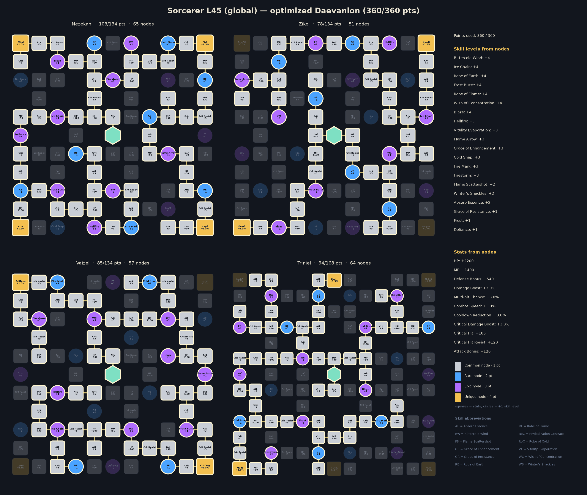

# Sorcerer, level 45 global: results at a glance

| | Median launch gear, 203 SP | Median gear, 383 SP (all Empyrean Traces) | First-month upgrade gear |
|---|---:|---:|---:|
| Optimized build, boss DPS | **21,722** | **22,756** | **31,547** |
| Typical top global build, same rotation optimizer | 18,873 | — | 26,608 |

* Full reports: [median gear](../../results/sorcerer_l45/README.md) ·
  [383 skill points](../../results/sorcerer_l45_full_sp/README.md) ([what changes](../../results/sorcerer_l45_full_sp/DIFF.md)) ·
  [upgrade gear](../../results/sorcerer_l45_geared/README.md) ([what changes](../../results/sorcerer_l45_geared/DIFF.md))
* Arcana: Mirror is the slot to chase (Robe of Flame: +1.3% for one level, +2.5% for two); Hellfire and
  Robe of Flame have the biggest single-level jumps (+1.3% each)
* Stigmas: Element Enhancement 10, Delayed Explosion 5, Fire Wall 5, Cold Storm 5
* Priority: Wish → Fire Wall → Element Enhancement → Blaze → Cold Storm → Winter's Shackles →
  Bittercold Wind (inside Element Enhancement) → Delayed Explosion → Hellfire (full charge, timed to
  Delayed Explosion) → Frost → Firestorm → Frost Burst → Flame Scattershot → Ice Chain (MP 60% or more)
  → Flame Arrow (filler)
* One-button in-game Skill Macro reaches ~92% of that priority list in simulation
* Stat priority (median gear): Cooldown Reduction > Damage Boost > Penetration ≈ PvE Attack ≈ Double ≈
  Weapon Damage Boost > Crit ≈ Attack; on upgrade gear Crit moves up to second, behind Cooldown Reduction


**Daevanion boards (optimized, 360 points)**



**Build card on first-month upgrade gear**


## Reproduce

```bash
python -m aion2calc optimize sorcerer                                   # median gear, 203 skill points
python -m aion2calc optimize sorcerer --skill-points 383 --out results/sorcerer_l45_full_sp
python -m aion2calc optimize sorcerer --loadout sorcerer_l45_geared --out results/sorcerer_l45_geared
```

The images in this folder are copies from those result folders. Other classes are optimized the same
way (`python -m aion2calc optimize <class>`); see the [main README](../../README.md).
