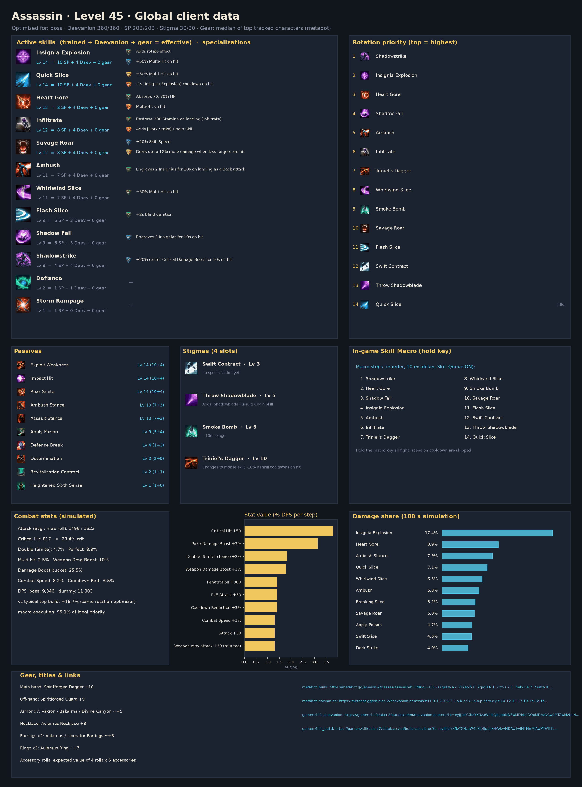
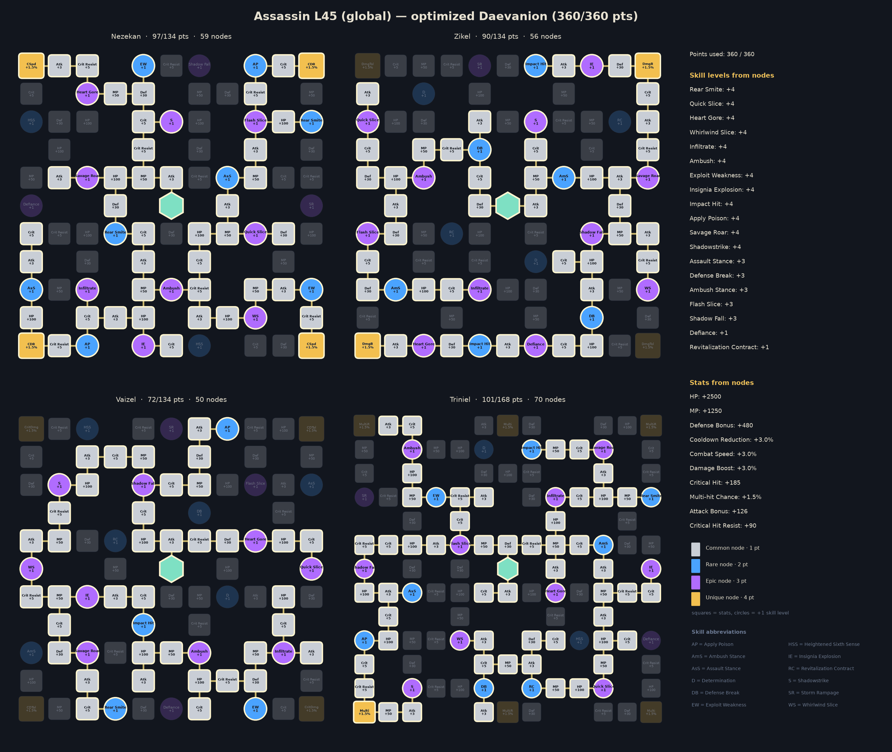
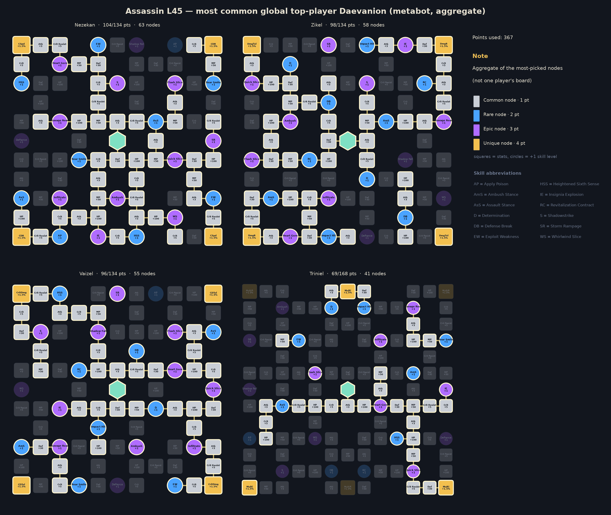

# Assassin — level 45 global build, rotation and macro

Generated by `aion2calc` from the global client data (metabot.gg) with Korean data as fallback. Primary view: **boss** fight (see `docs/methodology.md`). Daevanion budget **360** points.



## Damage objective: boss modeled DPS

Score: 9,346 modeled DPS.

boss: 100%, 180.0s, 9,346 DPS

Damage objective subject to the saved HP and trained-skill reserves. Balanced uses equal scenario weights. Stat weights follow the selected objective; skill shares, opener, macro and sensitivity remain primary-scenario views. This local search does not establish a global optimum or competitive PvP efficacy.

## Results

| Build | boss DPS | dummy DPS |
|---|---:|---:|
| **Optimized (this report)** | **9,346** | **11,303** |
| Typical top global build, optimized rotation | 8,009 | 9,686 |
| Typical top global build, default priority | 7,788 | — |

The optimized build is **+16.7%** over the typical top global build played with the same rotation optimizer, and **+20.0%** over that build played with the default priority. *Typical top global build* = average skill levels, the four most-picked damage stigmas and the most-picked Daevanion nodes of the top tracked global L45 players of this class (metabot.gg live data), given the best legal specializations for its levels (specs are not published).

## Rotation (priority list)

Use the highest skill that is ready; the last entry is the filler.

1. `shadowstrike`
2. `insignia_explosion`
3. `heart_gore`
4. `shadow_fall`
5. `ambush`
6. `infiltrate`
7. `triniel`
8. `whirlwind_slice`
9. `smoke`
10. `savage_roar`
11. `flash_slice`
12. `swift`
13. `tshadow`
14. `quick_slice`

`[sync_de]` = wait for the Delayed Explosion vulnerability window when it is about to be ready; `[in_ee]` = prefer using it inside Element Enhancement; `[mp_hi]` = only while MP is at least 60% (weave it in, keep MP for Grace of Enhancement).

### In-game Skill Macro

**Left mouse button** is the basic auto-attack: `quick_slice`. Hold it for continuous attacks; the Skill Macro below goes on the **right mouse button** (or another held key). Weave both together.

Settings → Key Settings → General → Skill Macro. Skill Queue (스킬 예약) **ON**, 10 ms delay on every step, hold the macro key; manual presses always take priority over the macro.

| Step | Skill |
|---:|---|
| 1 | shadowstrike |
| 2 | heart_gore |
| 3 | shadow_fall |
| 4 | insignia_explosion |
| 5 | ambush |
| 6 | infiltrate |
| 7 | triniel |
| 8 | whirlwind_slice |
| 9 | smoke |
| 10 | savage_roar |
| 11 | flash_slice |
| 12 | swift |
| 13 | tshadow |
| 14 | quick_slice |

Manual keys (press on cooldown, in this priority): none — hold the macro key for the whole fight

Simulated: this layout reaches **95.1%** of the ideal priority list.

**Alternative — macro with manual keys**: macro shadowstrike → insignia_explosion → heart_gore → shadow_fall → ambush → infiltrate → whirlwind_slice → savage_roar → flash_slice → quick_slice; manual: triniel, smoke, swift, tshadow. Simulated: **94.1%** of the ideal priority list.

### Opener (first 30 s of the simulated fight)

```
shadowstrike@0.0s → heart_gore@0.3s → shadow_fall@0.6s → insignia_explosion@1.5s → ambush@1.9s → infiltrate@2.4s → triniel@3.2s → whirlwind_slice@3.5s → smoke@4.3s → savage_roar@4.6s → heart_gore@5.1s → flash_slice@5.5s → swift@6.3s → tshadow@6.6s → quick_slice@6.9s → quick_slice@8.4s → insignia_explosion@10.0s → heart_gore@10.3s → savage_roar@10.6s → quick_slice@11.1s → ambush@12.6s → whirlwind_slice@13.0s → quick_slice@13.7s → heart_gore@15.2s → savage_roar@15.5s → flash_slice@15.9s → quick_slice@16.6s → insignia_explosion@18.2s
```

## Skills, specializations and points

Skill points used **203 / 203**, stigma points **30 / 30**, Daevanion **360 / 360**.

| Skill | Trained (SP) | Effective level | Specializations |
|---|---:|---:|---|
| Quick Slice | 10 | 14 | +50% Multi-Hit on hit; -1s [Insignia Explosion] cooldown on hit |
| Exploit Weakness | 10 | 14 | — |
| Impact Hit | 10 | 14 | — |
| Insignia Explosion | 10 | 14 | Adds rotate effect; +50% Multi-Hit on hit |
| Rear Smite | 10 | 14 | — |
| Savage Roar | 8 | 12 | +20% Skill Speed; Deals up to 12% more damage when less targets are hit |
| Infiltrate | 8 | 12 | Restores 300 Stamina on landing [Infiltrate]; Adds [Dark Strike] Chain Skill |
| Heart Gore | 8 | 12 | Absorbs 70, 70% HP; Multi-Hit on hit |
| Ambush | 7 | 11 | Engraves 2 Insignias for 10s on landing as a Back attack |
| Whirlwind Slice | 7 | 11 | +50% Multi-Hit on hit |
| Assault Stance | 7 | 10 | — |
| Ambush Stance | 7 | 10 | — |
| Flash Slice | 6 | 9 | +2s Blind duration |
| Apply Poison | 5 | 9 | — |
| Shadow Fall | 6 | 9 | Engraves 3 Insignias for 10s on hit |
| Shadowstrike | 4 | 8 | +20% caster Critical Damage Boost for 10s on hit |
| Defense Break | 1 | 4 | — |
| Defiance | 1 | 2 | — |
| Determination | 2 | 2 | — |
| Revitalization Contract | 1 | 2 | — |

**Stigmas**: Swift Contract Lv 3, Throw Shadowblade Lv 5, Smoke Bomb Lv 6, Triniel's Dagger Lv 10

## Daevanion (360 points)



* Open in metabot planner: https://metabot.gg/en/aion-2/daevanion/assassin#41-0.1.2.3.6.7.8.a.b.c.f.k.l.n.o.p.r.t.w.x.y.z.10.12.13.17.19.1b.1e.1f.1h.1i.1j.1k.1m.1o.1p.1r.1t.1u.1v.1w.1x.1y.1z.20.21.22.23.24.25.26.27.28.29.2a.2b.2c.2g_42-6.7.8.9.a.b.f.g.j.l.p.q.r.s.t.u.w.x.y.z.10.11.12.13.14.15.16.17.19.1a.1b.1c.1h.1i.1j.1k.1o.1p.1q.1r.1s.1t.1u.1v.1y.20.24.26.27.28.29.2a.2b.2c.2d.2e_43-5.6.b.c.d.e.i.j.k.l.m.r.s.v.w.z.10.11.12.13.14.15.16.1a.1b.1c.1d.1e.1f.1k.1m.1n.1p.1r.1s.1u.1v.1w.1x.1y.1z.21.22.23.24.25.29.2a.2d.2e_44-1.2.a.e.f.g.h.k.o.s.t.u.v.x.y.z.10.11.13.14.16.17.18.19.1a.1b.1c.1d.1e.1f.1g.1j.1n.1o.1p.1q.1r.1s.1v.1w.1y.20.21.22.23.26.27.28.2b.2c.2d.2e.2g.2h.2j.2l.2m.2n.2o.2q.2r.2u.2v.2w.2x.2y.30.31.32.33
* Open in gamers4.life planner (KR node values, same node IDs): https://gamers4.life/aion-2/database/en/daevanion-planner/?b=eyJjIjoiYXNzYXNzaW4iLCJkIjpbNDEwMDMzLDQxMDAzNCw0MTAwMzUsNDEwMDM3LDQxMDA0MSw0MTAwNDIsNDEwMDQzLDQxMDA1MCw0MTAwNTEsNDEwMDUyLDQxMDA1Niw0MTAwNjcsNDEwMDY4LDQxMDA3MSw0MTAwNzIsNDEwMDczLDQxMDA4Miw0MTAwODYsNDEwMDk0LDQxMDA5NSw0MTAwOTYsNDEwMDk3LDQxMDA5OCw0MTAxMDAsNDEwMTAxLDQxMDExMSw0MTAxMTUsNDEwMTIzLDQxMDEyNiw0MTAxMjcsNDEwMTI5LDQxMDEzMCw0MTAxMzEsNDEwMTMyLDQxMDEzOCw0MTAxNDIsNDEwMTQ0LDQxMDE1Myw0MTAxNTUsNDEwMTU3LDQxMDE1OCw0MTAxNTksNDEwMTYxLDQxMDE2Miw0MTAxNjMsNDEwMTY4LDQxMDE3MCw0MTAxNzEsNDEwMTcyLDQxMDE3NCw0MTAxNzUsNDEwMTc2LDQxMDE3OCw0MTAxODMsNDEwMTg0LDQxMDE4NSw0MTAxODcsNDEwMTg4LDQxMDE5Myw0MjAwMzksNDIwMDQwLDQyMDA0MSw0MjAwNDIsNDIwMDQzLDQyMDA0OCw0MjAwNTgsNDIwMDYzLDQyMDA2Nyw0MjAwNjksNDIwMDczLDQyMDA3OCw0MjAwODAsNDIwMDgxLDQyMDA4Miw0MjAwODQsNDIwMDg4LDQyMDA5Myw0MjAwOTQsNDIwMDk1LDQyMDA5Nyw0MjAwOTksNDIwMTAwLDQyMDEwMSw0MjAxMDIsNDIwMTAzLDQyMDEwOSw0MjAxMTIsNDIwMTE0LDQyMDExNyw0MjAxMjMsNDIwMTI0LDQyMDEzMSw0MjAxMzIsNDIwMTMzLDQyMDEzOCw0MjAxNDUsNDIwMTQ2LDQyMDE0OCw0MjAxNTMsNDIwMTU0LDQyMDE1NSw0MjAxNTYsNDIwMTU3LDQyMDE2MSw0MjAxNjMsNDIwMTc2LDQyMDE4Myw0MjAxODQsNDIwMTg1LDQyMDE4Niw0MjAxODcsNDIwMTg4LDQyMDE4OSw0MjAxOTAsNDIwMTkxLDQzMDAzOSw0MzAwNDAsNDMwMDUwLDQzMDA1MSw0MzAwNTIsNDMwMDU0LDQzMDA2NCw0MzAwNjUsNDMwMDY3LDQzMDA2OCw0MzAwNjksNDMwMDc5LDQzMDA4Miw0MzAwOTMsNDMwMDk0LDQzMDA5Nyw0MzAwOTgsNDMwMDk5LDQzMDEwMCw0MzAxMDEsNDMwMTAyLDQzMDEwMyw0MzAxMDgsNDMwMTE4LDQzMDEyMyw0MzAxMjQsNDMwMTI1LDQzMDEyNiw0MzAxMjcsNDMwMTMyLDQzMDEzOSw0MzAxNDIsNDMwMTQ3LDQzMDE1NCw0MzAxNTUsNDMwMTU3LDQzMDE1OCw0MzAxNTksNDMwMTYxLDQzMDE2Miw0MzAxNjMsNDMwMTcwLDQzMDE3Miw0MzAxNzQsNDMwMTc1LDQzMDE3Niw0MzAxODUsNDMwMTg2LDQzMDE4OSw0MzAxOTEsNDQwMDE4LDQ0MDAxOSw0NDAwMzQsNDQwMDM5LDQ0MDA0MCw0NDAwNDEsNDQwMDQyLDQ0MDA0OSw0NDAwNTcsNDQwMDY0LDQ0MDA2NSw0NDAwNjYsNDQwMDY3LDQ0MDA3MCw0NDAwNzEsNDQwMDcyLDQ0MDA3Myw0NDAwNzQsNDQwMDgxLDQ0MDA4NSw0NDAwOTIsNDQwMDkzLDQ0MDA5NCw0NDAwOTUsNDQwMDk2LDQ0MDA5Nyw0NDAwOTgsNDQwMDk5LDQ0MDEwMCw0NDAxMDEsNDQwMTAyLDQ0MDEwNyw0NDAxMTUsNDQwMTE3LDQ0MDExOSw0NDAxMjIsNDQwMTIzLDQ0MDEyNCw0NDAxMjcsNDQwMTI4LDQ0MDEzMCw0NDAxMzIsNDQwMTMzLDQ0MDEzNCw0NDAxMzgsNDQwMTQ3LDQ0MDE1Miw0NDAxNTMsNDQwMTU2LDQ0MDE1Nyw0NDAxNTksNDQwMTYwLDQ0MDE2Miw0NDAxNjMsNDQwMTY3LDQ0MDE3Miw0NDAxNzMsNDQwMTc0LDQ0MDE3Nyw0NDAxODIsNDQwMTg0LDQ0MDE4Nyw0NDAxODksNDQwMTkwLDQ0MDE5MSw0NDAxOTIsNDQwMTk3LDQ0MDE5OCw0NDAxOTksNDQwMjAyXX0
* Full skill/stigma/Daevanion build in metabot planner: https://metabot.gg/en/aion-2/classes/assassin/build#v1~l19~s7qukw.a.c_7r2ao.5.0_7rpg0.6.1_7rx5s.7.1_7s4vk.4.2_7ss0w.8.6_7tf68.a.3_7v4wg.7.1_7vcm8.6.2_7vzrk.6.0_7x2cg.a.0_7y4xc.8.9_7ycn4.8.9_7yzsg.3.0_862f4.a.0_86a4w.5.0_86huo.a.0_86pkg.7.0_86xa8.a.0_87500.7.0_87s5c.2.0~g7yzsg_7r2ao_7vzrk_7x2cg~d41-0.1.2.3.6.7.8.a.b.c.f.k.l.n.o.p.r.t.w.x.y.z.10.12.13.17.19.1b.1e.1f.1h.1i.1j.1k.1m.1o.1p.1r.1t.1u.1v.1w.1x.1y.1z.20.21.22.23.24.25.26.27.28.29.2a.2b.2c.2g_42-6.7.8.9.a.b.f.g.j.l.p.q.r.s.t.u.w.x.y.z.10.11.12.13.14.15.16.17.19.1a.1b.1c.1h.1i.1j.1k.1o.1p.1q.1r.1s.1t.1u.1v.1y.20.24.26.27.28.29.2a.2b.2c.2d.2e_43-5.6.b.c.d.e.i.j.k.l.m.r.s.v.w.z.10.11.12.13.14.15.16.1a.1b.1c.1d.1e.1f.1k.1m.1n.1p.1r.1s.1u.1v.1w.1x.1y.1z.21.22.23.24.25.29.2a.2d.2e_44-1.2.a.e.f.g.h.k.o.s.t.u.v.x.y.z.10.11.13.14.16.17.18.19.1a.1b.1c.1d.1e.1f.1g.1j.1n.1o.1p.1q.1r.1s.1v.1w.1y.20.21.22.23.26.27.28.2b.2c.2d.2e.2g.2h.2j.2l.2m.2n.2o.2q.2r.2u.2v.2w.2x.2y.30.31.32.33

For comparison, the aggregate of the most-picked nodes among top global players:



## Stat priority (simulated)

| Upgrade | DPS gain | Worth in Attack |
|---|---:|---:|
| Critical Hit +50 | +3.80% | 88 |
| PvE / Damage Boost +3% | +3.14% | 73 |
| Double (Smite) chance +2% | +1.82% | 42 |
| Weapon Damage Boost +3% | +1.77% | 41 |
| Penetration +300 | +1.40% | 33 |
| PvE Attack +30 | +1.40% | 33 |
| Cooldown Reduction +3% | +1.39% | 32 |
| Combat Speed +3% | +1.30% | 30 |
| Attack +30 | +1.29% | 30 |
| Weapon max attack +30 (min too) | +1.29% | 30 |
| Wisdom +10 (Double +1%) | +0.91% | 21 |
| Back Attack +30 | +0.77% | 18 |
| Critical Attack +50 | +0.61% | 14 |
| Critical Damage Boost +3% | +0.57% | 13 |
| Precision +10 (Crit +1%) | +0.54% | 13 |
| Death +10 (Crit +1%) | +0.54% | 13 |
| Might +10 (Attack +1%) | +0.51% | 12 |
| Destruction +10 (Attack +1%) | +0.51% | 12 |
| Illusion +10 (Cooldown -1%) | +0.46% | 11 |
| Time +10 (Combat Speed +1%) | +0.43% | 10 |
| Multi-hit chance +3% | +0.32% | 7 |
| Front Attack +30 | +0.13% | 3 |
| Perfect chance +3% | +0.03% | 1 |
| Justice +10 (Perfect +1%) | +0.01% | 0 |
| MP +300 | +0.00% | 0 |
| Freedom +10 (Accuracy +1%) | +0.00% | 0 |

Accuracy is a threshold stat (avoid parries; back attacks ignore them) and is not ranked.

## Gear, rolls, enchanting

Loadout: **Global L45 Assassin - median of top tracked characters (metabot)**

* Main hand: Spiritforged Dagger +10
* Off-hand: Spiritforged Guard +9
* Armor x7: Vakron / Bakarma / Divine Canyon ~+5
* Necklace: Aulamus Necklace +8
* Earrings x2: Aulamus / Liberator Earrings ~+6
* Rings x2: Aulamus Ring ~+7
* Accessory rolls: expected value of 4 rolls x 5 accessories
* Bracelets x2: Ascension +9 / Liberator +6
* Amulet: Revelation Amulet +0
* Rune: Clash Rune +2
* Attack title: Guardian of Altgard / Verteron
* Other title: Through Hell and Back
* Owned titles: collection bonuses (estimate)
* Wings: Ultimate Daeva Wings
* Primary/deity stats: profile averages

**Random-roll priority per item** (keep / reroll toward the top of each list):

* **Rupture Tome**: Damage Boost (+4.9% – +5.7%), Weapon Damage Boost (+6.5% – +7.6%), Combat Speed (+8.8% – +10.2%), Critical Hit (+46 – +60), Back Attack (+65 – +82)
* **Ludras Grimoire**: Damage Boost (+6.3% – +7.3%), Weapon Damage Boost (+8.3% – +9.6%), Combat Speed (+11.2% – +13%), Critical Hit (+59 – +75), Back Attack (+83 – +102)
* **Spiritforged Guard**: Might (+10 – +10), Accuracy (+30 – +30)
* **Vakron Helm**: Critical Hit (+25 – +36), Double Chance (+1.6% – +1.9%), Attack increase (+1.6% – +1.9%), Attack (+16 – +25), MP (+76 – +94)
* **Bakarma Breastplate**: Damage Boost (+4.4% – +5.2%), Critical Hit (+27 – +38), Attack (+18 – +28), Perfect Chance (+3.9% – +4.6%), MP (+83 – +102)
* **Aulamus Necklace**: Critical Hit (+35 – +47), Combat Speed (+3.2% – +3.8%), Attack (+23 – +33), Precision (+9 – +17), Might (+9 – +17)
* **Aulamus Ring**: Critical Hit (+25 – +36), Attack (+16 – +25), Precision (+5 – +13), Might (+5 – +13), Natural MP Regen (+18 – +28)

**Enchant priority** (DPS per enchant level):

* Weapon (Spiritforged / Rupture): 33.2 DPS/level
* Guard (off-hand): 20.1 DPS/level
* Necklace / Earrings / Rings (Aulamus): 16.1 DPS/level
* Revelation Amulet: 13.1 DPS/level
* Bracelets: 12.1 DPS/level
* Armor pieces: 0.0 DPS/level

## Titles, arcana, wings, pets

**Best titles by equip bonus** (global client values):

| Title | Grade | Equip bonus | Owned bonus |
|---|---|---|---|
| Unbound by Genus (Both factions) | Unique | PvE Damage Boost +4.5%, Attack Bonus +34, Critical Hit +68 | PvE Damage Boost +1% |
| Saint of Ereshkigal (Both factions) | Unique | PvP Damage Boost +4%, Endurance Penetration +2.5%, Critical Hit +60 | PvP Accuracy +20 |
| You're My Gem (Both factions) | Epic | Critical Hit +52, Critical Attack +39 | Natural MP Regen +5 |
| Guardian of Altgard (Asmodian) | Epic | PvE Damage Boost +3%, Penetration +210 | PvE Attack +4 |
| Guardian of Verteron (Elyos) | Epic | PvE Damage Boost +3%, Penetration +210 | PvE Attack +4 |
| Shaking Off the World's Shackles (Both factions) | Epic | Accuracy Bonus +50, Critical Hit +50 | Penetration +20 |
| Scenery Collector (Both factions) | Epic | PvE Damage Boost +3.3%, Block Penetration +54 | Critical Hit +10 |
| Teleportation Specialist (Both factions) | Epic | PvE Accuracy +58, PvE Damage Boost +3.1% | Critical Hit +10 |
| Activated the Trap Card (Elyos) | Epic | Critical Hit +42, Accuracy Bonus +42 | Accuracy Bonus +10 |
| Here I Am (Asmodian) | Epic | Critical Hit +42, Accuracy Bonus +42 | Accuracy Bonus +10 |

**Arcana variant per slot** (deity stat that is worth more for this build):

* Chalice / Grail: **Vigor or Frenzy** (Time +20)
* Parchment: either variant (Life +20 / Destiny +20: no damage either way)
* Compass: **Magic or Purity** (Death +20)
* Bell: **Magic or Purity** (Destruction +20)
* Mirror: **Magic or Purity** (Wisdom +20)

**Arcana skill rolls.** Each arcana gives (grade base + enhancement level) random skill levels from its slot's pool — Rare 2, Legend 3, Unique 4 base rolls, +1 per enhancement level (so a Unique +5 gives 9); a skill rolled again gains another level, up to the cap. Chalice, Parchment and Compass roll active skills; Bell and Mirror roll passives.

| Arcana slot | Expected DPS, Unique +0 (4 rolls) | Expected DPS, Unique +5 (9 rolls) | Best rolls (+1 / +2) |
|---|---:|---:|---|
| Parchment | +2.1% | +6.4% | Quick Slice +0.3% / +8.6%, Insignia Explosion +0.3% / +3.5%, Heart Gore +0.2% / +0.3% |
| Mirror | +1.7% | +4.0% | Rear Smite +1.0% / +2.1%, Exploit Weakness +0.9% / +1.9%, Impact Hit +0.3% / +0.5% |
| Chalice | +0.9% | +2.6% | Rear Smite +1.0% / +2.1%, Exploit Weakness +0.9% / +1.9%, Quick Slice +0.3% / +8.6% |
| Compass | +0.4% | +0.8% | Ambush +0.2% / +0.3%, Savage Roar +0.1% / +0.3%, Infiltrate +0.1% / +0.3% |
| Bell | +0.3% | +0.8% | Assault Stance +0.2% / +0.4%, Ambush Stance +0.1% / +0.3%, Apply Poison +0.1% / +0.2% |

Biggest single-level jumps (usually a specialization unlocking at Lv 16): Quick Slice +8.3%, Insignia Explosion +3.3%, Rear Smite +1.0%, Exploit Weakness +1.0%.

**Deity (pantheon) stats**, +10 points each (arcana main stats, Abyssal Bracelet rolls, Monolith rewards): Wisdom +0.91%, Death +0.54%, Might +0.51%, Destruction +0.51%, Illusion +0.46%, Time +0.43%, Justice +0.01%.

**Closet / appearance collection**: every unlocked skin and costume set adds permanent Collection Effect stats, and wings keep a Retention Effect once owned. The client tables for these are not public, so they are not itemised here; they are flat stats, so value them with the stat table above and collect the cheap ones first.

**Wings**: Ultimate Daeva Wings (Accuracy +40, Penetration +500) are the most used and the best launch option for damage among common wings. **Pets**: pet collection bonuses are mostly genus-specific (damage vs that monster genus) plus Accuracy/Crit; level the genus of the content you farm first.

## Robustness

Samples with no modeled damage are excluded from percentage losses.

Every animation time was randomly perturbed by up to ±25% (8 samples) and the rotation re-optimized each time. Playing the recommended priority instead of the re-optimized one lost on average **1.56%** (worst 2.47%).

**Crit curve.** The crit-chance curve is fitted to tests at Crit 1048–1326 and extrapolated down to launch values: this build sits at **23.4%** crit, and Crit +50 ranks #1 (+3.80%). If launch testing shows more crit — e.g. the curve shifted to a midpoint of 700, giving 70% — Crit +50 becomes #1 (+3.27%). Re-run with `--crit-midpoint` once real numbers exist.

## Validation against Korean logs

Simulated damage shares (training dummy) overlap **41%** with the mean of the top-10 A2DIL Korean dummy logs; 16% of the Korean damage comes from skills that are not in the global level-45 client. Korea plays above level 45 with Lv 16-20 specializations, so a perfect match is not expected; low values mean the class kit needs hand-tuning (see `kit/sorcerer.py` for a hand-written kit).

## Sources

* metabot.gg (global client): class skills, Daevanion boards, items, titles, top-player statistics
* gamers4.life (KR database): skill hit counts, build/Daevanion planners
* A2DIL (KR training-dummy logs): damage-share validation
* Inven / Bahamut damage research, aion2ssow calculator: damage formula

See `docs/methodology.md` for every formula and assumption.
