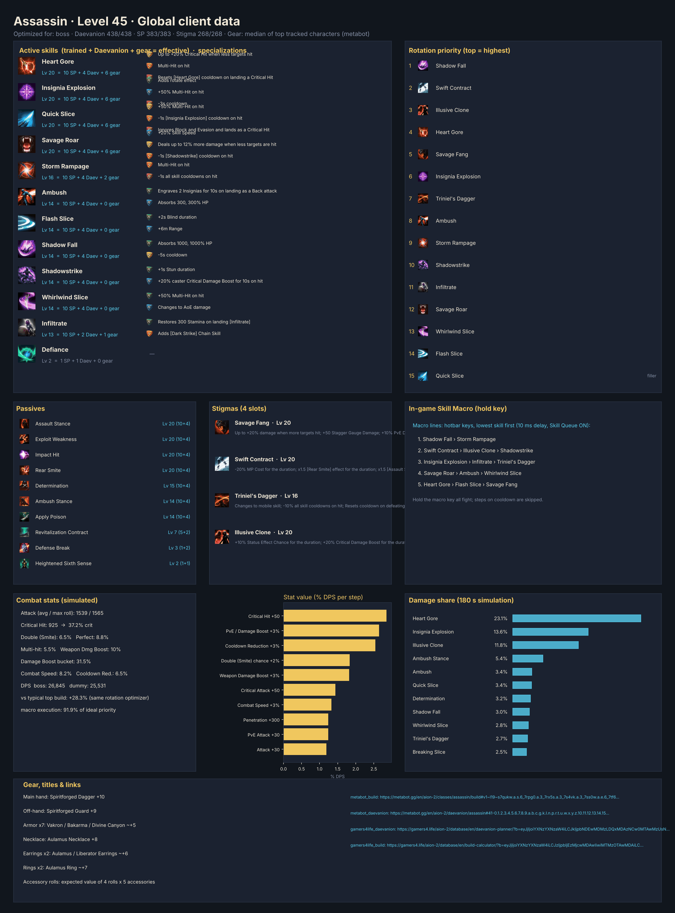
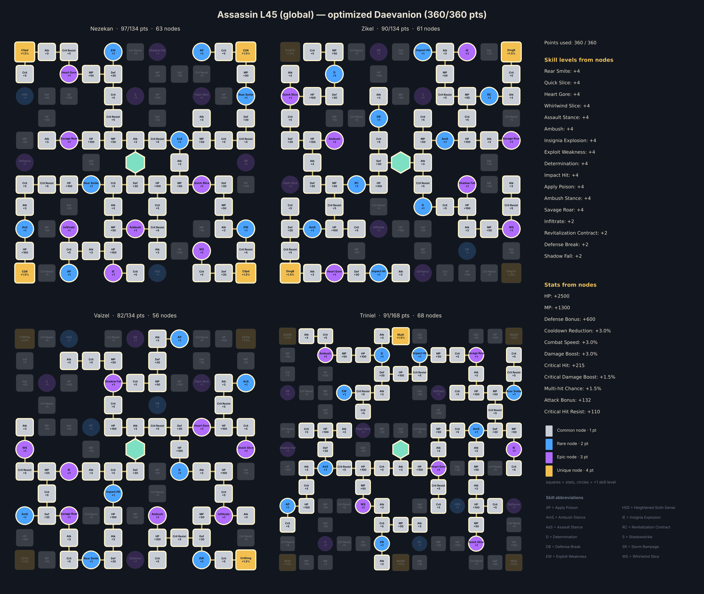
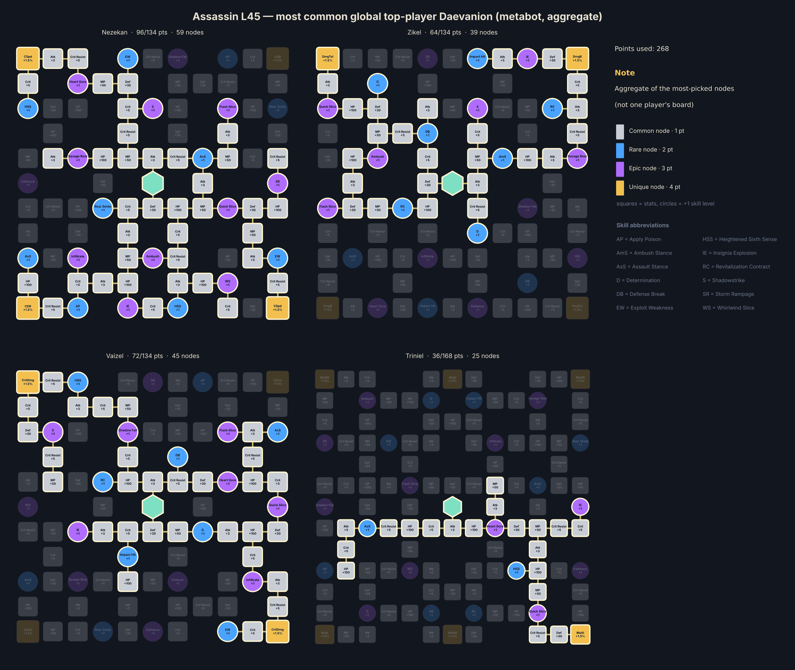

# Assassin — level 45 global build, rotation and macro

Generated by `aion2calc` from the global client data (metabot.gg) with Korean data as fallback. Primary view: **boss** fight (see `docs/methodology.md`). Daevanion budget **360** points.



## Damage objective: boss modeled DPS

Score: 12,097 modeled DPS.

boss: 100%, 180.0s, 12,097 DPS

Damage objective subject to the saved HP and trained-skill reserves. Balanced uses equal scenario weights. Stat weights follow the selected objective; skill shares, opener, macro and sensitivity remain primary-scenario views. This local search does not establish a global optimum or competitive PvP efficacy.

## Results

| Build | boss DPS | dummy DPS |
|---|---:|---:|
| **Optimized (this report)** | **12,097** | **12,997** |
| Typical top global build, optimized rotation | 9,150 | 9,828 |
| Typical top global build, default priority | 8,704 | — |

**Whole fight:** 9,035 DPS on the boss scenario, the same rotation stretched over the 39% of a recorded boss fight this class's players spend pressing nothing or dodging (the log server's public uploads). The table above is the rotation's own DPS, which the optimizer compares builds by; a parse on the log server is a whole fight's.

The optimized build is **+32.2%** over the typical top global build played with the same rotation optimizer, and **+39.0%** over that build played with the default priority. *Typical top global build* = average skill levels, the four most-picked damage stigmas and the most-picked Daevanion nodes of the top tracked global L45 players of this class (metabot.gg live data), given the best legal specializations for its levels (specs are not published).

## Rotation (priority list)

Use the highest skill that is ready; the last entry is the filler.

1. `illusive_clone`
2. `shadow_fall`
3. `heart_gore`
4. `shadowstrike`
5. `swift`
6. `sfang`
7. `insignia_explosion`
8. `triniel`
9. `ambush`
10. `savage_roar`
11. `infiltrate`
12. `whirlwind_slice`
13. `flash_slice`
14. `storm_rampage`
15. `quick_slice`

`[sync_de]` = wait for the Delayed Explosion vulnerability window when it is about to be ready; `[in_ee]` = prefer using it inside Element Enhancement; `[mp_hi]` = only while MP is at least 60% (weave it in, keep MP for Grace of Enhancement).

### In-game Skill Macro

**Left mouse button** is the basic auto-attack: `quick_slice`. Hold it for continuous attacks; the Skill Macro below goes on the **right mouse button** (or another held key). Weave both together.

Each line is a hotbar key: put its skills on that key in the order listed, the first lowest (a key holds up to four). The macro casts a key's skills from first to last, skipping any that cannot be cast, then moves to the next line. Then Settings → Key Settings → General → Skill Macro: add the keys as macro lines from top to bottom, a key listed twice added twice. Skill Queue (스킬 예약) **ON**, 10 ms delay on every line, hold the macro key; manual presses always take priority over the macro. A skill's key presses its chain step while the chain is open, in the macro too.

| Line | Hotbar key holds (cast in this order) |
|---:|---|
| 1 | illusive_clone › heart_gore |
| 2 | shadowstrike › swift › sfang › insignia_explosion |
| 3 | the same key as line 1, pressed again: its skills are tried twice a round |
| 4 | triniel › whirlwind_slice › savage_roar |
| 5 | the same key as line 1, pressed again: its skills are tried twice a round |
| 6 | ambush › storm_rampage › shadow_fall |
| 7 | the same key as line 1, pressed again: its skills are tried twice a round |
| 8 | flash_slice › infiltrate |

Manual keys (press on cooldown, in this priority): none — hold the macro key for the whole fight

Simulated: this layout reaches **97.0%** of the ideal priority list.

**Alternative — one skill per macro line**: macro illusive_clone → shadowstrike → shadow_fall → swift → sfang → insignia_explosion → heart_gore → triniel → ambush → savage_roar → infiltrate → whirlwind_slice → flash_slice → storm_rampage → quick_slice. Simulated: **87.6%** of the ideal priority list.

### Opener (first 30 s of the simulated fight)

```
illusive_clone@0.0s → heart_gore@0.3s → shadowstrike@0.7s → shadow_fall@0.9s → heart_gore@1.9s → swift@2.2s → sfang@2.5s → heart_gore@2.8s → insignia_explosion@3.1s → heart_gore@3.5s → triniel@3.8s → heart_gore@4.0s → ambush@4.3s → heart_gore@4.7s → savage_roar@5.0s → heart_gore@6.4s → infiltrate@6.8s → heart_gore@7.4s → whirlwind_slice@7.7s → heart_gore@8.4s → flash_slice@8.7s → heart_gore@9.4s → quick_slice@9.7s → heart_gore@11.3s → insignia_explosion@11.6s → heart_gore@11.9s → quick_slice@12.2s → heart_gore@13.8s
```

## Skills, specializations and points

Skill points used **203 / 203**, stigma points **30 / 30**, Daevanion **360 / 360**.

| Skill | Trained (SP) | Effective level | Specializations |
|---|---:|---:|---|
| Assault Stance | 10 | 14 | — |
| Exploit Weakness | 10 | 14 | — |
| Heart Gore | 10 | 14 | Up to +20% Critical Hit when less targets hit; Multi-Hit on hit |
| Rear Smite | 10 | 14 | — |
| Quick Slice | 9 | 13 | +50% Multi-Hit on hit; -1s [Insignia Explosion] cooldown on hit |
| Infiltrate | 10 | 12 | Restores 300 Stamina on landing [Infiltrate]; Adds [Dark Strike] Chain Skill |
| Insignia Explosion | 8 | 12 | Adds rotate effect; +50% Multi-Hit on hit |
| Savage Roar | 8 | 12 | +20% Skill Speed; -1s [Shadowstrike] cooldown on hit |
| Ambush | 7 | 11 | Engraves 2 Insignias for 10s on landing as a Back attack |
| Impact Hit | 7 | 11 | — |
| Determination | 6 | 10 | — |
| Whirlwind Slice | 5 | 9 | +50% Multi-Hit on hit |
| Shadowstrike | 8 | 8 | +20% caster Critical Damage Boost for 10s on hit |
| Ambush Stance | 4 | 8 | — |
| Apply Poison | 4 | 8 | — |
| Shadow Fall | 4 | 6 | — |
| Flash Slice | 4 | 4 | — |
| Defense Break | 1 | 3 | — |
| Revitalization Contract | 1 | 3 | — |

**Stigmas**: Illusive Clone Lv 10, Swift Contract Lv 5, Savage Fang Lv 5, Triniel's Dagger Lv 5

## Daevanion (360 points)



* Open in metabot planner: https://metabot.gg/en/aion-2/daevanion/assassin#41-0.1.2.3.6.7.8.9.a.b.c.g.k.p.r.t.u.w.x.y.z.10.11.12.13.14.15.19.1b.1c.1d.1e.1f.1g.1h.1i.1j.1k.1m.1o.1p.1q.1r.1t.1u.1v.1w.1y.1z.20.21.22.23.24.26.27.28.2a.2b.2c.2e.2f.2g_42-1.2.6.7.8.a.b.c.e.f.g.h.i.j.m.n.o.p.q.t.u.v.x.y.z.10.11.12.13.14.15.16.17.19.1c.1d.1e.1f.1g.1h.1j.1k.1l.1n.1o.1p.1q.1r.1s.1t.1u.1y.1z.20.21.26.27.28.29.2a.2b_43-5.6.b.c.d.e.k.l.m.p.q.s.u.v.z.10.11.12.13.14.15.16.19.1a.1b.1c.1d.1e.1f.1g.1i.1j.1k.1m.1n.1p.1q.1r.1s.1u.1w.1x.1y.1z.21.22.23.24.25.29.2a.2b.2d.2e.2f.2g_44-1.2.3.4.a.b.c.d.e.f.g.h.i.l.m.n.o.p.t.u.v.y.z.10.11.13.15.17.18.19.1e.1f.1g.1h.1i.1k.1n.1o.1p.1r.1s.1t.1u.1v.1w.1x.1y.20.22.23.24.25.26.27.28.2b.2c.2e.2g.2h.2j.2l.2m.2n.2o.2u.2y.33
* Open in gamers4.life planner (KR node values, same node IDs): https://gamers4.life/aion-2/database/en/daevanion-planner/?b=eyJjIjoiYXNzYXNzaW4iLCJkIjpbNDEwMDMzLDQxMDAzNCw0MTAwMzUsNDEwMDM3LDQxMDA0MSw0MTAwNDIsNDEwMDQzLDQxMDA0OCw0MTAwNTAsNDEwMDUxLDQxMDA1Miw0MTAwNTgsNDEwMDY3LDQxMDA3Myw0MTAwODIsNDEwMDg2LDQxMDA4OCw0MTAwOTQsNDEwMDk1LDQxMDA5Niw0MTAwOTcsNDEwMDk4LDQxMDA5OSw0MTAxMDAsNDEwMTAxLDQxMDEwMiw0MTAxMDMsNDEwMTE1LDQxMDEyMyw0MTAxMjQsNDEwMTI1LDQxMDEyNiw0MTAxMjcsNDEwMTI4LDQxMDEyOSw0MTAxMzAsNDEwMTMxLDQxMDEzMiw0MTAxMzgsNDEwMTQyLDQxMDE0NCw0MTAxNDcsNDEwMTUzLDQxMDE1NSw0MTAxNTcsNDEwMTU4LDQxMDE1OSw0MTAxNjIsNDEwMTYzLDQxMDE2OCw0MTAxNzAsNDEwMTcxLDQxMDE3Miw0MTAxNzQsNDEwMTc2LDQxMDE3OCw0MTAxODMsNDEwMTg1LDQxMDE4Nyw0MTAxODgsNDEwMTkxLDQxMDE5Miw0MTAxOTMsNDIwMDM0LDQyMDAzNSw0MjAwMzksNDIwMDQwLDQyMDA0MSw0MjAwNDMsNDIwMDQ4LDQyMDA1MCw0MjAwNTUsNDIwMDU4LDQyMDA2Myw0MjAwNjQsNDIwMDY1LDQyMDA2Nyw0MjAwNzAsNDIwMDcxLDQyMDA3Miw0MjAwNzMsNDIwMDc4LDQyMDA4Miw0MjAwODQsNDIwMDg2LDQyMDA5Myw0MjAwOTQsNDIwMDk1LDQyMDA5Nyw0MjAwOTksNDIwMTAwLDQyMDEwMSw0MjAxMDIsNDIwMTAzLDQyMDEwOSw0MjAxMTIsNDIwMTE0LDQyMDEyNCw0MjAxMjUsNDIwMTI2LDQyMDEyNyw0MjAxMjksNDIwMTMxLDQyMDEzMyw0MjAxMzgsNDIwMTQwLDQyMDE0NCw0MjAxNDUsNDIwMTQ2LDQyMDE0OCw0MjAxNTMsNDIwMTU0LDQyMDE1NSw0MjAxNTYsNDIwMTYxLDQyMDE2Miw0MjAxNjMsNDIwMTY4LDQyMDE4Myw0MjAxODQsNDIwMTg1LDQyMDE4Niw0MjAxODcsNDIwMTg4LDQzMDAzOSw0MzAwNDAsNDMwMDUwLDQzMDA1MSw0MzAwNTIsNDMwMDU0LDQzMDA2Nyw0MzAwNjgsNDMwMDY5LDQzMDA3Miw0MzAwNzMsNDMwMDgyLDQzMDA4Nyw0MzAwOTMsNDMwMDk3LDQzMDA5OCw0MzAwOTksNDMwMTAwLDQzMDEwMSw0MzAxMDIsNDMwMTAzLDQzMDEwOCw0MzAxMTUsNDMwMTE4LDQzMDEyMyw0MzAxMjQsNDMwMTI1LDQzMDEyNiw0MzAxMjcsNDMwMTI4LDQzMDEzMCw0MzAxMzEsNDMwMTMyLDQzMDEzOSw0MzAxNDIsNDMwMTQ3LDQzMDE1Myw0MzAxNTQsNDMwMTU1LDQzMDE1Nyw0MzAxNTksNDMwMTYxLDQzMDE2Miw0MzAxNjMsNDMwMTcwLDQzMDE3Miw0MzAxNzQsNDMwMTc1LDQzMDE3Niw0MzAxODUsNDMwMTg2LDQzMDE4Nyw0MzAxODksNDMwMTkxLDQzMDE5Miw0MzAxOTMsNDQwMDE4LDQ0MDAxOSw0NDAwMjIsNDQwMDIzLDQ0MDAzNCw0NDAwMzUsNDQwMDM2LDQ0MDAzNyw0NDAwMzksNDQwMDQwLDQ0MDA0MSw0NDAwNDIsNDQwMDQ0LDQ0MDA1Miw0NDAwNTMsNDQwMDU0LDQ0MDA1Nyw0NDAwNTksNDQwMDY1LDQ0MDA2Niw0NDAwNjcsNDQwMDcxLDQ0MDA3Miw0NDAwNzMsNDQwMDc0LDQ0MDA4MSw0NDAwODgsNDQwMDkzLDQ0MDA5NCw0NDAwOTUsNDQwMTAwLDQ0MDEwMSw0NDAxMDIsNDQwMTAzLDQ0MDEwNCw0NDAxMDksNDQwMTE1LDQ0MDExNyw0NDAxMTksNDQwMTIzLDQ0MDEyNCw0NDAxMjUsNDQwMTI2LDQ0MDEyNyw0NDAxMjgsNDQwMTI5LDQ0MDEzMCw0NDAxMzIsNDQwMTM0LDQ0MDEzOCw0NDAxNDEsNDQwMTQ1LDQ0MDE0Nyw0NDAxNTIsNDQwMTUzLDQ0MDE1Niw0NDAxNTcsNDQwMTYwLDQ0MDE2Miw0NDAxNjMsNDQwMTY3LDQ0MDE3Miw0NDAxNzMsNDQwMTc0LDQ0MDE3Nyw0NDAxODcsNDQwMTkyLDQ0MDIwMl19
* Full skill/stigma/Daevanion build in metabot planner: https://metabot.gg/en/aion-2/classes/assassin/build#v1~l19~s7qukw.9.c_7rpg0.4.0_7rx5s.7.1_7s4vk.8.2_7ss0w.8.a_7tf68.8.3_7v4wg.5.1_7vcm8.4.0_7wf74.5.0_7x2cg.5.0_7xa28.a.0_7y4xc.a.c_7ycn4.a.9_7yzsg.5.0_862f4.a.0_86a4w.4.0_86huo.a.0_86pkg.a.0_86xa8.7.0_87500.4.0_87s5c.6.0~g7xa28_7yzsg_7wf74_7x2cg~d41-0.1.2.3.6.7.8.9.a.b.c.g.k.p.r.t.u.w.x.y.z.10.11.12.13.14.15.19.1b.1c.1d.1e.1f.1g.1h.1i.1j.1k.1m.1o.1p.1q.1r.1t.1u.1v.1w.1y.1z.20.21.22.23.24.26.27.28.2a.2b.2c.2e.2f.2g_42-1.2.6.7.8.a.b.c.e.f.g.h.i.j.m.n.o.p.q.t.u.v.x.y.z.10.11.12.13.14.15.16.17.19.1c.1d.1e.1f.1g.1h.1j.1k.1l.1n.1o.1p.1q.1r.1s.1t.1u.1y.1z.20.21.26.27.28.29.2a.2b_43-5.6.b.c.d.e.k.l.m.p.q.s.u.v.z.10.11.12.13.14.15.16.19.1a.1b.1c.1d.1e.1f.1g.1i.1j.1k.1m.1n.1p.1q.1r.1s.1u.1w.1x.1y.1z.21.22.23.24.25.29.2a.2b.2d.2e.2f.2g_44-1.2.3.4.a.b.c.d.e.f.g.h.i.l.m.n.o.p.t.u.v.y.z.10.11.13.15.17.18.19.1e.1f.1g.1h.1i.1k.1n.1o.1p.1r.1s.1t.1u.1v.1w.1x.1y.20.22.23.24.25.26.27.28.2b.2c.2e.2g.2h.2j.2l.2m.2n.2o.2u.2y.33

For comparison, the aggregate of the most-picked nodes among top global players:



## Stat priority (simulated)

| Upgrade | DPS gain | Worth in Attack |
|---|---:|---:|
| Critical Hit +50 | +4.18% | 96 |
| PvE / Damage Boost +3% | +3.14% | 72 |
| Cooldown Reduction +3% | +3.03% | 70 |
| Double (Smite) chance +2% | +1.85% | 43 |
| Weapon Damage Boost +3% | +1.79% | 41 |
| Penetration +300 | +1.61% | 37 |
| PvE Attack +30 | +1.61% | 37 |
| Critical Attack +50 | +1.43% | 33 |
| Attack +30 | +1.31% | 30 |
| Weapon max attack +30 (min too) | +1.31% | 30 |
| Combat Speed +3% | +1.15% | 26 |
| Back Attack +30 | +1.05% | 24 |
| Illusion +10 (Cooldown -1%) | +1.01% | 23 |
| Wisdom +10 (Double +1%) | +0.93% | 21 |
| Critical Damage Boost +3% | +0.85% | 20 |
| Precision +10 (Crit +1%) | +0.68% | 16 |
| Death +10 (Crit +1%) | +0.68% | 16 |
| Might +10 (Attack +1%) | +0.52% | 12 |
| Destruction +10 (Attack +1%) | +0.52% | 12 |
| Time +10 (Combat Speed +1%) | +0.38% | 9 |
| Multi-hit chance +3% | +0.25% | 6 |
| Front Attack +30 | +0.18% | 4 |
| Perfect chance +3% | +0.03% | 1 |
| Justice +10 (Perfect +1%) | +0.01% | 0 |
| MP +300 | +0.00% | 0 |
| Freedom +10 (Accuracy +1%) | +0.00% | 0 |

Accuracy is a threshold stat (avoid parries; back attacks ignore them) and is not ranked.

## Gear, rolls, enchanting

Loadout: **Global L45 Assassin - median of top tracked characters (metabot)**

* Main hand: Spiritforged Dagger +10
* Off-hand: Spiritforged Guard +9
* Armor x7: Vakron / Bakarma / Divine Canyon ~+5
* Necklace: Aulamus Necklace +8
* Earrings x2: Aulamus / Liberator Earrings ~+6
* Rings x2: Aulamus Ring ~+7
* Accessory rolls: expected value of 4 rolls x 5 accessories
* Bracelets x2: Ascension +9 / Liberator +6
* Amulet: Revelation Amulet +0
* Rune: Clash Rune +2
* Attack title: Guardian of Altgard / Verteron
* Other title: Through Hell and Back
* Owned titles: collection bonuses (estimate)
* Wings: Ultimate Daeva Wings
* Primary/deity stats: profile averages

**Random-roll priority per item** (keep / reroll toward the top of each list):

* **Rupture Tome**: Damage Boost (+4.9% – +5.7%), Critical Hit (+46 – +60), Weapon Damage Boost (+6.5% – +7.6%), Combat Speed (+8.8% – +10.2%), Back Attack (+65 – +82)
* **Ludras Grimoire**: Damage Boost (+6.3% – +7.3%), Critical Hit (+59 – +75), Weapon Damage Boost (+8.3% – +9.6%), Combat Speed (+11.2% – +13%), Back Attack (+83 – +102)
* **Spiritforged Guard**: Might (+10 – +10), Accuracy (+30 – +30)
* **Vakron Helm**: Critical Hit (+25 – +36), Double Chance (+1.6% – +1.9%), Attack increase (+1.6% – +1.9%), Attack (+16 – +25), MP (+76 – +94)
* **Bakarma Breastplate**: Damage Boost (+4.4% – +5.2%), Critical Hit (+27 – +38), Attack (+18 – +28), Perfect Chance (+3.9% – +4.6%), MP (+83 – +102)
* **Aulamus Necklace**: Critical Hit (+35 – +47), Combat Speed (+3.2% – +3.8%), Attack (+23 – +33), Precision (+9 – +17), Might (+9 – +17)
* **Aulamus Ring**: Critical Hit (+25 – +36), Attack (+16 – +25), Precision (+5 – +13), Might (+5 – +13), Natural MP Regen (+18 – +28)

**Enchant priority** (DPS per enchant level):

* Weapon (Spiritforged / Rupture): 43.5 DPS/level
* Guard (off-hand): 26.4 DPS/level
* Necklace / Earrings / Rings (Aulamus): 21.1 DPS/level
* Revelation Amulet: 19.5 DPS/level
* Bracelets: 15.8 DPS/level
* Armor pieces: 0.0 DPS/level

## Titles, arcana, wings, pets

**Best titles by equip bonus** (global client values):

| Title | Grade | Equip bonus | Owned bonus |
|---|---|---|---|
| Unbound by Genus (Both factions) | Unique | PvE Damage Boost +4.5%, Attack Bonus +34, Critical Hit +68 | PvE Damage Boost +1% |
| You're My Gem (Both factions) | Epic | Critical Hit +52, Critical Attack +39 | Natural MP Regen +5 |
| Saint of Ereshkigal (Both factions) | Unique | PvP Damage Boost +4%, Endurance Penetration +2.5%, Critical Hit +60 | PvP Accuracy +20 |
| Empty Closet (Both factions) | Unique | Combat Speed +3.5%, Natural HP Regen +42, Cooldown Reduction +3.5% | HP +120 |
| Guardian of Altgard (Asmodian) | Epic | PvE Damage Boost +3%, Penetration +210 | PvE Attack +4 |
| Guardian of Verteron (Elyos) | Epic | PvE Damage Boost +3%, Penetration +210 | PvE Attack +4 |
| Shaking Off the World's Shackles (Both factions) | Epic | Accuracy Bonus +50, Critical Hit +50 | Penetration +20 |
| Activated the Trap Card (Elyos) | Epic | Critical Hit +42, Accuracy Bonus +42 | Accuracy Bonus +10 |
| Here I Am (Asmodian) | Epic | Critical Hit +42, Accuracy Bonus +42 | Accuracy Bonus +10 |
| Scenery Collector (Both factions) | Epic | PvE Damage Boost +3.3%, Block Penetration +54 | Critical Hit +10 |

**Arcana variant per slot** (deity stat that is worth more for this build):

* Chalice / Grail: **Vigor or Frenzy** (Time +20)
* Parchment: either variant (Life +20 / Destiny +20: no damage either way)
* Compass: **Magic or Purity** (Death +20)
* Bell: **Magic or Purity** (Destruction +20)
* Mirror: **Vigor or Frenzy** (Illusion +20)

**Arcana skill rolls.** Each arcana gives (grade base + enhancement level) random skill levels from its slot's pool — Rare 2, Legend 3, Unique 4 base rolls, +1 per enhancement level (so a Unique +5 gives 9); a skill rolled again gains another level, up to the cap. Chalice, Parchment and Compass roll active skills; Bell and Mirror roll passives.

| Arcana slot | Expected DPS, Unique +0 (4 rolls) | Expected DPS, Unique +5 (9 rolls) | Best rolls (+1 / +2) |
|---|---:|---:|---|
| Mirror | +2.0% | +4.6% | Exploit Weakness +1.1% / +2.1%, Rear Smite +1.0% / +2.1%, Impact Hit +0.3% / +0.6% |
| Parchment | +0.9% | +2.7% | Heart Gore +0.4% / +0.8%, Insignia Explosion +0.3% / +0.6%, Quick Slice +0.3% / +0.5% |
| Chalice | +0.9% | +2.0% | Exploit Weakness +1.1% / +2.1%, Rear Smite +1.0% / +2.1%, Heart Gore +0.4% / +0.8% |
| Compass | +0.4% | +0.9% | Savage Roar +0.3% / +0.5%, Ambush +0.2% / +0.3%, Infiltrate +0.1% / +0.2% |
| Bell | +0.4% | +0.9% | Assault Stance +0.3% / +0.6%, Ambush Stance +0.1% / +0.2%, Apply Poison +0.1% / +0.2% |

Biggest single-level jumps (usually a specialization unlocking at Lv 16): Quick Slice +4.7%, Insignia Explosion +3.7%, Exploit Weakness +1.1%, Rear Smite +1.0%.

**Deity (pantheon) stats**, +10 points each (arcana main stats, Abyssal Bracelet rolls, Monolith rewards): Illusion +1.01%, Wisdom +0.93%, Death +0.68%, Might +0.52%, Destruction +0.52%, Time +0.38%, Justice +0.01%.

**Closet / appearance collection**: every unlocked skin and costume set adds permanent Collection Effect stats, and wings keep a Retention Effect once owned. The client tables for these are not public, so they are not itemised here; they are flat stats, so value them with the stat table above and collect the cheap ones first.

**Wings**: Ultimate Daeva Wings (Accuracy +40, Penetration +500) are the most used and the best launch option for damage among common wings. **Pets**: pet collection bonuses are mostly genus-specific (damage vs that monster genus) plus Accuracy/Crit; level the genus of the content you farm first.

## Robustness

Samples with no modeled damage are excluded from percentage losses.

Every animation time was randomly perturbed by up to ±25% (8 samples) and the rotation re-optimized each time. Playing the recommended priority instead of the re-optimized one lost on average **1.44%** (worst 2.67%).

**Crit curve.** The crit-chance curve is fitted to tests at Crit 1048–1326 and extrapolated down to launch values: this build sits at **26.9%** crit, and Crit +50 ranks #1 (+4.18%). If launch testing shows more crit — e.g. the curve shifted to a midpoint of 700, giving 74% — Crit +50 becomes #3 (+2.22%). Re-run with `--crit-midpoint` once real numbers exist.

## Validation against Korean logs

Simulated damage shares (training dummy) overlap **51%** with the mean of the top-10 A2DIL Korean dummy logs; 16% of the Korean damage comes from skills that are not in the global level-45 client. Korea plays above level 45 with Lv 16-20 specializations, so a perfect match is not expected; low values mean the class kit needs hand-tuning (see `kit/sorcerer.py` for a hand-written kit).

## Sources

* metabot.gg (global client): class skills, Daevanion boards, items, titles, top-player statistics
* gamers4.life (KR database): skill hit counts, build/Daevanion planners
* A2DIL (KR training-dummy logs): damage-share validation
* Inven / Bahamut damage research, aion2ssow calculator: damage formula

See `docs/methodology.md` for every formula and assumption.
