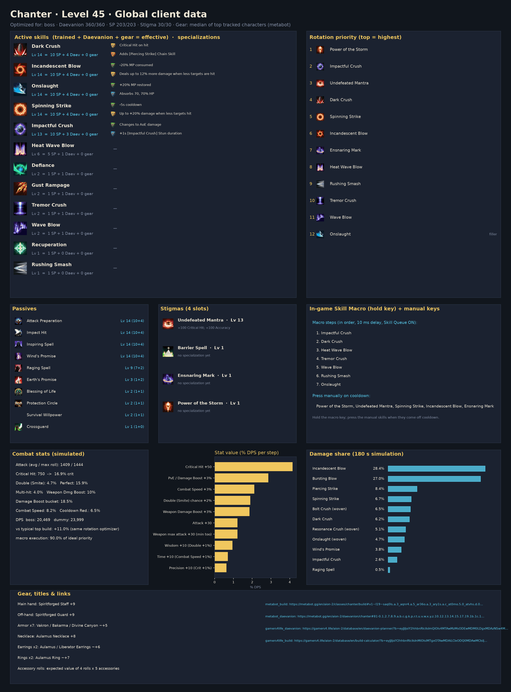
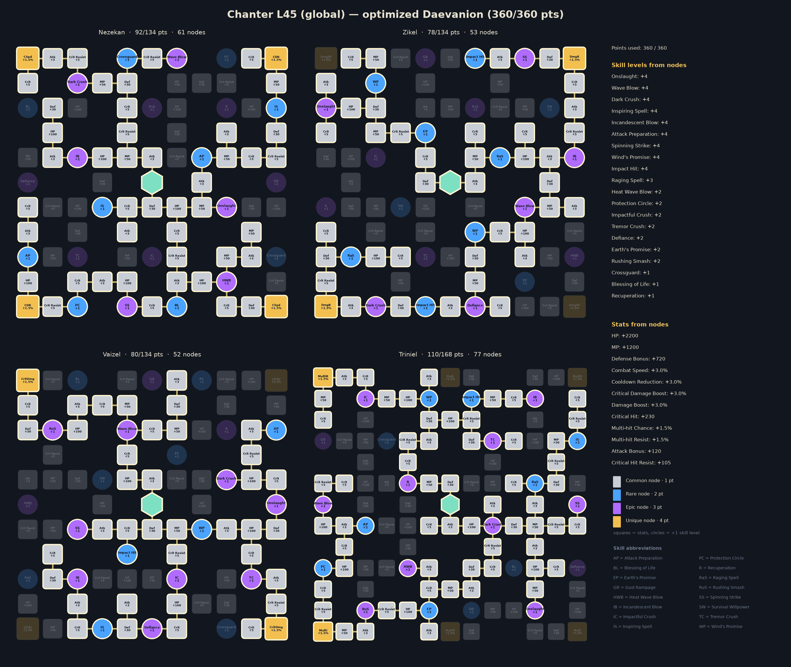
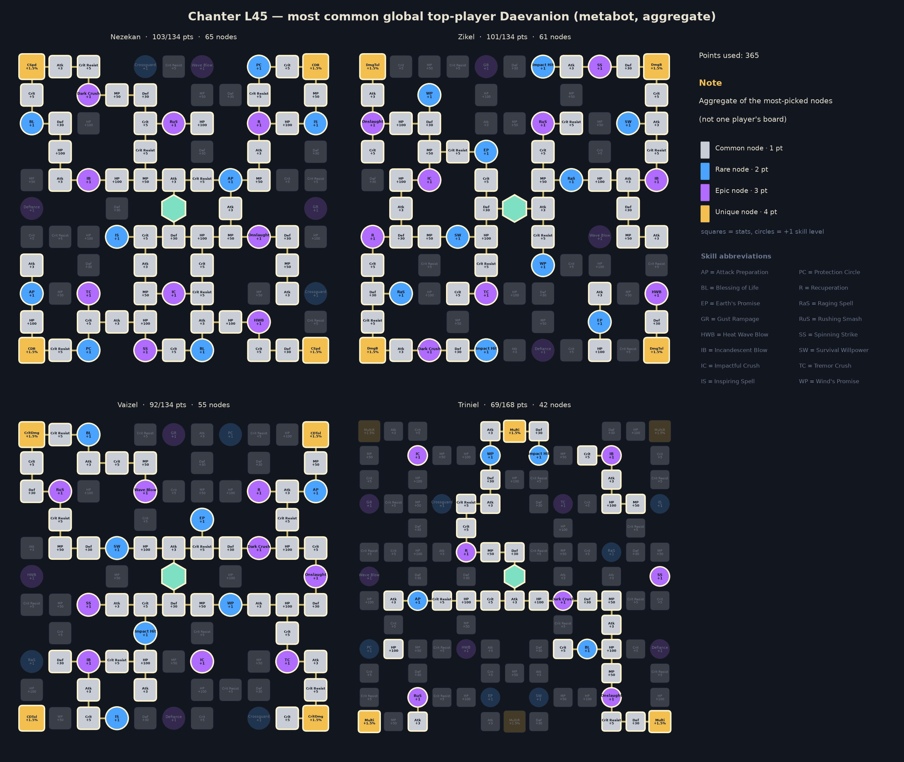

# Chanter — level 45 global build, rotation and macro

Generated by `aion2calc` from the global client data (metabot.gg) with Korean data as fallback. Primary view: **boss** fight (see `docs/methodology.md`). Daevanion budget **360** points.



## Damage objective: boss modeled DPS

Score: 20,469 modeled DPS.

boss: 100%, 180.0s, 20,469 DPS

Damage objective subject to the saved HP and trained-skill reserves. Balanced uses equal scenario weights. Stat weights follow the selected objective; skill shares, opener, macro and sensitivity remain primary-scenario views. This local search does not establish a global optimum or competitive PvP efficacy.

## Results

| Build | boss DPS | dummy DPS |
|---|---:|---:|
| **Optimized (this report)** | **20,469** | **23,999** |
| Typical top global build, optimized rotation | 18,443 | 22,154 |
| Typical top global build, default priority | 16,287 | — |

The optimized build is **+11.0%** over the typical top global build played with the same rotation optimizer, and **+25.7%** over that build played with the default priority. *Typical top global build* = average skill levels, the four most-picked damage stigmas and the most-picked Daevanion nodes of the top tracked global L45 players of this class (metabot.gg live data), given the best legal specializations for its levels (specs are not published).

## Rotation (priority list)

Use the highest skill that is ready; the last entry is the filler.

1. `stormpower`
2. `impactful_crush`
3. `undefeated`
4. `dark_crush`
5. `spinning_strike`
6. `incandescent_blow`
7. `ensnare`
8. `heat_wave_blow`
9. `rushing_smash`
10. `tremor_crush`
11. `wave_blow`
12. `onslaught`

`[sync_de]` = wait for the Delayed Explosion vulnerability window when it is about to be ready; `[in_ee]` = prefer using it inside Element Enhancement; `[mp_hi]` = only while MP is at least 60% (weave it in, keep MP for Grace of Enhancement).

### In-game Skill Macro

**Left mouse button** is the basic auto-attack: `onslaught`. Hold it for continuous attacks; the Skill Macro below goes on the **right mouse button** (or another held key). Weave both together.

Settings → Key Settings → General → Skill Macro. Skill Queue (스킬 예약) **ON**, 10 ms delay on every step, hold the macro key; manual presses always take priority over the macro.

| Step | Skill |
|---:|---|
| 1 | impactful_crush |
| 2 | dark_crush |
| 3 | heat_wave_blow |
| 4 | tremor_crush |
| 5 | wave_blow |
| 6 | rushing_smash |
| 7 | onslaught |

Manual keys (press on cooldown, in this priority): stormpower, undefeated, spinning_strike, incandescent_blow, ensnare

Simulated: this layout reaches **90.0%** of the ideal priority list.

**Alternative — one-button macro (no manual keys)**: macro stormpower → undefeated → spinning_strike → impactful_crush → dark_crush → incandescent_blow → heat_wave_blow → ensnare → wave_blow → rushing_smash → onslaught → tremor_crush. Simulated: **69.8%** of the ideal priority list.

### Opener (first 30 s of the simulated fight)

```
stormpower@0.0s → impactful_crush@1.0s → undefeated@1.3s → dark_crush@1.8s → spinning_strike@2.7s → incandescent_blow@3.1s → incandescent_blow@4.2s → incandescent_blow@5.3s → incandescent_blow@6.4s → incandescent_blow@7.5s → incandescent_blow@8.7s → incandescent_blow@9.8s → incandescent_blow@10.9s → incandescent_blow@12.0s → incandescent_blow@13.1s → incandescent_blow@14.2s → impactful_crush@15.3s → dark_crush@15.7s → incandescent_blow@16.5s → incandescent_blow@17.6s → incandescent_blow@18.8s → incandescent_blow@19.9s → incandescent_blow@21.0s → incandescent_blow@22.3s → incandescent_blow@23.6s → incandescent_blow@24.9s → spinning_strike@26.2s → dark_crush@26.7s
```

## Skills, specializations and points

Skill points used **203 / 203**, stigma points **30 / 30**, Daevanion **360 / 360**.

| Skill | Trained (SP) | Effective level | Specializations |
|---|---:|---:|---|
| Attack Preparation | 10 | 14 | — |
| Wind's Promise | 10 | 14 | — |
| Impact Hit | 10 | 14 | — |
| Onslaught | 10 | 14 | +20% MP restored; Absorbs 70, 70% HP |
| Incandescent Blow | 10 | 14 | -20% MP consumed; Deals up to 12% more damage when less targets are hit |
| Spinning Strike | 10 | 14 | -5s cooldown; Up to +20% damage when less targets hit |
| Inspiring Spell | 10 | 14 | — |
| Dark Crush | 10 | 14 | Critical Hit on hit; Adds [Piercing Strike] Chain Skill |
| Impactful Crush | 10 | 13 | Changes to AoE damage; +1s [Impactful Crush] Stun duration |
| Raging Spell | 7 | 9 | — |
| Heat Wave Blow | 5 | 6 | — |
| Earth's Promise | 1 | 3 | — |
| Wave Blow | 1 | 2 | — |
| Defiance | 1 | 2 | — |
| Blessing of Life | 1 | 2 | — |
| Gust Rampage | 1 | 2 | — |
| Protection Circle | 1 | 2 | — |
| Survival Willpower | 1 | 2 | — |
| Tremor Crush | 1 | 2 | — |

**Stigmas**: Undefeated Mantra Lv 13, Barrier Spell Lv 1, Ensnaring Mark Lv 1, Power of the Storm Lv 1

## Daevanion (360 points)



* Open in metabot planner: https://metabot.gg/en/aion-2/daevanion/chanter#81-0.1.2.7.8.9.a.b.c.g.k.p.r.t.u.v.w.x.y.z.10.12.13.14.15.17.19.1b.1c.1d.1e.1f.1i.1j.1k.1m.1o.1p.1q.1r.1s.1u.1v.1w.1x.1y.20.21.22.23.24.25.26.28.2b.2c.2e.2f.2g_82-1.2.6.7.8.a.b.c.e.f.g.h.i.j.k.m.n.p.q.r.s.t.u.v.w.x.y.10.11.12.13.14.15.16.17.19.1a.1c.1d.1g.1i.1j.1k.1n.1o.1p.1r.1u.1x.1y.1z.21.22.23.26.27.28.29.2a.2b.2c.2d_83-0.1.2.5.a.b.c.d.e.g.k.l.m.p.q.s.u.v.w.x.y.z.10.13.14.15.17.1a.1c.1d.1e.1f.1g.1h.1i.1j.1k.1l.1m.1n.1p.1s.1t.1u.1v.1w.1x.1y.1z.21.22.23.26.28.29.2a.2g_84-1.2.3.4.5.9.a.b.d.e.f.g.h.i.j.k.l.o.p.q.r.s.u.v.y.z.10.11.12.13.15.17.18.19.1b.1c.1d.1e.1f.1g.1h.1i.1k.1n.1o.1p.1r.1s.1t.1u.1v.1w.1y.20.22.23.24.25.26.27.28.29.2c.2d.2e.2g.2h.2j.2l.2m.2n.2o.2q.2u.2w.2x.2y.30.31.32.33
* Open in gamers4.life planner (KR node values, same node IDs): https://gamers4.life/aion-2/database/en/daevanion-planner/?b=eyJjIjoiY2hhbnRlciIsImQiOls4MTAwMzMsODEwMDM0LDgxMDAzNSw4MTAwNDIsODEwMDQzLDgxMDA0OCw4MTAwNTAsODEwMDUxLDgxMDA1Miw4MTAwNTgsODEwMDY3LDgxMDA3Myw4MTAwODIsODEwMDg2LDgxMDA4OCw4MTAwOTMsODEwMDk0LDgxMDA5NSw4MTAwOTYsODEwMDk3LDgxMDA5OCw4MTAxMDAsODEwMTAxLDgxMDEwMiw4MTAxMDMsODEwMTExLDgxMDExNSw4MTAxMjMsODEwMTI0LDgxMDEyNSw4MTAxMjYsODEwMTI3LDgxMDEzMCw4MTAxMzEsODEwMTMyLDgxMDEzOCw4MTAxNDIsODEwMTQ0LDgxMDE0Nyw4MTAxNTMsODEwMTU0LDgxMDE1Nyw4MTAxNTgsODEwMTU5LDgxMDE2MSw4MTAxNjIsODEwMTY4LDgxMDE3MCw4MTAxNzEsODEwMTcyLDgxMDE3NCw4MTAxNzUsODEwMTc2LDgxMDE4Myw4MTAxODcsODEwMTg4LDgxMDE5MSw4MTAxOTIsODEwMTkzLDgyMDAzNCw4MjAwMzUsODIwMDM5LDgyMDA0MCw4MjAwNDEsODIwMDQzLDgyMDA0OCw4MjAwNTAsODIwMDU1LDgyMDA1OCw4MjAwNjMsODIwMDY0LDgyMDA2NSw4MjAwNjcsODIwMDY4LDgyMDA3MCw4MjAwNzEsODIwMDczLDgyMDA3OCw4MjAwODAsODIwMDgxLDgyMDA4Miw4MjAwODQsODIwMDg2LDgyMDA4OCw4MjAwOTMsODIwMDk0LDgyMDA5Nyw4MjAwOTksODIwMTAwLDgyMDEwMSw4MjAxMDIsODIwMTAzLDgyMDEwOSw4MjAxMTIsODIwMTE0LDgyMDExNyw4MjAxMjQsODIwMTI1LDgyMDEyOSw4MjAxMzIsODIwMTMzLDgyMDEzOCw4MjAxNDQsODIwMTQ1LDgyMDE0Niw4MjAxNTMsODIwMTU2LDgyMDE1OSw4MjAxNjEsODIwMTYyLDgyMDE2OCw4MjAxNzEsODIwMTc0LDgyMDE4Myw4MjAxODQsODIwMTg1LDgyMDE4Niw4MjAxODcsODIwMTg4LDgyMDE4OSw4MjAxOTAsODMwMDMzLDgzMDAzNCw4MzAwMzUsODMwMDM5LDgzMDA0OCw4MzAwNTAsODMwMDUxLDgzMDA1Miw4MzAwNTQsODMwMDU4LDgzMDA2Nyw4MzAwNjgsODMwMDY5LDgzMDA3Miw4MzAwNzMsODMwMDgyLDgzMDA4Nyw4MzAwOTMsODMwMDk0LDgzMDA5NSw4MzAwOTYsODMwMDk3LDgzMDA5OCw4MzAxMDEsODMwMTAyLDgzMDEwMyw4MzAxMTEsODMwMTE4LDgzMDEyNCw4MzAxMjUsODMwMTI2LDgzMDEyNyw4MzAxMjgsODMwMTI5LDgzMDEzMCw4MzAxMzEsODMwMTMyLDgzMDEzMyw4MzAxMzksODMwMTQyLDgzMDE0Nyw4MzAxNTUsODMwMTU2LDgzMDE1Nyw4MzAxNTgsODMwMTU5LDgzMDE2MSw4MzAxNjIsODMwMTYzLDgzMDE3MCw4MzAxNzIsODMwMTc0LDgzMDE3OCw4MzAxODQsODMwMTg1LDgzMDE4Niw4MzAxOTMsODQwMDE4LDg0MDAxOSw4NDAwMjIsODQwMDIzLDg0MDAyNCw4NDAwMzIsODQwMDM0LDg0MDAzNSw4NDAwMzcsODQwMDM5LDg0MDA0MCw4NDAwNDEsODQwMDQyLDg0MDA0NCw4NDAwNDcsODQwMDQ5LDg0MDA1Miw4NDAwNTcsODQwMDU5LDg0MDA2Miw4NDAwNjMsODQwMDY0LDg0MDA2Niw4NDAwNjcsODQwMDcxLDg0MDA3Miw4NDAwNzMsODQwMDc0LDg0MDA3OSw4NDAwODEsODQwMDg4LDg0MDA5Myw4NDAwOTQsODQwMDk1LDg0MDA5Nyw4NDAwOTgsODQwMDk5LDg0MDEwMCw4NDAxMDEsODQwMTAyLDg0MDEwMyw4NDAxMDQsODQwMTA5LDg0MDExNSw4NDAxMTcsODQwMTE5LDg0MDEyMyw4NDAxMjQsODQwMTI1LDg0MDEyNiw4NDAxMjcsODQwMTI4LDg0MDEzMCw4NDAxMzIsODQwMTM0LDg0MDEzOCw4NDAxNDEsODQwMTQ1LDg0MDE0Nyw4NDAxNTIsODQwMTUzLDg0MDE1NCw4NDAxNTcsODQwMTU5LDg0MDE2MCw4NDAxNjIsODQwMTYzLDg0MDE2Nyw4NDAxNzIsODQwMTczLDg0MDE3NCw4NDAxNzcsODQwMTgyLDg0MDE4Nyw4NDAxOTAsODQwMTkxLDg0MDE5Miw4NDAxOTcsODQwMTk4LDg0MDE5OSw4NDAyMDJdfQ
* Full skill/stigma/Daevanion build in metabot planner: https://metabot.gg/en/aion-2/classes/chanter/build#v1~l19~saq0ls.a.3_aqnr4.a.5_ar36o.a.3_ary1s.a.c_at0mo.5.0_atvhs.d.0_aw0nk.a.5_b5nvk.a.0_b5vlc.a.0_b63b4.a.0_b6b0w.7.0_b6y68.a.0~gatvhs_az8e8_auqcw_av5sg~d81-0.1.2.7.8.9.a.b.c.g.k.p.r.t.u.v.w.x.y.z.10.12.13.14.15.17.19.1b.1c.1d.1e.1f.1i.1j.1k.1m.1o.1p.1q.1r.1s.1u.1v.1w.1x.1y.20.21.22.23.24.25.26.28.2b.2c.2e.2f.2g_82-1.2.6.7.8.a.b.c.e.f.g.h.i.j.k.m.n.p.q.r.s.t.u.v.w.x.y.10.11.12.13.14.15.16.17.19.1a.1c.1d.1g.1i.1j.1k.1n.1o.1p.1r.1u.1x.1y.1z.21.22.23.26.27.28.29.2a.2b.2c.2d_83-0.1.2.5.a.b.c.d.e.g.k.l.m.p.q.s.u.v.w.x.y.z.10.13.14.15.17.1a.1c.1d.1e.1f.1g.1h.1i.1j.1k.1l.1m.1n.1p.1s.1t.1u.1v.1w.1x.1y.1z.21.22.23.26.28.29.2a.2g_84-1.2.3.4.5.9.a.b.d.e.f.g.h.i.j.k.l.o.p.q.r.s.u.v.y.z.10.11.12.13.15.17.18.19.1b.1c.1d.1e.1f.1g.1h.1i.1k.1n.1o.1p.1r.1s.1t.1u.1v.1w.1y.20.22.23.24.25.26.27.28.29.2c.2d.2e.2g.2h.2j.2l.2m.2n.2o.2q.2u.2w.2x.2y.30.31.32.33

For comparison, the aggregate of the most-picked nodes among top global players:



## Stat priority (simulated)

| Upgrade | DPS gain | Worth in Attack |
|---|---:|---:|
| Critical Hit +50 | +4.15% | 102 |
| PvE / Damage Boost +3% | +2.86% | 70 |
| Combat Speed +3% | +2.11% | 52 |
| Double (Smite) chance +2% | +1.90% | 47 |
| Weapon Damage Boost +3% | +1.86% | 46 |
| Attack +30 | +1.22% | 30 |
| Weapon max attack +30 (min too) | +1.22% | 30 |
| Wisdom +10 (Double +1%) | +0.95% | 23 |
| Time +10 (Combat Speed +1%) | +0.70% | 17 |
| Precision +10 (Crit +1%) | +0.63% | 16 |
| Death +10 (Crit +1%) | +0.63% | 16 |
| Critical Damage Boost +3% | +0.60% | 15 |
| Penetration +300 | +0.60% | 15 |
| PvE Attack +30 | +0.60% | 15 |
| Might +10 (Attack +1%) | +0.55% | 13 |
| Destruction +10 (Attack +1%) | +0.55% | 13 |
| Cooldown Reduction +3% | +0.44% | 11 |
| Multi-hit chance +3% | +0.37% | 9 |
| Critical Attack +50 | +0.36% | 9 |
| Back Attack +30 | +0.33% | 8 |
| Illusion +10 (Cooldown -1%) | +0.15% | 4 |
| Front Attack +30 | +0.13% | 3 |
| Perfect chance +3% | +0.04% | 1 |
| Justice +10 (Perfect +1%) | +0.01% | 0 |
| MP +300 | +0.00% | 0 |
| Freedom +10 (Accuracy +1%) | +0.00% | 0 |

Accuracy is a threshold stat (avoid parries; back attacks ignore them) and is not ranked.

## Gear, rolls, enchanting

Loadout: **Global L45 Chanter - median of top tracked characters (metabot)**

* Main hand: Spiritforged Staff +9
* Off-hand: Spiritforged Guard +9
* Armor x7: Vakron / Bakarma / Divine Canyon ~+5
* Necklace: Aulamus Necklace +8
* Earrings x2: Aulamus / Liberator Earrings ~+6
* Rings x2: Aulamus Ring ~+7
* Accessory rolls: expected value of 4 rolls x 5 accessories
* Bracelets x2: Ascension +9 / Liberator +6
* Amulet: Revelation Amulet +0
* Rune: Clash Rune +2
* Attack title: Guardian of Altgard / Verteron
* Other title: Through Hell and Back
* Owned titles: collection bonuses (estimate)
* Wings: Ultimate Daeva Wings
* Primary/deity stats: profile averages

**Random-roll priority per item** (keep / reroll toward the top of each list):

* **Rupture Tome**: Combat Speed (+8.8% – +10.2%), Damage Boost (+4.9% – +5.7%), Critical Hit (+46 – +60), Weapon Damage Boost (+6.5% – +7.6%), Attack (+30 – +42)
* **Ludras Grimoire**: Combat Speed (+11.2% – +13%), Damage Boost (+6.3% – +7.3%), Critical Hit (+59 – +75), Weapon Damage Boost (+8.3% – +9.6%), Attack (+38 – +51)
* **Spiritforged Guard**: Might (+10 – +10), Accuracy (+30 – +30)
* **Vakron Helm**: Critical Hit (+25 – +36), Double Chance (+1.6% – +1.9%), Attack increase (+1.6% – +1.9%), Attack (+16 – +25), MP (+76 – +94)
* **Bakarma Breastplate**: Damage Boost (+4.4% – +5.2%), Critical Hit (+27 – +38), Attack (+18 – +28), Perfect Chance (+3.9% – +4.6%), MP (+83 – +102)
* **Aulamus Necklace**: Critical Hit (+35 – +47), Combat Speed (+3.2% – +3.8%), Attack (+23 – +33), Precision (+9 – +17), Might (+9 – +17)
* **Aulamus Ring**: Critical Hit (+25 – +36), Attack (+16 – +25), Precision (+5 – +13), Might (+5 – +13), Natural MP Regen (+18 – +28)

**Enchant priority** (DPS per enchant level):

* Weapon (Spiritforged / Rupture): 68.7 DPS/level
* Guard (off-hand): 41.6 DPS/level
* Necklace / Earrings / Rings (Aulamus): 33.3 DPS/level
* Bracelets: 25.0 DPS/level
* Revelation Amulet: 12.3 DPS/level
* Armor pieces: 0.0 DPS/level

## Titles, arcana, wings, pets

**Best titles by equip bonus** (global client values):

| Title | Grade | Equip bonus | Owned bonus |
|---|---|---|---|
| Unbound by Genus (Both factions) | Unique | PvE Damage Boost +4.5%, Attack Bonus +34, Critical Hit +68 | PvE Damage Boost +1% |
| Saint of Ereshkigal (Both factions) | Unique | PvP Damage Boost +4%, Endurance Penetration +2.5%, Critical Hit +60 | PvP Accuracy +20 |
| You're My Gem (Both factions) | Epic | Critical Hit +52, Critical Attack +39 | Natural MP Regen +5 |
| Shaking Off the World's Shackles (Both factions) | Epic | Accuracy Bonus +50, Critical Hit +50 | Penetration +20 |
| Activated the Trap Card (Elyos) | Epic | Critical Hit +42, Accuracy Bonus +42 | Accuracy Bonus +10 |
| Here I Am (Asmodian) | Epic | Critical Hit +42, Accuracy Bonus +42 | Accuracy Bonus +10 |
| Guardian of Altgard (Asmodian) | Epic | PvE Damage Boost +3%, Penetration +210 | PvE Attack +4 |
| Guardian of Verteron (Elyos) | Epic | PvE Damage Boost +3%, Penetration +210 | PvE Attack +4 |
| Executioner of Black Warrior Aed (Asmodian) | Rare | Critical Hit +38 | Accuracy Bonus +5 |
| Executioner of Neikel of the East (Elyos) | Rare | Critical Hit +38 | Accuracy Bonus +5 |

**Arcana variant per slot** (deity stat that is worth more for this build):

* Chalice / Grail: **Vigor or Frenzy** (Time +20)
* Parchment: either variant (Life +20 / Destiny +20: no damage either way)
* Compass: **Magic or Purity** (Death +20)
* Bell: **Magic or Purity** (Destruction +20)
* Mirror: **Magic or Purity** (Wisdom +20)

**Arcana skill rolls.** Each arcana gives (grade base + enhancement level) random skill levels from its slot's pool — Rare 2, Legend 3, Unique 4 base rolls, +1 per enhancement level (so a Unique +5 gives 9); a skill rolled again gains another level, up to the cap. Chalice, Parchment and Compass roll active skills; Bell and Mirror roll passives.

| Arcana slot | Expected DPS, Unique +0 (4 rolls) | Expected DPS, Unique +5 (9 rolls) | Best rolls (+1 / +2) |
|---|---:|---:|---|
| Parchment | +1.5% | +4.4% | Dark Crush +0.3% / +4.8%, Onslaught +0.3% / +0.7%, Spinning Strike +0.1% / +3.2% |
| Mirror | +1.0% | +2.3% | Inspiring Spell +0.7% / +1.4%, Impact Hit +0.3% / +0.6%, Wind's Promise +0.2% / +0.4% |
| Compass | +0.8% | +2.0% | Incandescent Blow +1.0% / +2.3%, Impactful Crush +0.2% / +0.2%, Tremor Crush +0.0% / +0.0% |
| Chalice | +0.8% | +1.9% | Incandescent Blow +1.0% / +2.3%, Inspiring Spell +0.7% / +1.4%, Attack Preparation +0.5% / +1.0% |
| Bell | +0.3% | +0.7% | Attack Preparation +0.5% / +1.0%, Raging Spell +0.0% / +0.0%, Blessing of Life +0.0% / +0.0% |

Biggest single-level jumps (usually a specialization unlocking at Lv 16): Dark Crush +4.4%, Spinning Strike +3.1%, Incandescent Blow +1.3%, Inspiring Spell +1.0%.

**Deity (pantheon) stats**, +10 points each (arcana main stats, Abyssal Bracelet rolls, Monolith rewards): Wisdom +0.95%, Time +0.70%, Death +0.63%, Might +0.55%, Destruction +0.55%, Illusion +0.15%, Justice +0.01%.

**Closet / appearance collection**: every unlocked skin and costume set adds permanent Collection Effect stats, and wings keep a Retention Effect once owned. The client tables for these are not public, so they are not itemised here; they are flat stats, so value them with the stat table above and collect the cheap ones first.

**Wings**: Ultimate Daeva Wings (Accuracy +40, Penetration +500) are the most used and the best launch option for damage among common wings. **Pets**: pet collection bonuses are mostly genus-specific (damage vs that monster genus) plus Accuracy/Crit; level the genus of the content you farm first.

## Robustness

Samples with no modeled damage are excluded from percentage losses.

Every animation time was randomly perturbed by up to ±25% (8 samples) and the rotation re-optimized each time. Playing the recommended priority instead of the re-optimized one lost on average **1.42%** (worst 2.91%).

**Crit curve.** The crit-chance curve is fitted to tests at Crit 1048–1326 and extrapolated down to launch values: this build sits at **16.9%** crit, and Crit +50 ranks #1 (+4.15%). If launch testing shows more crit — e.g. the curve shifted to a midpoint of 700, giving 60% — Crit +50 becomes #1 (+5.18%). Re-run with `--crit-midpoint` once real numbers exist.

## Validation against Korean logs

Simulated damage shares (training dummy) overlap **28%** with the mean of the top-10 A2DIL Korean dummy logs; 52% of the Korean damage comes from skills that are not in the global level-45 client. Korea plays above level 45 with Lv 16-20 specializations, so a perfect match is not expected; low values mean the class kit needs hand-tuning (see `kit/sorcerer.py` for a hand-written kit).

## Sources

* metabot.gg (global client): class skills, Daevanion boards, items, titles, top-player statistics
* gamers4.life (KR database): skill hit counts, build/Daevanion planners
* A2DIL (KR training-dummy logs): damage-share validation
* Inven / Bahamut damage research, aion2ssow calculator: damage formula

See `docs/methodology.md` for every formula and assumption.
