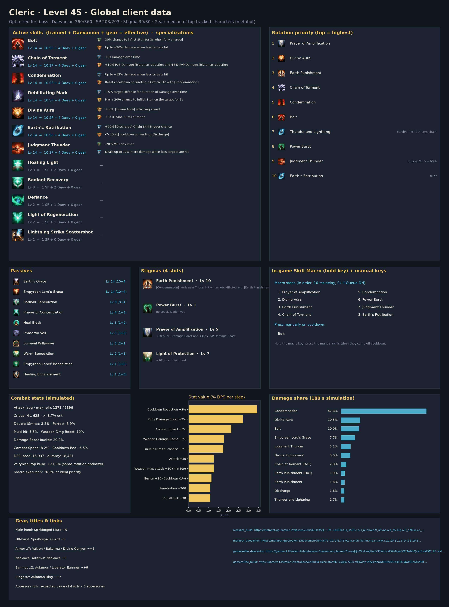
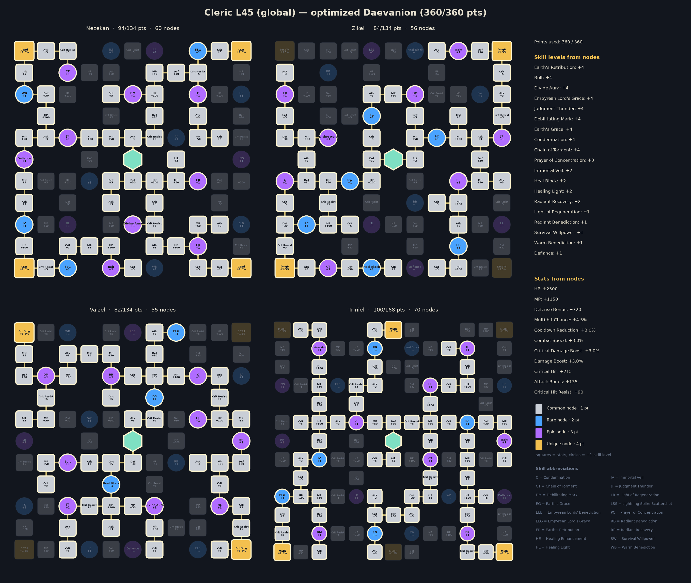
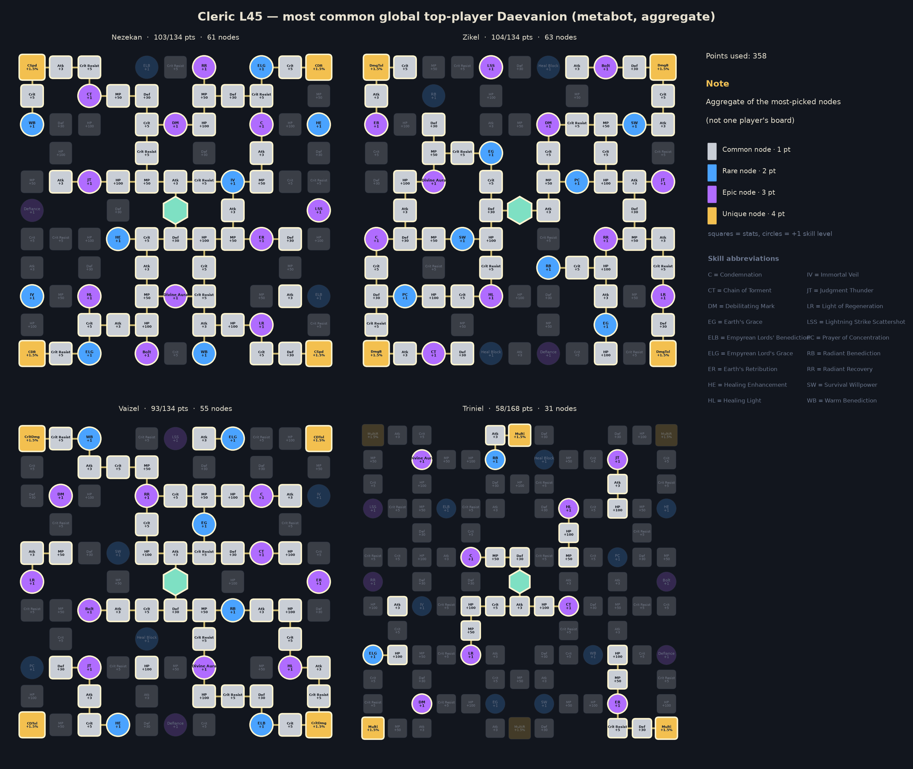

# Cleric — level 45 global build, rotation and macro

Generated by `aion2calc` from the global client data (metabot.gg) with Korean data as fallback. Primary view: **boss** fight (see `docs/methodology.md`). Daevanion budget **360** points.



## Damage objective: boss modeled DPS

Score: 15,937 modeled DPS.

boss: 100%, 180.0s, 15,937 DPS

Damage objective subject to the saved HP and trained-skill reserves. Balanced uses equal scenario weights. Stat weights follow the selected objective; skill shares, opener, macro and sensitivity remain primary-scenario views. This local search does not establish a global optimum or competitive PvP efficacy.

## Results

| Build | boss DPS | dummy DPS |
|---|---:|---:|
| **Optimized (this report)** | **15,937** | **18,431** |
| Typical top global build, optimized rotation | 12,137 | 13,615 |
| Typical top global build, default priority | 11,861 | — |

The optimized build is **+31.3%** over the typical top global build played with the same rotation optimizer, and **+34.4%** over that build played with the default priority. *Typical top global build* = average skill levels, the four most-picked damage stigmas and the most-picked Daevanion nodes of the top tracked global L45 players of this class (metabot.gg live data), given the best legal specializations for its levels (specs are not published).

## Rotation (priority list)

Use the highest skill that is ready; the last entry is the filler.

1. `prayamp`
2. `divine_aura`
3. `epunish`
4. `chain_of_torment`
5. `condemnation`
6. `bolt`
7. `thunder_and_lightning`
8. `powerburst`
9. `judgment_thunder [mp_hi]`
10. `earths_retribution`

`[sync_de]` = wait for the Delayed Explosion vulnerability window when it is about to be ready; `[in_ee]` = prefer using it inside Element Enhancement; `[mp_hi]` = only while MP is at least 60% (weave it in, keep MP for Grace of Enhancement).

### In-game Skill Macro

**Left mouse button** is the basic auto-attack: `earths_retribution`. Hold it for continuous attacks; the Skill Macro below goes on the **right mouse button** (or another held key). Weave both together.

Settings → Key Settings → General → Skill Macro. Skill Queue (스킬 예약) **ON**, 10 ms delay on every step, hold the macro key; manual presses always take priority over the macro.

| Step | Skill |
|---:|---|
| 1 | chain_of_torment |
| 2 | condemnation |
| 3 | judgment_thunder |
| 4 | earths_retribution |

Manual keys (press on cooldown, in this priority): prayamp, divine_aura, epunish, bolt, thunder_and_lightning, powerburst

Simulated: this layout reaches **74.4%** of the ideal priority list.

**Alternative — macro with manual keys**: macro divine_aura → epunish → prayamp → chain_of_torment → thunder_and_lightning → condemnation → earths_retribution → powerburst → judgment_thunder; manual: bolt. Simulated: **71.2%** of the ideal priority list.

### Opener (first 30 s of the simulated fight)

```
prayamp@0.0s → divine_aura@0.7s → epunish@1.3s → chain_of_torment@2.0s → condemnation@2.6s → condemnation@3.2s → condemnation@3.7s → condemnation@4.2s → condemnation@4.8s → condemnation@5.3s → condemnation@5.8s → condemnation@6.3s → condemnation@6.9s → condemnation@7.4s → condemnation@7.9s → condemnation@8.5s → condemnation@9.0s → condemnation@9.5s → condemnation@10.0s → condemnation@10.6s → condemnation@11.1s → condemnation@11.6s → bolt@12.2s → powerburst@13.7s → judgment_thunder@14.4s → earths_retribution@15.2s → thunder_and_lightning@16.4s → judgment_thunder@16.9s
```

## Skills, specializations and points

Skill points used **203 / 203**, stigma points **30 / 30**, Daevanion **360 / 360**.

| Skill | Trained (SP) | Effective level | Specializations |
|---|---:|---:|---|
| Condemnation | 10 | 14 | Up to +12% damage when less targets hit; Resets cooldown on landing a Critical Hit with [Condemnation] |
| Earth's Grace | 10 | 14 | — |
| Debilitating Mark | 10 | 14 | -15% target Defense for duration of Damage over Time; Has a 20% chance to inflict Stun on the target for 3s |
| Chain of Torment | 10 | 14 | +3s Damage over Time; +10% PvE Damage Tolerance reduction and +5% PvP Damage Tolerance reduction |
| Empyrean Lord's Grace | 10 | 14 | — |
| Judgment Thunder | 10 | 14 | -20% MP consumed; Deals up to 12% more damage when less targets are hit |
| Bolt | 10 | 14 | 30% chance to inflict Stun for 3s when fully charged; Up to +20% damage when less targets hit |
| Earth's Retribution | 10 | 14 | +20% [Discharge] Chain Skill trigger chance; -7s [Bolt] cooldown on landing [Discharge] |
| Divine Aura | 10 | 14 | +50% [Divine Aura] attacking speed; +3s [Divine Aura] duration |
| Radiant Benediction | 8 | 9 | — |
| Prayer of Concentration | 1 | 4 | — |
| Healing Light | 1 | 3 | — |
| Immortal Veil | 1 | 3 | — |
| Heal Block | 1 | 3 | — |
| Radiant Recovery | 1 | 3 | — |
| Survival Willpower | 2 | 3 | — |
| Defiance | 1 | 2 | — |
| Light of Regeneration | 1 | 2 | — |
| Warm Benediction | 1 | 2 | — |

**Stigmas**: Earth Punishment Lv 10, Power Burst Lv 1, Prayer of Amplification Lv 5, Light of Protection Lv 7

## Daevanion (360 points)



* Open in metabot planner: https://metabot.gg/en/aion-2/daevanion/cleric#71-0.1.2.6.7.8.9.a.d.e.f.h.i.k.l.m.n.q.s.t.v.w.x.y.z.10.11.13.14.16.19.1b.1f.1g.1h.1i.1j.1m.1o.1p.1r.1v.1w.1x.1y.20.21.22.23.24.25.26.28.29.2a.2b.2c.2e.2f.2g_72-7.8.9.a.b.f.g.j.k.l.p.q.t.u.v.w.x.y.z.10.11.12.13.14.15.16.17.19.1a.1b.1c.1d.1e.1f.1h.1i.1j.1k.1l.1o.1p.1r.1s.1t.1u.1y.21.24.26.27.28.29.2a.2b.2d.2e_73-0.5.6.a.b.c.d.e.h.i.j.k.l.m.n.o.p.r.s.t.u.v.w.10.11.13.14.15.1a.1c.1d.1e.1f.1g.1j.1k.1l.1m.1n.1p.1s.1t.1u.1v.1w.1y.1z.21.22.23.26.29.2d.2f.2g_74-1.2.3.4.a.d.g.h.k.l.o.s.u.v.x.y.z.12.13.14.17.18.19.1a.1b.1c.1d.1e.1f.1g.1h.1i.1k.1n.1o.1p.1r.1s.1v.1w.1y.20.22.23.25.26.27.28.29.2c.2d.2e.2g.2h.2j.2k.2l.2m.2n.2o.2q.2r.2u.2y.30.32.33.36.37.38
* Open in gamers4.life planner (KR node values, same node IDs): https://gamers4.life/aion-2/database/en/daevanion-planner/?b=eyJjIjoiY2xlcmljIiwiZCI6WzcxMDAzMyw3MTAwMzQsNzEwMDM1LDcxMDA0MSw3MTAwNDIsNzEwMDQzLDcxMDA0OCw3MTAwNTAsNzEwMDU0LDcxMDA1NSw3MTAwNTYsNzEwMDYzLDcxMDA2NCw3MTAwNjcsNzEwMDY4LDcxMDA2OSw3MTAwNzEsNzEwMDc5LDcxMDA4NCw3MTAwODYsNzEwMDkzLDcxMDA5NCw3MTAwOTUsNzEwMDk2LDcxMDA5Nyw3MTAwOTgsNzEwMDk5LDcxMDEwMSw3MTAxMDIsNzEwMTA4LDcxMDExNSw3MTAxMjMsNzEwMTI3LDcxMDEyOCw3MTAxMjksNzEwMTMwLDcxMDEzMSw3MTAxMzgsNzEwMTQyLDcxMDE0NCw3MTAxNTMsNzEwMTU4LDcxMDE1OSw3MTAxNjEsNzEwMTYyLDcxMDE2OCw3MTAxNzAsNzEwMTcxLDcxMDE3Miw3MTAxNzQsNzEwMTc1LDcxMDE3Niw3MTAxODMsNzEwMTg0LDcxMDE4NSw3MTAxODcsNzEwMTg4LDcxMDE5MSw3MTAxOTIsNzEwMTkzLDcyMDA0MCw3MjAwNDEsNzIwMDQyLDcyMDA0Myw3MjAwNDgsNzIwMDU4LDcyMDA2Myw3MjAwNjcsNzIwMDY4LDcyMDA2OSw3MjAwNzMsNzIwMDc4LDcyMDA4Miw3MjAwODQsNzIwMDg2LDcyMDA4OCw3MjAwOTMsNzIwMDk0LDcyMDA5NSw3MjAwOTcsNzIwMDk5LDcyMDEwMCw3MjAxMDEsNzIwMTAyLDcyMDEwMyw3MjAxMDksNzIwMTEyLDcyMDExNCw3MjAxMTcsNzIwMTIzLDcyMDEyNCw3MjAxMjUsNzIwMTI2LDcyMDEyNyw3MjAxMzEsNzIwMTMyLDcyMDEzMyw3MjAxMzgsNzIwMTQwLDcyMDE0NSw3MjAxNDYsNzIwMTUzLDcyMDE1NCw3MjAxNTUsNzIwMTU2LDcyMDE2MSw3MjAxNjgsNzIwMTc2LDcyMDE4Myw3MjAxODQsNzIwMTg1LDcyMDE4Niw3MjAxODcsNzIwMTg4LDcyMDE5MCw3MjAxOTEsNzMwMDMzLDczMDAzOSw3MzAwNDAsNzMwMDQ4LDczMDA1MCw3MzAwNTEsNzMwMDUyLDczMDA1NCw3MzAwNjMsNzMwMDY0LDczMDA2NSw3MzAwNjcsNzMwMDY4LDczMDA2OSw3MzAwNzAsNzMwMDcxLDczMDA3Miw3MzAwNzksNzMwMDgyLDczMDA4NCw3MzAwODcsNzMwMDkzLDczMDA5NCw3MzAwOTgsNzMwMDk5LDczMDEwMSw3MzAxMDIsNzMwMTAzLDczMDExOCw3MzAxMjQsNzMwMTI1LDczMDEyNiw3MzAxMjcsNzMwMTI4LDczMDEzMSw3MzAxMzIsNzMwMTMzLDczMDEzOSw3MzAxNDIsNzMwMTQ3LDczMDE1NSw3MzAxNTYsNzMwMTU3LDczMDE1OCw3MzAxNTksNzMwMTYyLDczMDE2Myw3MzAxNzAsNzMwMTcyLDczMDE3NCw3MzAxNzgsNzMwMTg1LDczMDE4OSw3MzAxOTIsNzMwMTkzLDc0MDAxOCw3NDAwMTksNzQwMDIyLDc0MDAyMyw3NDAwMzQsNzQwMDM3LDc0MDA0MSw3NDAwNDIsNzQwMDQ5LDc0MDA1Miw3NDAwNTcsNzQwMDY0LDc0MDA2Niw3NDAwNjcsNzQwMDcwLDc0MDA3MSw3NDAwNzIsNzQwMDc5LDc0MDA4MSw3NDAwODUsNzQwMDkzLDc0MDA5NCw3NDAwOTUsNzQwMDk2LDc0MDA5Nyw3NDAwOTgsNzQwMDk5LDc0MDEwMCw3NDAxMDEsNzQwMTAyLDc0MDEwMyw3NDAxMDQsNzQwMTA5LDc0MDExNSw3NDAxMTcsNzQwMTE5LDc0MDEyMyw3NDAxMjQsNzQwMTI3LDc0MDEyOCw3NDAxMzAsNzQwMTMyLDc0MDEzNCw3NDAxMzgsNzQwMTQ1LDc0MDE0Nyw3NDAxNTIsNzQwMTUzLDc0MDE1NCw3NDAxNTcsNzQwMTU5LDc0MDE2MCw3NDAxNjIsNzQwMTYzLDc0MDE2Nyw3NDAxNjksNzQwMTcyLDc0MDE3Myw3NDAxNzQsNzQwMTc3LDc0MDE4Miw3NDAxODQsNzQwMTg3LDc0MDE5Miw3NDAxOTcsNzQwMTk5LDc0MDIwMiw3NDAyMDcsNzQwMjA4LDc0MDIwOV19
* Full skill/stigma/Daevanion build in metabot planner: https://metabot.gg/en/aion-2/classes/cleric/build#v1~l19~sa4l00.a.a_a585c.a.3_a5nkw.a.9_a5vao.a.a_a630g.a.6_a7l0w.a.c_abvcg.a.a_acxxc.a.0_ad5n4.7.0_adl2o.5.0_ak0k0.a.0_al34w.a.0_alauo.2.0_alikg.8.0~gacxxc_aadc0_adl2o_ad5n4~d71-0.1.2.6.7.8.9.a.d.e.f.h.i.k.l.m.n.q.s.t.v.w.x.y.z.10.11.13.14.16.19.1b.1f.1g.1h.1i.1j.1m.1o.1p.1r.1v.1w.1x.1y.20.21.22.23.24.25.26.28.29.2a.2b.2c.2e.2f.2g_72-7.8.9.a.b.f.g.j.k.l.p.q.t.u.v.w.x.y.z.10.11.12.13.14.15.16.17.19.1a.1b.1c.1d.1e.1f.1h.1i.1j.1k.1l.1o.1p.1r.1s.1t.1u.1y.21.24.26.27.28.29.2a.2b.2d.2e_73-0.5.6.a.b.c.d.e.h.i.j.k.l.m.n.o.p.r.s.t.u.v.w.10.11.13.14.15.1a.1c.1d.1e.1f.1g.1j.1k.1l.1m.1n.1p.1s.1t.1u.1v.1w.1y.1z.21.22.23.26.29.2d.2f.2g_74-1.2.3.4.a.d.g.h.k.l.o.s.u.v.x.y.z.12.13.14.17.18.19.1a.1b.1c.1d.1e.1f.1g.1h.1i.1k.1n.1o.1p.1r.1s.1v.1w.1y.20.22.23.25.26.27.28.29.2c.2d.2e.2g.2h.2j.2k.2l.2m.2n.2o.2q.2r.2u.2y.30.32.33.36.37.38

For comparison, the aggregate of the most-picked nodes among top global players:



## Stat priority (simulated)

| Upgrade | DPS gain | Worth in Attack |
|---|---:|---:|
| Cooldown Reduction +3% | +3.42% | 82 |
| PvE / Damage Boost +3% | +2.72% | 65 |
| Combat Speed +3% | +2.13% | 51 |
| Weapon Damage Boost +3% | +1.77% | 42 |
| Double (Smite) chance +2% | +1.74% | 41 |
| Attack +30 | +1.26% | 30 |
| Weapon max attack +30 (min too) | +1.26% | 30 |
| Illusion +10 (Cooldown -1%) | +1.14% | 27 |
| Penetration +300 | +1.08% | 26 |
| PvE Attack +30 | +1.08% | 26 |
| Wisdom +10 (Double +1%) | +0.87% | 21 |
| Critical Damage Boost +3% | +0.86% | 20 |
| Time +10 (Combat Speed +1%) | +0.71% | 17 |
| Might +10 (Attack +1%) | +0.50% | 12 |
| Destruction +10 (Attack +1%) | +0.50% | 12 |
| Critical Attack +50 | +0.48% | 12 |
| Multi-hit chance +3% | +0.35% | 8 |
| Front Attack +30 | +0.23% | 6 |
| Back Attack +30 | +0.21% | 5 |
| Precision +10 (Crit +1%) | +0.11% | 3 |
| Death +10 (Crit +1%) | +0.11% | 3 |
| Perfect chance +3% | +0.02% | 1 |
| Justice +10 (Perfect +1%) | +0.01% | 0 |
| MP +300 | +0.00% | 0 |
| Freedom +10 (Accuracy +1%) | +0.00% | 0 |
| Critical Hit +50 | -1.55% | -37 |

Accuracy is a threshold stat (avoid parries; back attacks ignore them) and is not ranked.

## Gear, rolls, enchanting

Loadout: **Global L45 Cleric - median of top tracked characters (metabot)**

* Main hand: Spiritforged Mace +9
* Off-hand: Spiritforged Guard +9
* Armor x7: Vakron / Bakarma / Divine Canyon ~+5
* Necklace: Aulamus Necklace +8
* Earrings x2: Aulamus / Liberator Earrings ~+6
* Rings x2: Aulamus Ring ~+7
* Accessory rolls: expected value of 4 rolls x 5 accessories
* Bracelets x2: Ascension +9 / Liberator +6
* Amulet: Revelation Amulet +0
* Rune: Clash Rune +2
* Attack title: Guardian of Altgard / Verteron
* Other title: Through Hell and Back
* Owned titles: collection bonuses (estimate)
* Wings: Ultimate Daeva Wings
* Primary/deity stats: profile averages

**Random-roll priority per item** (keep / reroll toward the top of each list):

* **Rupture Tome**: Combat Speed (+8.8% – +10.2%), Damage Boost (+4.9% – +5.7%), Weapon Damage Boost (+6.5% – +7.6%), Attack (+30 – +42), Might (+17 – +27)
* **Ludras Grimoire**: Combat Speed (+11.2% – +13%), Damage Boost (+6.3% – +7.3%), Weapon Damage Boost (+8.3% – +9.6%), Attack (+38 – +51), Might (+22 – +32)
* **Spiritforged Guard**: Might (+10 – +10), Accuracy (+30 – +30)
* **Vakron Helm**: Double Chance (+1.6% – +1.9%), Attack increase (+1.6% – +1.9%), Attack (+16 – +25), MP (+76 – +94), Natural MP Regen (+18 – +28)
* **Bakarma Breastplate**: Damage Boost (+4.4% – +5.2%), Attack (+18 – +28), Perfect Chance (+3.9% – +4.6%), MP (+83 – +102), Natural MP Regen (+20 – +30)
* **Aulamus Necklace**: Combat Speed (+3.2% – +3.8%), Attack (+23 – +33), Might (+9 – +17), Precision (+9 – +17), Natural MP Regen (+25 – +36)
* **Aulamus Ring**: Attack (+16 – +25), Might (+5 – +13), Precision (+5 – +13), Natural MP Regen (+18 – +28), MP (+76 – +94)

**Enchant priority** (DPS per enchant level):

* Weapon (Spiritforged / Rupture): 55.2 DPS/level
* Guard (off-hand): 33.4 DPS/level
* Necklace / Earrings / Rings (Aulamus): 26.8 DPS/level
* Bracelets: 20.1 DPS/level
* Revelation Amulet: 17.2 DPS/level
* Armor pieces: 0.0 DPS/level

## Titles, arcana, wings, pets

**Best titles by equip bonus** (global client values):

| Title | Grade | Equip bonus | Owned bonus |
|---|---|---|---|
| Empty Closet (Both factions) | Unique | Combat Speed +3.5%, Natural HP Regen +42, Cooldown Reduction +3.5% | HP +120 |
| Guardian of Altgard (Asmodian) | Epic | PvE Damage Boost +3%, Penetration +210 | PvE Attack +4 |
| Guardian of Verteron (Elyos) | Epic | PvE Damage Boost +3%, Penetration +210 | PvE Attack +4 |
| Through Hell and Back (Both factions) | Unique | Cooldown Reduction +3%, HP +900, Stamina +225 | Block +10 |
| Unbound by Genus (Both factions) | Unique | PvE Damage Boost +4.5%, Attack Bonus +34, Critical Hit +68 | PvE Damage Boost +1% |
| Scenery Collector (Both factions) | Epic | PvE Damage Boost +3.3%, Block Penetration +54 | Critical Hit +10 |
| Teleportation Specialist (Both factions) | Epic | PvE Accuracy +58, PvE Damage Boost +3.1% | Critical Hit +10 |
| Nice to Meet You (Both factions) | Rare | PvE Damage Boost +2.9% | PvE Defense +10 |
| Verteron Seal Breaker (Both factions) | Rare | Boss Damage Boost +2.7% | PvE Accuracy +10 |
| A Whale in a Shrimp Fight (Elyos) | Epic | Cooldown Reduction +2%, Out-of-Combat Natural MP Regen +62 | Attack Bonus +2 |

**Arcana variant per slot** (deity stat that is worth more for this build):

* Chalice / Grail: **Vigor or Frenzy** (Time +20)
* Parchment: either variant (Life +20 / Destiny +20: no damage either way)
* Compass: **Magic or Purity** (Death +20)
* Bell: **Magic or Purity** (Destruction +20)
* Mirror: **Vigor or Frenzy** (Illusion +20)

**Arcana skill rolls.** Each arcana gives (grade base + enhancement level) random skill levels from its slot's pool — Rare 2, Legend 3, Unique 4 base rolls, +1 per enhancement level (so a Unique +5 gives 9); a skill rolled again gains another level, up to the cap. Chalice, Parchment and Compass roll active skills; Bell and Mirror roll passives.

| Arcana slot | Expected DPS, Unique +0 (4 rolls) | Expected DPS, Unique +5 (9 rolls) | Best rolls (+1 / +2) |
|---|---:|---:|---|
| Parchment | +2.0% | +5.9% | Condemnation +1.0% / +1.9%, Bolt +0.2% / +6.7%, Earth's Retribution +0.1% / +0.2% |
| Chalice | +0.5% | +1.5% | Condemnation +1.0% / +1.9%, Empyrean Lord's Grace +0.4% / +0.1%, Divine Aura +0.2% / +0.4% |
| Compass | +0.2% | +0.5% | Divine Aura +0.2% / +0.4%, Judgment Thunder +0.1% / +0.3%, Light of Regeneration +0.0% / +0.0% |
| Bell | +0.2% | +0.3% | Empyrean Lord's Grace +0.4% / +0.1%, Warm Benediction +0.0% / +0.0%, Immortal Veil +0.0% / +0.0% |
| Mirror | +0.1% | +0.3% | Earth's Grace +0.1% / +0.3%, Empyrean Lords' Benediction +0.0% / +0.0%, Healing Enhancement +0.0% / +0.0% |

Biggest single-level jumps (usually a specialization unlocking at Lv 16): Bolt +6.5%, Debilitating Mark +2.3%, Condemnation +1.0%, Empyrean Lord's Grace +0.4%.

**Deity (pantheon) stats**, +10 points each (arcana main stats, Abyssal Bracelet rolls, Monolith rewards): Illusion +1.14%, Wisdom +0.87%, Time +0.71%, Might +0.50%, Destruction +0.50%, Death +0.11%, Justice +0.01%.

**Closet / appearance collection**: every unlocked skin and costume set adds permanent Collection Effect stats, and wings keep a Retention Effect once owned. The client tables for these are not public, so they are not itemised here; they are flat stats, so value them with the stat table above and collect the cheap ones first.

**Wings**: Ultimate Daeva Wings (Accuracy +40, Penetration +500) are the most used and the best launch option for damage among common wings. **Pets**: pet collection bonuses are mostly genus-specific (damage vs that monster genus) plus Accuracy/Crit; level the genus of the content you farm first.

## Robustness

Samples with no modeled damage are excluded from percentage losses.

Every animation time was randomly perturbed by up to ±25% (8 samples) and the rotation re-optimized each time. Playing the recommended priority instead of the re-optimized one lost on average **3.00%** (worst 5.30%).

**Crit curve.** The crit-chance curve is fitted to tests at Crit 1048–1326 and extrapolated down to launch values: this build sits at **8.7%** crit, and Crit +50 ranks #26 (-1.55%). If launch testing shows more crit — e.g. the curve shifted to a midpoint of 700, giving 41% — Crit +50 becomes #2 (+2.94%). Re-run with `--crit-midpoint` once real numbers exist.

## Validation against Korean logs

Simulated damage shares (training dummy) overlap **72%** with the mean of the top-10 A2DIL Korean dummy logs; 11% of the Korean damage comes from skills that are not in the global level-45 client. Korea plays above level 45 with Lv 16-20 specializations, so a perfect match is not expected; low values mean the class kit needs hand-tuning (see `kit/sorcerer.py` for a hand-written kit).

## Sources

* metabot.gg (global client): class skills, Daevanion boards, items, titles, top-player statistics
* gamers4.life (KR database): skill hit counts, build/Daevanion planners
* A2DIL (KR training-dummy logs): damage-share validation
* Inven / Bahamut damage research, aion2ssow calculator: damage formula

See `docs/methodology.md` for every formula and assumption.
