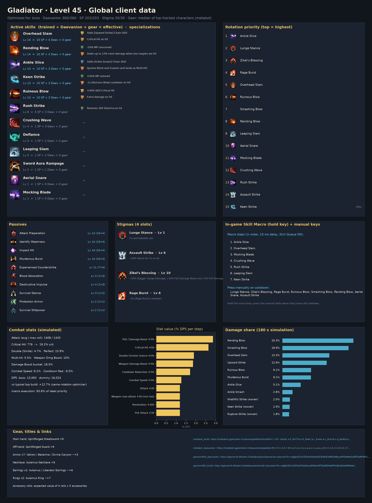
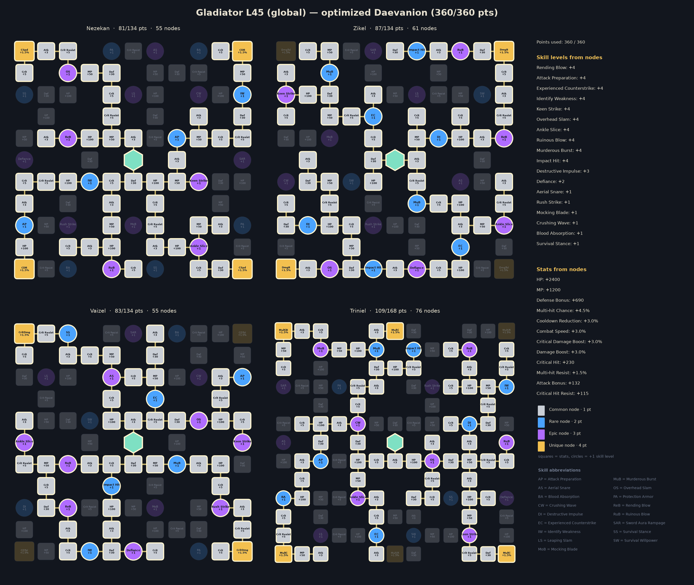
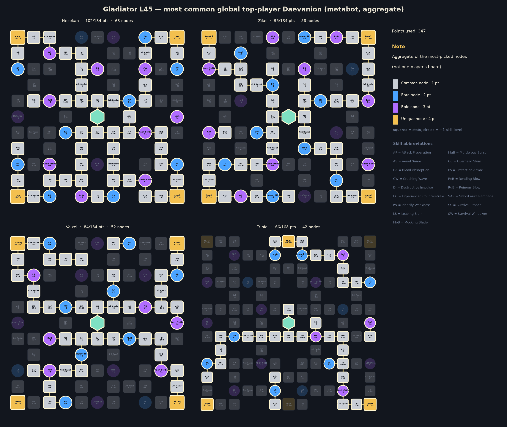

# Gladiator — level 45 global build, rotation and macro

Generated by `aion2calc` from the global client data (metabot.gg) with Korean data as fallback. Primary view: **boss** fight (see `docs/methodology.md`). Daevanion budget **360** points.



## Damage objective: boss modeled DPS

Score: 19,473 modeled DPS.

boss: 100%, 180.0s, 19,473 DPS

Damage objective subject to the saved HP and trained-skill reserves. Balanced uses equal scenario weights. Stat weights follow the selected objective; skill shares, opener, macro and sensitivity remain primary-scenario views. This local search does not establish a global optimum or competitive PvP efficacy.

## Results

| Build | boss DPS | dummy DPS |
|---|---:|---:|
| **Optimized (this report)** | **19,473** | **23,877** |
| Typical top global build, optimized rotation | 16,679 | 20,563 |
| Typical top global build, default priority | 14,669 | — |

The optimized build is **+16.7%** over the typical top global build played with the same rotation optimizer, and **+32.7%** over that build played with the default priority. *Typical top global build* = average skill levels, the four most-picked damage stigmas and the most-picked Daevanion nodes of the top tracked global L45 players of this class (metabot.gg live data), given the best legal specializations for its levels (specs are not published).

## Rotation (priority list)

Use the highest skill that is ready; the last entry is the filler.

1. `overhead_slam`
2. `ankle_slice`
3. `lunge`
4. `zikel`
5. `rage`
6. `ruinous_blow`
7. `basic_combo`
8. `rending_blow`
9. `aerial_snare`
10. `leaping_slam`
11. `mocking_blade`
12. `rush_strike`
13. `crushing_wave`
14. `keen_strike`

`[sync_de]` = wait for the Delayed Explosion vulnerability window when it is about to be ready; `[in_ee]` = prefer using it inside Element Enhancement; `[mp_hi]` = only while MP is at least 60% (weave it in, keep MP for Grace of Enhancement).

### In-game Skill Macro

**Left mouse button** is the basic auto-attack: `keen_strike`. Hold it for continuous attacks; the Skill Macro below goes on the **right mouse button** (or another held key). Weave both together.

Settings → Key Settings → General → Skill Macro. Skill Queue (스킬 예약) **ON**, 10 ms delay on every step, hold the macro key; manual presses always take priority over the macro.

| Step | Skill |
|---:|---|
| 1 | ankle_slice |
| 2 | lunge |
| 3 | overhead_slam |
| 4 | zikel |
| 5 | rage |
| 6 | basic_combo |
| 7 | rending_blow |
| 8 | ruinous_blow |
| 9 | aerial_snare |
| 10 | mocking_blade |
| 11 | leaping_slam |
| 12 | crushing_wave |
| 13 | keen_strike |
| 14 | rush_strike |

Manual keys (press on cooldown, in this priority): none — hold the macro key for the whole fight

Simulated: this layout reaches **89.7%** of the ideal priority list.

**Alternative — macro with manual keys**: macro overhead_slam → leaping_slam → ankle_slice → mocking_blade → rush_strike → crushing_wave → keen_strike; manual: lunge, zikel, rage, ruinous_blow, basic_combo, rending_blow, aerial_snare. Simulated: **82.9%** of the ideal priority list.

### Opener (first 30 s of the simulated fight)

```
overhead_slam@0.0s → ankle_slice@0.5s → lunge@1.4s → zikel@1.6s → rage@1.8s → ruinous_blow@1.9s → rending_blow@2.3s → basic_combo@2.6s → rending_blow@3.0s → basic_combo@3.4s → rending_blow@3.8s → basic_combo@4.1s → rending_blow@4.5s → overhead_slam@4.9s → basic_combo@5.3s → rending_blow@5.6s → basic_combo@6.0s → rending_blow@6.4s → basic_combo@6.8s → rending_blow@7.1s → basic_combo@7.5s → rending_blow@7.8s → basic_combo@8.2s → rending_blow@8.6s → basic_combo@9.0s → rending_blow@9.3s → overhead_slam@9.7s → ankle_slice@10.1s
```

## Skills, specializations and points

Skill points used **203 / 203**, stigma points **30 / 30**, Daevanion **360 / 360**.

| Skill | Trained (SP) | Effective level | Specializations |
|---|---:|---:|---|
| Keen Strike | 10 | 14 | +20% MP restored; Absorbs 100, 100% HP |
| Ruinous Blow | 10 | 14 | +30% Skill Critical Hit; Extra damage on hit |
| Identify Weakness | 10 | 14 | — |
| Impact Hit | 10 | 14 | — |
| Rending Blow | 10 | 14 | -20% MP consumed; Deals up to 12% more damage when less targets are hit |
| Attack Preparation | 10 | 14 | — |
| Murderous Burst | 10 | 14 | — |
| Overhead Slam | 10 | 14 | Adds [Upward Strike] Chain Skill; Critical Hit on hit |
| Ankle Slice | 8 | 12 | Adds [Ankle Smash] Chain Skill; Ignores Block and Evasion and lands as Multi-Hit |
| Experienced Counterstrike | 8 | 12 | — |
| Destructive Impulse | 7 | 10 | — |
| Defiance | 1 | 3 | — |
| Aerial Snare | 1 | 2 | — |
| Survival Stance | 1 | 2 | — |
| Crushing Wave | 1 | 2 | — |
| Blood Absorption | 1 | 2 | — |
| Mocking Blade | 1 | 2 | — |
| Rush Strike | 1 | 2 | — |

**Stigmas**: Lunge Stance Lv 3, Tenaciousness Lv 1, Zikel's Blessing Lv 10, Rage Burst Lv 8

## Daevanion (360 points)



* Open in metabot planner: https://metabot.gg/en/aion-2/daevanion/gladiator#11-0.1.2.7.8.9.a.b.c.g.k.p.r.t.u.w.x.y.z.10.12.13.14.15.19.1b.1c.1d.1e.1f.1g.1h.1i.1j.1m.1o.1p.1r.1u.1w.1x.1y.20.21.22.23.24.25.26.28.2b.2c.2e.2f.2g_12-1.2.5.6.7.8.9.a.b.c.f.g.h.i.j.p.q.r.s.t.u.v.w.10.11.12.13.14.15.16.17.19.1c.1d.1f.1g.1j.1k.1l.1n.1o.1p.1q.1r.1s.1t.1u.1y.1z.20.22.24.26.27.28.29.2a.2b.2c.2d.2e_13-0.1.2.5.a.b.c.d.e.k.l.m.p.q.s.t.u.v.z.10.11.12.13.14.15.16.1a.1b.1c.1d.1e.1f.1g.1h.1i.1j.1k.1m.1n.1p.1r.1s.1u.1y.1z.21.22.26.29.2a.2b.2c.2d.2f.2g_14-0.1.2.3.4.9.a.b.c.d.e.g.h.i.j.l.m.n.o.p.u.v.y.z.10.11.13.15.17.18.19.1a.1f.1g.1h.1k.1l.1n.1o.1p.1r.1s.1u.1v.1w.1x.1y.1z.20.21.22.23.24.25.26.27.28.2b.2c.2d.2e.2g.2h.2j.2l.2o.2q.2u.2y.30.31.32.33.36.37.38
* Open in gamers4.life planner (KR node values, same node IDs): https://gamers4.life/aion-2/database/en/daevanion-planner/?b=eyJjIjoiZ2xhZGlhdG9yIiwiZCI6WzExMDAzMywxMTAwMzQsMTEwMDM1LDExMDA0MiwxMTAwNDMsMTEwMDQ4LDExMDA1MCwxMTAwNTEsMTEwMDUyLDExMDA1OCwxMTAwNjcsMTEwMDczLDExMDA4MiwxMTAwODYsMTEwMDg4LDExMDA5NCwxMTAwOTUsMTEwMDk2LDExMDA5NywxMTAwOTgsMTEwMTAwLDExMDEwMSwxMTAxMDIsMTEwMTAzLDExMDExNSwxMTAxMjMsMTEwMTI0LDExMDEyNSwxMTAxMjYsMTEwMTI3LDExMDEyOCwxMTAxMjksMTEwMTMwLDExMDEzMSwxMTAxMzgsMTEwMTQyLDExMDE0NCwxMTAxNTMsMTEwMTU3LDExMDE1OSwxMTAxNjEsMTEwMTYyLDExMDE2OCwxMTAxNzAsMTEwMTcxLDExMDE3MiwxMTAxNzQsMTEwMTc1LDExMDE3NiwxMTAxODMsMTEwMTg3LDExMDE4OCwxMTAxOTEsMTEwMTkyLDExMDE5MywxMjAwMzQsMTIwMDM1LDEyMDAzOCwxMjAwMzksMTIwMDQwLDEyMDA0MSwxMjAwNDIsMTIwMDQzLDEyMDA0OCwxMjAwNTAsMTIwMDU4LDEyMDA2MywxMjAwNjQsMTIwMDY1LDEyMDA2NywxMjAwNzMsMTIwMDc4LDEyMDA4MCwxMjAwODEsMTIwMDgyLDEyMDA4NCwxMjAwODYsMTIwMDg4LDEyMDA5NywxMjAwOTksMTIwMTAwLDEyMDEwMSwxMjAxMDIsMTIwMTAzLDEyMDEwOSwxMjAxMTIsMTIwMTE0LDEyMDEyNCwxMjAxMjUsMTIwMTI3LDEyMDEyOSwxMjAxMzMsMTIwMTM4LDEyMDE0MCwxMjAxNDQsMTIwMTQ1LDEyMDE0NiwxMjAxNDgsMTIwMTUzLDEyMDE1NCwxMjAxNTUsMTIwMTU2LDEyMDE2MSwxMjAxNjIsMTIwMTYzLDEyMDE3MSwxMjAxNzYsMTIwMTgzLDEyMDE4NCwxMjAxODUsMTIwMTg2LDEyMDE4NywxMjAxODgsMTIwMTg5LDEyMDE5MCwxMjAxOTEsMTMwMDMzLDEzMDAzNCwxMzAwMzUsMTMwMDM5LDEzMDA0OCwxMzAwNTAsMTMwMDUxLDEzMDA1MiwxMzAwNTQsMTMwMDY3LDEzMDA2OCwxMzAwNjksMTMwMDcyLDEzMDA3MywxMzAwODIsMTMwMDg0LDEzMDA4NywxMzAwOTMsMTMwMDk3LDEzMDA5OCwxMzAwOTksMTMwMTAwLDEzMDEwMSwxMzAxMDIsMTMwMTAzLDEzMDEwOCwxMzAxMTgsMTMwMTIzLDEzMDEyNCwxMzAxMjUsMTMwMTI2LDEzMDEyNywxMzAxMjgsMTMwMTI5LDEzMDEzMCwxMzAxMzEsMTMwMTMyLDEzMDEzOSwxMzAxNDIsMTMwMTQ3LDEzMDE1NCwxMzAxNTUsMTMwMTU3LDEzMDE2MiwxMzAxNjMsMTMwMTcwLDEzMDE3MiwxMzAxNzgsMTMwMTg1LDEzMDE4NiwxMzAxODcsMTMwMTg4LDEzMDE4OSwxMzAxOTIsMTMwMTkzLDE0MDAxNywxNDAwMTgsMTQwMDE5LDE0MDAyMiwxNDAwMjMsMTQwMDMyLDE0MDAzNCwxNDAwMzUsMTQwMDM2LDE0MDAzNywxNDAwMzksMTQwMDQxLDE0MDA0MiwxNDAwNDQsMTQwMDQ3LDE0MDA1MiwxNDAwNTMsMTQwMDU0LDE0MDA1NywxNDAwNTksMTQwMDY2LDE0MDA2NywxNDAwNzEsMTQwMDcyLDE0MDA3MywxNDAwNzQsMTQwMDgxLDE0MDA4OCwxNDAwOTMsMTQwMDk0LDE0MDA5NSwxNDAwOTYsMTQwMTAxLDE0MDEwMiwxNDAxMDMsMTQwMTA5LDE0MDExMSwxNDAxMTUsMTQwMTE3LDE0MDExOSwxNDAxMjMsMTQwMTI0LDE0MDEyNiwxNDAxMjcsMTQwMTI4LDE0MDEyOSwxNDAxMzAsMTQwMTMxLDE0MDEzMiwxNDAxMzMsMTQwMTM0LDE0MDEzOCwxNDAxNDEsMTQwMTQ1LDE0MDE0NywxNDAxNTIsMTQwMTUzLDE0MDE1NiwxNDAxNTcsMTQwMTU5LDE0MDE2MCwxNDAxNjIsMTQwMTYzLDE0MDE2NywxNDAxNzIsMTQwMTc3LDE0MDE4MiwxNDAxODcsMTQwMTkyLDE0MDE5NywxNDAxOTgsMTQwMTk5LDE0MDIwMiwxNDAyMDcsMTQwMjA4LDE0MDIwOV19
* Full skill/stigma/Daevanion build in metabot planner: https://metabot.gg/en/aion-2/classes/gladiator/build#v1~l19~s6jzdc.a.9_6k734.a.3_6lwtc.a.c_6nets.a.c_6o1z4.8.a_6p4k0.a.0_6s4kw.8.0_6scao.3.0_6zmn4.a.0_6zucw.a.0_7022o.a.0_709sg.7.0_70hi8.8.0_70wxs.a.0~g6scao_6rwv4_6p4k0_6s4kw~d11-0.1.2.7.8.9.a.b.c.g.k.p.r.t.u.w.x.y.z.10.12.13.14.15.19.1b.1c.1d.1e.1f.1g.1h.1i.1j.1m.1o.1p.1r.1u.1w.1x.1y.20.21.22.23.24.25.26.28.2b.2c.2e.2f.2g_12-1.2.5.6.7.8.9.a.b.c.f.g.h.i.j.p.q.r.s.t.u.v.w.10.11.12.13.14.15.16.17.19.1c.1d.1f.1g.1j.1k.1l.1n.1o.1p.1q.1r.1s.1t.1u.1y.1z.20.22.24.26.27.28.29.2a.2b.2c.2d.2e_13-0.1.2.5.a.b.c.d.e.k.l.m.p.q.s.t.u.v.z.10.11.12.13.14.15.16.1a.1b.1c.1d.1e.1f.1g.1h.1i.1j.1k.1m.1n.1p.1r.1s.1u.1y.1z.21.22.26.29.2a.2b.2c.2d.2f.2g_14-0.1.2.3.4.9.a.b.c.d.e.g.h.i.j.l.m.n.o.p.u.v.y.z.10.11.13.15.17.18.19.1a.1f.1g.1h.1k.1l.1n.1o.1p.1r.1s.1u.1v.1w.1x.1y.1z.20.21.22.23.24.25.26.27.28.2b.2c.2d.2e.2g.2h.2j.2l.2o.2q.2u.2y.30.31.32.33.36.37.38

For comparison, the aggregate of the most-picked nodes among top global players:



## Stat priority (simulated)

| Upgrade | DPS gain | Worth in Attack |
|---|---:|---:|
| PvE / Damage Boost +3% | +2.81% | 72 |
| Critical Hit +50 | +2.43% | 63 |
| Cooldown Reduction +3% | +2.19% | 56 |
| Double (Smite) chance +2% | +1.90% | 49 |
| Weapon Damage Boost +3% | +1.86% | 48 |
| Combat Speed +3% | +1.36% | 35 |
| Attack +30 | +1.16% | 30 |
| Weapon max attack +30 (min too) | +1.16% | 30 |
| Penetration +300 | +1.12% | 29 |
| PvE Attack +30 | +1.12% | 29 |
| Critical Damage Boost +3% | +1.11% | 29 |
| Wisdom +10 (Double +1%) | +0.95% | 25 |
| Critical Attack +50 | +0.89% | 23 |
| Illusion +10 (Cooldown -1%) | +0.73% | 19 |
| Back Attack +30 | +0.56% | 14 |
| Might +10 (Attack +1%) | +0.49% | 13 |
| Destruction +10 (Attack +1%) | +0.49% | 13 |
| Time +10 (Combat Speed +1%) | +0.45% | 12 |
| Multi-hit chance +3% | +0.36% | 9 |
| Front Attack +30 | +0.36% | 9 |
| Precision +10 (Crit +1%) | +0.35% | 9 |
| Death +10 (Crit +1%) | +0.35% | 9 |
| Perfect chance +3% | +0.04% | 1 |
| Justice +10 (Perfect +1%) | +0.01% | 0 |
| MP +300 | +0.00% | 0 |
| Freedom +10 (Accuracy +1%) | +0.00% | 0 |

Accuracy is a threshold stat (avoid parries; back attacks ignore them) and is not ranked.

## Gear, rolls, enchanting

Loadout: **Global L45 Gladiator - median of top tracked characters (metabot)**

* Main hand: Spiritforged Greatsword +9
* Off-hand: Spiritforged Guard +9
* Armor x7: Vakron / Bakarma / Divine Canyon ~+5
* Necklace: Aulamus Necklace +8
* Earrings x2: Aulamus / Liberator Earrings ~+6
* Rings x2: Aulamus Ring ~+7
* Accessory rolls: expected value of 4 rolls x 5 accessories
* Bracelets x2: Ascension +9 / Liberator +6
* Amulet: Revelation Amulet +0
* Rune: Clash Rune +2
* Attack title: Guardian of Altgard / Verteron
* Other title: Through Hell and Back
* Owned titles: collection bonuses (estimate)
* Wings: Ultimate Daeva Wings
* Primary/deity stats: profile averages

**Random-roll priority per item** (keep / reroll toward the top of each list):

* **Rupture Tome**: Damage Boost (+4.9% – +5.7%), Weapon Damage Boost (+6.5% – +7.6%), Combat Speed (+8.8% – +10.2%), Critical Hit (+46 – +60), Attack (+30 – +42)
* **Ludras Grimoire**: Damage Boost (+6.3% – +7.3%), Weapon Damage Boost (+8.3% – +9.6%), Combat Speed (+11.2% – +13%), Critical Hit (+59 – +75), Back Attack (+83 – +102)
* **Spiritforged Guard**: Might (+10 – +10), Accuracy (+30 – +30)
* **Vakron Helm**: Double Chance (+1.6% – +1.9%), Critical Hit (+25 – +36), Attack increase (+1.6% – +1.9%), Attack (+16 – +25), MP (+76 – +94)
* **Bakarma Breastplate**: Damage Boost (+4.4% – +5.2%), Critical Hit (+27 – +38), Attack (+18 – +28), Perfect Chance (+3.9% – +4.6%), MP (+83 – +102)
* **Aulamus Necklace**: Critical Hit (+35 – +47), Combat Speed (+3.2% – +3.8%), Attack (+23 – +33), Might (+9 – +17), Precision (+9 – +17)
* **Aulamus Ring**: Critical Hit (+25 – +36), Attack (+16 – +25), Might (+5 – +13), Precision (+5 – +13), Natural MP Regen (+18 – +28)

**Enchant priority** (DPS per enchant level):

* Weapon (Spiritforged / Rupture): 62.4 DPS/level
* Guard (off-hand): 37.8 DPS/level
* Necklace / Earrings / Rings (Aulamus): 30.2 DPS/level
* Bracelets: 22.7 DPS/level
* Revelation Amulet: 21.7 DPS/level
* Armor pieces: 0.0 DPS/level

## Titles, arcana, wings, pets

**Best titles by equip bonus** (global client values):

| Title | Grade | Equip bonus | Owned bonus |
|---|---|---|---|
| Unbound by Genus (Both factions) | Unique | PvE Damage Boost +4.5%, Attack Bonus +34, Critical Hit +68 | PvE Damage Boost +1% |
| Empty Closet (Both factions) | Unique | Combat Speed +3.5%, Natural HP Regen +42, Cooldown Reduction +3.5% | HP +120 |
| Guardian of Altgard (Asmodian) | Epic | PvE Damage Boost +3%, Penetration +210 | PvE Attack +4 |
| Guardian of Verteron (Elyos) | Epic | PvE Damage Boost +3%, Penetration +210 | PvE Attack +4 |
| You're My Gem (Both factions) | Epic | Critical Hit +52, Critical Attack +39 | Natural MP Regen +5 |
| Scenery Collector (Both factions) | Epic | PvE Damage Boost +3.3%, Block Penetration +54 | Critical Hit +10 |
| Saint of Ereshkigal (Both factions) | Unique | PvP Damage Boost +4%, Endurance Penetration +2.5%, Critical Hit +60 | PvP Accuracy +20 |
| Teleportation Specialist (Both factions) | Epic | PvE Accuracy +58, PvE Damage Boost +3.1% | Critical Hit +10 |
| Nice to Meet You (Both factions) | Rare | PvE Damage Boost +2.9% | PvE Defense +10 |
| Verteron Seal Breaker (Both factions) | Rare | Boss Damage Boost +2.7% | PvE Accuracy +10 |

**Arcana variant per slot** (deity stat that is worth more for this build):

* Chalice / Grail: **Vigor or Frenzy** (Time +20)
* Parchment: either variant (Life +20 / Destiny +20: no damage either way)
* Compass: **Magic or Purity** (Death +20)
* Bell: **Magic or Purity** (Destruction +20)
* Mirror: **Magic or Purity** (Wisdom +20)

**Arcana skill rolls.** Each arcana gives (grade base + enhancement level) random skill levels from its slot's pool — Rare 2, Legend 3, Unique 4 base rolls, +1 per enhancement level (so a Unique +5 gives 9); a skill rolled again gains another level, up to the cap. Chalice, Parchment and Compass roll active skills; Bell and Mirror roll passives.

| Arcana slot | Expected DPS, Unique +0 (4 rolls) | Expected DPS, Unique +5 (9 rolls) | Best rolls (+1 / +2) |
|---|---:|---:|---|
| Parchment | +3.4% | +12.5% | Overhead Slam +0.7% / +24.2%, Ruinous Blow +0.4% / +0.8%, Keen Strike +0.2% / +0.4% |
| Chalice | +0.9% | +2.6% | Overhead Slam +0.7% / +24.2%, Identify Weakness +0.5% / +1.0%, Attack Preparation +0.5% / +0.9% |
| Mirror | +0.9% | +2.0% | Identify Weakness +0.5% / +1.0%, Impact Hit +0.3% / +0.6%, Murderous Burst +0.2% / +0.5% |
| Bell | +0.4% | +1.0% | Attack Preparation +0.5% / +0.9%, Destructive Impulse +0.1% / +0.2%, Survival Stance +0.0% / +0.0% |
| Compass | +0.2% | +0.5% | Rending Blow +0.3% / +0.6%, Mocking Blade +0.0% / +0.0%, Rush Strike +0.0% / +0.0% |

Biggest single-level jumps (usually a specialization unlocking at Lv 16): Overhead Slam +23.5%, Identify Weakness +0.5%, Attack Preparation +0.5%, Ruinous Blow +0.4%.

**Deity (pantheon) stats**, +10 points each (arcana main stats, Abyssal Bracelet rolls, Monolith rewards): Wisdom +0.95%, Illusion +0.73%, Might +0.49%, Destruction +0.49%, Time +0.45%, Death +0.35%, Justice +0.01%.

**Closet / appearance collection**: every unlocked skin and costume set adds permanent Collection Effect stats, and wings keep a Retention Effect once owned. The client tables for these are not public, so they are not itemised here; they are flat stats, so value them with the stat table above and collect the cheap ones first.

**Wings**: Ultimate Daeva Wings (Accuracy +40, Penetration +500) are the most used and the best launch option for damage among common wings. **Pets**: pet collection bonuses are mostly genus-specific (damage vs that monster genus) plus Accuracy/Crit; level the genus of the content you farm first.

## Robustness

Samples with no modeled damage are excluded from percentage losses.

Every animation time was randomly perturbed by up to ±25% (8 samples) and the rotation re-optimized each time. Playing the recommended priority instead of the re-optimized one lost on average **0.53%** (worst 0.90%).

**Crit curve.** The crit-chance curve is fitted to tests at Crit 1048–1326 and extrapolated down to launch values: this build sits at **22.8%** crit, and Crit +50 ranks #2 (+2.43%). If launch testing shows more crit — e.g. the curve shifted to a midpoint of 700, giving 69% — Crit +50 becomes #13 (+0.92%). Re-run with `--crit-midpoint` once real numbers exist.

## Validation against Korean logs

Simulated damage shares (training dummy) overlap **29%** with the mean of the top-10 A2DIL Korean dummy logs; 37% of the Korean damage comes from skills that are not in the global level-45 client. Korea plays above level 45 with Lv 16-20 specializations, so a perfect match is not expected; low values mean the class kit needs hand-tuning (see `kit/sorcerer.py` for a hand-written kit).

## Sources

* metabot.gg (global client): class skills, Daevanion boards, items, titles, top-player statistics
* gamers4.life (KR database): skill hit counts, build/Daevanion planners
* A2DIL (KR training-dummy logs): damage-share validation
* Inven / Bahamut damage research, aion2ssow calculator: damage formula

See `docs/methodology.md` for every formula and assumption.
