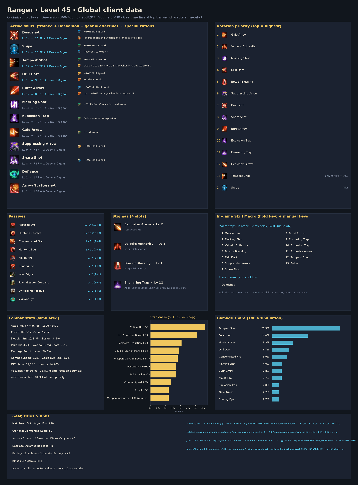
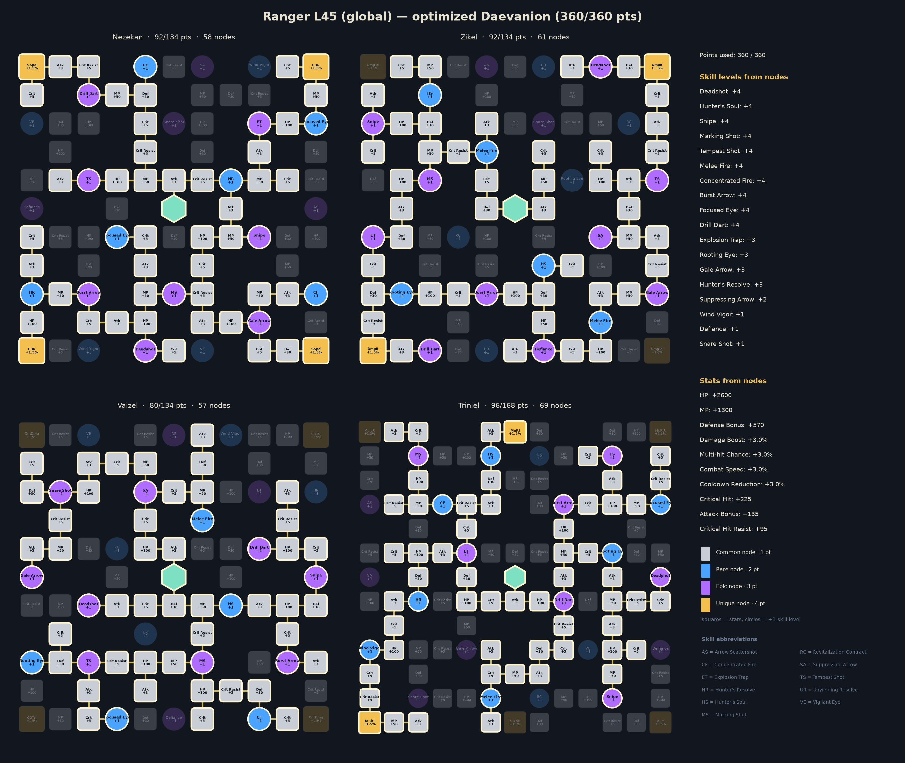
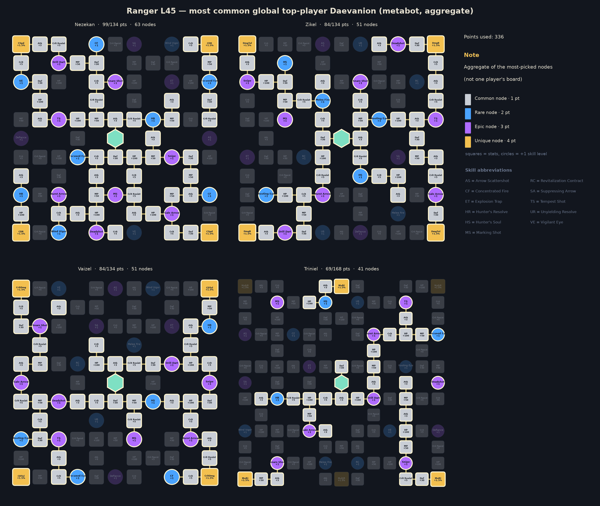

# Ranger — level 45 global build, rotation and macro

Generated by `aion2calc` from the global client data (metabot.gg) with Korean data as fallback. Primary view: **boss** fight (see `docs/methodology.md`). Daevanion budget **360** points.



## Damage objective: boss modeled DPS

Score: 12,175 modeled DPS.

boss: 100%, 180.0s, 12,175 DPS

Damage objective subject to the saved HP and trained-skill reserves. Balanced uses equal scenario weights. Stat weights follow the selected objective; skill shares, opener, macro and sensitivity remain primary-scenario views. This local search does not establish a global optimum or competitive PvP efficacy.

## Results

| Build | boss DPS | dummy DPS |
|---|---:|---:|
| **Optimized (this report)** | **12,175** | **14,703** |
| Typical top global build, optimized rotation | 10,701 | 12,925 |
| Typical top global build, default priority | 10,520 | — |

The optimized build is **+13.8%** over the typical top global build played with the same rotation optimizer, and **+15.7%** over that build played with the default priority. *Typical top global build* = average skill levels, the four most-picked damage stigmas and the most-picked Daevanion nodes of the top tracked global L45 players of this class (metabot.gg live data), given the best legal specializations for its levels (specs are not published).

## Rotation (priority list)

Use the highest skill that is ready; the last entry is the filler.

1. `gale_arrow`
2. `vaizel`
3. `marking_shot`
4. `drill_dart`
5. `bowbless`
6. `suppressing_arrow`
7. `deadshot`
8. `snare_shot`
9. `burst_arrow`
10. `explosion_trap`
11. `ensnaring_trap`
12. `explosive`
13. `tempest_shot [mp_hi]`
14. `snipe`

`[sync_de]` = wait for the Delayed Explosion vulnerability window when it is about to be ready; `[in_ee]` = prefer using it inside Element Enhancement; `[mp_hi]` = only while MP is at least 60% (weave it in, keep MP for Grace of Enhancement).

### In-game Skill Macro

**Left mouse button** is the basic auto-attack: `snipe`. Hold it for continuous attacks; the Skill Macro below goes on the **right mouse button** (or another held key). Weave both together.

Settings → Key Settings → General → Skill Macro. Skill Queue (스킬 예약) **ON**, 10 ms delay on every step, hold the macro key; manual presses always take priority over the macro.

| Step | Skill |
|---:|---|
| 1 | gale_arrow |
| 2 | marking_shot |
| 3 | vaizel |
| 4 | bowbless |
| 5 | drill_dart |
| 6 | suppressing_arrow |
| 7 | snare_shot |
| 8 | burst_arrow |
| 9 | ensnaring_trap |
| 10 | explosion_trap |
| 11 | explosive |
| 12 | tempest_shot |
| 13 | snipe |

Manual keys (press on cooldown, in this priority): deadshot

Simulated: this layout reaches **81.3%** of the ideal priority list.

**Alternative — macro with manual keys**: macro gale_arrow → marking_shot → drill_dart → suppressing_arrow → snare_shot → burst_arrow → explosion_trap → tempest_shot → snipe; manual: vaizel, bowbless, deadshot, ensnaring_trap, explosive. Simulated: **79.9%** of the ideal priority list.

### Opener (first 30 s of the simulated fight)

```
gale_arrow@0.0s → vaizel@0.4s → marking_shot@0.7s → drill_dart@1.2s → bowbless@1.5s → suppressing_arrow@1.8s → deadshot@2.3s → snare_shot@2.8s → burst_arrow@3.1s → explosion_trap@3.5s → ensnaring_trap@4.3s → explosive@5.2s → tempest_shot@5.5s → drill_dart@6.0s → tempest_shot@6.2s → tempest_shot@6.7s → tempest_shot@7.2s → tempest_shot@7.7s → tempest_shot@8.1s → tempest_shot@8.6s → tempest_shot@9.1s → tempest_shot@9.6s → tempest_shot@10.0s → marking_shot@10.5s → drill_dart@11.0s → tempest_shot@11.3s → tempest_shot@11.8s → tempest_shot@12.2s
```

## Skills, specializations and points

Skill points used **203 / 203**, stigma points **30 / 30**, Daevanion **360 / 360**.

| Skill | Trained (SP) | Effective level | Specializations |
|---|---:|---:|---|
| Snipe | 10 | 14 | +20% MP restored; Absorbs 70, 70% HP |
| Focused Eye | 10 | 14 | — |
| Deadshot | 10 | 14 | +30% Skill Speed; Ignores Block and Evasion and lands as Multi-Hit |
| Tempest Shot | 10 | 14 | -20% MP consumed; Deals up to 12% more damage when less targets are hit |
| Drill Dart | 9 | 13 | +20% Skill Speed; Multi-Hit on hit |
| Hunter's Resolve | 10 | 13 | — |
| Burst Arrow | 8 | 12 | +50% Multi-Hit on hit; Up to +20% damage when less targets hit |
| Hunter's Soul | 7 | 11 | — |
| Marking Shot | 7 | 11 | +5% Perfect Chance for the duration |
| Concentrated Fire | 7 | 11 | — |
| Explosion Trap | 7 | 10 | Pulls enemies on explosion |
| Gale Arrow | 7 | 10 | +5s duration |
| Suppressing Arrow | 7 | 9 | +20% Skill Speed |
| Snare Shot | 7 | 8 | +20% Skill Speed |
| Melee Fire | 3 | 7 | — |
| Rooting Eye | 4 | 7 | — |
| Defiance | 1 | 2 | — |
| Wind Vigor | 1 | 2 | — |

**Stigmas**: Explosive Arrow Lv 7, Vaizel's Authority Lv 1, Bow of Blessing Lv 1, Ensnaring Trap Lv 11

## Daevanion (360 points)



* Open in metabot planner: https://metabot.gg/en/aion-2/daevanion/ranger#31-0.1.2.3.7.8.9.a.b.c.g.k.n.o.p.r.t.w.x.y.z.10.11.12.13.14.19.1b.1e.1f.1h.1i.1j.1m.1o.1p.1r.1s.1t.1u.1v.1w.1x.1y.1z.20.21.22.23.24.25.26.28.2b.2c.2e.2f.2g_32-1.2.7.8.9.a.b.c.f.g.h.i.j.p.q.r.s.t.u.v.w.y.z.10.11.13.14.15.16.17.19.1a.1b.1c.1h.1i.1j.1k.1n.1o.1q.1r.1s.1t.1u.1v.1w.1x.1y.1z.20.21.23.24.26.27.28.2b.2c.2d.2e_33-5.a.b.c.d.e.h.i.j.k.l.m.p.r.s.t.u.v.w.z.10.13.14.15.16.1a.1d.1e.1f.1g.1h.1i.1j.1k.1l.1m.1o.1p.1q.1r.1s.1t.1u.1v.1w.1y.1z.21.22.23.24.25.29.2a.2d.2e.2f_34-1.2.3.4.a.d.g.h.i.k.l.o.p.r.s.t.u.v.x.y.z.10.11.13.14.17.18.19.1a.1e.1f.1g.1k.1l.1n.1o.1p.1r.1s.1u.1v.1w.1x.1y.20.21.22.23.25.26.27.28.2c.2d.2e.2g.2h.2j.2l.2m.2n.2o.2q.2u.2y.30.31.32.33
* Open in gamers4.life planner (KR node values, same node IDs): https://gamers4.life/aion-2/database/en/daevanion-planner/?b=eyJjIjoicmFuZ2VyIiwiZCI6WzMxMDAzMywzMTAwMzQsMzEwMDM1LDMxMDAzNywzMTAwNDIsMzEwMDQzLDMxMDA0OCwzMTAwNTAsMzEwMDUxLDMxMDA1MiwzMTAwNTgsMzEwMDY3LDMxMDA3MSwzMTAwNzIsMzEwMDczLDMxMDA4MiwzMTAwODYsMzEwMDk0LDMxMDA5NSwzMTAwOTYsMzEwMDk3LDMxMDA5OCwzMTAwOTksMzEwMTAwLDMxMDEwMSwzMTAxMDIsMzEwMTE1LDMxMDEyMywzMTAxMjYsMzEwMTI3LDMxMDEyOSwzMTAxMzAsMzEwMTMxLDMxMDEzOCwzMTAxNDIsMzEwMTQ0LDMxMDE1MywzMTAxNTQsMzEwMTU1LDMxMDE1NywzMTAxNTgsMzEwMTU5LDMxMDE2MSwzMTAxNjIsMzEwMTYzLDMxMDE2OCwzMTAxNzAsMzEwMTcxLDMxMDE3MiwzMTAxNzQsMzEwMTc1LDMxMDE3NiwzMTAxODMsMzEwMTg3LDMxMDE4OCwzMTAxOTEsMzEwMTkyLDMxMDE5MywzMjAwMzQsMzIwMDM1LDMyMDA0MCwzMjAwNDEsMzIwMDQyLDMyMDA0MywzMjAwNDgsMzIwMDUwLDMyMDA1OCwzMjAwNjMsMzIwMDY0LDMyMDA2NSwzMjAwNjcsMzIwMDczLDMyMDA3OCwzMjAwODAsMzIwMDgxLDMyMDA4MiwzMjAwODQsMzIwMDg2LDMyMDA4OCwzMjAwOTQsMzIwMDk1LDMyMDA5NywzMjAwOTksMzIwMTAxLDMyMDEwMiwzMjAxMDMsMzIwMTA5LDMyMDExMiwzMjAxMTQsMzIwMTE3LDMyMDEyMywzMjAxMjQsMzIwMTMxLDMyMDEzMiwzMjAxMzMsMzIwMTM4LDMyMDE0NCwzMjAxNDUsMzIwMTQ4LDMyMDE1MywzMjAxNTQsMzIwMTU1LDMyMDE1NiwzMjAxNTcsMzIwMTU4LDMyMDE1OSwzMjAxNjEsMzIwMTYyLDMyMDE2MywzMjAxNjgsMzIwMTc0LDMyMDE3NiwzMjAxODMsMzIwMTg0LDMyMDE4NSwzMjAxODgsMzIwMTg5LDMyMDE5MCwzMjAxOTEsMzMwMDM5LDMzMDA0OCwzMzAwNTAsMzMwMDUxLDMzMDA1MiwzMzAwNTQsMzMwMDYzLDMzMDA2NCwzMzAwNjUsMzMwMDY3LDMzMDA2OCwzMzAwNjksMzMwMDcyLDMzMDA3OSwzMzAwODIsMzMwMDg0LDMzMDA4NywzMzAwOTMsMzMwMDk0LDMzMDA5NywzMzAwOTgsMzMwMTAxLDMzMDEwMiwzMzAxMDMsMzMwMTA4LDMzMDExOCwzMzAxMjUsMzMwMTI2LDMzMDEyNywzMzAxMjgsMzMwMTI5LDMzMDEzMCwzMzAxMzEsMzMwMTMyLDMzMDEzMywzMzAxMzksMzMwMTQ0LDMzMDE0NywzMzAxNTMsMzMwMTU0LDMzMDE1NSwzMzAxNTYsMzMwMTU3LDMzMDE1OCwzMzAxNTksMzMwMTYyLDMzMDE2MywzMzAxNzAsMzMwMTcyLDMzMDE3NCwzMzAxNzUsMzMwMTc2LDMzMDE4NSwzMzAxODYsMzMwMTg5LDMzMDE5MSwzMzAxOTIsMzQwMDE4LDM0MDAxOSwzNDAwMjIsMzQwMDIzLDM0MDAzNCwzNDAwMzcsMzQwMDQxLDM0MDA0MiwzNDAwNDQsMzQwMDQ5LDM0MDA1MiwzNDAwNTcsMzQwMDU5LDM0MDA2MywzNDAwNjQsMzQwMDY1LDM0MDA2NiwzNDAwNjcsMzQwMDcwLDM0MDA3MSwzNDAwNzIsMzQwMDczLDM0MDA3NCwzNDAwODEsMzQwMDg1LDM0MDA5MywzNDAwOTQsMzQwMDk1LDM0MDA5NiwzNDAxMDAsMzQwMTAxLDM0MDEwMiwzNDAxMDksMzQwMTExLDM0MDExNSwzNDAxMTcsMzQwMTE5LDM0MDEyMywzNDAxMjQsMzQwMTI2LDM0MDEyNywzNDAxMjgsMzQwMTI5LDM0MDEzMCwzNDAxMzIsMzQwMTMzLDM0MDEzNCwzNDAxMzgsMzQwMTQ1LDM0MDE0NywzNDAxNTIsMzQwMTUzLDM0MDE1NywzNDAxNTksMzQwMTYwLDM0MDE2MiwzNDAxNjMsMzQwMTY3LDM0MDE3MiwzNDAxNzMsMzQwMTc0LDM0MDE3NywzNDAxODIsMzQwMTg3LDM0MDE5MiwzNDAxOTcsMzQwMTk4LDM0MDE5OSwzNDAyMDJdfQ
* Full skill/stigma/Daevanion build in metabot planner: https://metabot.gg/en/aion-2/classes/ranger/build#v1~l19~s8ca6o.a.a_8chwg.a.3_8d51s.9.c_8dkhc.7.4_8ds74.8.a_8dzww.7.1_8efcg.7.1_8eus0.7.2_8fpn4.7.1_8fxcw.b.0_8jctc.a.5_8js8w.7.0_8ri0w.7.0_8rxgg.a.0_8s568.a.0_8skls.4.0_8ssbk.3.0_8t7r4.7.0~g8js8w_8ipo0_8gs80_8fxcw~d31-0.1.2.3.7.8.9.a.b.c.g.k.n.o.p.r.t.w.x.y.z.10.11.12.13.14.19.1b.1e.1f.1h.1i.1j.1m.1o.1p.1r.1s.1t.1u.1v.1w.1x.1y.1z.20.21.22.23.24.25.26.28.2b.2c.2e.2f.2g_32-1.2.7.8.9.a.b.c.f.g.h.i.j.p.q.r.s.t.u.v.w.y.z.10.11.13.14.15.16.17.19.1a.1b.1c.1h.1i.1j.1k.1n.1o.1q.1r.1s.1t.1u.1v.1w.1x.1y.1z.20.21.23.24.26.27.28.2b.2c.2d.2e_33-5.a.b.c.d.e.h.i.j.k.l.m.p.r.s.t.u.v.w.z.10.13.14.15.16.1a.1d.1e.1f.1g.1h.1i.1j.1k.1l.1m.1o.1p.1q.1r.1s.1t.1u.1v.1w.1y.1z.21.22.23.24.25.29.2a.2d.2e.2f_34-1.2.3.4.a.d.g.h.i.k.l.o.p.r.s.t.u.v.x.y.z.10.11.13.14.17.18.19.1a.1e.1f.1g.1k.1l.1n.1o.1p.1r.1s.1u.1v.1w.1x.1y.20.21.22.23.25.26.27.28.2c.2d.2e.2g.2h.2j.2l.2m.2n.2o.2q.2u.2y.30.31.32.33

For comparison, the aggregate of the most-picked nodes among top global players:



## Stat priority (simulated)

| Upgrade | DPS gain | Worth in Attack |
|---|---:|---:|
| Critical Hit +50 | +3.62% | 90 |
| PvE / Damage Boost +3% | +3.12% | 77 |
| Cooldown Reduction +3% | +2.07% | 52 |
| Double (Smite) chance +2% | +1.88% | 47 |
| Weapon Damage Boost +3% | +1.81% | 45 |
| Penetration +300 | +1.71% | 42 |
| PvE Attack +30 | +1.71% | 42 |
| Combat Speed +3% | +1.36% | 34 |
| Attack +30 | +1.21% | 30 |
| Weapon max attack +30 (min too) | +1.21% | 30 |
| Critical Attack +50 | +0.99% | 24 |
| Wisdom +10 (Double +1%) | +0.94% | 23 |
| Critical Damage Boost +3% | +0.74% | 18 |
| Illusion +10 (Cooldown -1%) | +0.69% | 17 |
| Back Attack +30 | +0.52% | 13 |
| Front Attack +30 | +0.50% | 12 |
| Might +10 (Attack +1%) | +0.49% | 12 |
| Destruction +10 (Attack +1%) | +0.49% | 12 |
| Time +10 (Combat Speed +1%) | +0.45% | 11 |
| Precision +10 (Crit +1%) | +0.33% | 8 |
| Death +10 (Crit +1%) | +0.33% | 8 |
| Multi-hit chance +3% | +0.31% | 8 |
| Perfect chance +3% | +0.03% | 1 |
| Justice +10 (Perfect +1%) | +0.01% | 0 |
| MP +300 | +0.00% | 0 |
| Freedom +10 (Accuracy +1%) | +0.00% | 0 |

Accuracy is a threshold stat (avoid parries; back attacks ignore them) and is not ranked.

## Gear, rolls, enchanting

Loadout: **Global L45 Ranger - median of top tracked characters (metabot)**

* Main hand: Spiritforged Bow +10
* Off-hand: Spiritforged Guard +9
* Armor x7: Vakron / Bakarma / Divine Canyon ~+5
* Necklace: Aulamus Necklace +8
* Earrings x2: Aulamus / Liberator Earrings ~+6
* Rings x2: Aulamus Ring ~+7
* Accessory rolls: expected value of 4 rolls x 5 accessories
* Bracelets x2: Ascension +9 / Liberator +6
* Amulet: Revelation Amulet +0
* Rune: Clash Rune +2
* Attack title: Guardian of Altgard / Verteron
* Other title: Through Hell and Back
* Owned titles: collection bonuses (estimate)
* Wings: Ultimate Daeva Wings
* Primary/deity stats: profile averages

**Random-roll priority per item** (keep / reroll toward the top of each list):

* **Rupture Tome**: Damage Boost (+4.9% – +5.7%), Combat Speed (+8.8% – +10.2%), Weapon Damage Boost (+6.5% – +7.6%), Critical Hit (+46 – +60), Attack (+30 – +42)
* **Ludras Grimoire**: Damage Boost (+6.3% – +7.3%), Combat Speed (+11.2% – +13%), Weapon Damage Boost (+8.3% – +9.6%), Critical Hit (+59 – +75), Critical Attack (+83 – +102)
* **Spiritforged Guard**: Might (+10 – +10), Accuracy (+30 – +30)
* **Vakron Helm**: Critical Hit (+25 – +36), Double Chance (+1.6% – +1.9%), Attack increase (+1.6% – +1.9%), Attack (+16 – +25), MP (+76 – +94)
* **Bakarma Breastplate**: Damage Boost (+4.4% – +5.2%), Critical Hit (+27 – +38), Attack (+18 – +28), Perfect Chance (+3.9% – +4.6%), MP (+83 – +102)
* **Aulamus Necklace**: Critical Hit (+35 – +47), Combat Speed (+3.2% – +3.8%), Attack (+23 – +33), Might (+9 – +17), Precision (+9 – +17)
* **Aulamus Ring**: Critical Hit (+25 – +36), Attack (+16 – +25), Might (+5 – +13), Precision (+5 – +13), Natural MP Regen (+18 – +28)

**Enchant priority** (DPS per enchant level):

* Weapon (Spiritforged / Rupture): 40.4 DPS/level
* Guard (off-hand): 24.5 DPS/level
* Revelation Amulet: 20.8 DPS/level
* Necklace / Earrings / Rings (Aulamus): 19.6 DPS/level
* Bracelets: 14.7 DPS/level
* Armor pieces: 0.0 DPS/level

## Titles, arcana, wings, pets

**Best titles by equip bonus** (global client values):

| Title | Grade | Equip bonus | Owned bonus |
|---|---|---|---|
| Unbound by Genus (Both factions) | Unique | PvE Damage Boost +4.5%, Attack Bonus +34, Critical Hit +68 | PvE Damage Boost +1% |
| You're My Gem (Both factions) | Epic | Critical Hit +52, Critical Attack +39 | Natural MP Regen +5 |
| Saint of Ereshkigal (Both factions) | Unique | PvP Damage Boost +4%, Endurance Penetration +2.5%, Critical Hit +60 | PvP Accuracy +20 |
| Guardian of Altgard (Asmodian) | Epic | PvE Damage Boost +3%, Penetration +210 | PvE Attack +4 |
| Guardian of Verteron (Elyos) | Epic | PvE Damage Boost +3%, Penetration +210 | PvE Attack +4 |
| Empty Closet (Both factions) | Unique | Combat Speed +3.5%, Natural HP Regen +42, Cooldown Reduction +3.5% | HP +120 |
| Shaking Off the World's Shackles (Both factions) | Epic | Accuracy Bonus +50, Critical Hit +50 | Penetration +20 |
| Scenery Collector (Both factions) | Epic | PvE Damage Boost +3.3%, Block Penetration +54 | Critical Hit +10 |
| Teleportation Specialist (Both factions) | Epic | PvE Accuracy +58, PvE Damage Boost +3.1% | Critical Hit +10 |
| Activated the Trap Card (Elyos) | Epic | Critical Hit +42, Accuracy Bonus +42 | Accuracy Bonus +10 |

**Arcana variant per slot** (deity stat that is worth more for this build):

* Chalice / Grail: **Vigor or Frenzy** (Time +20)
* Parchment: either variant (Life +20 / Destiny +20: no damage either way)
* Compass: **Magic or Purity** (Death +20)
* Bell: **Magic or Purity** (Destruction +20)
* Mirror: **Magic or Purity** (Wisdom +20)

**Arcana skill rolls.** Each arcana gives (grade base + enhancement level) random skill levels from its slot's pool — Rare 2, Legend 3, Unique 4 base rolls, +1 per enhancement level (so a Unique +5 gives 9); a skill rolled again gains another level, up to the cap. Chalice, Parchment and Compass roll active skills; Bell and Mirror roll passives.

| Arcana slot | Expected DPS, Unique +0 (4 rolls) | Expected DPS, Unique +5 (9 rolls) | Best rolls (+1 / +2) |
|---|---:|---:|---|
| Parchment | +1.4% | +4.3% | Tempest Shot +0.4% / +7.2%, Drill Dart +0.1% / +0.3%, Snipe +0.1% / +0.2% |
| Mirror | +1.2% | +2.8% | Focused Eye +1.2% / +2.5%, Hunter's Soul +0.1% / +0.2%, Concentrated Fire +0.1% / +0.2% |
| Chalice | +0.7% | +1.7% | Focused Eye +1.2% / +2.5%, Tempest Shot +0.4% / +7.2%, Hunter's Resolve +0.2% / +0.5% |
| Compass | +0.3% | +0.7% | Deadshot +0.2% / +0.4%, Marking Shot +0.1% / +0.2%, Gale Arrow +0.1% / +0.1% |
| Bell | +0.2% | +0.5% | Hunter's Resolve +0.2% / +0.5%, Rooting Eye +0.1% / +0.1%, Vigilant Eye +0.0% / +0.0% |

Biggest single-level jumps (usually a specialization unlocking at Lv 16): Tempest Shot +6.8%, Focused Eye +1.2%, Drill Dart +0.7%, Hunter's Resolve +0.2%.

**Deity (pantheon) stats**, +10 points each (arcana main stats, Abyssal Bracelet rolls, Monolith rewards): Wisdom +0.94%, Illusion +0.69%, Might +0.49%, Destruction +0.49%, Time +0.45%, Death +0.33%, Justice +0.01%.

**Closet / appearance collection**: every unlocked skin and costume set adds permanent Collection Effect stats, and wings keep a Retention Effect once owned. The client tables for these are not public, so they are not itemised here; they are flat stats, so value them with the stat table above and collect the cheap ones first.

**Wings**: Ultimate Daeva Wings (Accuracy +40, Penetration +500) are the most used and the best launch option for damage among common wings. **Pets**: pet collection bonuses are mostly genus-specific (damage vs that monster genus) plus Accuracy/Crit; level the genus of the content you farm first.

## Robustness

Samples with no modeled damage are excluded from percentage losses.

Every animation time was randomly perturbed by up to ±25% (8 samples) and the rotation re-optimized each time. Playing the recommended priority instead of the re-optimized one lost on average **0.72%** (worst 1.12%).

**Crit curve.** The crit-chance curve is fitted to tests at Crit 1048–1326 and extrapolated down to launch values: this build sits at **4.8%** crit, and Crit +50 ranks #1 (+3.62%). If launch testing shows more crit — e.g. the curve shifted to a midpoint of 700, giving 26% — Crit +50 becomes #2 (+2.26%). Re-run with `--crit-midpoint` once real numbers exist.

## Validation against Korean logs

Simulated damage shares (training dummy) overlap **61%** with the mean of the top-10 A2DIL Korean dummy logs; 4% of the Korean damage comes from skills that are not in the global level-45 client. Korea plays above level 45 with Lv 16-20 specializations, so a perfect match is not expected; low values mean the class kit needs hand-tuning (see `kit/sorcerer.py` for a hand-written kit).

## Sources

* metabot.gg (global client): class skills, Daevanion boards, items, titles, top-player statistics
* gamers4.life (KR database): skill hit counts, build/Daevanion planners
* A2DIL (KR training-dummy logs): damage-share validation
* Inven / Bahamut damage research, aion2ssow calculator: damage formula

See `docs/methodology.md` for every formula and assumption.
