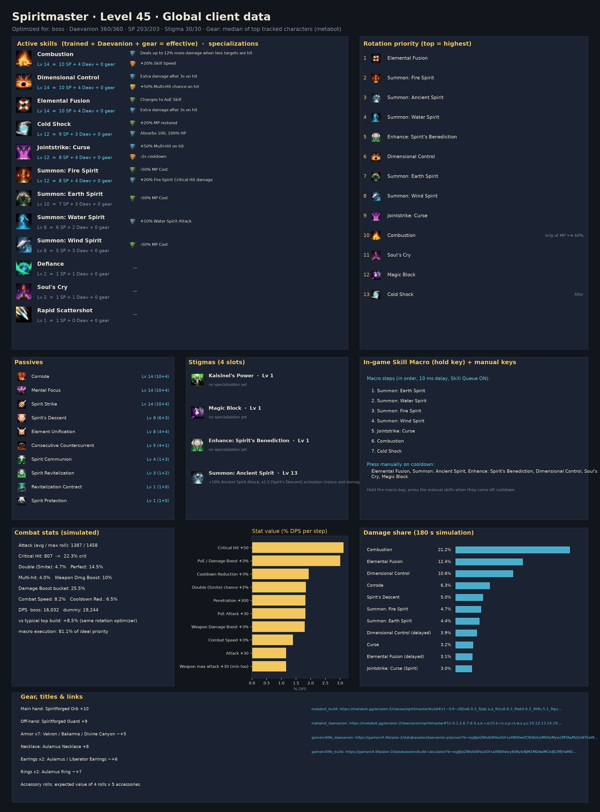
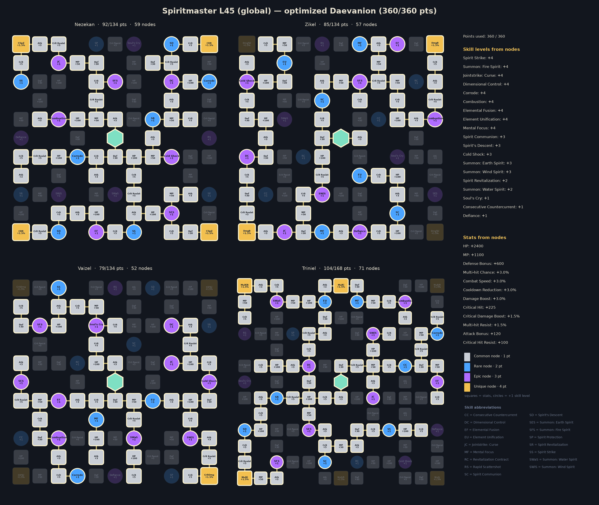
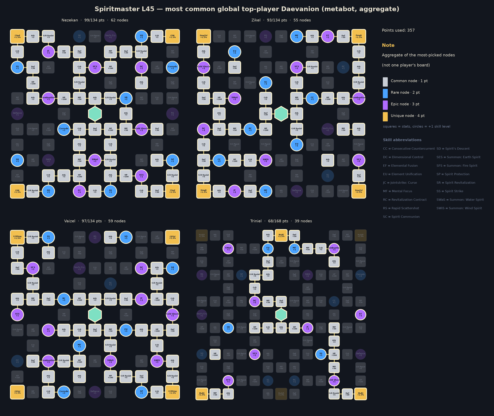

# Spiritmaster — level 45 global build, rotation and macro

Generated by `aion2calc` from the global client data (metabot.gg) with Korean data as fallback. Primary view: **boss** fight (see `docs/methodology.md`). Daevanion budget **360** points.



## Damage objective: boss modeled DPS

Score: 16,032 modeled DPS.

boss: 100%, 180.0s, 16,032 DPS

Damage objective subject to the saved HP and trained-skill reserves. Balanced uses equal scenario weights. Stat weights follow the selected objective; skill shares, opener, macro and sensitivity remain primary-scenario views. This local search does not establish a global optimum or competitive PvP efficacy.

## Results

| Build | boss DPS | dummy DPS |
|---|---:|---:|
| **Optimized (this report)** | **16,032** | **19,244** |
| Typical top global build, optimized rotation | 14,781 | 17,733 |
| Typical top global build, default priority | 14,301 | — |

The optimized build is **+8.5%** over the typical top global build played with the same rotation optimizer, and **+12.1%** over that build played with the default priority. *Typical top global build* = average skill levels, the four most-picked damage stigmas and the most-picked Daevanion nodes of the top tracked global L45 players of this class (metabot.gg live data), given the best legal specializations for its levels (specs are not published).

## Rotation (priority list)

Use the highest skill that is ready; the last entry is the filler.

1. `elemental_fusion`
2. `summon_fire`
3. `ancient_spirit`
4. `summon_water`
5. `enhance`
6. `dimensional_control`
7. `summon_earth`
8. `summon_wind`
9. `jointstrike_curse`
10. `combustion [mp_hi]`
11. `soul_cry`
12. `magicblk`
13. `cold_shock`

`[sync_de]` = wait for the Delayed Explosion vulnerability window when it is about to be ready; `[in_ee]` = prefer using it inside Element Enhancement; `[mp_hi]` = only while MP is at least 60% (weave it in, keep MP for Grace of Enhancement).

### In-game Skill Macro

**Left mouse button** is the basic auto-attack: `cold_shock`. Hold it for continuous attacks; the Skill Macro below goes on the **right mouse button** (or another held key). Weave both together.

Settings → Key Settings → General → Skill Macro. Skill Queue (스킬 예약) **ON**, 10 ms delay on every step, hold the macro key; manual presses always take priority over the macro.

| Step | Skill |
|---:|---|
| 1 | summon_earth |
| 2 | summon_water |
| 3 | summon_fire |
| 4 | summon_wind |
| 5 | jointstrike_curse |
| 6 | combustion |
| 7 | cold_shock |

Manual keys (press on cooldown, in this priority): elemental_fusion, ancient_spirit, enhance, dimensional_control, soul_cry, magicblk

Simulated: this layout reaches **81.1%** of the ideal priority list.

**Alternative — one-button macro (no manual keys)**: macro ancient_spirit → elemental_fusion → summon_water → summon_fire → dimensional_control → enhance → summon_earth → jointstrike_curse → summon_wind → soul_cry → magicblk → combustion → cold_shock. Simulated: **73.2%** of the ideal priority list.

### Opener (first 30 s of the simulated fight)

```
summon_fire@0.0s → ancient_spirit@0.2s → elemental_fusion@1.2s → summon_water@1.6s → enhance@1.8s → dimensional_control@2.8s → summon_earth@3.1s → dimensional_control@3.4s → dimensional_control@3.7s → summon_wind@4.1s → jointstrike_curse@4.3s → elemental_fusion@4.8s → dimensional_control@5.2s → combustion@5.5s → combustion@5.9s → combustion@6.3s → dimensional_control@6.8s → combustion@7.1s → combustion@7.5s → combustion@8.0s → combustion@8.4s → combustion@8.8s → combustion@9.2s → combustion@9.7s → combustion@10.1s → elemental_fusion@10.5s → dimensional_control@10.8s → combustion@11.2s
```

## Skills, specializations and points

Skill points used **203 / 203**, stigma points **30 / 30**, Daevanion **360 / 360**.

| Skill | Trained (SP) | Effective level | Specializations |
|---|---:|---:|---|
| Elemental Fusion | 10 | 14 | Changes to AoE Skill; Extra damage after 3s on hit |
| Dimensional Control | 10 | 14 | Extra damage after 3s on hit; +50% Multi-Hit chance on hit |
| Spirit Strike | 10 | 14 | — |
| Combustion | 10 | 14 | Deals up to 12% more damage when less targets are hit; +20% Skill Speed |
| Mental Focus | 10 | 14 | — |
| Corrode | 10 | 14 | — |
| Jointstrike: Curse | 8 | 12 | +50% Multi-Hit on hit; -2s cooldown |
| Cold Shock | 9 | 12 | +20% MP restored; Absorbs 100, 100% HP |
| Summon: Fire Spirit | 8 | 12 | -50% MP Cost; +20% Fire Spirit Critical Hit damage |
| Summon: Earth Spirit | 7 | 10 | -50% MP Cost |
| Spirit's Descent | 6 | 9 | — |
| Summon: Wind Spirit | 5 | 8 | -50% MP Cost |
| Element Unification | 4 | 8 | — |
| Summon: Water Spirit | 6 | 8 | +10% Water Spirit Attack |
| Consecutive Countercurrent | 4 | 5 | — |
| Spirit Communion | 1 | 4 | — |
| Spirit Revitalization | 1 | 3 | — |
| Soul's Cry | 1 | 2 | — |
| Defiance | 1 | 2 | — |

**Stigmas**: Kaisinel's Power Lv 1, Magic Block Lv 1, Enhance: Spirit's Benediction Lv 1, Summon: Ancient Spirit Lv 13

## Daevanion (360 points)



* Open in metabot planner: https://metabot.gg/en/aion-2/daevanion/spiritmaster#51-0.1.2.6.7.8.9.a.b.c.e.f.h.k.l.n.o.p.r.t.w.x.y.z.10.12.13.14.19.1b.1c.1d.1e.1f.1g.1h.1i.1j.1m.1o.1p.1w.1x.1y.21.22.23.24.25.26.28.29.2a.2b.2c.2d.2e.2f.2g_52-1.2.6.7.8.a.b.c.e.f.g.h.i.j.k.l.m.n.p.q.t.u.v.w.x.y.10.13.14.15.16.17.19.1b.1c.1f.1k.1m.1n.1o.1p.1r.1u.1v.1y.21.22.24.26.27.28.29.2a.2b.2c.2d.2e_53-2.a.b.c.d.h.i.j.k.l.o.p.s.u.v.z.10.13.14.15.16.1a.1b.1c.1d.1e.1f.1g.1h.1i.1j.1k.1l.1m.1n.1o.1p.1r.1s.1u.1w.1y.1z.21.22.23.26.29.2a.2d.2f.2g_54-0.1.2.3.4.5.9.a.b.c.d.e.f.g.h.j.l.o.p.u.v.x.y.10.11.13.14.15.17.18.19.1a.1c.1d.1e.1f.1g.1h.1i.1l.1n.1p.1r.1s.1t.1u.1v.1w.1y.22.23.24.27.28.2b.2c.2d.2e.2f.2g.2h.2j.2l.2m.2n.2q.2r.2u.30.31.32
* Open in gamers4.life planner (KR node values, same node IDs): https://gamers4.life/aion-2/database/en/daevanion-planner/?b=eyJjIjoiZWxlbWVudGFsaXN0IiwiZCI6WzUxMDAzMyw1MTAwMzQsNTEwMDM1LDUxMDA0MSw1MTAwNDIsNTEwMDQzLDUxMDA0OCw1MTAwNTAsNTEwMDUxLDUxMDA1Miw1MTAwNTUsNTEwMDU2LDUxMDA2Myw1MTAwNjcsNTEwMDY4LDUxMDA3MSw1MTAwNzIsNTEwMDczLDUxMDA4Miw1MTAwODYsNTEwMDk0LDUxMDA5NSw1MTAwOTYsNTEwMDk3LDUxMDA5OCw1MTAxMDAsNTEwMTAxLDUxMDEwMiw1MTAxMTUsNTEwMTIzLDUxMDEyNCw1MTAxMjUsNTEwMTI2LDUxMDEyNyw1MTAxMjgsNTEwMTI5LDUxMDEzMCw1MTAxMzEsNTEwMTM4LDUxMDE0Miw1MTAxNDQsNTEwMTU5LDUxMDE2MSw1MTAxNjIsNTEwMTcwLDUxMDE3MSw1MTAxNzIsNTEwMTc0LDUxMDE3NSw1MTAxNzYsNTEwMTgzLDUxMDE4NCw1MTAxODUsNTEwMTg3LDUxMDE4OCw1MTAxODksNTEwMTkxLDUxMDE5Miw1MTAxOTMsNTIwMDM0LDUyMDAzNSw1MjAwMzksNTIwMDQwLDUyMDA0MSw1MjAwNDMsNTIwMDQ4LDUyMDA1MCw1MjAwNTUsNTIwMDU4LDUyMDA2Myw1MjAwNjQsNTIwMDY1LDUyMDA2Nyw1MjAwNjgsNTIwMDY5LDUyMDA3MCw1MjAwNzEsNTIwMDczLDUyMDA3OCw1MjAwODIsNTIwMDg0LDUyMDA4Niw1MjAwODgsNTIwMDkzLDUyMDA5NCw1MjAwOTcsNTIwMTAxLDUyMDEwMiw1MjAxMDMsNTIwMTA5LDUyMDExMiw1MjAxMTQsNTIwMTIzLDUyMDEyNCw1MjAxMjcsNTIwMTM4LDUyMDE0Miw1MjAxNDQsNTIwMTQ1LDUyMDE0Niw1MjAxNTMsNTIwMTU2LDUyMDE1Nyw1MjAxNjEsNTIwMTY4LDUyMDE3MSw1MjAxNzYsNTIwMTgzLDUyMDE4NCw1MjAxODUsNTIwMTg2LDUyMDE4Nyw1MjAxODgsNTIwMTg5LDUyMDE5MCw1MjAxOTEsNTMwMDM1LDUzMDA0OCw1MzAwNTAsNTMwMDUxLDUzMDA1Miw1MzAwNjMsNTMwMDY0LDUzMDA2NSw1MzAwNjcsNTMwMDY4LDUzMDA3MSw1MzAwNzIsNTMwMDgyLDUzMDA4Nyw1MzAwOTMsNTMwMDk3LDUzMDA5OCw1MzAxMDEsNTMwMTAyLDUzMDEwMyw1MzAxMDgsNTMwMTE4LDUzMDEyMyw1MzAxMjQsNTMwMTI1LDUzMDEyNiw1MzAxMjcsNTMwMTI4LDUzMDEyOSw1MzAxMzAsNTMwMTMxLDUzMDEzMiw1MzAxMzMsNTMwMTM5LDUzMDE0Miw1MzAxNDQsNTMwMTQ3LDUzMDE1NCw1MzAxNTUsNTMwMTU3LDUzMDE1OSw1MzAxNjIsNTMwMTYzLDUzMDE3MCw1MzAxNzIsNTMwMTc0LDUzMDE3OCw1MzAxODUsNTMwMTg2LDUzMDE4OSw1MzAxOTIsNTMwMTkzLDU0MDAxNyw1NDAwMTgsNTQwMDE5LDU0MDAyMiw1NDAwMjMsNTQwMDI0LDU0MDAzMiw1NDAwMzQsNTQwMDM1LDU0MDAzNiw1NDAwMzcsNTQwMDM5LDU0MDA0MCw1NDAwNDEsNTQwMDQyLDU0MDA0Nyw1NDAwNTIsNTQwMDU3LDU0MDA1OSw1NDAwNjYsNTQwMDY3LDU0MDA3MCw1NDAwNzEsNTQwMDczLDU0MDA3NCw1NDAwODEsNTQwMDg1LDU0MDA4OCw1NDAwOTMsNTQwMDk0LDU0MDA5NSw1NDAwOTYsNTQwMDk4LDU0MDA5OSw1NDAxMDAsNTQwMTAxLDU0MDEwMiw1NDAxMDMsNTQwMTA0LDU0MDExMSw1NDAxMTUsNTQwMTE5LDU0MDEyMyw1NDAxMjQsNTQwMTI1LDU0MDEyNiw1NDAxMjcsNTQwMTI4LDU0MDEzMCw1NDAxMzQsNTQwMTM4LDU0MDE0MSw1NDAxNTIsNTQwMTUzLDU0MDE1Niw1NDAxNTcsNTQwMTU5LDU0MDE2MCw1NDAxNjEsNTQwMTYyLDU0MDE2Myw1NDAxNjcsNTQwMTcyLDU0MDE3Myw1NDAxNzQsNTQwMTgyLDU0MDE4NCw1NDAxODcsNTQwMTk3LDU0MDE5OCw1NDAxOTldfQ
* Full skill/stigma/Daevanion build in metabot planner: https://metabot.gg/en/aion-2/classes/spiritmaster/build#v1~l19~s9j5e8.9.3_9jsjk.a.a_9l2u8.8.3_9lak0.6.2_9li9s.5.1_9lpzk.7.1_9lxpc.8.a_9oakw.d.0_9pd5s.a.3_9q0b4.a.6_9y5io.a.0_9yky8.6.0_9yso0.a.0_9z83k.a.0_9znj4.4.0_a02yo.4.0~g9qngg_9oiao_9n0a8_9oakw~d51-0.1.2.6.7.8.9.a.b.c.e.f.h.k.l.n.o.p.r.t.w.x.y.z.10.12.13.14.19.1b.1c.1d.1e.1f.1g.1h.1i.1j.1m.1o.1p.1w.1x.1y.21.22.23.24.25.26.28.29.2a.2b.2c.2d.2e.2f.2g_52-1.2.6.7.8.a.b.c.e.f.g.h.i.j.k.l.m.n.p.q.t.u.v.w.x.y.10.13.14.15.16.17.19.1b.1c.1f.1k.1m.1n.1o.1p.1r.1u.1v.1y.21.22.24.26.27.28.29.2a.2b.2c.2d.2e_53-2.a.b.c.d.h.i.j.k.l.o.p.s.u.v.z.10.13.14.15.16.1a.1b.1c.1d.1e.1f.1g.1h.1i.1j.1k.1l.1m.1n.1o.1p.1r.1s.1u.1w.1y.1z.21.22.23.26.29.2a.2d.2f.2g_54-0.1.2.3.4.5.9.a.b.c.d.e.f.g.h.j.l.o.p.u.v.x.y.10.11.13.14.15.17.18.19.1a.1c.1d.1e.1f.1g.1h.1i.1l.1n.1p.1r.1s.1t.1u.1v.1w.1y.22.23.24.27.28.2b.2c.2d.2e.2f.2g.2h.2j.2l.2m.2n.2q.2r.2u.30.31.32

For comparison, the aggregate of the most-picked nodes among top global players:



## Stat priority (simulated)

| Upgrade | DPS gain | Worth in Attack |
|---|---:|---:|
| Critical Hit +50 | +3.12% | 80 |
| PvE / Damage Boost +3% | +3.00% | 77 |
| Cooldown Reduction +3% | +1.94% | 50 |
| Double (Smite) chance +2% | +1.84% | 47 |
| Penetration +300 | +1.82% | 47 |
| PvE Attack +30 | +1.82% | 47 |
| Weapon Damage Boost +3% | +1.80% | 46 |
| Combat Speed +3% | +1.40% | 36 |
| Attack +30 | +1.17% | 30 |
| Weapon max attack +30 (min too) | +1.17% | 30 |
| Wisdom +10 (Double +1%) | +0.92% | 24 |
| Critical Attack +50 | +0.86% | 22 |
| Illusion +10 (Cooldown -1%) | +0.65% | 17 |
| Back Attack +30 | +0.58% | 15 |
| Critical Damage Boost +3% | +0.57% | 15 |
| Might +10 (Attack +1%) | +0.51% | 13 |
| Destruction +10 (Attack +1%) | +0.51% | 13 |
| Front Attack +30 | +0.49% | 13 |
| Time +10 (Combat Speed +1%) | +0.47% | 12 |
| Precision +10 (Crit +1%) | +0.44% | 11 |
| Death +10 (Crit +1%) | +0.44% | 11 |
| Multi-hit chance +3% | +0.36% | 9 |
| Perfect chance +3% | +0.07% | 2 |
| Justice +10 (Perfect +1%) | +0.02% | 1 |
| MP +300 | +0.00% | 0 |
| Freedom +10 (Accuracy +1%) | +0.00% | 0 |

Accuracy is a threshold stat (avoid parries; back attacks ignore them) and is not ranked.

## Gear, rolls, enchanting

Loadout: **Global L45 Spiritmaster - median of top tracked characters (metabot)**

* Main hand: Spiritforged Orb +10
* Off-hand: Spiritforged Guard +9
* Armor x7: Vakron / Bakarma / Divine Canyon ~+5
* Necklace: Aulamus Necklace +8
* Earrings x2: Aulamus / Liberator Earrings ~+6
* Rings x2: Aulamus Ring ~+7
* Accessory rolls: expected value of 4 rolls x 5 accessories
* Bracelets x2: Ascension +9 / Liberator +6
* Amulet: Revelation Amulet +0
* Rune: Clash Rune +2
* Attack title: Guardian of Altgard / Verteron
* Other title: Through Hell and Back
* Owned titles: collection bonuses (estimate)
* Wings: Ultimate Daeva Wings
* Primary/deity stats: profile averages

**Random-roll priority per item** (keep / reroll toward the top of each list):

* **Rupture Tome**: Damage Boost (+4.9% – +5.7%), Combat Speed (+8.8% – +10.2%), Weapon Damage Boost (+6.5% – +7.6%), Critical Hit (+46 – +60), Back Attack (+65 – +82)
* **Ludras Grimoire**: Damage Boost (+6.3% – +7.3%), Combat Speed (+11.2% – +13%), Weapon Damage Boost (+8.3% – +9.6%), Critical Hit (+59 – +75), Back Attack (+83 – +102)
* **Spiritforged Guard**: Might (+10 – +10), Accuracy (+30 – +30)
* **Vakron Helm**: Critical Hit (+25 – +36), Double Chance (+1.6% – +1.9%), Attack increase (+1.6% – +1.9%), Attack (+16 – +25), MP (+76 – +94)
* **Bakarma Breastplate**: Damage Boost (+4.4% – +5.2%), Critical Hit (+27 – +38), Attack (+18 – +28), Perfect Chance (+3.9% – +4.6%), MP (+83 – +102)
* **Aulamus Necklace**: Critical Hit (+35 – +47), Combat Speed (+3.2% – +3.8%), Attack (+23 – +33), Might (+9 – +17), Precision (+9 – +17)
* **Aulamus Ring**: Critical Hit (+25 – +36), Attack (+16 – +25), Might (+5 – +13), Precision (+5 – +13), Natural MP Regen (+18 – +28)

**Enchant priority** (DPS per enchant level):

* Weapon (Spiritforged / Rupture): 51.4 DPS/level
* Guard (off-hand): 31.1 DPS/level
* Revelation Amulet: 29.1 DPS/level
* Necklace / Earrings / Rings (Aulamus): 24.9 DPS/level
* Bracelets: 18.7 DPS/level
* Armor pieces: 0.0 DPS/level

## Titles, arcana, wings, pets

**Best titles by equip bonus** (global client values):

| Title | Grade | Equip bonus | Owned bonus |
|---|---|---|---|
| Unbound by Genus (Both factions) | Unique | PvE Damage Boost +4.5%, Attack Bonus +34, Critical Hit +68 | PvE Damage Boost +1% |
| Guardian of Altgard (Asmodian) | Epic | PvE Damage Boost +3%, Penetration +210 | PvE Attack +4 |
| Guardian of Verteron (Elyos) | Epic | PvE Damage Boost +3%, Penetration +210 | PvE Attack +4 |
| You're My Gem (Both factions) | Epic | Critical Hit +52, Critical Attack +39 | Natural MP Regen +5 |
| Empty Closet (Both factions) | Unique | Combat Speed +3.5%, Natural HP Regen +42, Cooldown Reduction +3.5% | HP +120 |
| Saint of Ereshkigal (Both factions) | Unique | PvP Damage Boost +4%, Endurance Penetration +2.5%, Critical Hit +60 | PvP Accuracy +20 |
| Scenery Collector (Both factions) | Epic | PvE Damage Boost +3.3%, Block Penetration +54 | Critical Hit +10 |
| Shaking Off the World's Shackles (Both factions) | Epic | Accuracy Bonus +50, Critical Hit +50 | Penetration +20 |
| Teleportation Specialist (Both factions) | Epic | PvE Accuracy +58, PvE Damage Boost +3.1% | Critical Hit +10 |
| It's Okay to Be Imperfect (Both factions) | Epic | PvE Attack +37, Critical Attack +44 | PvE Damage Boost +1% |

**Arcana variant per slot** (deity stat that is worth more for this build):

* Chalice / Grail: **Vigor or Frenzy** (Time +20)
* Parchment: either variant (Life +20 / Destiny +20: no damage either way)
* Compass: **Magic or Purity** (Death +20)
* Bell: **Magic or Purity** (Destruction +20)
* Mirror: **Magic or Purity** (Wisdom +20)

**Arcana skill rolls.** Each arcana gives (grade base + enhancement level) random skill levels from its slot's pool — Rare 2, Legend 3, Unique 4 base rolls, +1 per enhancement level (so a Unique +5 gives 9); a skill rolled again gains another level, up to the cap. Chalice, Parchment and Compass roll active skills; Bell and Mirror roll passives.

| Arcana slot | Expected DPS, Unique +0 (4 rolls) | Expected DPS, Unique +5 (9 rolls) | Best rolls (+1 / +2) |
|---|---:|---:|---|
| Compass | +3.8% | +14.3% | Combustion +0.3% / +28.2%, Summon: Wind Spirit +0.1% / +0.1%, Summon: Water Spirit +0.1% / +0.2% |
| Chalice | +1.2% | +3.2% | Spirit Strike +1.0% / +2.0%, Corrode +0.7% / +1.4%, Combustion +0.3% / +28.2% |
| Parchment | +1.2% | +3.0% | Dimensional Control +0.3% / +0.6%, Elemental Fusion +0.2% / +3.5%, Cold Shock +0.2% / +0.3% |
| Bell | +0.9% | +2.1% | Spirit Strike +1.0% / +2.0%, Element Unification +0.1% / +0.2%, Spirit's Descent +0.1% / +0.2% |
| Mirror | +0.8% | +1.9% | Corrode +0.7% / +1.4%, Mental Focus +0.3% / +0.6%, Consecutive Countercurrent +0.1% / +0.1% |

Biggest single-level jumps (usually a specialization unlocking at Lv 16): Combustion +27.8%, Elemental Fusion +3.3%, Spirit Strike +1.0%, Jointstrike: Curse +0.9%.

**Deity (pantheon) stats**, +10 points each (arcana main stats, Abyssal Bracelet rolls, Monolith rewards): Wisdom +0.92%, Illusion +0.65%, Might +0.51%, Destruction +0.51%, Time +0.47%, Death +0.44%, Justice +0.02%.

**Closet / appearance collection**: every unlocked skin and costume set adds permanent Collection Effect stats, and wings keep a Retention Effect once owned. The client tables for these are not public, so they are not itemised here; they are flat stats, so value them with the stat table above and collect the cheap ones first.

**Wings**: Ultimate Daeva Wings (Accuracy +40, Penetration +500) are the most used and the best launch option for damage among common wings. **Pets**: pet collection bonuses are mostly genus-specific (damage vs that monster genus) plus Accuracy/Crit; level the genus of the content you farm first.

## Robustness

Samples with no modeled damage are excluded from percentage losses.

Every animation time was randomly perturbed by up to ±25% (8 samples) and the rotation re-optimized each time. Playing the recommended priority instead of the re-optimized one lost on average **1.16%** (worst 2.55%).

**Crit curve.** The crit-chance curve is fitted to tests at Crit 1048–1326 and extrapolated down to launch values: this build sits at **22.3%** crit, and Crit +50 ranks #1 (+3.12%). If launch testing shows more crit — e.g. the curve shifted to a midpoint of 700, giving 69% — Crit +50 becomes #2 (+2.93%). Re-run with `--crit-midpoint` once real numbers exist.

## Validation against Korean logs

Simulated damage shares (training dummy) overlap **47%** with the mean of the top-10 A2DIL Korean dummy logs; 37% of the Korean damage comes from skills that are not in the global level-45 client. Korea plays above level 45 with Lv 16-20 specializations, so a perfect match is not expected; low values mean the class kit needs hand-tuning (see `kit/sorcerer.py` for a hand-written kit).

## Sources

* metabot.gg (global client): class skills, Daevanion boards, items, titles, top-player statistics
* gamers4.life (KR database): skill hit counts, build/Daevanion planners
* A2DIL (KR training-dummy logs): damage-share validation
* Inven / Bahamut damage research, aion2ssow calculator: damage formula

See `docs/methodology.md` for every formula and assumption.
