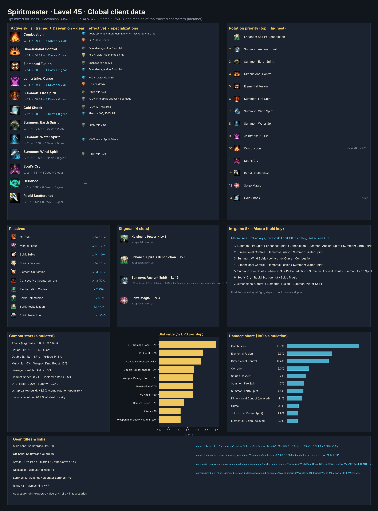
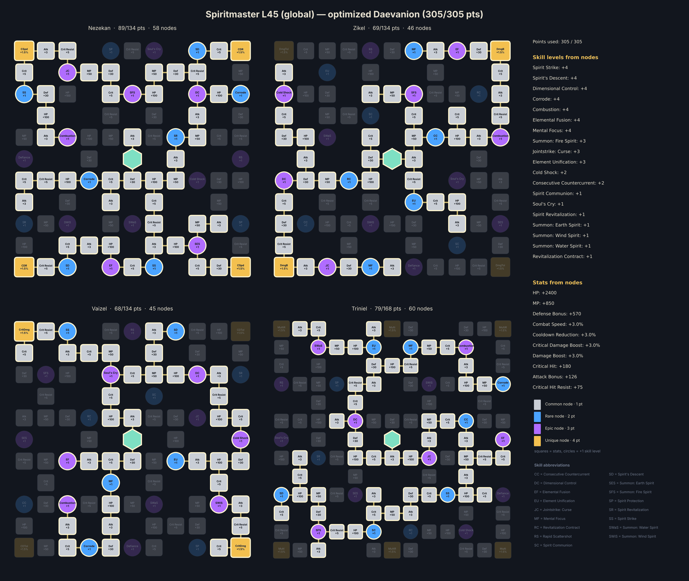
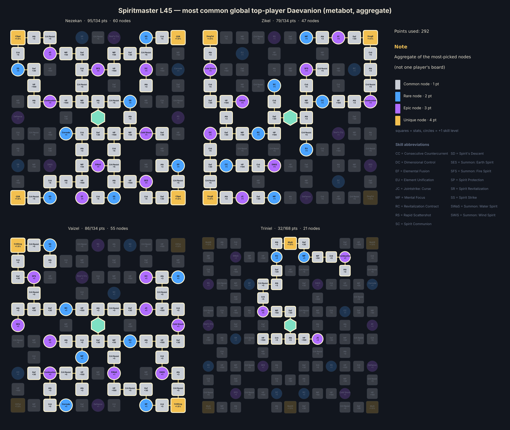

# Spiritmaster — level 45 global build, rotation and macro

Generated by `aion2calc` from the global client data (metabot.gg) with Korean data as fallback. Primary view: **boss** fight (see `docs/methodology.md`). Daevanion budget **360** points.



## Damage objective: boss modeled DPS

Score: 16,910 modeled DPS.

boss: 100%, 180.0s, 16,910 DPS

Damage objective subject to the saved HP and trained-skill reserves. Balanced uses equal scenario weights. Stat weights follow the selected objective; skill shares, opener, macro and sensitivity remain primary-scenario views. This local search does not establish a global optimum or competitive PvP efficacy.

## Results

| Build | boss DPS | dummy DPS |
|---|---:|---:|
| **Optimized (this report)** | **16,910** | **19,120** |
| Typical top global build, optimized rotation | 15,780 | 17,681 |
| Typical top global build, default priority | 15,070 | — |

**Whole fight:** 13,611 DPS on the boss scenario, the same rotation stretched over the 30% of a recorded boss fight this class's players spend pressing nothing or dodging (the log server's public uploads). The table above is the rotation's own DPS, which the optimizer compares builds by; a parse on the log server is a whole fight's.

The optimized build is **+7.2%** over the typical top global build played with the same rotation optimizer, and **+12.2%** over that build played with the default priority. *Typical top global build* = average skill levels, the four most-picked damage stigmas and the most-picked Daevanion nodes of the top tracked global L45 players of this class (metabot.gg live data), given the best legal specializations for its levels (specs are not published).

## Rotation (priority list)

Use the highest skill that is ready; the last entry is the filler.

1. `summon_earth`
2. `ancient_spirit`
3. `summon_water`
4. `enhance`
5. `dimensional_control`
6. `elemental_fusion`
7. `summon_fire`
8. `summon_wind`
9. `jointstrike_curse`
10. `combustion [mp_hi]`
11. `soul_cry`
12. `rapid_scattershot`
13. `magicblk`
14. `cold_shock`

`[sync_de]` = wait for the Delayed Explosion vulnerability window when it is about to be ready; `[in_ee]` = prefer using it inside Element Enhancement; `[mp_hi]` = only while MP is at least 60% (weave it in, keep MP for Grace of Enhancement).

### In-game Skill Macro

**Left mouse button** is the basic auto-attack: `cold_shock`. Hold it for continuous attacks; the Skill Macro below goes on the **right mouse button** (or another held key). Weave both together.

Each line is a hotbar key: put its skills on that key in the order listed, the first lowest (a key holds up to four). The macro casts a key's skills from first to last, skipping any that cannot be cast, then moves to the next line. Then Settings → Key Settings → General → Skill Macro: add the keys as macro lines from top to bottom, a key listed twice added twice. Skill Queue (스킬 예약) **ON**, 10 ms delay on every line, hold the macro key; manual presses always take priority over the macro. A skill's key presses its chain step while the chain is open, in the macro too.

| Line | Hotbar key holds (cast in this order) |
|---:|---|
| 1 | summon_earth › ancient_spirit › dimensional_control › summon_water |
| 2 | enhance › elemental_fusion › summon_fire › rapid_scattershot |
| 3 | the same key as line 1, pressed again: its skills are tried twice a round |
| 4 | jointstrike_curse › combustion |
| 5 | summon_wind › soul_cry › magicblk |

Manual keys (press on cooldown, in this priority): none — hold the macro key for the whole fight

Simulated: this layout reaches **95.6%** of the ideal priority list.

**Alternative — one skill per macro line**: macro summon_water → summon_earth → summon_fire → rapid_scattershot → jointstrike_curse → summon_wind → combustion → cold_shock; manual: ancient_spirit, enhance, dimensional_control, elemental_fusion, soul_cry, magicblk. Simulated: **80.9%** of the ideal priority list.

### Opener (first 30 s of the simulated fight)

```
summon_earth@0.0s → ancient_spirit@0.2s → summon_water@1.2s → enhance@1.5s → dimensional_control@2.4s → elemental_fusion@2.8s → summon_fire@3.1s → dimensional_control@3.4s → dimensional_control@3.7s → summon_wind@4.1s → jointstrike_curse@4.3s → dimensional_control@4.8s → combustion@5.2s → combustion@5.6s → combustion@6.0s → dimensional_control@6.4s → elemental_fusion@6.8s → combustion@7.1s → combustion@7.5s → combustion@8.0s → combustion@8.4s → combustion@8.8s → combustion@9.2s → combustion@9.7s → combustion@10.1s → dimensional_control@10.5s → elemental_fusion@10.8s → combustion@11.2s
```

## Skills, specializations and points

Skill points used **203 / 203**, stigma points **30 / 30**, Daevanion **360 / 360**.

| Skill | Trained (SP) | Effective level | Specializations |
|---|---:|---:|---|
| Combustion | 10 | 14 | Deals up to 12% more damage when less targets are hit; +20% Skill Speed |
| Corrode | 10 | 14 | — |
| Dimensional Control | 10 | 14 | Extra damage after 3s on hit; +50% Multi-Hit chance on hit |
| Elemental Fusion | 10 | 14 | Changes to AoE Skill; Extra damage after 3s on hit |
| Mental Focus | 10 | 14 | — |
| Spirit Strike | 10 | 14 | — |
| Cold Shock | 9 | 13 | +20% MP restored; Absorbs 100, 100% HP |
| Jointstrike: Curse | 8 | 12 | +50% Multi-Hit on hit; -2s cooldown |
| Summon: Fire Spirit | 8 | 12 | -50% MP Cost; +20% Fire Spirit Critical Hit damage |
| Summon: Earth Spirit | 7 | 11 | -50% MP Cost |
| Element Unification | 7 | 10 | — |
| Spirit's Descent | 5 | 9 | — |
| Summon: Water Spirit | 5 | 8 | +10% Water Spirit Attack |
| Summon: Wind Spirit | 4 | 8 | -50% MP Cost |
| Consecutive Countercurrent | 4 | 7 | — |
| Spirit Communion | 1 | 2 | — |

**Stigmas**: Kaisinel's Power Lv 1, Magic Block Lv 1, Enhance: Spirit's Benediction Lv 1, Summon: Ancient Spirit Lv 13

## Daevanion (360 points)



* Open in metabot planner: https://metabot.gg/en/aion-2/daevanion/spiritmaster#51-0.1.2.6.7.8.9.a.d.e.f.h.i.k.l.m.n.o.p.q.r.t.w.x.y.z.10.19.1b.1c.1d.1e.1f.1g.1h.1i.1j.1m.1o.1p.1t.1w.1x.1y.21.22.23.24.25.26.28.29.2a.2b.2c.2d.2e.2f.2g_52-6.7.8.9.a.b.f.g.j.k.l.p.q.u.v.w.x.y.z.10.11.12.13.14.15.16.17.19.1a.1b.1c.1f.1i.1j.1k.1m.1n.1o.1p.1q.1r.1s.1u.1v.1y.1z.20.21.22.26.27.28.29.2a.2b_53-0.2.5.6.a.b.c.e.h.i.j.l.m.n.o.p.r.s.u.v.w.z.10.13.14.15.16.1a.1b.1c.1d.1e.1f.1g.1h.1i.1j.1k.1l.1n.1p.1s.1t.1u.1v.1w.1y.1z.21.22.26.29.2a.2f.2g_54-1.2.3.4.a.b.c.d.e.f.g.h.l.o.u.v.x.y.z.10.11.13.14.19.1a.1b.1c.1e.1f.1g.1n.1o.1p.1r.1v.1w.1x.1y.20.21.22.23.26.27.28.2b.2c.2d.2e.2f.2g.2h.2j.2l.2m.2n.2o.2q.2r.2s.2t.2u.2y.30.31.32.33.36
* Open in gamers4.life planner (KR node values, same node IDs): https://gamers4.life/aion-2/database/en/daevanion-planner/?b=eyJjIjoiZWxlbWVudGFsaXN0IiwiZCI6WzUxMDAzMyw1MTAwMzQsNTEwMDM1LDUxMDA0MSw1MTAwNDIsNTEwMDQzLDUxMDA0OCw1MTAwNTAsNTEwMDU0LDUxMDA1NSw1MTAwNTYsNTEwMDYzLDUxMDA2NCw1MTAwNjcsNTEwMDY4LDUxMDA2OSw1MTAwNzEsNTEwMDcyLDUxMDA3Myw1MTAwNzksNTEwMDgyLDUxMDA4Niw1MTAwOTQsNTEwMDk1LDUxMDA5Niw1MTAwOTcsNTEwMDk4LDUxMDExNSw1MTAxMjMsNTEwMTI0LDUxMDEyNSw1MTAxMjYsNTEwMTI3LDUxMDEyOCw1MTAxMjksNTEwMTMwLDUxMDEzMSw1MTAxMzgsNTEwMTQyLDUxMDE0NCw1MTAxNTUsNTEwMTU5LDUxMDE2MSw1MTAxNjIsNTEwMTcwLDUxMDE3MSw1MTAxNzIsNTEwMTc0LDUxMDE3NSw1MTAxNzYsNTEwMTgzLDUxMDE4NCw1MTAxODUsNTEwMTg3LDUxMDE4OCw1MTAxODksNTEwMTkxLDUxMDE5Miw1MTAxOTMsNTIwMDM5LDUyMDA0MCw1MjAwNDEsNTIwMDQyLDUyMDA0Myw1MjAwNDgsNTIwMDU4LDUyMDA2Myw1MjAwNjcsNTIwMDY4LDUyMDA2OSw1MjAwNzMsNTIwMDc4LDUyMDA4NCw1MjAwODYsNTIwMDg4LDUyMDA5Myw1MjAwOTQsNTIwMDk1LDUyMDA5Nyw1MjAwOTksNTIwMTAwLDUyMDEwMSw1MjAxMDIsNTIwMTAzLDUyMDEwOSw1MjAxMTIsNTIwMTE0LDUyMDExNyw1MjAxMjMsNTIwMTI0LDUyMDEyNyw1MjAxMzIsNTIwMTMzLDUyMDEzOCw1MjAxNDIsNTIwMTQ0LDUyMDE0NSw1MjAxNDYsNTIwMTQ4LDUyMDE1Myw1MjAxNTQsNTIwMTU2LDUyMDE1Nyw1MjAxNjEsNTIwMTYyLDUyMDE2Myw1MjAxNjgsNTIwMTcxLDUyMDE4Myw1MjAxODQsNTIwMTg1LDUyMDE4Niw1MjAxODcsNTIwMTg4LDUzMDAzMyw1MzAwMzUsNTMwMDM5LDUzMDA0MCw1MzAwNDgsNTMwMDUwLDUzMDA1MSw1MzAwNTQsNTMwMDYzLDUzMDA2NCw1MzAwNjUsNTMwMDY4LDUzMDA2OSw1MzAwNzAsNTMwMDcxLDUzMDA3Miw1MzAwNzksNTMwMDgyLDUzMDA4Nyw1MzAwOTMsNTMwMDk0LDUzMDA5Nyw1MzAwOTgsNTMwMTAxLDUzMDEwMiw1MzAxMDMsNTMwMTA4LDUzMDExOCw1MzAxMjMsNTMwMTI0LDUzMDEyNSw1MzAxMjYsNTMwMTI3LDUzMDEyOCw1MzAxMjksNTMwMTMwLDUzMDEzMSw1MzAxMzIsNTMwMTMzLDUzMDE0Miw1MzAxNDcsNTMwMTU1LDUzMDE1Niw1MzAxNTcsNTMwMTU4LDUzMDE1OSw1MzAxNjIsNTMwMTYzLDUzMDE3MCw1MzAxNzIsNTMwMTc4LDUzMDE4NSw1MzAxODYsNTMwMTkyLDUzMDE5Myw1NDAwMTgsNTQwMDE5LDU0MDAyMiw1NDAwMjMsNTQwMDM0LDU0MDAzNSw1NDAwMzYsNTQwMDM3LDU0MDAzOSw1NDAwNDAsNTQwMDQxLDU0MDA0Miw1NDAwNTIsNTQwMDU3LDU0MDA2Niw1NDAwNjcsNTQwMDcwLDU0MDA3MSw1NDAwNzIsNTQwMDczLDU0MDA3NCw1NDAwODEsNTQwMDg1LDU0MDA5NSw1NDAwOTYsNTQwMDk3LDU0MDA5OCw1NDAxMDAsNTQwMTAxLDU0MDEwMiw1NDAxMTUsNTQwMTE3LDU0MDExOSw1NDAxMjMsNTQwMTI3LDU0MDEyOCw1NDAxMjksNTQwMTMwLDU0MDEzMiw1NDAxMzMsNTQwMTM0LDU0MDEzOCw1NDAxNDcsNTQwMTUyLDU0MDE1Myw1NDAxNTYsNTQwMTU3LDU0MDE1OSw1NDAxNjAsNTQwMTYxLDU0MDE2Miw1NDAxNjMsNTQwMTY3LDU0MDE3Miw1NDAxNzMsNTQwMTc0LDU0MDE3Nyw1NDAxODIsNTQwMTg0LDU0MDE4NSw1NDAxODYsNTQwMTg3LDU0MDE5Miw1NDAxOTcsNTQwMTk4LDU0MDE5OSw1NDAyMDIsNTQwMjA3XX0
* Full skill/stigma/Daevanion build in metabot planner: https://metabot.gg/en/aion-2/classes/spiritmaster/build#v1~l19~s9j5e8.9.3_9jsjk.a.a_9l2u8.8.3_9lak0.5.2_9li9s.4.1_9lpzk.7.1_9lxpc.8.a_9oakw.d.0_9pd5s.a.3_9q0b4.a.6_9y5io.a.0_9yky8.5.0_9yso0.a.0_9z83k.a.0_9znj4.7.0_a02yo.4.0~g9qngg_9oiao_9n0a8_9oakw~d51-0.1.2.6.7.8.9.a.d.e.f.h.i.k.l.m.n.o.p.q.r.t.w.x.y.z.10.19.1b.1c.1d.1e.1f.1g.1h.1i.1j.1m.1o.1p.1t.1w.1x.1y.21.22.23.24.25.26.28.29.2a.2b.2c.2d.2e.2f.2g_52-6.7.8.9.a.b.f.g.j.k.l.p.q.u.v.w.x.y.z.10.11.12.13.14.15.16.17.19.1a.1b.1c.1f.1i.1j.1k.1m.1n.1o.1p.1q.1r.1s.1u.1v.1y.1z.20.21.22.26.27.28.29.2a.2b_53-0.2.5.6.a.b.c.e.h.i.j.l.m.n.o.p.r.s.u.v.w.z.10.13.14.15.16.1a.1b.1c.1d.1e.1f.1g.1h.1i.1j.1k.1l.1n.1p.1s.1t.1u.1v.1w.1y.1z.21.22.26.29.2a.2f.2g_54-1.2.3.4.a.b.c.d.e.f.g.h.l.o.u.v.x.y.z.10.11.13.14.19.1a.1b.1c.1e.1f.1g.1n.1o.1p.1r.1v.1w.1x.1y.20.21.22.23.26.27.28.2b.2c.2d.2e.2f.2g.2h.2j.2l.2m.2n.2o.2q.2r.2s.2t.2u.2y.30.31.32.33.36

For comparison, the aggregate of the most-picked nodes among top global players:



## Stat priority (simulated)

| Upgrade | DPS gain | Worth in Attack |
|---|---:|---:|
| PvE / Damage Boost +3% | +3.00% | 78 |
| Critical Hit +50 | +2.38% | 62 |
| Cooldown Reduction +3% | +2.12% | 55 |
| Double (Smite) chance +2% | +1.84% | 48 |
| Weapon Damage Boost +3% | +1.80% | 47 |
| Penetration +300 | +1.80% | 47 |
| PvE Attack +30 | +1.80% | 47 |
| Combat Speed +3% | +1.40% | 36 |
| Attack +30 | +1.15% | 30 |
| Weapon max attack +30 (min too) | +1.15% | 30 |
| Critical Attack +50 | +1.10% | 29 |
| Wisdom +10 (Double +1%) | +0.92% | 24 |
| Critical Damage Boost +3% | +0.73% | 19 |
| Illusion +10 (Cooldown -1%) | +0.71% | 18 |
| Back Attack +30 | +0.57% | 15 |
| Might +10 (Attack +1%) | +0.51% | 13 |
| Destruction +10 (Attack +1%) | +0.51% | 13 |
| Front Attack +30 | +0.49% | 13 |
| Time +10 (Combat Speed +1%) | +0.47% | 12 |
| Multi-hit chance +3% | +0.32% | 8 |
| Precision +10 (Crit +1%) | +0.31% | 8 |
| Death +10 (Crit +1%) | +0.31% | 8 |
| Perfect chance +3% | +0.07% | 2 |
| Justice +10 (Perfect +1%) | +0.02% | 1 |
| MP +300 | +0.00% | 0 |
| Freedom +10 (Accuracy +1%) | +0.00% | 0 |

Accuracy is a threshold stat (avoid parries; back attacks ignore them) and is not ranked.

## Gear, rolls, enchanting

Loadout: **Global L45 Spiritmaster - median of top tracked characters (metabot)**

* Main hand: Spiritforged Orb +10
* Off-hand: Spiritforged Guard +9
* Armor x7: Vakron / Bakarma / Divine Canyon ~+5
* Necklace: Aulamus Necklace +8
* Earrings x2: Aulamus / Liberator Earrings ~+6
* Rings x2: Aulamus Ring ~+7
* Accessory rolls: expected value of 4 rolls x 5 accessories
* Bracelets x2: Ascension +9 / Liberator +6
* Amulet: Revelation Amulet +0
* Rune: Clash Rune +2
* Attack title: Guardian of Altgard / Verteron
* Other title: Through Hell and Back
* Owned titles: collection bonuses (estimate)
* Wings: Ultimate Daeva Wings
* Primary/deity stats: profile averages

**Random-roll priority per item** (keep / reroll toward the top of each list):

* **Rupture Tome**: Damage Boost (+4.9% – +5.7%), Combat Speed (+8.8% – +10.2%), Weapon Damage Boost (+6.5% – +7.6%), Critical Hit (+46 – +60), Critical Attack (+65 – +82)
* **Ludras Grimoire**: Damage Boost (+6.3% – +7.3%), Combat Speed (+11.2% – +13%), Weapon Damage Boost (+8.3% – +9.6%), Critical Hit (+59 – +75), Critical Attack (+83 – +102)
* **Spiritforged Guard**: Might (+10 – +10), Accuracy (+30 – +30)
* **Vakron Helm**: Double Chance (+1.6% – +1.9%), Critical Hit (+25 – +36), Attack increase (+1.6% – +1.9%), Attack (+16 – +25), MP (+76 – +94)
* **Bakarma Breastplate**: Damage Boost (+4.4% – +5.2%), Critical Hit (+27 – +38), Attack (+18 – +28), Perfect Chance (+3.9% – +4.6%), MP (+83 – +102)
* **Aulamus Necklace**: Critical Hit (+35 – +47), Combat Speed (+3.2% – +3.8%), Attack (+23 – +33), Might (+9 – +17), Precision (+9 – +17)
* **Aulamus Ring**: Critical Hit (+25 – +36), Attack (+16 – +25), Might (+5 – +13), Precision (+5 – +13), Natural MP Regen (+18 – +28)

**Enchant priority** (DPS per enchant level):

* Weapon (Spiritforged / Rupture): 53.6 DPS/level
* Guard (off-hand): 32.5 DPS/level
* Revelation Amulet: 30.4 DPS/level
* Necklace / Earrings / Rings (Aulamus): 26.0 DPS/level
* Bracelets: 19.5 DPS/level
* Armor pieces: 0.0 DPS/level

## Titles, arcana, wings, pets

**Best titles by equip bonus** (global client values):

| Title | Grade | Equip bonus | Owned bonus |
|---|---|---|---|
| Unbound by Genus (Both factions) | Unique | PvE Damage Boost +4.5%, Attack Bonus +34, Critical Hit +68 | PvE Damage Boost +1% |
| Guardian of Altgard (Asmodian) | Epic | PvE Damage Boost +3%, Penetration +210 | PvE Attack +4 |
| Guardian of Verteron (Elyos) | Epic | PvE Damage Boost +3%, Penetration +210 | PvE Attack +4 |
| Empty Closet (Both factions) | Unique | Combat Speed +3.5%, Natural HP Regen +42, Cooldown Reduction +3.5% | HP +120 |
| You're My Gem (Both factions) | Epic | Critical Hit +52, Critical Attack +39 | Natural MP Regen +5 |
| Scenery Collector (Both factions) | Epic | PvE Damage Boost +3.3%, Block Penetration +54 | Critical Hit +10 |
| It's Okay to Be Imperfect (Both factions) | Epic | PvE Attack +37, Critical Attack +44 | PvE Damage Boost +1% |
| Teleportation Specialist (Both factions) | Epic | PvE Accuracy +58, PvE Damage Boost +3.1% | Critical Hit +10 |
| Nice to Meet You (Both factions) | Rare | PvE Damage Boost +2.9% | PvE Defense +10 |
| Saint of Ereshkigal (Both factions) | Unique | PvP Damage Boost +4%, Endurance Penetration +2.5%, Critical Hit +60 | PvP Accuracy +20 |

**Arcana variant per slot** (deity stat that is worth more for this build):

* Chalice / Grail: **Vigor or Frenzy** (Time +20)
* Parchment: either variant (Life +20 / Destiny +20: no damage either way)
* Compass: **Magic or Purity** (Death +20)
* Bell: **Magic or Purity** (Destruction +20)
* Mirror: **Magic or Purity** (Wisdom +20)

**Arcana skill rolls.** Each arcana gives (grade base + enhancement level) random skill levels from its slot's pool — Rare 2, Legend 3, Unique 4 base rolls, +1 per enhancement level (so a Unique +5 gives 9); a skill rolled again gains another level, up to the cap. Chalice, Parchment and Compass roll active skills; Bell and Mirror roll passives.

| Arcana slot | Expected DPS, Unique +0 (4 rolls) | Expected DPS, Unique +5 (9 rolls) | Best rolls (+1 / +2) |
|---|---:|---:|---|
| Compass | +3.7% | +13.9% | Combustion +0.3% / +27.4%, Summon: Wind Spirit +0.1% / +0.1%, Summon: Water Spirit +0.1% / +0.2% |
| Parchment | +1.2% | +3.2% | Dimensional Control +0.3% / +0.6%, Elemental Fusion +0.2% / +4.1%, Jointstrike: Curse +0.2% / +0.3% |
| Chalice | +1.1% | +3.2% | Spirit Strike +1.0% / +2.0%, Corrode +0.6% / +1.1%, Combustion +0.3% / +27.4% |
| Bell | +1.0% | +2.2% | Spirit Strike +1.0% / +2.0%, Element Unification +0.1% / +0.2%, Spirit's Descent +0.1% / +0.2% |
| Mirror | +0.7% | +1.6% | Corrode +0.6% / +1.1%, Mental Focus +0.3% / +0.6%, Consecutive Countercurrent +0.0% / +0.1% |

Biggest single-level jumps (usually a specialization unlocking at Lv 16): Combustion +27.0%, Elemental Fusion +3.9%, Spirit Strike +1.0%, Jointstrike: Curse +0.8%.

**Deity (pantheon) stats**, +10 points each (arcana main stats, Abyssal Bracelet rolls, Monolith rewards): Wisdom +0.92%, Illusion +0.71%, Might +0.51%, Destruction +0.51%, Time +0.47%, Death +0.31%, Justice +0.02%.

**Closet / appearance collection**: every unlocked skin and costume set adds permanent Collection Effect stats, and wings keep a Retention Effect once owned. The client tables for these are not public, so they are not itemised here; they are flat stats, so value them with the stat table above and collect the cheap ones first.

**Wings**: Ultimate Daeva Wings (Accuracy +40, Penetration +500) are the most used and the best launch option for damage among common wings. **Pets**: pet collection bonuses are mostly genus-specific (damage vs that monster genus) plus Accuracy/Crit; level the genus of the content you farm first.

## Robustness

Samples with no modeled damage are excluded from percentage losses.

Every animation time was randomly perturbed by up to ±25% (8 samples) and the rotation re-optimized each time. Playing the recommended priority instead of the re-optimized one lost on average **1.23%** (worst 1.94%).

**Crit curve.** The crit-chance curve is fitted to tests at Crit 1048–1326 and extrapolated down to launch values: this build sits at **18.8%** crit, and Crit +50 ranks #2 (+2.38%). If launch testing shows more crit — e.g. the curve shifted to a midpoint of 700, giving 63% — Crit +50 becomes #2 (+2.80%). Re-run with `--crit-midpoint` once real numbers exist.

## Validation against Korean logs

Simulated damage shares (training dummy) overlap **47%** with the mean of the top-10 A2DIL Korean dummy logs; 37% of the Korean damage comes from skills that are not in the global level-45 client. Korea plays above level 45 with Lv 16-20 specializations, so a perfect match is not expected; low values mean the class kit needs hand-tuning (see `kit/sorcerer.py` for a hand-written kit).

## Sources

* metabot.gg (global client): class skills, Daevanion boards, items, titles, top-player statistics
* gamers4.life (KR database): skill hit counts, build/Daevanion planners
* A2DIL (KR training-dummy logs): damage-share validation
* Inven / Bahamut damage research, aion2ssow calculator: damage formula

See `docs/methodology.md` for every formula and assumption.
