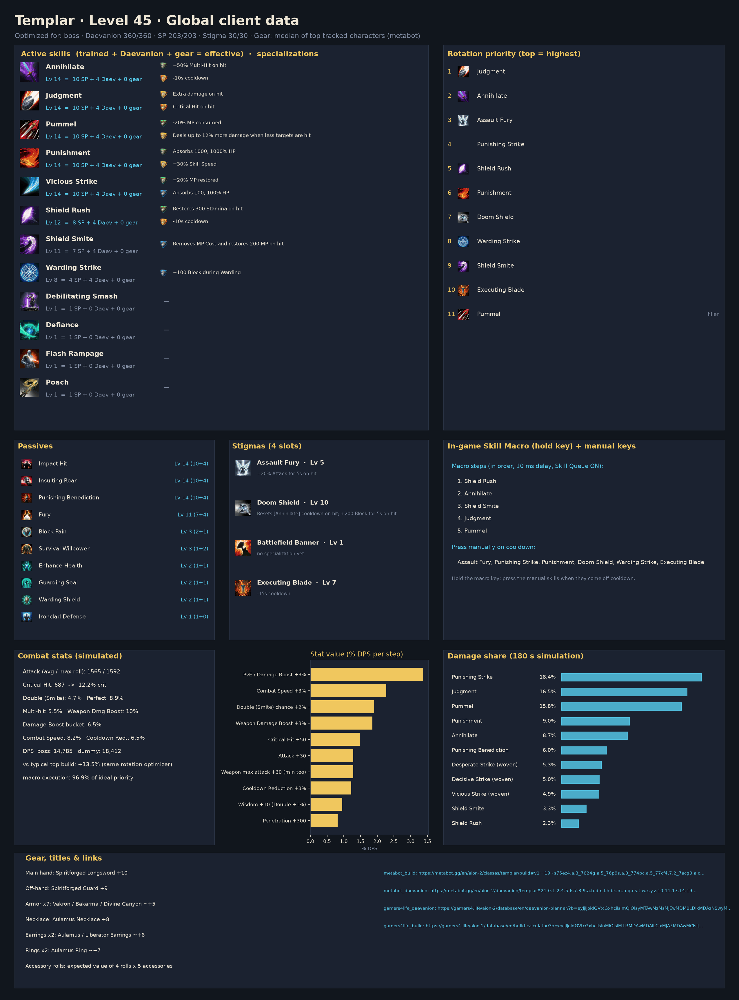
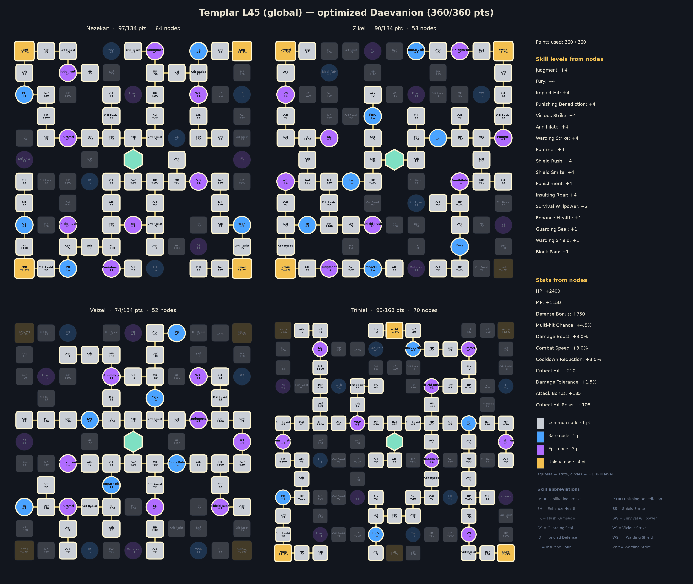
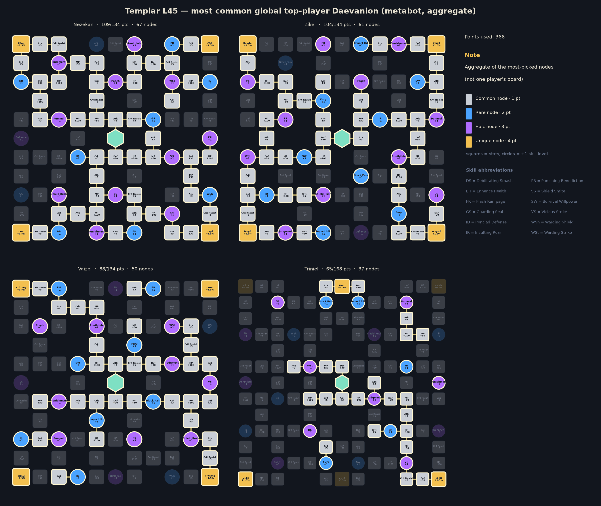

# Templar — level 45 global build, rotation and macro

Generated by `aion2calc` from the global client data (metabot.gg) with Korean data as fallback. Primary view: **boss** fight (see `docs/methodology.md`). Daevanion budget **360** points.



## Damage objective: boss modeled DPS

Score: 15,700 modeled DPS.

boss: 100%, 180.0s, 15,700 DPS

Damage objective subject to the saved HP and trained-skill reserves. Balanced uses equal scenario weights. Stat weights follow the selected objective; skill shares, opener, macro and sensitivity remain primary-scenario views. This local search does not establish a global optimum or competitive PvP efficacy.

## Results

| Build | boss DPS | dummy DPS |
|---|---:|---:|
| **Optimized (this report)** | **15,700** | **19,631** |
| Typical top global build, optimized rotation | 14,309 | 17,893 |
| Typical top global build, default priority | 6,125 | — |

The optimized build is **+9.7%** over the typical top global build played with the same rotation optimizer, and **+156.3%** over that build played with the default priority. *Typical top global build* = average skill levels, the four most-picked damage stigmas and the most-picked Daevanion nodes of the top tracked global L45 players of this class (metabot.gg live data), given the best legal specializations for its levels (specs are not published).

## Rotation (priority list)

Use the highest skill that is ready; the last entry is the filler.

1. `afury`
2. `punishment`
3. `annihilate`
4. `judgment`
5. `vicious_strike [mp_hi]`
6. `warding_strike`
7. `debilitating_smash`
8. `poach`
9. `shield_smite`
10. `shield_rush`
11. `exec`
12. `vicious_strike`

`[sync_de]` = wait for the Delayed Explosion vulnerability window when it is about to be ready; `[in_ee]` = prefer using it inside Element Enhancement; `[mp_hi]` = only while MP is at least 60% (weave it in, keep MP for Grace of Enhancement).

### In-game Skill Macro

**Left mouse button** is the basic auto-attack: `vicious_strike`. Hold it for continuous attacks; the Skill Macro below goes on the **right mouse button** (or another held key). Weave both together.

Settings → Key Settings → General → Skill Macro. Skill Queue (스킬 예약) **ON**, 10 ms delay on every step, hold the macro key; manual presses always take priority over the macro.

| Step | Skill |
|---:|---|
| 1 | annihilate |
| 2 | judgment |
| 3 | shield_rush |
| 4 | shield_smite |
| 5 | debilitating_smash |
| 6 | poach |
| 7 | vicious_strike |
| 8 | vicious_strike |

Manual keys (press on cooldown, in this priority): afury, punishment, warding_strike, exec

Simulated: this layout reaches **76.5%** of the ideal priority list.

**Alternative — macro with manual keys**: macro afury → annihilate → judgment → warding_strike → debilitating_smash → poach → shield_rush → exec → shield_smite → vicious_strike → vicious_strike; manual: punishment. Simulated: **76.3%** of the ideal priority list.

### Opener (first 30 s of the simulated fight)

```
afury@0.0s → punishment@0.9s → vicious_strike@1.9s → vicious_strike@2.6s → vicious_strike@3.4s → vicious_strike@4.2s → vicious_strike@4.9s → vicious_strike@5.7s → vicious_strike@6.5s → vicious_strike@7.2s → vicious_strike@8.0s → vicious_strike@8.8s → vicious_strike@9.6s → vicious_strike@10.3s → vicious_strike@11.1s → vicious_strike@11.8s → vicious_strike@12.6s → vicious_strike@13.4s → vicious_strike@14.2s → vicious_strike@14.9s → vicious_strike@15.7s → vicious_strike@16.5s → vicious_strike@17.2s → vicious_strike@18.0s → vicious_strike@18.8s → vicious_strike@19.6s → vicious_strike@20.3s → vicious_strike@21.1s
```

## Skills, specializations and points

Skill points used **203 / 203**, stigma points **30 / 30**, Daevanion **360 / 360**.

| Skill | Trained (SP) | Effective level | Specializations |
|---|---:|---:|---|
| Vicious Strike | 10 | 14 | +20% MP restored; +50% Multi-Hit on hit |
| Punishing Benediction | 10 | 14 | — |
| Impact Hit | 10 | 14 | — |
| Insulting Roar | 10 | 14 | — |
| Punishment | 10 | 14 | Absorbs 1000, 1000% HP; +30% Skill Speed |
| Fury | 10 | 14 | — |
| Guarding Seal | 10 | 12 | — |
| Survival Willpower | 10 | 12 | — |
| Block Pain | 10 | 12 | — |
| Ironclad Defense | 8 | 11 | — |
| Warding Strike | 1 | 4 | — |
| Judgment | 1 | 4 | — |
| Shield Smite | 1 | 3 | — |
| Enhance Health | 1 | 3 | — |
| Warding Shield | 2 | 3 | — |
| Pummel | 1 | 3 | — |
| Shield Rush | 1 | 3 | — |
| Debilitating Smash | 1 | 2 | — |
| Annihilate | 1 | 2 | — |
| Flash Rampage | 1 | 2 | — |
| Poach | 1 | 2 | — |

**Stigmas**: Assault Fury Lv 13, Battlefield Banner Lv 1, Executing Blade Lv 1, Comrade in Arms Lv 1

## Daevanion (360 points)



* Open in metabot planner: https://metabot.gg/en/aion-2/daevanion/templar#21-0.1.2.6.7.8.9.a.b.c.f.h.i.k.n.q.r.t.w.z.10.11.12.13.14.19.1b.1c.1d.1e.1f.1g.1h.1i.1j.1m.1o.1p.1u.1w.1x.1y.21.22.23.24.25.26.28.29.2a.2b.2c.2e.2f.2g_22-0.1.6.7.8.9.a.b.f.g.h.i.j.p.q.r.s.t.u.v.w.10.11.12.13.14.15.16.17.19.1a.1b.1c.1d.1e.1f.1h.1i.1j.1k.1l.1o.1p.1s.1t.1u.1y.22.24.26.27.28.29.2a.2b.2d.2e_23-0.5.6.a.b.c.e.h.i.j.l.m.p.r.s.t.u.v.w.x.y.z.10.11.14.15.17.1a.1c.1d.1e.1f.1g.1h.1i.1j.1k.1l.1m.1n.1o.1p.1q.1r.1s.1w.1y.1z.21.22.23.26.29.2a.2b.2d.2f.2g_24-1.2.3.4.5.a.d.e.f.g.i.j.k.l.o.p.q.r.s.t.u.v.x.y.z.10.11.13.14.17.18.19.1a.1e.1f.1g.1k.1l.1n.1o.1p.1r.1s.1u.1v.1w.1x.1y.20.21.22.23.26.27.28.29.2c.2d.2e.2f.2g.2h.2j.2l.2m.2n.2o.2q.2u.2y.30.31.32.33.36.37.38
* Open in gamers4.life planner (KR node values, same node IDs): https://gamers4.life/aion-2/database/en/daevanion-planner/?b=eyJjIjoidGVtcGxhciIsImQiOlsyMTAwMzMsMjEwMDM0LDIxMDAzNSwyMTAwNDEsMjEwMDQyLDIxMDA0MywyMTAwNDgsMjEwMDUwLDIxMDA1MSwyMTAwNTIsMjEwMDU2LDIxMDA2MywyMTAwNjQsMjEwMDY3LDIxMDA3MSwyMTAwNzksMjEwMDgyLDIxMDA4NiwyMTAwOTQsMjEwMDk3LDIxMDA5OCwyMTAwOTksMjEwMTAwLDIxMDEwMSwyMTAxMDIsMjEwMTE1LDIxMDEyMywyMTAxMjQsMjEwMTI1LDIxMDEyNiwyMTAxMjcsMjEwMTI4LDIxMDEyOSwyMTAxMzAsMjEwMTMxLDIxMDEzOCwyMTAxNDIsMjEwMTQ0LDIxMDE1NywyMTAxNTksMjEwMTYxLDIxMDE2MiwyMTAxNzAsMjEwMTcxLDIxMDE3MiwyMTAxNzQsMjEwMTc1LDIxMDE3NiwyMTAxODMsMjEwMTg0LDIxMDE4NSwyMTAxODcsMjEwMTg4LDIxMDE5MSwyMTAxOTIsMjEwMTkzLDIyMDAzMywyMjAwMzQsMjIwMDM5LDIyMDA0MCwyMjAwNDEsMjIwMDQyLDIyMDA0MywyMjAwNDgsMjIwMDU4LDIyMDA2MywyMjAwNjQsMjIwMDY1LDIyMDA2NywyMjAwNzMsMjIwMDc4LDIyMDA4MCwyMjAwODEsMjIwMDgyLDIyMDA4NCwyMjAwODYsMjIwMDg4LDIyMDA5NywyMjAwOTksMjIwMTAwLDIyMDEwMSwyMjAxMDIsMjIwMTAzLDIyMDEwOSwyMjAxMTIsMjIwMTE0LDIyMDExNywyMjAxMjMsMjIwMTI0LDIyMDEyNSwyMjAxMjYsMjIwMTI3LDIyMDEzMSwyMjAxMzIsMjIwMTMzLDIyMDEzOCwyMjAxNDAsMjIwMTQ1LDIyMDE0NiwyMjAxNTQsMjIwMTU1LDIyMDE1NiwyMjAxNjEsMjIwMTcxLDIyMDE3NiwyMjAxODMsMjIwMTg0LDIyMDE4NSwyMjAxODYsMjIwMTg3LDIyMDE4OCwyMjAxOTAsMjIwMTkxLDIzMDAzMywyMzAwMzksMjMwMDQwLDIzMDA0OCwyMzAwNTAsMjMwMDUxLDIzMDA1NCwyMzAwNjMsMjMwMDY0LDIzMDA2NSwyMzAwNjgsMjMwMDY5LDIzMDA3MiwyMzAwNzksMjMwMDgyLDIzMDA4NCwyMzAwODcsMjMwMDkzLDIzMDA5NCwyMzAwOTUsMjMwMDk2LDIzMDA5NywyMzAwOTgsMjMwMDk5LDIzMDEwMiwyMzAxMDMsMjMwMTExLDIzMDExOCwyMzAxMjQsMjMwMTI1LDIzMDEyNiwyMzAxMjcsMjMwMTI4LDIzMDEyOSwyMzAxMzAsMjMwMTMxLDIzMDEzMiwyMzAxMzMsMjMwMTM5LDIzMDE0MiwyMzAxNDQsMjMwMTQ3LDIzMDE1MywyMzAxNTQsMjMwMTU1LDIzMDE1OSwyMzAxNjIsMjMwMTYzLDIzMDE3MCwyMzAxNzIsMjMwMTc0LDIzMDE3OCwyMzAxODUsMjMwMTg2LDIzMDE4NywyMzAxODksMjMwMTkyLDIzMDE5MywyNDAwMTgsMjQwMDE5LDI0MDAyMiwyNDAwMjMsMjQwMDI0LDI0MDAzNCwyNDAwMzcsMjQwMDM5LDI0MDA0MCwyNDAwNDEsMjQwMDQ0LDI0MDA0NywyNDAwNDksMjQwMDUyLDI0MDA1NywyNDAwNTksMjQwMDYyLDI0MDA2MywyNDAwNjQsMjQwMDY1LDI0MDA2NiwyNDAwNjcsMjQwMDcwLDI0MDA3MSwyNDAwNzIsMjQwMDczLDI0MDA3NCwyNDAwODEsMjQwMDg1LDI0MDA5MywyNDAwOTQsMjQwMDk1LDI0MDA5NiwyNDAxMDAsMjQwMTAxLDI0MDEwMiwyNDAxMDksMjQwMTExLDI0MDExNSwyNDAxMTcsMjQwMTE5LDI0MDEyMywyNDAxMjQsMjQwMTI2LDI0MDEyNywyNDAxMjgsMjQwMTI5LDI0MDEzMCwyNDAxMzIsMjQwMTMzLDI0MDEzNCwyNDAxMzgsMjQwMTQ3LDI0MDE1MiwyNDAxNTMsMjQwMTU0LDI0MDE1NywyNDAxNTksMjQwMTYwLDI0MDE2MSwyNDAxNjIsMjQwMTYzLDI0MDE2NywyNDAxNzIsMjQwMTczLDI0MDE3NCwyNDAxNzcsMjQwMTgyLDI0MDE4NywyNDAxOTIsMjQwMTk3LDI0MDE5OCwyNDAxOTksMjQwMjAyLDI0MDIwNywyNDAyMDgsMjQwMjA5XX0
* Full skill/stigma/Daevanion build in metabot planner: https://metabot.gg/en/aion-2/classes/templar/build#v1~l19~s75ez4.a.5_774pc.a.5_7k7ds.d.0_7kmtc.2.0_7kuj4.a.0_7l28w.8.0_7l9yo.a.0_7lhog.a.0_7lpe8.a.0_7lx40.a.0_7m4ts.a.0_7mcjk.a.0~g7k7ds_7euhc_7dzm8_7ak5s~d21-0.1.2.6.7.8.9.a.b.c.f.h.i.k.n.q.r.t.w.z.10.11.12.13.14.19.1b.1c.1d.1e.1f.1g.1h.1i.1j.1m.1o.1p.1u.1w.1x.1y.21.22.23.24.25.26.28.29.2a.2b.2c.2e.2f.2g_22-0.1.6.7.8.9.a.b.f.g.h.i.j.p.q.r.s.t.u.v.w.10.11.12.13.14.15.16.17.19.1a.1b.1c.1d.1e.1f.1h.1i.1j.1k.1l.1o.1p.1s.1t.1u.1y.22.24.26.27.28.29.2a.2b.2d.2e_23-0.5.6.a.b.c.e.h.i.j.l.m.p.r.s.t.u.v.w.x.y.z.10.11.14.15.17.1a.1c.1d.1e.1f.1g.1h.1i.1j.1k.1l.1m.1n.1o.1p.1q.1r.1s.1w.1y.1z.21.22.23.26.29.2a.2b.2d.2f.2g_24-1.2.3.4.5.a.d.e.f.g.i.j.k.l.o.p.q.r.s.t.u.v.x.y.z.10.11.13.14.17.18.19.1a.1e.1f.1g.1k.1l.1n.1o.1p.1r.1s.1u.1v.1w.1x.1y.20.21.22.23.26.27.28.29.2c.2d.2e.2f.2g.2h.2j.2l.2m.2n.2o.2q.2u.2y.30.31.32.33.36.37.38

For comparison, the aggregate of the most-picked nodes among top global players:



## Stat priority (simulated)

| Upgrade | DPS gain | Worth in Attack |
|---|---:|---:|
| PvE / Damage Boost +3% | +3.36% | 79 |
| Combat Speed +3% | +2.57% | 60 |
| Critical Hit +50 | +2.03% | 48 |
| Double (Smite) chance +2% | +1.91% | 45 |
| Weapon Damage Boost +3% | +1.86% | 44 |
| Attack +30 | +1.28% | 30 |
| Weapon max attack +30 (min too) | +1.28% | 30 |
| Penetration +300 | +0.96% | 22 |
| PvE Attack +30 | +0.96% | 22 |
| Wisdom +10 (Double +1%) | +0.95% | 22 |
| Time +10 (Combat Speed +1%) | +0.86% | 20 |
| Cooldown Reduction +3% | +0.79% | 19 |
| Might +10 (Attack +1%) | +0.50% | 12 |
| Destruction +10 (Attack +1%) | +0.50% | 12 |
| Front Attack +30 | +0.47% | 11 |
| Critical Damage Boost +3% | +0.38% | 9 |
| Multi-hit chance +3% | +0.37% | 9 |
| Critical Attack +50 | +0.30% | 7 |
| Back Attack +30 | +0.29% | 7 |
| Illusion +10 (Cooldown -1%) | +0.26% | 6 |
| Precision +10 (Crit +1%) | +0.24% | 6 |
| Death +10 (Crit +1%) | +0.24% | 6 |
| Perfect chance +3% | +0.03% | 1 |
| Justice +10 (Perfect +1%) | +0.01% | 0 |
| MP +300 | +0.00% | 0 |
| Freedom +10 (Accuracy +1%) | +0.00% | 0 |

Accuracy is a threshold stat (avoid parries; back attacks ignore them) and is not ranked.

## Gear, rolls, enchanting

Loadout: **Global L45 Templar - median of top tracked characters (metabot)**

* Main hand: Spiritforged Longsword +10
* Off-hand: Spiritforged Guard +9
* Armor x7: Vakron / Bakarma / Divine Canyon ~+5
* Necklace: Aulamus Necklace +8
* Earrings x2: Aulamus / Liberator Earrings ~+6
* Rings x2: Aulamus Ring ~+7
* Accessory rolls: expected value of 4 rolls x 5 accessories
* Bracelets x2: Ascension +9 / Liberator +6
* Amulet: Revelation Amulet +0
* Rune: Clash Rune +2
* Attack title: Guardian of Altgard / Verteron
* Other title: Through Hell and Back
* Owned titles: collection bonuses (estimate)
* Wings: Ultimate Daeva Wings
* Primary/deity stats: profile averages

**Random-roll priority per item** (keep / reroll toward the top of each list):

* **Rupture Tome**: Combat Speed (+8.8% – +10.2%), Damage Boost (+4.9% – +5.7%), Weapon Damage Boost (+6.5% – +7.6%), Critical Hit (+46 – +60), Attack (+30 – +42)
* **Ludras Grimoire**: Combat Speed (+11.2% – +13%), Damage Boost (+6.3% – +7.3%), Weapon Damage Boost (+8.3% – +9.6%), Critical Hit (+59 – +75), Attack (+38 – +51)
* **Spiritforged Guard**: Might (+10 – +10), Accuracy (+30 – +30)
* **Vakron Helm**: Double Chance (+1.6% – +1.9%), Critical Hit (+25 – +36), Attack increase (+1.6% – +1.9%), Attack (+16 – +25), MP (+76 – +94)
* **Bakarma Breastplate**: Damage Boost (+4.4% – +5.2%), Critical Hit (+27 – +38), Attack (+18 – +28), Perfect Chance (+3.9% – +4.6%), MP (+83 – +102)
* **Aulamus Necklace**: Combat Speed (+3.2% – +3.8%), Critical Hit (+35 – +47), Attack (+23 – +33), Might (+9 – +17), Precision (+9 – +17)
* **Aulamus Ring**: Critical Hit (+25 – +36), Attack (+16 – +25), Might (+5 – +13), Precision (+5 – +13), Natural MP Regen (+18 – +28)

**Enchant priority** (DPS per enchant level):

* Weapon (Spiritforged / Rupture): 55.1 DPS/level
* Guard (off-hand): 33.4 DPS/level
* Necklace / Earrings / Rings (Aulamus): 26.7 DPS/level
* Bracelets: 20.0 DPS/level
* Revelation Amulet: 15.0 DPS/level
* Armor pieces: 0.0 DPS/level

## Titles, arcana, wings, pets

**Best titles by equip bonus** (global client values):

| Title | Grade | Equip bonus | Owned bonus |
|---|---|---|---|
| Unbound by Genus (Both factions) | Unique | PvE Damage Boost +4.5%, Attack Bonus +34, Critical Hit +68 | PvE Damage Boost +1% |
| Guardian of Altgard (Asmodian) | Epic | PvE Damage Boost +3%, Penetration +210 | PvE Attack +4 |
| Guardian of Verteron (Elyos) | Epic | PvE Damage Boost +3%, Penetration +210 | PvE Attack +4 |
| Empty Closet (Both factions) | Unique | Combat Speed +3.5%, Natural HP Regen +42, Cooldown Reduction +3.5% | HP +120 |
| Scenery Collector (Both factions) | Epic | PvE Damage Boost +3.3%, Block Penetration +54 | Critical Hit +10 |
| Teleportation Specialist (Both factions) | Epic | PvE Accuracy +58, PvE Damage Boost +3.1% | Critical Hit +10 |
| Nice to Meet You (Both factions) | Rare | PvE Damage Boost +2.9% | PvE Defense +10 |
| Verteron Seal Breaker (Both factions) | Rare | Boss Damage Boost +2.7% | PvE Accuracy +10 |
| The Beacons Are Lit! (Elyos) | Rare | PvE Damage Boost +2.3% | Evasion Bonus +5 |
| Wasting Hard Work (Asmodian) | Rare | PvE Damage Boost +2.3% | Evasion Bonus +5 |

**Arcana variant per slot** (deity stat that is worth more for this build):

* Chalice / Grail: **Vigor or Frenzy** (Time +20)
* Parchment: either variant (Life +20 / Destiny +20: no damage either way)
* Compass: **Magic or Purity** (Death +20)
* Bell: **Magic or Purity** (Destruction +20)
* Mirror: **Magic or Purity** (Wisdom +20)

**Arcana skill rolls.** Each arcana gives (grade base + enhancement level) random skill levels from its slot's pool — Rare 2, Legend 3, Unique 4 base rolls, +1 per enhancement level (so a Unique +5 gives 9); a skill rolled again gains another level, up to the cap. Chalice, Parchment and Compass roll active skills; Bell and Mirror roll passives.

| Arcana slot | Expected DPS, Unique +0 (4 rolls) | Expected DPS, Unique +5 (9 rolls) | Best rolls (+1 / +2) |
|---|---:|---:|---|
| Parchment | +6.1% | +19.4% | Vicious Strike +1.3% / +37.8%, Punishment +0.1% / +4.1%, Poach +0.0% / +0.0% |
| Chalice | +1.1% | +4.0% | Vicious Strike +1.3% / +37.8%, Punishing Benediction +0.5% / +1.0%, Impact Hit +0.3% / +0.6% |
| Bell | +0.7% | +1.6% | Punishing Benediction +0.5% / +1.0%, Insulting Roar +0.3% / +0.5%, Fury +0.1% / +0.3% |
| Mirror | +0.2% | +0.5% | Impact Hit +0.3% / +0.6%, Warding Shield +0.0% / +0.0%, Ironclad Defense +0.0% / +0.0% |
| Compass | +0.0% | +0.0% | Pummel +0.0% / +0.0%, Shield Smite +0.0% / +0.0%, Shield Rush +0.0% / +0.0% |

Biggest single-level jumps (usually a specialization unlocking at Lv 16): Vicious Strike +36.4%, Punishment +3.9%, Punishing Benediction +0.5%, Impact Hit +0.3%.

**Deity (pantheon) stats**, +10 points each (arcana main stats, Abyssal Bracelet rolls, Monolith rewards): Wisdom +0.95%, Time +0.86%, Might +0.50%, Destruction +0.50%, Illusion +0.26%, Death +0.24%, Justice +0.01%.

**Closet / appearance collection**: every unlocked skin and costume set adds permanent Collection Effect stats, and wings keep a Retention Effect once owned. The client tables for these are not public, so they are not itemised here; they are flat stats, so value them with the stat table above and collect the cheap ones first.

**Wings**: Ultimate Daeva Wings (Accuracy +40, Penetration +500) are the most used and the best launch option for damage among common wings. **Pets**: pet collection bonuses are mostly genus-specific (damage vs that monster genus) plus Accuracy/Crit; level the genus of the content you farm first.

## Robustness

Samples with no modeled damage are excluded from percentage losses.

Every animation time was randomly perturbed by up to ±25% (8 samples) and the rotation re-optimized each time. Playing the recommended priority instead of the re-optimized one lost on average **0.00%** (worst 0.00%).

**Crit curve.** The crit-chance curve is fitted to tests at Crit 1048–1326 and extrapolated down to launch values: this build sits at **13.6%** crit, and Crit +50 ranks #3 (+2.03%). If launch testing shows more crit — e.g. the curve shifted to a midpoint of 700, giving 54% — Crit +50 becomes #2 (+3.31%). Re-run with `--crit-midpoint` once real numbers exist.

## Validation against Korean logs

Simulated damage shares (training dummy) overlap **12%** with the mean of the top-10 A2DIL Korean dummy logs; 28% of the Korean damage comes from skills that are not in the global level-45 client. Korea plays above level 45 with Lv 16-20 specializations, so a perfect match is not expected; low values mean the class kit needs hand-tuning (see `kit/sorcerer.py` for a hand-written kit).

## Sources

* metabot.gg (global client): class skills, Daevanion boards, items, titles, top-player statistics
* gamers4.life (KR database): skill hit counts, build/Daevanion planners
* A2DIL (KR training-dummy logs): damage-share validation
* Inven / Bahamut damage research, aion2ssow calculator: damage formula

See `docs/methodology.md` for every formula and assumption.
