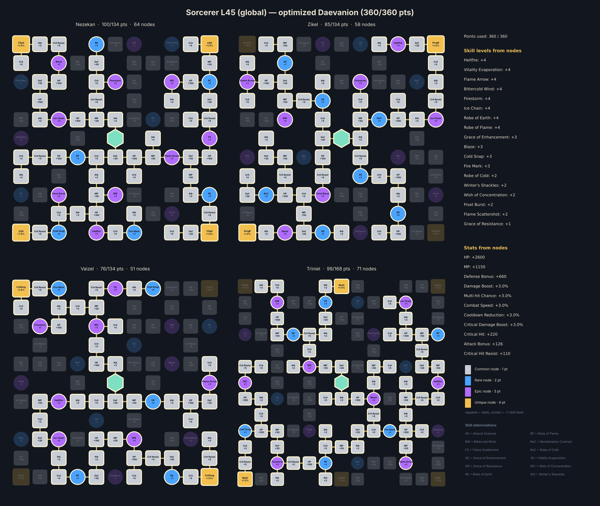
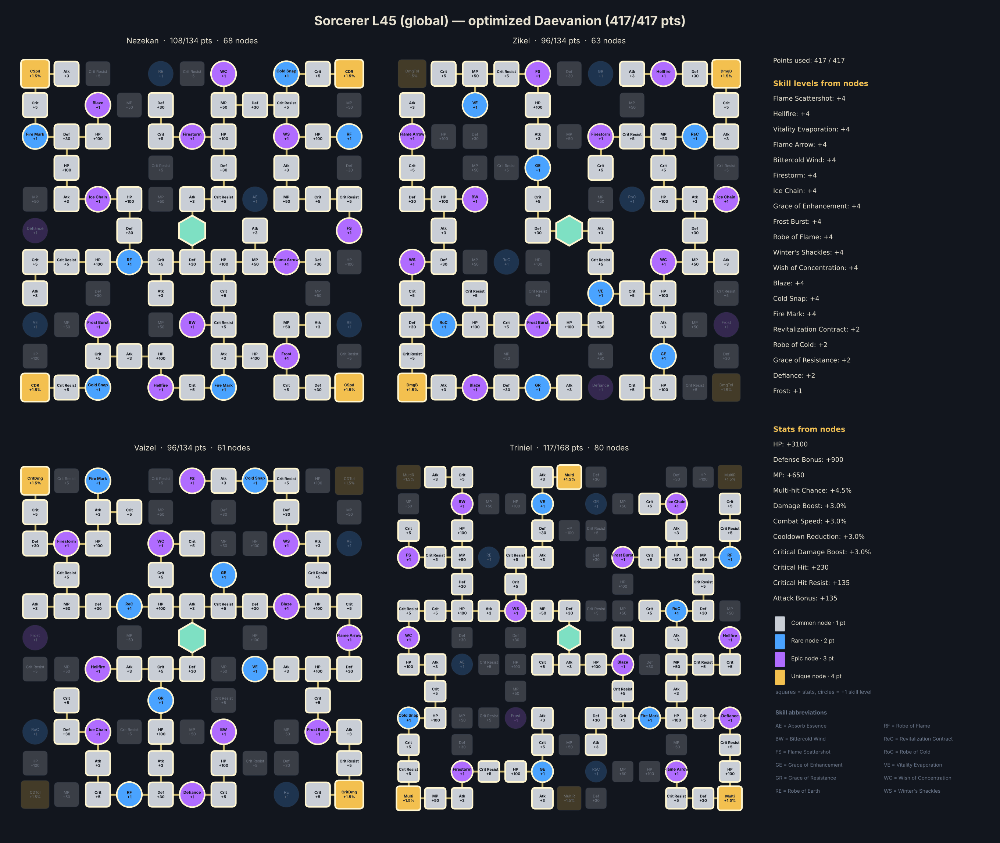

# Sorcerer · sorcerer_l45_global_median  vs  Sorcerer · sorcerer_l45_global_median

| | A | B | B vs A |
|---|---:|---:|---:|
| boss modeled DPS | 23,876 | 49,658 | +108.0% |
| boss DPS | 23,876 | 49,658 | +108.0% |
| dummy DPS | 27,746 | 47,760 | +72.1% |
| Crit chance | 5.1% | 5.4% | |
| Cooldown reduction | 6.5% | 6.5% | |
| Combat Speed | 8.2% | 8.2% | |
| Attack (avg) | 1,404 | 1,413 | |
| Damage Boost bucket | 20.5% | 26.5% | |

## Build changes

| Skill | What | A | B |
|---|---|---|---|
| Absorb Essence | SP level | 10 | 1 |
| Grace of Resistance | SP level | 1 | 5 |
| Revitalization Contract | SP level | 5 | 10 |
| Absorb Essence | effective level | 10 | 1 |
| Bittercold Wind | effective level | 14 | 18 |
| Blaze | effective level | 13 | 20 |
| Cold Snap | effective level | 13 | 14 |
| Cold Storm | effective level | 5 | 13 |
| Defiance | effective level | 1 | 3 |
| Delayed Explosion | effective level | 5 | 8 |
| Element Enhancement | effective level | 10 | 20 |
| Fire Mark | effective level | 13 | 14 |
| Fire Wall | effective level | 5 | 20 |
| Firestorm | effective level | 14 | 20 |
| Flame Arrow | effective level | 14 | 17 |
| Flame Scattershot | effective level | 12 | 20 |
| Frost | effective level | 10 | 11 |
| Frost Burst | effective level | 12 | 14 |
| Grace of Enhancement | effective level | 13 | 14 |
| Grace of Resistance | effective level | 2 | 7 |
| Hellfire | effective level | 14 | 20 |
| Ice Chain | effective level | 14 | 20 |
| Revitalization Contract | effective level | 5 | 12 |
| Robe of Earth | effective level | 14 | 10 |
| Robe of Flame | effective level | 14 | 20 |
| Vitality Evaporation | effective level | 14 | 15 |
| Winter's Shackles | effective level | 12 | 14 |
| Wish of Concentration | effective level | 12 | 20 |
| Blaze | specializations | Delayed Damage after 3s; Multi-Hit on hit | +50% MP restored; Delayed Damage after 3s; -3s [Wish of Concentration] cooldown on hit |
| Firestorm | specializations | -50% MP Cost; -2s [Hellfire] cooldown per fireball | +20% Skill Speed; -2s [Hellfire] cooldown per fireball; +15% damage per fireball, up to +75% |
| Flame Arrow | specializations | Absorbs 100, 100% HP; +50% Multi-Hit on hit | +5% Fire Damage Boost for 10s on activating [Pyroclasm]; Reset [Blaze] cooldown on landing [Pyroclasm] |
| Flame Scattershot | specializations | Absorbs 500, 500% HP; Multi-Hit on hit | Absorbs 500, 500% HP; Multi-Hit on hit; -1s all skill cooldowns on hit |
| Frost | specializations | Restores 200 MP | Reset [Frost Burst] cooldown on landing Frost |
| Hellfire | specializations | Fire Damage over Time for 10s on hit; Ignores Block and Evasion and lands as Multi-Hit | Fire Damage over Time for 10s on hit; Ignores Block and Evasion and lands as Multi-Hit; -15s cooldown |
| Ice Chain | specializations | +20% Skill Speed; Deals up to 12% more damage when less targets are hit | +20% Skill Speed; Deals up to 12% more damage when less targets are hit; -1s [Winter's Shackles] cooldown on hit |
| Winter's Shackles | specializations | +20% PvE Damage Boost and +10% PvP Damage Boost for 5s on landing [Winter's Shackles]; Adds [Winter's Illusion] Chain Skill | 30% chance to inflict Frost for 3s on landing [Winter's Shackles]; +20% PvE Damage Boost and +10% PvP Damage Boost for 5s on landing [Winter's Shackles] |
| Wish of Concentration | specializations | +10% additional Attack; +10% Combat Speed | +10% additional Attack; +10% Combat Speed; -10s all skill cooldowns |
| Cold Storm | stigma level | 5 | 13 |
| Delayed Explosion | stigma level | 5 | 8 |
| Element Enhancement | stigma level | 10 | 20 |
| Fire Wall | stigma level | 5 | 20 |

Daevanion: 206 nodes shared, 38 only in A, 66 only in B.

## Daevanion boards

A:

B:

## Rotation

| # | A | B |
|---:|---|---|
| 1 | `frost_burst` | `blaze [in_ee]` |
| 2 | `winters_shackles [sync_de]` | `fire_wall` |
| 3 | `fire_wall` | `flame_scattershot` |
| 4 | `wish` | `element_enhancement` |
| 5 | `element_enhancement` | `cold_storm` |
| 6 | `cold_storm` | `wish` |
| 7 | `blaze` | `delayed_explosion` |
| 8 | `bittercold_wind` | `bittercold_wind` |
| 9 | `delayed_explosion` | `winters_shackles [sync_de]` |
| 10 | `firestorm` | `hellfire_c3` |
| 11 | `hellfire_c3 [sync_de]` | `frost_burst` |
| 12 | `frost` | `firestorm` |
| 13 | `flame_scattershot` | `frost` |
| 14 | `ice_chain [mp_hi]` | `ice_chain [mp_hi]` |
| 15 | `flame_arrow` | `flame_arrow` |

## Stat weights (DPS gain per step)

| Upgrade | A | B |
|---|---:|---:|
| Cooldown Reduction +3% | +3.33% | +3.08% |
| PvE / Damage Boost +3% | +2.55% | +2.14% |
| Double (Smite) chance +2% | +1.69% | +1.53% |
| Weapon Damage Boost +3% | +1.63% | +1.50% |
| PvE Attack +30 | +1.62% | +1.27% |
| Penetration +300 | +1.62% | +1.27% |
| Critical Hit +50 | +1.35% | +0.97% |
| Combat Speed +3% | +0.95% | +1.27% |
| Attack +30 | +1.20% | +1.10% |
| Weapon max attack +30 (min too) | +1.20% | +1.10% |
| Illusion +10 (Cooldown -1%) | +1.11% | +1.03% |
| Critical Attack +50 | +1.04% | +0.73% |
| Wisdom +10 (Double +1%) | +0.84% | -3.66% |
| Critical Damage Boost +3% | +0.62% | +0.59% |
| Front Attack +30 | +0.61% | +0.44% |
| Might +10 (Attack +1%) | +0.49% | +0.42% |
| Destruction +10 (Attack +1%) | +0.49% | +0.42% |
| Back Attack +30 | +0.42% | +0.31% |
| Time +10 (Combat Speed +1%) | +0.32% | +0.42% |
| Multi-hit chance +3% | +0.20% | +0.20% |
| Precision +10 (Crit +1%) | +0.12% | +0.09% |
| Death +10 (Crit +1%) | +0.12% | +0.09% |
| Perfect chance +3% | +0.01% | +0.01% |
| Justice +10 (Perfect +1%) | +0.00% | +0.00% |
| Freedom +10 (Accuracy +1%) | +0.00% | +0.00% |
| MP +300 | +0.00% | -5.73% |

## Damage shares

| Source | A | B |
|---|---:|---:|
| Hellfire | 15.9% | 18.8% |
| Fire Wall | 6.1% | 13.4% |
| Ice Chain | 12.6% | 3.2% |
| Fire Wall (Embers) | 5.2% | 10.5% |
| Blaze | 7.5% | 6.8% |
| Bittercold Wind | 7.2% | 5.8% |
| Firestorm | 7.0% | 5.9% |
| Cold Storm | 5.4% | 6.8% |
| Cold Storm (Frostbite) | 4.4% | 5.5% |
| Fire Mark | 3.6% | 3.2% |
| Cold Snap | 3.3% | 1.6% |
| Hellfire (DoT) | 2.7% | 3.0% |
| Vitality Evaporation | 2.9% | 1.8% |
| Grace of Enhancement | 2.8% | 1.6% |
| Flame Scattershot | 2.0% | 2.1% |
| Blaze (delayed) | 2.0% | 2.0% |
