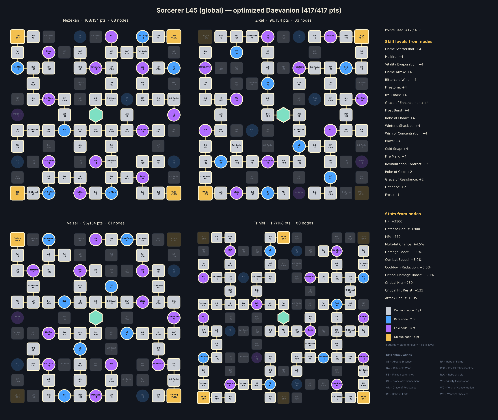
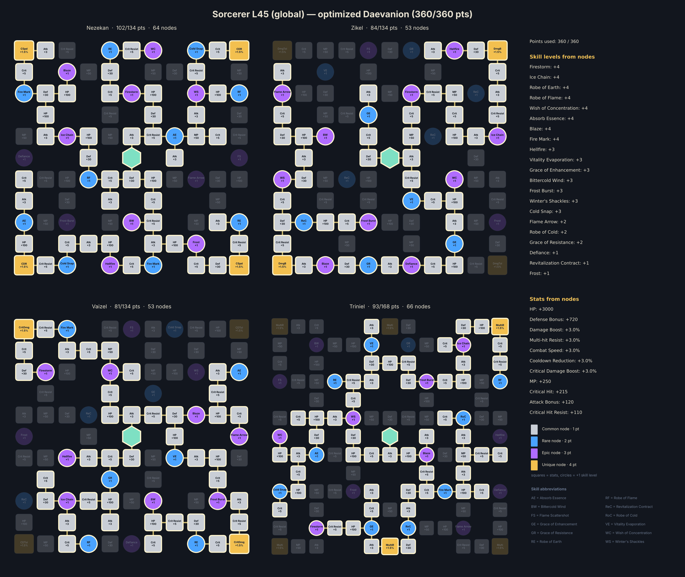

# Sorcerer · sorcerer_l45_global_median  vs  Sorcerer · sorcerer_l45_geared

| | A | B | B vs A |
|---|---:|---:|---:|
| boss modeled DPS | 49,658 | 43,793 | -11.8% |
| boss DPS | 49,658 | 43,793 | -11.8% |
| dummy DPS | 47,760 | 50,240 | +5.2% |
| Crit chance | 5.4% | 11.7% | |
| Cooldown reduction | 6.5% | 10.3% | |
| Combat Speed | 8.2% | 13.7% | |
| Attack (avg) | 1,413 | 1,877 | |
| Damage Boost bucket | 26.5% | 24.0% | |

## Build changes

| Skill | What | A | B |
|---|---|---|---|
| Absorb Essence | SP level | 1 | 10 |
| Grace of Resistance | SP level | 5 | 1 |
| Revitalization Contract | SP level | 10 | 5 |
| Absorb Essence | effective level | 1 | 11 |
| Bittercold Wind | effective level | 18 | 15 |
| Blaze | effective level | 20 | 15 |
| Cold Snap | effective level | 14 | 15 |
| Fire Mark | effective level | 14 | 16 |
| Firestorm | effective level | 20 | 15 |
| Flame Arrow | effective level | 17 | 15 |
| Flame Scattershot | effective level | 20 | 13 |
| Frost | effective level | 11 | 14 |
| Grace of Enhancement | effective level | 14 | 16 |
| Grace of Resistance | effective level | 7 | 4 |
| Hellfire | effective level | 20 | 15 |
| Ice Chain | effective level | 20 | 15 |
| Revitalization Contract | effective level | 12 | 8 |
| Robe of Cold | effective level | 3 | 4 |
| Robe of Earth | effective level | 10 | 11 |
| Robe of Flame | effective level | 20 | 16 |
| Winter's Shackles | effective level | 14 | 15 |
| Wish of Concentration | effective level | 20 | 15 |
| Blaze | specializations | +50% MP restored; Delayed Damage after 3s; -3s [Wish of Concentration] cooldown on hit | Delayed Damage after 3s; Multi-Hit on hit |
| Firestorm | specializations | +20% Skill Speed; -2s [Hellfire] cooldown per fireball; +15% damage per fireball, up to +75% | -50% MP Cost; -2s [Hellfire] cooldown per fireball |
| Flame Arrow | specializations | +5% Fire Damage Boost for 10s on activating [Pyroclasm]; Reset [Blaze] cooldown on landing [Pyroclasm] | +20% MP restored; +50% Multi-Hit on hit |
| Flame Scattershot | specializations | Absorbs 500, 500% HP; Multi-Hit on hit; -1s all skill cooldowns on hit | Restores 120 MP; Multi-Hit on hit |
| Frost | specializations | Reset [Frost Burst] cooldown on landing Frost | Restores 200 MP; -5s cooldown |
| Hellfire | specializations | Fire Damage over Time for 10s on hit; Ignores Block and Evasion and lands as Multi-Hit; -15s cooldown | Fire Damage over Time for 10s on hit; Ignores Block and Evasion and lands as Multi-Hit |
| Ice Chain | specializations | +20% Skill Speed; Deals up to 12% more damage when less targets are hit; -1s [Winter's Shackles] cooldown on hit | +20% Skill Speed; -1s [Winter's Shackles] cooldown on hit |
| Winter's Shackles | specializations | 30% chance to inflict Frost for 3s on landing [Winter's Shackles]; +20% PvE Damage Boost and +10% PvP Damage Boost for 5s on landing [Winter's Shackles] | +20% PvE Damage Boost and +10% PvP Damage Boost for 5s on landing [Winter's Shackles]; Adds [Winter's Illusion] Chain Skill |
| Wish of Concentration | specializations | +10% additional Attack; +10% Combat Speed; -10s all skill cooldowns | +10% additional Attack; +10% Combat Speed |

Daevanion: 242 nodes shared, 30 only in A, 26 only in B.

## Daevanion boards

A:

B:

## Rotation

| # | A | B |
|---:|---|---|
| 1 | `blaze [in_ee]` | `fire_wall` |
| 2 | `fire_wall` | `element_enhancement` |
| 3 | `flame_scattershot` | `wish` |
| 4 | `element_enhancement` | `cold_storm` |
| 5 | `cold_storm` | `delayed_explosion` |
| 6 | `wish` | `bittercold_wind` |
| 7 | `delayed_explosion` | `blaze` |
| 8 | `bittercold_wind` | `winters_shackles` |
| 9 | `winters_shackles [sync_de]` | `hellfire_c3` |
| 10 | `hellfire_c3` | `firestorm` |
| 11 | `frost_burst` | `frost_burst` |
| 12 | `firestorm` | `frost` |
| 13 | `frost` | `ice_chain [mp_hi]` |
| 14 | `ice_chain [mp_hi]` | `flame_scattershot` |
| 15 | `flame_arrow` | `flame_arrow` |

## Stat weights (DPS gain per step)

| Upgrade | A | B |
|---|---:|---:|
| Cooldown Reduction +3% | +3.08% | +3.96% |
| PvE / Damage Boost +3% | +2.14% | +2.29% |
| Critical Hit +50 | +0.97% | +2.04% |
| Double (Smite) chance +2% | +1.53% | +1.61% |
| Weapon Damage Boost +3% | +1.50% | +1.50% |
| Illusion +10 (Cooldown -1%) | +1.03% | +1.32% |
| PvE Attack +30 | +1.27% | +1.15% |
| Penetration +300 | +1.27% | +1.15% |
| Combat Speed +3% | +1.27% | +0.87% |
| Attack +30 | +1.10% | +0.99% |
| Weapon max attack +30 (min too) | +1.10% | +0.99% |
| Critical Damage Boost +3% | +0.59% | +0.80% |
| Critical Attack +50 | +0.73% | +0.80% |
| Might +10 (Attack +1%) | +0.42% | +0.51% |
| Destruction +10 (Attack +1%) | +0.42% | +0.51% |
| Front Attack +30 | +0.44% | +0.42% |
| Time +10 (Combat Speed +1%) | +0.42% | +0.29% |
| Back Attack +30 | +0.31% | +0.29% |
| Death +10 (Crit +1%) | +0.09% | +0.23% |
| Precision +10 (Crit +1%) | +0.09% | +0.23% |
| Multi-hit chance +3% | +0.20% | +0.20% |
| Perfect chance +3% | +0.01% | +0.01% |
| Justice +10 (Perfect +1%) | +0.00% | +0.00% |
| Freedom +10 (Accuracy +1%) | +0.00% | +0.00% |
| Wisdom +10 (Double +1%) | -3.66% | -1.03% |
| MP +300 | -5.73% | -1.93% |

## Damage shares

| Source | A | B |
|---|---:|---:|
| Hellfire | 18.8% | 15.1% |
| Fire Wall | 13.4% | 11.8% |
| Ice Chain | 3.2% | 10.8% |
| Fire Wall (Embers) | 10.5% | 8.8% |
| Blaze | 6.8% | 6.8% |
| Cold Storm | 6.8% | 6.3% |
| Firestorm | 5.9% | 5.7% |
| Bittercold Wind | 5.8% | 5.6% |
| Cold Storm (Frostbite) | 5.5% | 4.7% |
| Fire Mark | 3.2% | 3.4% |
| Hellfire (DoT) | 3.0% | 2.2% |
| Cold Snap | 1.6% | 2.5% |
| Vitality Evaporation | 1.8% | 2.2% |
| Flame Scattershot | 2.1% | 0.0% |
| Blaze (delayed) | 2.0% | 1.8% |
| Grace of Enhancement | 1.6% | 2.0% |
