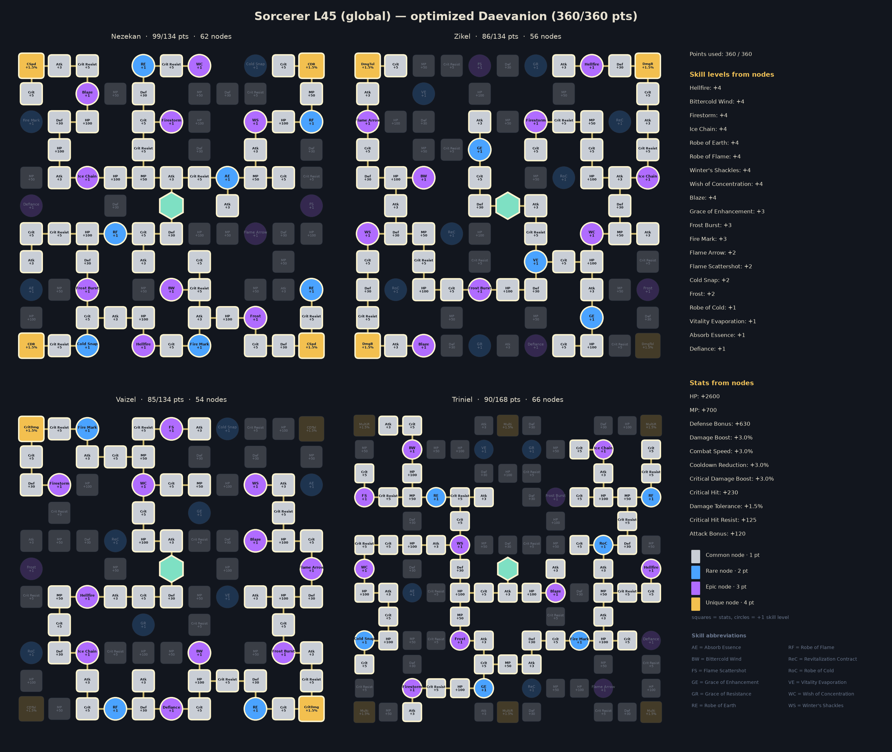

# Sorcerer · sorcerer_l45_global_median  vs  Sorcerer · sorcerer_l45_geared

| | A | B | B vs A |
|---|---:|---:|---:|
| boss modeled DPS | 21,722 | 31,547 | +45.2% |
| boss DPS | 21,722 | 31,547 | +45.2% |
| dummy DPS | 25,723 | 36,494 | +41.9% |
| Crit chance | 4.1% | 12.8% | |
| Cooldown reduction | 6.5% | 10.3% | |
| Combat Speed | 8.2% | 13.7% | |
| Attack (avg) | 1,398 | 1,861 | |
| Damage Boost bucket | 20.5% | 24.0% | |

## Build changes

| Skill | What | A | B |
|---|---|---|---|
| Absorb Essence | SP level | 4 | 1 |
| Blaze | SP level | 9 | 10 |
| Cold Snap | SP level | 4 | 6 |
| Firestorm | SP level | 10 | 9 |
| Flame Arrow | SP level | 7 | 10 |
| Flame Scattershot | SP level | 7 | 3 |
| Frost Burst | SP level | 8 | 1 |
| Grace of Enhancement | SP level | 2 | 3 |
| Robe of Earth | SP level | 8 | 9 |
| Winter's Shackles | SP level | 6 | 7 |
| Absorb Essence | effective level | 6 | 2 |
| Bittercold Wind | effective level | 12 | 13 |
| Blaze | effective level | 13 | 15 |
| Cold Snap | effective level | 7 | 9 |
| Fire Mark | effective level | 10 | 12 |
| Firestorm | effective level | 13 | 14 |
| Flame Arrow | effective level | 10 | 13 |
| Flame Scattershot | effective level | 9 | 5 |
| Frost | effective level | 2 | 4 |
| Frost Burst | effective level | 12 | 4 |
| Grace of Enhancement | effective level | 5 | 8 |
| Grace of Resistance | effective level | 2 | 1 |
| Hellfire | effective level | 13 | 15 |
| Ice Chain | effective level | 14 | 15 |
| Revitalization Contract | effective level | 1 | 2 |
| Robe of Cold | effective level | 1 | 3 |
| Robe of Earth | effective level | 12 | 14 |
| Robe of Flame | effective level | 14 | 16 |
| Vitality Evaporation | effective level | 10 | 9 |
| Winter's Shackles | effective level | 8 | 12 |
| Wish of Concentration | effective level | 12 | 13 |
| Flame Arrow | specializations | +20% MP restored | +20% MP restored; +5% Fire Damage Boost for 10s on activating [Pyroclasm] |
| Flame Scattershot | specializations | Restores 120 MP | — |
| Frost Burst | specializations | Absorbs 700, 700% HP; Ignores Block and Evasion and lands as a Critical Hit | — |
| Ice Chain | specializations | +20% Skill Speed; Deals up to 12% more damage when less targets are hit | +20% Skill Speed; -1s [Winter's Shackles] cooldown on hit |
| Winter's Shackles | specializations | +20% PvE Damage Boost and +10% PvP Damage Boost for 5s on landing [Winter's Shackles] | +20% PvE Damage Boost and +10% PvP Damage Boost for 5s on landing [Winter's Shackles]; Adds [Winter's Illusion] Chain Skill |

Daevanion: 179 nodes shared, 58 only in A, 59 only in B.

## Daevanion boards

A:

B:

## Rotation

| # | A | B |
|---:|---|---|
| 1 | `wish` | `cold_storm` |
| 2 | `fire_wall` | `element_enhancement` |
| 3 | `element_enhancement` | `fire_wall [mp_hi]` |
| 4 | `blaze` | `wish` |
| 5 | `cold_storm` | `delayed_explosion` |
| 6 | `winters_shackles` | `hellfire_c3` |
| 7 | `bittercold_wind [in_ee]` | `blaze` |
| 8 | `delayed_explosion` | `firestorm` |
| 9 | `hellfire_c3 [sync_de]` | `winters_shackles [sync_de]` |
| 10 | `frost` | `frost` |
| 11 | `firestorm` | `bittercold_wind [mp_hi]` |
| 12 | `frost_burst` | `frost_burst` |
| 13 | `flame_scattershot` | `flame_scattershot` |
| 14 | `ice_chain [mp_hi]` | `ice_chain [mp_hi]` |
| 15 | `flame_arrow` | `flame_arrow` |

## Stat weights (DPS gain per step)

| Upgrade | A | B |
|---|---:|---:|
| Cooldown Reduction +3% | +3.34% | +2.83% |
| Critical Hit +50 | +1.24% | +2.68% |
| PvE / Damage Boost +3% | +2.55% | +2.40% |
| PvE Attack +30 | +1.71% | +1.35% |
| Penetration +300 | +1.71% | +1.35% |
| Double (Smite) chance +2% | +1.66% | +1.66% |
| Weapon Damage Boost +3% | +1.61% | +1.55% |
| Weapon max attack +30 (min too) | +1.24% | +1.06% |
| Attack +30 | +1.24% | +1.06% |
| Illusion +10 (Cooldown -1%) | +1.11% | +0.94% |
| Combat Speed +3% | +1.10% | +1.07% |
| Critical Attack +50 | +0.68% | +0.86% |
| Wisdom +10 (Double +1%) | +0.83% | -0.70% |
| Critical Damage Boost +3% | +0.41% | +0.73% |
| Front Attack +30 | +0.64% | +0.50% |
| Might +10 (Attack +1%) | +0.50% | +0.54% |
| Destruction +10 (Attack +1%) | +0.50% | +0.54% |
| Back Attack +30 | +0.44% | +0.35% |
| Time +10 (Combat Speed +1%) | +0.37% | +0.36% |
| Precision +10 (Crit +1%) | +0.10% | +0.31% |
| Death +10 (Crit +1%) | +0.10% | +0.31% |
| Multi-hit chance +3% | +0.24% | +0.23% |
| Perfect chance +3% | +0.01% | +0.01% |
| Justice +10 (Perfect +1%) | +0.00% | +0.00% |
| MP +300 | +0.00% | -1.15% |
| Freedom +10 (Accuracy +1%) | +0.00% | +0.00% |

## Damage shares

| Source | A | B |
|---|---:|---:|
| Hellfire | 14.9% | 16.8% |
| Ice Chain | 12.5% | 8.8% |
| Blaze | 7.3% | 8.0% |
| Bittercold Wind | 7.7% | 5.8% |
| Firestorm | 6.9% | 7.5% |
| Fire Wall | 6.8% | 7.3% |
| Cold Storm | 5.8% | 6.0% |
| Fire Wall (Embers) | 5.8% | 5.4% |
| Cold Storm (Frostbite) | 4.8% | 4.8% |
| Fire Mark | 3.7% | 3.9% |
| Hellfire (DoT) | 3.0% | 2.8% |
| Cold Snap | 2.8% | 2.6% |
| Flame Scattershot | 2.6% | 1.4% |
| Vitality Evaporation | 2.6% | 2.3% |
| Grace of Enhancement | 2.5% | 2.4% |
| Blaze (delayed) | 2.1% | 2.2% |
