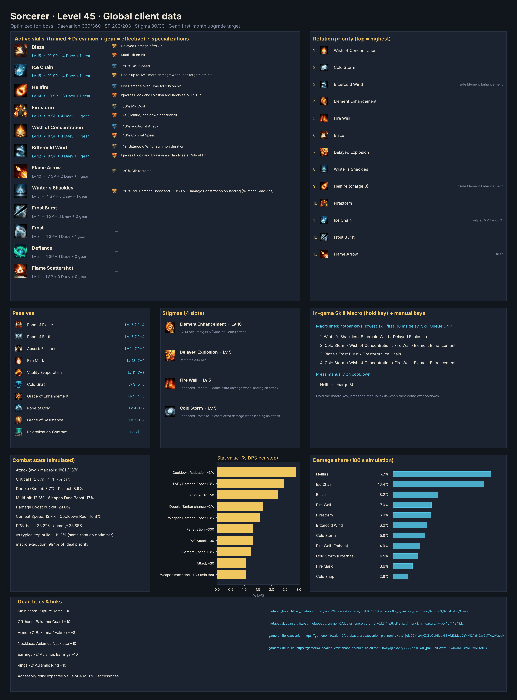
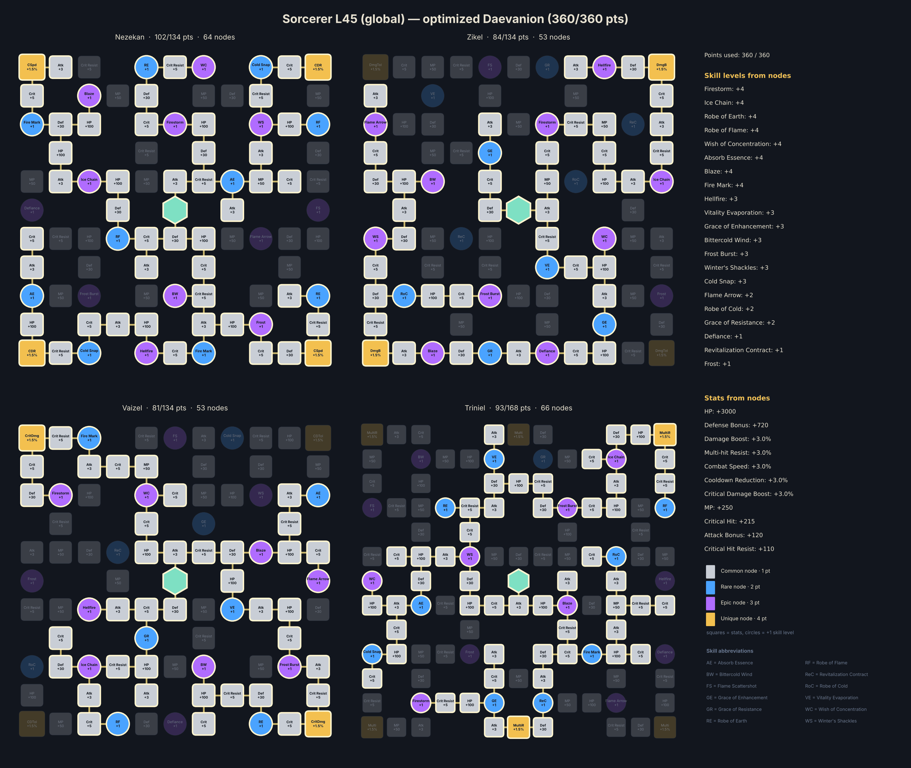
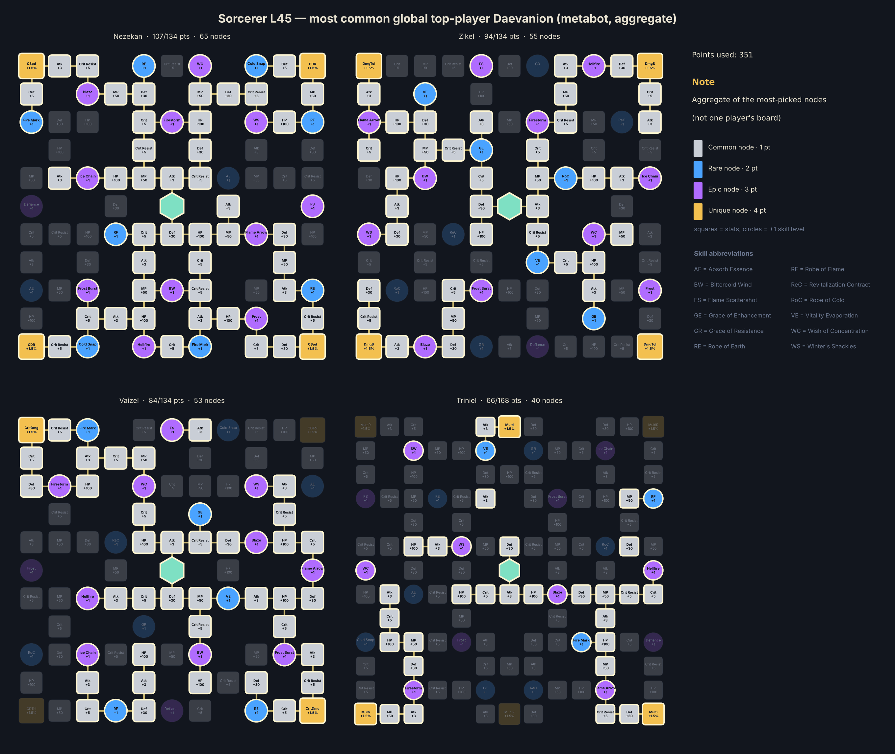

# Sorcerer — level 45 global build, rotation and macro

Generated by `aion2calc` from the global client data (metabot.gg) with Korean data as fallback. Primary view: **boss** fight (see `docs/methodology.md`). Daevanion budget **417** points.



## Damage objective: boss modeled DPS

Score: 43,793 modeled DPS.

boss: 100%, 180.0s, 43,793 DPS

Damage objective subject to the saved HP and trained-skill reserves. Balanced uses equal scenario weights. Stat weights follow the selected objective; skill shares, opener, macro and sensitivity remain primary-scenario views. This local search does not establish a global optimum or competitive PvP efficacy.

## Results

| Build | boss DPS | dummy DPS |
|---|---:|---:|
| **Optimized (this report)** | **43,793** | **50,240** |
| Typical top global build, optimized rotation | 37,722 | 43,447 |
| Typical top global build, default priority | 31,103 | — |

**Whole fight:** 34,813 DPS on the boss scenario, the same rotation stretched over the 35% of a recorded boss fight this class's players spend pressing nothing or dodging (the log server's public uploads). The table above is the rotation's own DPS, which the optimizer compares builds by; a parse on the log server is a whole fight's.

The optimized build is **+16.1%** over the typical top global build played with the same rotation optimizer, and **+40.8%** over that build played with the default priority. *Typical top global build* = average skill levels, the four most-picked damage stigmas and the most-picked Daevanion nodes of the top tracked global L45 players of this class (metabot.gg live data), fitted to this build's skill and stigma points (spare points raise its most-levelled skills and stigmas first) and given the best legal specializations for its levels (specs are not published).

## Rotation (priority list)

Use the highest skill that is ready; the last entry is the filler.

1. `fire_wall`
2. `element_enhancement`
3. `wish`
4. `cold_storm`
5. `delayed_explosion`
6. `bittercold_wind`
7. `blaze`
8. `winters_shackles`
9. `hellfire_c3`
10. `firestorm`
11. `frost_burst`
12. `frost`
13. `ice_chain [mp_hi]`
14. `flame_scattershot`
15. `flame_arrow`

`[sync_de]` = wait for the Delayed Explosion vulnerability window when it is about to be ready; `[in_ee]` = prefer using it inside Element Enhancement; `[mp_hi]` = only while MP is at least 60% (weave it in, keep MP for Grace of Enhancement).

### In-game Skill Macro

**Left mouse button** is the basic auto-attack: `flame_arrow`. Hold it for continuous attacks; the Skill Macro below goes on the **right mouse button** (or another held key). Weave both together.

Each line is a hotbar key: put its skills on that key in the order listed, the first lowest (a key holds up to four). The macro casts a key's skills from first to last, skipping any that cannot be cast, then moves to the next line. Then Settings → Key Settings → General → Skill Macro: add the keys as macro lines from top to bottom, each once: held, the macro cycles through them. Skill Queue (스킬 예약) **ON**, 10 ms delay on every line, hold the macro key; manual presses always take priority over the macro. A skill's key presses its chain step while the chain is open, in the macro too.

| Line | Hotbar key holds (cast in this order) |
|---:|---|
| 1 | fire_wall › wish › element_enhancement |
| 2 | blaze › winters_shackles › firestorm › frost_burst |
| 3 | cold_storm › bittercold_wind › delayed_explosion › ice_chain |
| 4 | frost › flame_scattershot |

Manual keys (press on cooldown, in this priority): hellfire_c3

Simulated: this layout reaches **97.8%** of the ideal priority list.

**Alternative — one skill per macro line**: macro blaze → flame_scattershot → firestorm → bittercold_wind → frost_burst → ice_chain → flame_arrow; manual: fire_wall, element_enhancement, wish, cold_storm, delayed_explosion, winters_shackles, hellfire_c3, frost. Simulated: **92.2%** of the ideal priority list.

### Opener (first 30 s of the simulated fight)

```
fire_wall@0.0s → element_enhancement@0.9s → wish@1.5s → cold_storm@2.0s → delayed_explosion@2.9s → bittercold_wind@3.6s → blaze@3.9s → winters_shackles@4.2s → hellfire_c3@5.0s → firestorm@6.8s → frost@7.2s → frost_burst@7.7s → ice_chain@8.1s → blaze@8.7s → ice_chain@9.0s → ice_chain@9.6s → ice_chain@10.2s → ice_chain@10.8s → firestorm@11.4s → ice_chain@11.9s → ice_chain@12.5s → ice_chain@13.1s → blaze@13.7s → ice_chain@14.0s → ice_chain@14.7s → ice_chain@15.2s → ice_chain@15.9s → firestorm@16.5s
```

## Skills, specializations and points

Skill points used **383 / 383**, stigma points **188 / 188**, Daevanion **417 / 417**.

| Skill | Trained (SP) | Effective level | Specializations |
|---|---:|---:|---|
| Fire Mark | 10 | 16 | — |
| Grace of Enhancement | 10 | 16 | — |
| Robe of Flame | 10 | 16 | — |
| Bittercold Wind | 10 | 15 | +1s [Bittercold Wind] summon duration; Ignores Block and Evasion and lands as a Critical Hit |
| Blaze | 10 | 15 | Delayed Damage after 3s; Multi-Hit on hit |
| Cold Snap | 10 | 15 | — |
| Firestorm | 10 | 15 | -50% MP Cost; -2s [Hellfire] cooldown per fireball |
| Flame Arrow | 10 | 15 | +20% MP restored; +50% Multi-Hit on hit |
| Hellfire | 10 | 15 | Fire Damage over Time for 10s on hit; Ignores Block and Evasion and lands as Multi-Hit |
| Ice Chain | 10 | 15 | +20% Skill Speed; -1s [Winter's Shackles] cooldown on hit |
| Vitality Evaporation | 10 | 15 | — |
| Winter's Shackles | 10 | 15 | +20% PvE Damage Boost and +10% PvP Damage Boost for 5s on landing [Winter's Shackles]; Adds [Winter's Illusion] Chain Skill |
| Wish of Concentration | 10 | 15 | +10% additional Attack; +10% Combat Speed |
| Frost | 10 | 14 | Restores 200 MP; -5s cooldown |
| Frost Burst | 10 | 14 | Absorbs 700, 700% HP; Ignores Block and Evasion and lands as a Critical Hit |
| Flame Scattershot | 10 | 13 | Restores 120 MP; Multi-Hit on hit |
| Absorb Essence | 10 | 11 | — |
| Robe of Earth | 10 | 11 | — |
| Revitalization Contract | 5 | 8 | — |
| Grace of Resistance | 1 | 4 | — |
| Robe of Cold | 1 | 4 | — |
| Defiance | 1 | 3 | — |

**Stigmas**: Cold Storm Lv 13, Element Enhancement Lv 20, Fire Wall Lv 20, Delayed Explosion Lv 8

## Daevanion (417 points)



* Open in metabot planner: https://metabot.gg/en/aion-2/daevanion/sorcerer#61-0.1.2.5.6.7.8.9.a.d.e.f.g.h.i.k.l.m.n.p.q.s.t.u.w.x.y.10.11.12.14.15.17.19.1a.1b.1c.1d.1e.1f.1g.1h.1i.1j.1m.1o.1p.1t.1u.1v.1w.1x.1y.21.22.23.24.25.26.28.29.2a.2b.2c.2d.2e.2f.2g_62-4.7.8.9.a.b.c.d.f.g.h.i.j.l.m.n.o.p.q.t.u.v.x.y.z.10.11.13.14.15.16.17.19.1b.1c.1d.1e.1f.1g.1h.1i.1j.1k.1l.1n.1o.1p.1q.1r.1s.1t.1u.1v.1y.20.21.24.26.27.28.29.2a.2b.2d.2e_63-0.2.4.5.6.7.a.b.c.d.f.h.i.j.k.l.o.p.r.s.t.u.v.w.z.10.11.12.13.14.15.19.1a.1d.1e.1f.1g.1i.1j.1k.1n.1p.1s.1u.1v.1w.1y.1z.21.22.26.29.2a.2b.2c.2d.2f.2g_64-1.2.3.4.5.a.b.c.d.e.f.g.h.i.l.o.p.u.v.x.y.z.10.11.13.15.16.17.18.19.1a.1e.1f.1g.1h.1i.1j.1n.1o.1p.1q.1r.1v.1w.1x.1y.22.23.25.26.27.28.2b.2c.2d.2e.2f.2g.2h.2i.2j.2l.2m.2n.2o.2p.2q.2r.2s.2t.2u.2y.2z.30.32.33.38
* Open in gamers4.life planner (KR node values, same node IDs): https://gamers4.life/aion-2/database/en/daevanion-planner/?b=eyJjIjoic29yY2VyZXIiLCJkIjpbNjEwMDMzLDYxMDAzNCw2MTAwMzUsNjEwMDM5LDYxMDA0MSw2MTAwNDIsNjEwMDQzLDYxMDA0OCw2MTAwNTAsNjEwMDU0LDYxMDA1NSw2MTAwNTYsNjEwMDU4LDYxMDA2Myw2MTAwNjQsNjEwMDY3LDYxMDA2OCw2MTAwNjksNjEwMDcxLDYxMDA3Myw2MTAwNzksNjEwMDg0LDYxMDA4Niw2MTAwODgsNjEwMDk0LDYxMDA5NSw2MTAwOTYsNjEwMDk4LDYxMDA5OSw2MTAxMDAsNjEwMTAyLDYxMDEwMyw2MTAxMTEsNjEwMTE1LDYxMDExOCw2MTAxMjMsNjEwMTI0LDYxMDEyNSw2MTAxMjYsNjEwMTI3LDYxMDEyOCw2MTAxMjksNjEwMTMwLDYxMDEzMSw2MTAxMzgsNjEwMTQyLDYxMDE0NCw2MTAxNTUsNjEwMTU3LDYxMDE1OCw2MTAxNTksNjEwMTYxLDYxMDE2Miw2MTAxNzAsNjEwMTcxLDYxMDE3Miw2MTAxNzQsNjEwMTc1LDYxMDE3Niw2MTAxODMsNjEwMTg0LDYxMDE4NSw2MTAxODcsNjEwMTg4LDYxMDE4OSw2MTAxOTEsNjEwMTkyLDYxMDE5Myw2MjAwMzcsNjIwMDQwLDYyMDA0MSw2MjAwNDIsNjIwMDQzLDYyMDA0OCw2MjAwNTAsNjIwMDUyLDYyMDA1OCw2MjAwNjMsNjIwMDY0LDYyMDA2NSw2MjAwNjcsNjIwMDY5LDYyMDA3MCw2MjAwNzEsNjIwMDcyLDYyMDA3Myw2MjAwNzgsNjIwMDgyLDYyMDA4NCw2MjAwODYsNjIwMDkzLDYyMDA5NCw2MjAwOTUsNjIwMDk3LDYyMDA5OSw2MjAxMDEsNjIwMTAyLDYyMDEwMyw2MjAxMDksNjIwMTEyLDYyMDExNCw2MjAxMjMsNjIwMTI0LDYyMDEyNSw2MjAxMjYsNjIwMTI3LDYyMDEyOSw2MjAxMzEsNjIwMTMyLDYyMDEzMyw2MjAxMzgsNjIwMTQwLDYyMDE0NCw2MjAxNDUsNjIwMTQ2LDYyMDE0OCw2MjAxNTMsNjIwMTU0LDYyMDE1NSw2MjAxNTYsNjIwMTU3LDYyMDE2MSw2MjAxNjMsNjIwMTY4LDYyMDE3Niw2MjAxODMsNjIwMTg0LDYyMDE4NSw2MjAxODYsNjIwMTg3LDYyMDE4OCw2MjAxOTAsNjIwMTkxLDYzMDAzMyw2MzAwMzUsNjMwMDM4LDYzMDAzOSw2MzAwNDAsNjMwMDQxLDYzMDA0OCw2MzAwNTAsNjMwMDUxLDYzMDA1Miw2MzAwNTYsNjMwMDYzLDYzMDA2NCw2MzAwNjUsNjMwMDY3LDYzMDA2OCw2MzAwNzEsNjMwMDcyLDYzMDA3OSw2MzAwODIsNjMwMDg0LDYzMDA4Nyw2MzAwOTMsNjMwMDk0LDYzMDA5Nyw2MzAwOTgsNjMwMDk5LDYzMDEwMCw2MzAxMDEsNjMwMTAyLDYzMDEwMyw2MzAxMTUsNjMwMTE4LDYzMDEyNSw2MzAxMjYsNjMwMTI3LDYzMDEyOCw2MzAxMzAsNjMwMTMxLDYzMDEzMiw2MzAxNDIsNjMwMTQ3LDYzMDE1NSw2MzAxNTcsNjMwMTU4LDYzMDE1OSw2MzAxNjIsNjMwMTYzLDYzMDE3MCw2MzAxNzIsNjMwMTc4LDYzMDE4NSw2MzAxODYsNjMwMTg3LDYzMDE4OCw2MzAxODksNjMwMTkyLDYzMDE5Myw2NDAwMTgsNjQwMDE5LDY0MDAyMiw2NDAwMjMsNjQwMDI0LDY0MDAzNCw2NDAwMzUsNjQwMDM2LDY0MDAzNyw2NDAwMzksNjQwMDQwLDY0MDA0MSw2NDAwNDIsNjQwMDQ0LDY0MDA1Miw2NDAwNTcsNjQwMDU5LDY0MDA2Niw2NDAwNjcsNjQwMDcwLDY0MDA3MSw2NDAwNzIsNjQwMDczLDY0MDA3NCw2NDAwODEsNjQwMDg4LDY0MDA5Miw2NDAwOTMsNjQwMDk0LDY0MDA5NSw2NDAwOTYsNjQwMTAwLDY0MDEwMSw2NDAxMDIsNjQwMTAzLDY0MDEwNCw2NDAxMDcsNjQwMTE1LDY0MDExNyw2NDAxMTksNjQwMTIyLDY0MDEyMyw2NDAxMjcsNjQwMTI4LDY0MDEyOSw2NDAxMzAsNjQwMTM0LDY0MDEzOCw2NDAxNDUsNjQwMTQ3LDY0MDE1Miw2NDAxNTMsNjQwMTU2LDY0MDE1Nyw2NDAxNTksNjQwMTYwLDY0MDE2MSw2NDAxNjIsNjQwMTYzLDY0MDE2NCw2NDAxNjcsNjQwMTcyLDY0MDE3Myw2NDAxNzQsNjQwMTc3LDY0MDE3OSw2NDAxODIsNjQwMTg0LDY0MDE4NSw2NDAxODYsNjQwMTg3LDY0MDE5Miw2NDAxOTQsNjQwMTk3LDY0MDE5OSw2NDAyMDIsNjQwMjA5XX0
* Full skill/stigma/Daevanion build in metabot planner: https://metabot.gg/en/aion-2/classes/sorcerer/build#v1~l19~s8xpsg.a.a_8ycxs.a.9_8yknk.a.c_8ysdc.a.a_8zfio.a.a_8zuy8.a.c_90ptc.a.3_91se8.d.0_92040.a.5_927ts.a.9_93i4g.a.9_9459s.a.a_94czk.8.0_95v00.k.0_962ps.k.0_9cpww.a.0_9cxmo.a.0_9d5cg.a.0_9dd28.a.0_9dshs.a.0_9e7xc.a.0_9efn4.5.0_9encw.a.0~g91se8_962ps_95v00_94czk~d61-0.1.2.5.6.7.8.9.a.d.e.f.g.h.i.k.l.m.n.p.q.s.t.u.w.x.y.10.11.12.14.15.17.19.1a.1b.1c.1d.1e.1f.1g.1h.1i.1j.1m.1o.1p.1t.1u.1v.1w.1x.1y.21.22.23.24.25.26.28.29.2a.2b.2c.2d.2e.2f.2g_62-4.7.8.9.a.b.c.d.f.g.h.i.j.l.m.n.o.p.q.t.u.v.x.y.z.10.11.13.14.15.16.17.19.1b.1c.1d.1e.1f.1g.1h.1i.1j.1k.1l.1n.1o.1p.1q.1r.1s.1t.1u.1v.1y.20.21.24.26.27.28.29.2a.2b.2d.2e_63-0.2.4.5.6.7.a.b.c.d.f.h.i.j.k.l.o.p.r.s.t.u.v.w.z.10.11.12.13.14.15.19.1a.1d.1e.1f.1g.1i.1j.1k.1n.1p.1s.1u.1v.1w.1y.1z.21.22.26.29.2a.2b.2c.2d.2f.2g_64-1.2.3.4.5.a.b.c.d.e.f.g.h.i.l.o.p.u.v.x.y.z.10.11.13.15.16.17.18.19.1a.1e.1f.1g.1h.1i.1j.1n.1o.1p.1q.1r.1v.1w.1x.1y.22.23.25.26.27.28.2b.2c.2d.2e.2f.2g.2h.2i.2j.2l.2m.2n.2o.2p.2q.2r.2s.2t.2u.2y.2z.30.32.33.38

For comparison, the aggregate of the most-picked nodes among top global players:



## Stat priority (simulated)

| Upgrade | DPS gain | Worth in Attack |
|---|---:|---:|
| Cooldown Reduction +3% | +3.96% | 120 |
| PvE / Damage Boost +3% | +2.29% | 70 |
| Critical Hit +50 | +2.04% | 62 |
| Double (Smite) chance +2% | +1.61% | 49 |
| Weapon Damage Boost +3% | +1.50% | 46 |
| Illusion +10 (Cooldown -1%) | +1.32% | 40 |
| Penetration +300 | +1.15% | 35 |
| PvE Attack +30 | +1.15% | 35 |
| Attack +30 | +0.99% | 30 |
| Weapon max attack +30 (min too) | +0.99% | 30 |
| Combat Speed +3% | +0.87% | 26 |
| Critical Damage Boost +3% | +0.80% | 24 |
| Critical Attack +50 | +0.80% | 24 |
| Might +10 (Attack +1%) | +0.51% | 15 |
| Destruction +10 (Attack +1%) | +0.51% | 15 |
| Front Attack +30 | +0.42% | 13 |
| Back Attack +30 | +0.29% | 9 |
| Time +10 (Combat Speed +1%) | +0.29% | 9 |
| Precision +10 (Crit +1%) | +0.23% | 7 |
| Death +10 (Crit +1%) | +0.23% | 7 |
| Multi-hit chance +3% | +0.20% | 6 |
| Perfect chance +3% | +0.01% | 0 |
| Justice +10 (Perfect +1%) | +0.00% | 0 |
| Freedom +10 (Accuracy +1%) | +0.00% | 0 |
| Wisdom +10 (Double +1%) | -1.03% | -31 |
| MP +300 | -1.93% | -59 |

Accuracy is a threshold stat (avoid parries; back attacks ignore them) and is not ranked.

## Gear, rolls, enchanting

Loadout: **Global L45 Sorcerer - first-month upgrade target**

* Main hand: Rupture Tome +10
* Off-hand: Bakarma Guard +10
* Armor x7: Bakarma / Vakron ~+8
* Necklace: Aulamus Necklace +10
* Earrings x2: Aulamus Earrings +10
* Rings x2: Aulamus Ring +10
* Accessory rolls: expected value of 4 rolls x 5 accessories
* Bracelets x2: Abyssal Bracelet +10
* Amulet: Revelation Amulet +0
* Rune: Clash Rune +2
* Attack title: Unbound by Genus
* Defense title: Empty Closet
* Owned titles: collection bonuses (estimate)
* Wings: Ultimate Daeva Wings
* Arcana x5: Unique arcana +0, 4 skill rolls each (Chalice of Vigor, Parchment of Magic, Compass of Magic, Bell of Magic, Mirror of Vigor)
* Primary/deity stats: profile averages + arcana main stats (+20 each) + Abyssal rolls

**Weapon comparison (same build & rotation):**

| Weapon | DPS | vs baseline |
|---|---:|---:|
| Rupture Tome +10 (this loadout) | 43,793 | +0.0% |
| Rupture Tome +10, average rolls | 40,605 | -7.3% |
| Rupture Tome +10, 3 best rolls | 44,637 | +1.9% |
| Ludra's Grimoire +10, average rolls | 45,233 | +3.3% |
| Ludra's Grimoire +10, 3 best rolls | 50,129 | +14.5% |

**Random-roll priority per item** (keep / reroll toward the top of each list):

* **Rupture Tome**: Damage Boost (+4.9% – +5.7%), Weapon Damage Boost (+6.5% – +7.6%), Combat Speed (+8.8% – +10.2%), Critical Hit (+46 – +60), Attack (+30 – +42)
* **Ludras Grimoire**: Damage Boost (+6.3% – +7.3%), Weapon Damage Boost (+8.3% – +9.6%), Combat Speed (+11.2% – +13%), Critical Hit (+59 – +75), Critical Attack (+83 – +102)
* **Spiritforged Guard**: Might (+10 – +10), Accuracy (+30 – +30)
* **Vakron Helm**: Double Chance (+1.6% – +1.9%), Critical Hit (+25 – +36), Attack increase (+1.6% – +1.9%), Attack (+16 – +25), Natural MP Regen (+18 – +28)
* **Bakarma Breastplate**: Damage Boost (+4.4% – +5.2%), Critical Hit (+27 – +38), Attack (+18 – +28), Perfect Chance (+3.9% – +4.6%), Natural MP Regen (+20 – +30)
* **Aulamus Necklace**: Critical Hit (+35 – +47), Combat Speed (+3.2% – +3.8%), Attack (+23 – +33), Might (+9 – +17), Precision (+9 – +17)
* **Aulamus Ring**: Critical Hit (+25 – +36), Attack (+16 – +25), Might (+5 – +13), Precision (+5 – +13), Natural MP Regen (+18 – +28)

**Enchant priority** (DPS per enchant level):

* Weapon (Spiritforged / Rupture): 119.1 DPS/level
* Guard (off-hand): 72.2 DPS/level
* Necklace / Earrings / Rings (Aulamus): 57.7 DPS/level
* Revelation Amulet: 50.3 DPS/level
* Bracelets: 43.3 DPS/level
* Armor pieces: 0.0 DPS/level

## Titles, arcana, wings, pets

**Best titles by equip bonus** (global client values):

| Title | Grade | Equip bonus | Owned bonus |
|---|---|---|---|
| Unbound by Genus (Both factions) | Unique | PvE Damage Boost +4.5%, Attack Bonus +34, Critical Hit +68 | PvE Damage Boost +1% |
| Empty Closet (Both factions) | Unique | Combat Speed +3.5%, Natural HP Regen +42, Cooldown Reduction +3.5% | HP +120 |
| Through Hell and Back (Both factions) | Unique | Cooldown Reduction +3%, HP +900, Stamina +225 | Block +10 |
| Guardian of Altgard (Asmodian) | Epic | PvE Damage Boost +3%, Penetration +210 | PvE Attack +4 |
| Guardian of Verteron (Elyos) | Epic | PvE Damage Boost +3%, Penetration +210 | PvE Attack +4 |
| You're My Gem (Both factions) | Epic | Critical Hit +52, Critical Attack +39 | Natural MP Regen +5 |
| A Whale in a Shrimp Fight (Elyos) | Epic | Cooldown Reduction +2%, Out-of-Combat Natural MP Regen +62 | Attack Bonus +2 |
| Open Up (Asmodian) | Epic | Cooldown Reduction +2%, Out-of-Combat Natural MP Regen +62 | Attack Bonus +2 |
| Scenery Collector (Both factions) | Epic | PvE Damage Boost +3.3%, Block Penetration +54 | Critical Hit +10 |
| Saint of Ereshkigal (Both factions) | Unique | PvP Damage Boost +4%, Endurance Penetration +2.5%, Critical Hit +60 | PvP Accuracy +20 |

**Arcana variant per slot** (deity stat that is worth more for this build):

* Chalice / Grail: **Vigor or Frenzy** (Time +20)
* Parchment: either variant (Life +20 / Destiny +20: no damage either way)
* Compass: **Magic or Purity** (Death +20)
* Bell: **Magic or Purity** (Destruction +20)
* Mirror: **Vigor or Frenzy** (Illusion +20)

**Arcana skill rolls.** Each arcana gives (grade base + enhancement level) random skill levels from its slot's pool — Rare 2, Legend 3, Unique 4 base rolls, +1 per enhancement level (so a Unique +5 gives 9); a skill rolled again gains another level, up to the cap. Chalice, Parchment and Compass roll active skills; Bell and Mirror roll passives.

| Arcana slot | Expected DPS, Unique +0 (4 rolls) | Expected DPS, Unique +5 (9 rolls) | Best rolls (+1 / +2) |
|---|---:|---:|---|
| Parchment | +0.4% | +1.0% | Hellfire +0.3% / +0.6%, Blaze +0.2% / +0.3%, Firestorm +0.1% / +0.2% |
| Compass | +0.2% | +0.5% | Ice Chain +0.2% / +0.4%, Bittercold Wind +0.1% / +0.2%, Winter's Shackles +0.0% / +0.1% |
| Bell | +0.1% | +0.2% | Fire Mark +0.1% / +0.1%, Cold Snap +0.0% / +0.1%, Robe of Cold +0.0% / +0.0% |
| Mirror | -1.1% | -0.3% | Robe of Flame +1.2% / +2.5%, Vitality Evaporation +0.1% / +0.1%, Grace of Enhancement +0.0% / +0.0% |
| Chalice | -0.2% | -0.4% | Robe of Flame +1.2% / +2.5%, Hellfire +0.3% / +0.6%, Ice Chain +0.2% / +0.4% |

Biggest single-level jumps (usually a specialization unlocking at Lv 16): Absorb Essence +1.4%, Robe of Flame +1.2%, Robe of Earth +0.6%, Frost Burst +0.5%.

**Deity (pantheon) stats**, +10 points each (arcana main stats, Abyssal Bracelet rolls, Monolith rewards): Illusion +1.32%, Might +0.51%, Destruction +0.51%, Time +0.29%, Death +0.23%, Justice +0.00%, Wisdom -1.03%.

**Closet / appearance collection**: every unlocked skin and costume set adds permanent Collection Effect stats, and wings keep a Retention Effect once owned. The client tables for these are not public, so they are not itemised here; they are flat stats, so value them with the stat table above and collect the cheap ones first.

**Wings**: Ultimate Daeva Wings (Accuracy +40, Penetration +500) are the most used and the best launch option for damage among common wings. **Pets**: pet collection bonuses are mostly genus-specific (damage vs that monster genus) plus Accuracy/Crit; level the genus of the content you farm first.

## Robustness

Samples with no modeled damage are excluded from percentage losses.

Every animation time was randomly perturbed by up to ±25% (8 samples) and the rotation re-optimized each time. Playing the recommended priority instead of the re-optimized one lost on average **1.46%** (worst 2.58%).

**Crit curve.** The crit-chance curve is fitted to tests at Crit 1048–1326 and extrapolated down to launch values: this build sits at **11.7%** crit, and Crit +50 ranks #3 (+2.04%). If launch testing shows more crit — e.g. the curve shifted to a midpoint of 700, giving 49% — Crit +50 becomes #3 (+1.80%). Re-run with `--crit-midpoint` once real numbers exist.

## Validation against Korean logs

Simulated damage shares (training dummy) overlap **70%** with the mean of the top-10 A2DIL Korean dummy logs; 5% of the Korean damage comes from skills that are not in the global level-45 client. Korea plays above level 45 with Lv 16-20 specializations, so a perfect match is not expected; low values mean the class kit needs hand-tuning (see `kit/sorcerer.py` for a hand-written kit).

## Sources

* metabot.gg (global client): class skills, Daevanion boards, items, titles, top-player statistics
* gamers4.life (KR database): skill hit counts, build/Daevanion planners
* A2DIL (KR training-dummy logs): damage-share validation
* Inven / Bahamut damage research, aion2ssow calculator: damage formula

See `docs/methodology.md` for every formula and assumption.
