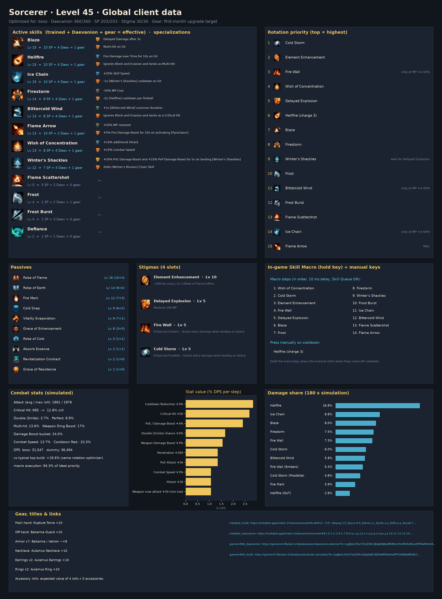
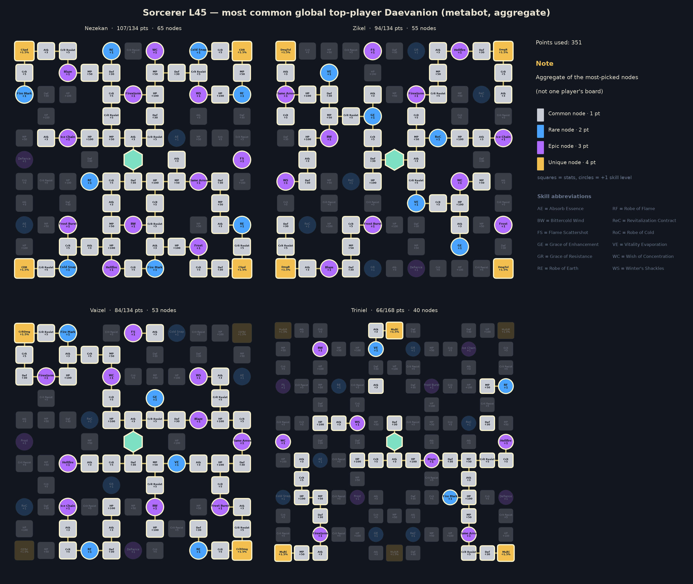

# Sorcerer — level 45 global build, rotation and macro

Generated by `aion2calc` from the global client data (metabot.gg) with Korean data as fallback. Primary view: **boss** fight (see `docs/methodology.md`). Daevanion budget **360** points.



## Damage objective: boss modeled DPS

Score: 31,547 modeled DPS.

boss: 100%, 180.0s, 31,547 DPS

Damage objective subject to the saved HP and trained-skill reserves. Balanced uses equal scenario weights. Stat weights follow the selected objective; skill shares, opener, macro and sensitivity remain primary-scenario views. This local search does not establish a global optimum or competitive PvP efficacy.

## Results

| Build | boss DPS | dummy DPS |
|---|---:|---:|
| **Optimized (this report)** | **31,547** | **36,494** |
| Typical top global build, optimized rotation | 26,608 | 31,908 |
| Typical top global build, default priority | 22,858 | — |

The optimized build is **+18.6%** over the typical top global build played with the same rotation optimizer, and **+38.0%** over that build played with the default priority. *Typical top global build* = average skill levels, the four most-picked damage stigmas and the most-picked Daevanion nodes of the top tracked global L45 players of this class (metabot.gg live data), given the best legal specializations for its levels (specs are not published).

## Rotation (priority list)

Use the highest skill that is ready; the last entry is the filler.

1. `cold_storm`
2. `element_enhancement`
3. `fire_wall [mp_hi]`
4. `wish`
5. `delayed_explosion`
6. `hellfire_c3`
7. `blaze`
8. `firestorm`
9. `winters_shackles [sync_de]`
10. `frost`
11. `bittercold_wind [mp_hi]`
12. `frost_burst`
13. `flame_scattershot`
14. `ice_chain [mp_hi]`
15. `flame_arrow`

`[sync_de]` = wait for the Delayed Explosion vulnerability window when it is about to be ready; `[in_ee]` = prefer using it inside Element Enhancement; `[mp_hi]` = only while MP is at least 60% (weave it in, keep MP for Grace of Enhancement).

### In-game Skill Macro

**Left mouse button** is the basic auto-attack: `flame_arrow`. Hold it for continuous attacks; the Skill Macro below goes on the **right mouse button** (or another held key). Weave both together.

Settings → Key Settings → General → Skill Macro. Skill Queue (스킬 예약) **ON**, 10 ms delay on every step, hold the macro key; manual presses always take priority over the macro.

| Step | Skill |
|---:|---|
| 1 | wish |
| 2 | cold_storm |
| 3 | element_enhancement |
| 4 | fire_wall |
| 5 | delayed_explosion |
| 6 | blaze |
| 7 | frost |
| 8 | firestorm |
| 9 | winters_shackles |
| 10 | frost_burst |
| 11 | ice_chain |
| 12 | bittercold_wind |
| 13 | flame_scattershot |
| 14 | flame_arrow |

Manual keys (press on cooldown, in this priority): hellfire_c3

Simulated: this layout reaches **94.3%** of the ideal priority list.

**Alternative — macro with manual keys**: macro blaze → firestorm → frost_burst → ice_chain → flame_arrow; manual: cold_storm, element_enhancement, fire_wall [mp_hi], wish, delayed_explosion, hellfire_c3, winters_shackles [sync_de], frost, bittercold_wind [mp_hi], flame_scattershot. Simulated: **92.0%** of the ideal priority list.

### Opener (first 30 s of the simulated fight)

```
cold_storm@0.0s → element_enhancement@0.9s → fire_wall@1.5s → wish@2.4s → delayed_explosion@2.9s → hellfire_c3@3.6s → blaze@5.3s → firestorm@5.7s → winters_shackles@6.1s → frost@6.9s → bittercold_wind@7.4s → frost_burst@7.7s → ice_chain@8.2s → ice_chain@8.8s → ice_chain@9.4s → blaze@10.0s → firestorm@10.3s → ice_chain@10.8s → ice_chain@11.4s → ice_chain@12.0s → ice_chain@12.6s → ice_chain@13.2s → ice_chain@13.8s → ice_chain@14.4s → blaze@15.0s → firestorm@15.3s → ice_chain@15.8s → hellfire_c3@16.4s
```

## Skills, specializations and points

Skill points used **203 / 203**, stigma points **30 / 30**, Daevanion **360 / 360**.

| Skill | Trained (SP) | Effective level | Specializations |
|---|---:|---:|---|
| Robe of Flame | 10 | 16 | — |
| Blaze | 10 | 15 | Delayed Damage after 3s; Multi-Hit on hit |
| Ice Chain | 10 | 15 | +20% Skill Speed; -1s [Winter's Shackles] cooldown on hit |
| Hellfire | 10 | 15 | Fire Damage over Time for 10s on hit; Ignores Block and Evasion and lands as Multi-Hit |
| Firestorm | 9 | 14 | -50% MP Cost; -2s [Hellfire] cooldown per fireball |
| Robe of Earth | 9 | 14 | — |
| Wish of Concentration | 8 | 13 | +10% additional Attack; +10% Combat Speed |
| Flame Arrow | 10 | 13 | +20% MP restored; +5% Fire Damage Boost for 10s on activating [Pyroclasm] |
| Bittercold Wind | 8 | 13 | +1s [Bittercold Wind] summon duration; Ignores Block and Evasion and lands as a Critical Hit |
| Winter's Shackles | 7 | 12 | +20% PvE Damage Boost and +10% PvP Damage Boost for 5s on landing [Winter's Shackles]; Adds [Winter's Illusion] Chain Skill |
| Fire Mark | 7 | 12 | — |
| Cold Snap | 6 | 9 | — |
| Vitality Evaporation | 7 | 9 | — |
| Grace of Enhancement | 3 | 8 | — |
| Flame Scattershot | 3 | 5 | — |
| Frost | 1 | 4 | — |
| Frost Burst | 1 | 4 | — |
| Robe of Cold | 1 | 3 | — |
| Revitalization Contract | 1 | 2 | — |
| Absorb Essence | 1 | 2 | — |
| Defiance | 1 | 2 | — |

**Stigmas**: Element Enhancement Lv 10, Delayed Explosion Lv 5, Fire Wall Lv 5, Cold Storm Lv 5

## Daevanion (360 points)


* Open in metabot planner: https://metabot.gg/en/aion-2/daevanion/sorcerer#61-0.1.2.3.4.5.7.8.9.a.c.g.i.j.k.l.n.o.p.q.r.t.w.x.y.z.10.11.12.13.14.19.1b.1c.1d.1e.1f.1g.1m.1n.1o.1p.1t.1v.1w.1z.21.22.23.24.25.26.27.28.29.2a.2b.2c.2d.2e.2f.2g_62-0.1.7.8.9.a.b.f.g.j.l.m.n.p.q.t.u.v.w.x.y.z.10.13.14.15.16.17.19.1a.1b.1c.1d.1g.1h.1i.1j.1k.1l.1n.1o.1p.1r.1t.1u.1v.1w.1x.1y.21.24.26.27.28.2d.2e_63-0.1.2.3.4.5.a.b.c.d.h.i.k.l.m.o.p.s.u.z.10.13.14.15.1a.1c.1d.1e.1f.1g.1j.1k.1l.1m.1p.1r.1s.1w.1y.1z.21.22.23.24.25.26.29.2a.2b.2c.2d.2e.2f.2g_64-1.2.a.g.h.i.j.k.o.p.q.r.s.t.u.v.y.z.10.11.13.15.16.17.18.19.1a.1f.1g.1h.1j.1l.1n.1o.1p.1q.1r.1u.1v.1w.1x.1y.20.21.22.23.24.26.27.28.2b.2c.2d.2e.2f.2g.2h.2j.2l.2m.2n.2r.2s.2t.2u.32
* Open in gamers4.life planner (KR node values, same node IDs): https://gamers4.life/aion-2/database/en/daevanion-planner/?b=eyJjIjoic29yY2VyZXIiLCJkIjpbNjEwMDMzLDYxMDAzNCw2MTAwMzUsNjEwMDM3LDYxMDAzOCw2MTAwMzksNjEwMDQyLDYxMDA0Myw2MTAwNDgsNjEwMDUwLDYxMDA1Miw2MTAwNTgsNjEwMDY0LDYxMDA2NSw2MTAwNjcsNjEwMDY4LDYxMDA3MSw2MTAwNzIsNjEwMDczLDYxMDA3OSw2MTAwODIsNjEwMDg2LDYxMDA5NCw2MTAwOTUsNjEwMDk2LDYxMDA5Nyw2MTAwOTgsNjEwMDk5LDYxMDEwMCw2MTAxMDEsNjEwMTAyLDYxMDExNSw2MTAxMjMsNjEwMTI0LDYxMDEyNSw2MTAxMjYsNjEwMTI3LDYxMDEyOCw2MTAxMzgsNjEwMTQwLDYxMDE0Miw2MTAxNDQsNjEwMTU1LDYxMDE1OCw2MTAxNTksNjEwMTYzLDYxMDE3MCw2MTAxNzEsNjEwMTcyLDYxMDE3NCw2MTAxNzUsNjEwMTc2LDYxMDE3OCw2MTAxODMsNjEwMTg0LDYxMDE4NSw2MTAxODcsNjEwMTg4LDYxMDE4OSw2MTAxOTEsNjEwMTkyLDYxMDE5Myw2MjAwMzMsNjIwMDM0LDYyMDA0MCw2MjAwNDEsNjIwMDQyLDYyMDA0Myw2MjAwNDgsNjIwMDU4LDYyMDA2Myw2MjAwNjcsNjIwMDY5LDYyMDA3MCw2MjAwNzEsNjIwMDczLDYyMDA3OCw2MjAwODIsNjIwMDg0LDYyMDA4Niw2MjAwODgsNjIwMDkzLDYyMDA5NCw2MjAwOTUsNjIwMDk3LDYyMDEwMSw2MjAxMDIsNjIwMTAzLDYyMDEwOSw2MjAxMTIsNjIwMTE0LDYyMDExNyw2MjAxMjMsNjIwMTI0LDYyMDEyNSw2MjAxMjksNjIwMTMxLDYyMDEzMiw2MjAxMzMsNjIwMTM4LDYyMDE0MCw2MjAxNDQsNjIwMTQ1LDYyMDE0Niw2MjAxNTMsNjIwMTU1LDYyMDE1Niw2MjAxNTcsNjIwMTU4LDYyMDE1OSw2MjAxNjEsNjIwMTY4LDYyMDE3Niw2MjAxODMsNjIwMTg0LDYyMDE4NSw2MjAxOTAsNjIwMTkxLDYzMDAzMyw2MzAwMzQsNjMwMDM1LDYzMDAzNyw2MzAwMzgsNjMwMDM5LDYzMDA0OCw2MzAwNTAsNjMwMDUxLDYzMDA1Miw2MzAwNjMsNjMwMDY0LDYzMDA2Nyw2MzAwNjgsNjMwMDY5LDYzMDA3MSw2MzAwNzIsNjMwMDgyLDYzMDA4Nyw2MzAwOTcsNjMwMDk4LDYzMDEwMSw2MzAxMDIsNjMwMTAzLDYzMDExOCw2MzAxMjQsNjMwMTI1LDYzMDEyNiw2MzAxMjcsNjMwMTI4LDYzMDEzMSw2MzAxMzIsNjMwMTMzLDYzMDEzOSw2MzAxNDcsNjMwMTU0LDYzMDE1NSw2MzAxNTksNjMwMTYyLDYzMDE2Myw2MzAxNzAsNjMwMTcyLDYzMDE3NCw2MzAxNzUsNjMwMTc2LDYzMDE3OCw2MzAxODUsNjMwMTg2LDYzMDE4Nyw2MzAxODgsNjMwMTg5LDYzMDE5MSw2MzAxOTIsNjMwMTkzLDY0MDAxOCw2NDAwMTksNjQwMDM0LDY0MDA0MSw2NDAwNDIsNjQwMDQ0LDY0MDA0Nyw2NDAwNDksNjQwMDU3LDY0MDA1OSw2NDAwNjIsNjQwMDYzLDY0MDA2NCw2NDAwNjUsNjQwMDY2LDY0MDA2Nyw2NDAwNzEsNjQwMDcyLDY0MDA3Myw2NDAwNzQsNjQwMDgxLDY0MDA4OCw2NDAwOTIsNjQwMDkzLDY0MDA5NCw2NDAwOTUsNjQwMDk2LDY0MDEwMSw2NDAxMDIsNjQwMTAzLDY0MDEwNyw2NDAxMTEsNjQwMTE1LDY0MDExNyw2NDAxMTksNjQwMTIyLDY0MDEyMyw2NDAxMjYsNjQwMTI3LDY0MDEyOCw2NDAxMjksNjQwMTMwLDY0MDEzMiw2NDAxMzMsNjQwMTM0LDY0MDEzOCw2NDAxNDEsNjQwMTQ3LDY0MDE1Miw2NDAxNTMsNjQwMTU2LDY0MDE1Nyw2NDAxNTksNjQwMTYwLDY0MDE2MSw2NDAxNjIsNjQwMTYzLDY0MDE2Nyw2NDAxNzIsNjQwMTczLDY0MDE3NCw2NDAxODQsNjQwMTg1LDY0MDE4Niw2NDAxODcsNjQwMTk5XX0
* Full skill/stigma/Daevanion build in metabot planner: https://metabot.gg/en/aion-2/classes/sorcerer/build#v1~l19~s8xpsg.3.0_8ycxs.9.9_8yknk.a.c_8ysdc.a.a_8zfio.a.a_8zuy8.7.c_91se8.5.0_92040.a.9_93i4g.8.9_9459s.8.a_94czk.5.0_95v00.5.0_962ps.a.0_9cpww.7.0_9cxmo.9.0_9d5cg.6.0_9dd28.a.0_9e7xc.3.0_9encw.7.0~g962ps_94czk_95v00_91se8~d61-0.1.2.3.4.5.7.8.9.a.c.g.i.j.k.l.n.o.p.q.r.t.w.x.y.z.10.11.12.13.14.19.1b.1c.1d.1e.1f.1g.1m.1n.1o.1p.1t.1v.1w.1z.21.22.23.24.25.26.27.28.29.2a.2b.2c.2d.2e.2f.2g_62-0.1.7.8.9.a.b.f.g.j.l.m.n.p.q.t.u.v.w.x.y.z.10.13.14.15.16.17.19.1a.1b.1c.1d.1g.1h.1i.1j.1k.1l.1n.1o.1p.1r.1t.1u.1v.1w.1x.1y.21.24.26.27.28.2d.2e_63-0.1.2.3.4.5.a.b.c.d.h.i.k.l.m.o.p.s.u.z.10.13.14.15.1a.1c.1d.1e.1f.1g.1j.1k.1l.1m.1p.1r.1s.1w.1y.1z.21.22.23.24.25.26.29.2a.2b.2c.2d.2e.2f.2g_64-1.2.a.g.h.i.j.k.o.p.q.r.s.t.u.v.y.z.10.11.13.15.16.17.18.19.1a.1f.1g.1h.1j.1l.1n.1o.1p.1q.1r.1u.1v.1w.1x.1y.20.21.22.23.24.26.27.28.2b.2c.2d.2e.2f.2g.2h.2j.2l.2m.2n.2r.2s.2t.2u.32

For comparison, the aggregate of the most-picked nodes among top global players:



## Stat priority (simulated)

| Upgrade | DPS gain | Worth in Attack |
|---|---:|---:|
| Cooldown Reduction +3% | +2.83% | 80 |
| Critical Hit +50 | +2.68% | 76 |
| PvE / Damage Boost +3% | +2.40% | 68 |
| Double (Smite) chance +2% | +1.66% | 47 |
| Weapon Damage Boost +3% | +1.55% | 44 |
| Penetration +300 | +1.35% | 38 |
| PvE Attack +30 | +1.35% | 38 |
| Combat Speed +3% | +1.07% | 30 |
| Attack +30 | +1.06% | 30 |
| Weapon max attack +30 (min too) | +1.06% | 30 |
| Illusion +10 (Cooldown -1%) | +0.94% | 27 |
| Critical Attack +50 | +0.86% | 24 |
| Critical Damage Boost +3% | +0.73% | 21 |
| Might +10 (Attack +1%) | +0.54% | 15 |
| Destruction +10 (Attack +1%) | +0.54% | 15 |
| Front Attack +30 | +0.50% | 14 |
| Time +10 (Combat Speed +1%) | +0.36% | 10 |
| Back Attack +30 | +0.35% | 10 |
| Precision +10 (Crit +1%) | +0.31% | 9 |
| Death +10 (Crit +1%) | +0.31% | 9 |
| Multi-hit chance +3% | +0.23% | 6 |
| Perfect chance +3% | +0.01% | 0 |
| Justice +10 (Perfect +1%) | +0.00% | 0 |
| Freedom +10 (Accuracy +1%) | +0.00% | 0 |
| Wisdom +10 (Double +1%) | -0.70% | -20 |
| MP +300 | -1.15% | -33 |

Accuracy is a threshold stat (avoid parries; back attacks ignore them) and is not ranked.

## Gear, rolls, enchanting

Loadout: **Global L45 Sorcerer - first-month upgrade target**

* Main hand: Rupture Tome +10
* Off-hand: Bakarma Guard +10
* Armor x7: Bakarma / Vakron ~+8
* Necklace: Aulamus Necklace +10
* Earrings x2: Aulamus Earrings +10
* Rings x2: Aulamus Ring +10
* Accessory rolls: expected value of 4 rolls x 5 accessories
* Bracelets x2: Abyssal Bracelet +10
* Amulet: Revelation Amulet +0
* Rune: Clash Rune +2
* Attack title: Unbound by Genus
* Defense title: Empty Closet
* Owned titles: collection bonuses (estimate)
* Wings: Ultimate Daeva Wings
* Arcana x5: Unique arcana +0, 4 skill rolls each (Chalice of Vigor, Parchment of Magic, Compass of Magic, Bell of Magic, Mirror of Vigor)
* Primary/deity stats: profile averages + arcana main stats (+20 each) + Abyssal rolls

**Weapon comparison (same build & rotation):**

| Weapon | DPS | vs baseline |
|---|---:|---:|
| Rupture Tome +10 (this loadout) | 31,547 | +0.0% |
| Rupture Tome +10, average rolls | 28,278 | -10.4% |
| Rupture Tome +10, 3 best rolls | 31,234 | -1.0% |
| Ludra's Grimoire +10, average rolls | 31,093 | -1.4% |
| Ludra's Grimoire +10, 3 best rolls | 35,417 | +12.3% |

**Random-roll priority per item** (keep / reroll toward the top of each list):

* **Rupture Tome**: Damage Boost (+4.9% – +5.7%), Weapon Damage Boost (+6.5% – +7.6%), Combat Speed (+8.8% – +10.2%), Critical Hit (+46 – +60), Attack (+30 – +42)
* **Ludras Grimoire**: Damage Boost (+6.3% – +7.3%), Weapon Damage Boost (+8.3% – +9.6%), Combat Speed (+11.2% – +13%), Critical Hit (+59 – +75), Critical Attack (+83 – +102)
* **Spiritforged Guard**: Might (+10 – +10), Accuracy (+30 – +30)
* **Vakron Helm**: Critical Hit (+25 – +36), Double Chance (+1.6% – +1.9%), Attack increase (+1.6% – +1.9%), Attack (+16 – +25), Natural MP Regen (+18 – +28)
* **Bakarma Breastplate**: Damage Boost (+4.4% – +5.2%), Critical Hit (+27 – +38), Attack (+18 – +28), Perfect Chance (+3.9% – +4.6%), Natural MP Regen (+20 – +30)
* **Aulamus Necklace**: Critical Hit (+35 – +47), Combat Speed (+3.2% – +3.8%), Attack (+23 – +33), Might (+9 – +17), Precision (+9 – +17)
* **Aulamus Ring**: Critical Hit (+25 – +36), Attack (+16 – +25), Might (+5 – +13), Precision (+5 – +13), Natural MP Regen (+18 – +28)

**Enchant priority** (DPS per enchant level):

* Weapon (Spiritforged / Rupture): 92.0 DPS/level
* Guard (off-hand): 55.7 DPS/level
* Necklace / Earrings / Rings (Aulamus): 44.6 DPS/level
* Revelation Amulet: 42.6 DPS/level
* Bracelets: 33.4 DPS/level
* Armor pieces: 0.0 DPS/level

## Titles, arcana, wings, pets

**Best titles by equip bonus** (global client values):

| Title | Grade | Equip bonus | Owned bonus |
|---|---|---|---|
| Unbound by Genus (Both factions) | Unique | PvE Damage Boost +4.5%, Attack Bonus +34, Critical Hit +68 | PvE Damage Boost +1% |
| Empty Closet (Both factions) | Unique | Combat Speed +3.5%, Natural HP Regen +42, Cooldown Reduction +3.5% | HP +120 |
| You're My Gem (Both factions) | Epic | Critical Hit +52, Critical Attack +39 | Natural MP Regen +5 |
| Guardian of Altgard (Asmodian) | Epic | PvE Damage Boost +3%, Penetration +210 | PvE Attack +4 |
| Guardian of Verteron (Elyos) | Epic | PvE Damage Boost +3%, Penetration +210 | PvE Attack +4 |
| Saint of Ereshkigal (Both factions) | Unique | PvP Damage Boost +4%, Endurance Penetration +2.5%, Critical Hit +60 | PvP Accuracy +20 |
| Through Hell and Back (Both factions) | Unique | Cooldown Reduction +3%, HP +900, Stamina +225 | Block +10 |
| Shaking Off the World's Shackles (Both factions) | Epic | Accuracy Bonus +50, Critical Hit +50 | Penetration +20 |
| Scenery Collector (Both factions) | Epic | PvE Damage Boost +3.3%, Block Penetration +54 | Critical Hit +10 |
| Teleportation Specialist (Both factions) | Epic | PvE Accuracy +58, PvE Damage Boost +3.1% | Critical Hit +10 |

**Arcana variant per slot** (deity stat that is worth more for this build):

* Chalice / Grail: **Vigor or Frenzy** (Time +20)
* Parchment: either variant (Life +20 / Destiny +20: no damage either way)
* Compass: **Magic or Purity** (Death +20)
* Bell: **Magic or Purity** (Destruction +20)
* Mirror: **Vigor or Frenzy** (Illusion +20)

**Arcana skill rolls.** Each arcana gives (grade base + enhancement level) random skill levels from its slot's pool — Rare 2, Legend 3, Unique 4 base rolls, +1 per enhancement level (so a Unique +5 gives 9); a skill rolled again gains another level, up to the cap. Chalice, Parchment and Compass roll active skills; Bell and Mirror roll passives.

| Arcana slot | Expected DPS, Unique +0 (4 rolls) | Expected DPS, Unique +5 (9 rolls) | Best rolls (+1 / +2) |
|---|---:|---:|---|
| Mirror | -0.0% | +0.9% | Robe of Flame +1.2% / +2.4%, Vitality Evaporation +0.1% / +0.2%, Grace of Enhancement +0.0% / +0.1% |
| Parchment | +0.4% | +0.8% | Hellfire +0.2% / +0.5%, Blaze +0.2% / +0.4%, Flame Arrow +0.1% / +0.2% |
| Compass | +0.2% | +0.5% | Ice Chain +0.2% / +0.3%, Bittercold Wind +0.1% / +0.2%, Winter's Shackles +0.1% / +0.1% |
| Chalice | +0.1% | +0.3% | Robe of Flame +1.2% / +2.4%, Hellfire +0.2% / +0.5%, Blaze +0.2% / +0.4% |
| Bell | +0.1% | +0.2% | Fire Mark +0.1% / +0.1%, Cold Snap +0.1% / +0.1%, Robe of Cold +0.0% / +0.0% |

Biggest single-level jumps (usually a specialization unlocking at Lv 16): Robe of Flame +1.2%, Robe of Earth +1.2%, Absorb Essence +1.1%, Hellfire +0.3%.

**Deity (pantheon) stats**, +10 points each (arcana main stats, Abyssal Bracelet rolls, Monolith rewards): Illusion +0.94%, Might +0.54%, Destruction +0.54%, Time +0.36%, Death +0.31%, Justice +0.00%, Wisdom -0.70%.

**Closet / appearance collection**: every unlocked skin and costume set adds permanent Collection Effect stats, and wings keep a Retention Effect once owned. The client tables for these are not public, so they are not itemised here; they are flat stats, so value them with the stat table above and collect the cheap ones first.

**Wings**: Ultimate Daeva Wings (Accuracy +40, Penetration +500) are the most used and the best launch option for damage among common wings. **Pets**: pet collection bonuses are mostly genus-specific (damage vs that monster genus) plus Accuracy/Crit; level the genus of the content you farm first.

## Robustness

Samples with no modeled damage are excluded from percentage losses.

Every animation time was randomly perturbed by up to ±25% (8 samples) and the rotation re-optimized each time. Playing the recommended priority instead of the re-optimized one lost on average **2.05%** (worst 3.79%).

**Crit curve.** The crit-chance curve is fitted to tests at Crit 1048–1326 and extrapolated down to launch values: this build sits at **12.8%** crit, and Crit +50 ranks #2 (+2.68%). If launch testing shows more crit — e.g. the curve shifted to a midpoint of 700, giving 52% — Crit +50 becomes #9 (+1.16%). Re-run with `--crit-midpoint` once real numbers exist.

## Validation against Korean logs

Simulated damage shares (training dummy) overlap **73%** with the mean of the top-10 A2DIL Korean dummy logs; 5% of the Korean damage comes from skills that are not in the global level-45 client. Korea plays above level 45 with Lv 16-20 specializations, so a perfect match is not expected; low values mean the class kit needs hand-tuning (see `kit/sorcerer.py` for a hand-written kit).

## Sources

* metabot.gg (global client): class skills, Daevanion boards, items, titles, top-player statistics
* gamers4.life (KR database): skill hit counts, build/Daevanion planners
* A2DIL (KR training-dummy logs): damage-share validation
* Inven / Bahamut damage research, aion2ssow calculator: damage formula

See `docs/methodology.md` for every formula and assumption.
